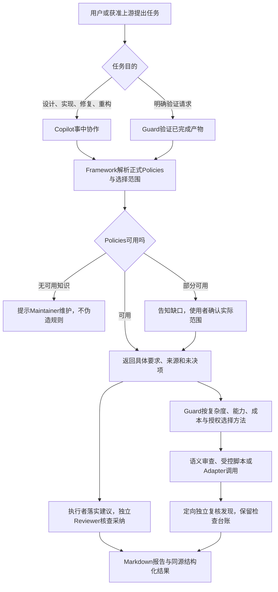

# Idea Summary — AI-secure-code-toolkit-v2

> Idea ID：尚未单独分配；沿用当前 idea 文件夹，不新造功能板编号。
>
> Folder：Draft Idea - 10142026 153612  
> Version：v2（v1保留为比较基线）  
> Created：2026-10-18  
> Status：Refined — 用户已决定保留开放项并推进到 Requirement Gathering  
> Task trace：TASK-001，仅作本轮讨论追溯，不是产品运行必需条件。

## Overview

AI-secure-code-toolkit-v2 是一个面向 AI 辅助开发的安全质量工具包，由 **Framework、Copilot、Guard** 三个自包含 skills 协作：

- **Framework** 管理安全知识、Reference 探索、Policy 选择，以及预制工具接口资源。
- **Copilot** 在设计、实现、Bug修复和重构过程中给出具体建议，并复核是否真正采纳。
- **Guard** 对已经形成的设计或实现进行扫描与验证，报告问题、证据及覆盖缺口，不负责修复。

升级目标不是照搬旧版命令或设置更多门禁，而是：**知识可维护、调用有上下文、执行有边界、结果有证据、成本可控制**。

完整决定以[详细功能清单 v2](<x-ipe-docs/ideas/Draft Idea - 10142026 153612/secure-code-toolkit-v2-feature-inventory-v2.md>)为展开基线；本摘要不替代其中的待定、暂缓和排除项。另提供[分类 HTML 浏览版](<x-ipe-docs/ideas/Draft Idea - 10142026 153612/secure-code-toolkit-v2-feature-inventory-v2.html>)。

## Problem Statement

旧版已有知识导入、阶段指导、扫描编排、工具投影与报告等能力，但存在以下升级诉求：

1. **职责与时机需要重构**：Copilot不应只是编辑前发一次清单；Guard不能被误解为修复或整改执行器。
2. **知识与使用范围需要分离**：导入了规则不代表每次全量采用，标签、Preset、实际采用范围也不能混为一谈。
3. **可信结果不能靠口头声明**：模型说“已采纳”“Reviewer通过”或工具退出正常，不等于当前产物满足要求。
4. **低成本不应靠降低要求**：需要减少重复导入、探索、工具调用和无效重试，同时保留未验证项。
5. **经验积累不能成为几千条积压**：建议要有证据、可行动、非重复、有容量和有效期。
6. **权限不能全靠提示词**：维护资格、真实委托与自主优化预授权分开；执行入口控制必须有真实可行性证据。
7. **多宿主接入不能互相打架**：system-prompt片段、AGENTS和instructions同源生成，不重复触发，不锁整份用户文件。

本轮对旧版采用文档与关键源码对照，不将旧声明、历史结果或模板当作新版已运行的证据。

## Target Users

| 用户 | 主要需求 |
|---|---|
| 开发者／普通 User | 使用已维护知识，选择Preset或本次范围，获得设计与实现建议，执行获准验证并理解报告 |
| Maintainer／Admin | 维护正式知识、skills、Adapter和接入规则；管理本机授权及自主策略，对维护有完整决定权 |
| 上游开发 Agent／工作流 | 以最小真实上下文调用三类skills，消费结构化结果，不把“调用过”当完成 |
| Reviewer子代理 | 在只读委托内复核采纳、发现或候选，返回与当前产物绑定的证据，不自授权限 |

首版是**本地工作流级防误操作**，不是企业账号服务或真实多用户文件隔离。Maintainer资格不因进入沙箱失效，也不等于当前Agent已经获得任意动作授权。

## Proposed Solution

### 1. 一个知识底座，两种存储形式

正式知识位于：

```text
x-ipe-docs/secure-code/
├── knowledge/
│   ├── local/
│   └── reference/
├── presets/
├── tags/
├── improvements/
└── reports/
    ├── copilot/
    └── guard/
```

首次安装保持空库，不附带默认知识或Preset。没有可用Policies时，提示使用者由Maintainer维护好后再用；不允许未入库的临时文本或工具原生空库扫描绕过。

首版需跑通最小首次使用闭环：受控安装工具包及预制接口，所有者明确初始化维护授权，维护有效Policies，按既定分支选择范围，明确接入宿主，再进行获准协作／验证并取得报告。Preset可选；不把接口代码预制等同三个扫描器已安装，不增加强制默认Preset。状态查询分别说明安装、授权、知识与工具条件，不以一个Ready标记掩盖缺口。

Local保存完整当前正文；Reference保存维护过的来源，Framework可在登记域名及子域名内按需探索。正式Local优先；探索结果跨调用缓存7天，不自动转为正式知识。

来源按机构、发布版本、实际规则ID组织；自建使用`@CUSTOM`或自选`@命名空间`。来源版本可并存，每个来源版本只保留一份当前正式内容，用完整前后差异的changelog回溯，不建本地修订快照链。

知识停用、删除或重命名由维护者明确发起，先提示Preset、标签、关联和缓存的影响；不因引用存在剥夺决定权，不自动连带修改其他记录。断链不静默换版本，已知变更使相关缓存失效或待确认；旧报告仍保留历史事实。未知远端变化不承诺实时发现，Preset仍不增加正文指纹。

### 2. 先明确采用范围，再进行有证据协作



上图表示协作关系，不要求每个任务同时跑两条分支，也不表示Guard会自动修复。Guard可以无Copilot报告独立使用。

### 3. 工具接口稳定，运行决策灵活

首批预制 **Opengrep、Strix、Trivy** Adapter，代码位于 **Framework skill的`scripts`**。Guard agent决定具体参数、目标、指令、模式与预算，经Adapter调用；不是为每条Policy预编固定扫描方案。

方法选择先看能否完成检查及所需证据，再看全成本。优先复用已有方法；临时脚本仅在必要缺口下生成，须通过检查、独立Reviewer、正反样例及实际执行限制。

Strix先验证能否强制只读检查原项目，不能可靠做到时使用工作副本。不能因为有Docker或提示“不要改”就声称原项目受保护。

网络授权按目的分开：Reference取资料、工具／漏洞库更新、向被测目标发请求、向模型或第三方服务提交内容。允许联网不等于可任意上传数据；维护资格也不等第三方目标授权。明确必要内容与接收者，最小化并处理敏感值，不默认让敏感源码或凭据出站，不静默换服务或启用遥测；不建设重型DLP平台。

### 4. 三态结论与四态台账

| 层次 | 表达方式 |
|---|---|
| 总结结论 | 通过／不通过／未能确认通过 |
| 每项检查 | 满足／不满足／未能确认／不适用，关联证据和理由 |
| 执行状态 | 另行记录完成、部分、失败、取消、预算停止等真实情况 |

已核实Medium及以上问题导致不通过，Low仍报告。必要项证据不足不能因其他项满足就通过。难以自动检测不等于Policy无效。

实施前明确每个必要检查的最低证据和替代方法条件；辅助工具失败不必机械阻断，但不能以阅读或零发现冒充所需运行证据。规范、严重级或证据冲突保留并复核，不让Agent静默选低风险结果。具体优先级和schema在技术设计定。

客观N/A、主动范围排除与风险接受分别记录。风险接受不降低问题严重级、不改变事实和验证结论；本次User或获准上游可明确记录，如何继续由上游按自身门槛决定。

### 5. 可维护的学习与受控自主优化

改进建议严格准入，活跃最多10条，普通未采纳30天失效，终态再保留30天。已证实严重问题的例外需要证据与明确复核，不能凭AI自报。

用户建议强制评审；Agent可在既有委托内优化运行策略，不为每个想法创建长期记录。正式资产优化由独立本机签名策略约束，不能仅凭Maintainer资格就执行任意动作。

明确请求或获准上游步骤触发后，默认最多处理3条有效Lesson；同条件幂等、候选复用、失败不无限重试。低风险本地解释和充分验证示例可在预授权内正式落地；skill／Adapter实现只自动改候选，正式发布仍确认。

### 6. 同源、局部、尊重维护权的项目接入

Framework维护单一路由定义，生成可追加system-prompt片段、默认AGENTS入口及可选GitHub instructions。各skill仍自包含。

只对显式toolkit片段做幂等检查，不锁全文。差异报告给Maintainer，由其忽略、修改或重生成；不将摘要当权限凭据。首版只验文件与元数据；真实宿主加载和路由行为的**自动**验收后续开展（I-19）。首版用何种人工或端到端冒烟证据证明toolkit实际可被调用，在需求整理中确定。

## Key Features

| 分类 | 核心功能 | 清单定位 |
|---|---|---|
| 知识管理 | Local／Reference、机构与自建ID、单份当前内容、可逆changelog、独立示例、部分幂等导入、入库预检 | K、X |
| 规则选择 | 顶层JSON标签、具体规则Preset、query意图、snapshot_at、范围确认、默认与Apply All分支 | P、T |
| 事中协作 | 具体建议、执行者统一修改、独立采纳复核、高危未采纳交上游处置 | C |
| 完成后验证 | 产物优先、范围与上下文区分、轻量检查清单、组合验证、独立发现复核 | V |
| 工具与脚本 | 三个预制接口、Guard动态传参、兼容预检、成本感知方法调整、受限临时脚本 | A |
| 证据与运行 | 轻量共享预算、取消、部分结果、原始证据30天、报告人工清理、按需跨次报告对比 | B、R |
| 权限 | 本机Owner明确初始化、标准签名、固定可信公钥、持续至撤销、资格与动作授权分开 | U |
| 学习优化 | 有界建议、来源分流、签名自主策略、低风险自动落地、候选发布分离、真实Reviewer记录绑定 | L、AU、O-07/O-08 |
| 接入与开发 | 单源多载体、局部幂等、去重防递归、最小交接、开发沙箱、不自初始化 | I、S |

功能编号、状态、旧版证据、未讨论默认和未决细节全部在[清单 v2](<x-ipe-docs/ideas/Draft Idea - 10142026 153612/secure-code-toolkit-v2-feature-inventory-v2.md>)中展开。HTML筛选不会修改设计决定。

## Success Criteria

以下为后续可验证的目标，**本轮没有完成产品测试，不将工程交付当成已观察到的用户效果**：

- [ ] 同一批次重复提交能跳过已完成且输入未变条目，复用已有处理结果；变化输入不静默覆盖。
- [ ] 无正式可用Policies时明确返回需维护，不伪造规则；部分可用仅在确认后执行并报告实际范围。
- [ ] Preset只使用具体规则清单；query不自动执行，读取不刷新snapshot_at，标签变化不隐式改清单。
- [ ] Reviewer真实调用、审阅要求、当前产物及实际结果可对应；产物变化不会套用旧通过。
- [ ] Guard四态台账保留必要未确认项，三态结论与发现、取消、失败、风险接受一致。
- [ ] Adapter可解析真实结果及异常，版本不兼容不自动升级；没有以退出成功或零发现代替覆盖证明。
- [ ] 原件写入会被可靠拒绝，或改用明确工作副本；无法证明边界时不宣称已隔离。
- [ ] 预算切换与重试不重置，取消只作用本次任务，停止未确认如实报告。
- [ ] 仅toolkit片段变化参与幂等，其他AGENTS内容修改保留；维护者有完整差异决定权。
- [ ] 自主优化不触碰未授权控制，不无限重试；候选、应用与发布有真实证据和权限区别。
- [ ] 在已授权沙箱样本中测得各工具的效果、资源、耗时与成本；未达到标准的候选不假称合格。
- [ ] 首次安装到首次有Policies的协作／验证闭环可实际完成；缺授权、空库、缺工具分别准确提示，不自动自授权。
- [ ] 知识停用／删除／重命名先给影响清单；引用与缓存不会静默使用失效内容，历史报告不被连带删除。
- [ ] 单条正式修改与changelog保持一致，并发或中断不覆盖他人修改、不把半完成标成功。
- [ ] 四种联网目的与内容出站授权分离，不能以单一允许联网代替数据提交许可。
- [ ] 正常和反例有固定输入及可观察结果；若自动正式写入前提不能可靠满足，则保留候选或请求确认，不伪装为已受控落地。

待观察的用户效果：安全措施更早落实、误导性通过更少、重复token与工具开销降低、维护建议更少而有用。具体KPI、基线、样本量和合格阈值尚未设定，不能编造提升百分比。

## Constraints & Considerations

### 已确认约束

- 首次空库，不附CWE／OWASP起步包；只使用正式维护知识，Reference受登记域名及子域限制。
- 语言适用字段仅为建议，不能据此硬排除安全要求；不建设逐条许可审查模块。
- Preset不存正文指纹或副本；清单快照不是正文冻结；不保留完整本地修订快照链。
- Guard不修复业务产物、不编排整改闭环；Copilot不作为第二个业务写入者。
- 权限是本地工作流级，不抵御拥有本机写权限的人替换信任配置；不建立企业身份服务。
- Maintainer有完整维护权，但Agent仍按真实请求／签名预授权；数据中的角色声明不授权限。
- 代码位于Framework不意味着Framework agent掌握扫描策略；执行编排归Guard。
- 费用接口通常是估算，不保证严格硬金额上限；不建设复杂计费预测与覆盖评分。
- 初版不做旧四模式、降严重级式waiver、专用集成JSON文件导出器。
- 自动卸载、故障维护恢复、真实宿主加载／行为的自动验收（I-19）、管理层PPT暂缓。
- 不自动提交、推送或发布；授权私钥和模型凭据不进入模型上下文或报告。

### 仍待技术设计或进一步决定

1. 各schema、命令入口、命名、版本兼容及受控写入的实际实现。
2. 本机签名算法、可信文件位置、撤销／轮换、工作区识别和引导来源。
3. 宿主真实执行入口拦截能力，及不足时应限制哪些自动行为。
4. 三个工具的验证版本、配置／规则来源、网络与环境依赖、默认预算。
5. 动态工具检测规则生成是否支持；不与已允许的临时辅助脚本混为一谈。
6. 严重级冲突、混合方法证据及必需／可选检查的具体处理。
7. 补充说明和示例的实际文件白名单、低风险识别与充分验证标准。
8. 建议／Lesson状态细节、未落地已批准项、长期依赖证据及历史格式演进。
9. 需求分析阶段的Copilot适用性、新请求复用旧证据等尚未确认的功能。

10. **MVP切分**：207项“已确认”是方向性决定，不等于全部进入单批首版。需求整理与功能拆分须定义最小纵向闭环及分阶段验收，其余已确认能力进入后续增量，不因此取消。

以上不应无限扩展功能。首版实现前优先收敛：首次成功路径、知识退出与引用影响、真实执行入口、冲突与最低证据、单记录并发一致性、数据出站和最小验收；具体算法、文件名与预算数字留到技术设计或实测。新增必要项详见功能清单O-09/O-10、K-34至K-36、X-15、V-24/V-25、E-01/E-02及S-09。

## Brainstorming Notes

- **由旧版调研转向目标驱动取舍**：不把旧命令面、预算数值或模式开关等同新版需求。
- **Adapter概念曾纠正**：它是接口／调用对接，不是预先固定每条Policy的扫描方案；运行参数由Guard决定。
- **三种“范围”被拆开**：知识候选、建议与采用范围；同时产物范围不等Policy范围。
- **权限模型逐步收敛**：从临时维护模式转为本机签名资格；再明确资格不等具体动作授权。
- **维护者决定权得到保留**：幂等不锁全文，差异不是剥夺权限的理由；保护条款针对Agent自行扩大委托。
- **学习机制强调退出**：严格准入、10条活跃、30天失效、30天终态保留，不积累几千条无用建议。
- **后续查漏加入真实证据**：入库预检、Reviewer来源／对象绑定、谨慎的跨次报告变化。
- **验证事实与业务处置分开**：风险被接受仍保留真实问题和原结论，不能改成已修复或已满足。
- **Ideation评审（2026-10-18）**：独立critic未发现阻止需求整理的问题；已采纳：状态与后续步骤对齐用户决定、补充MVP切分要求、恢复I-19“自动验收”限定、链接改为项目根相对路径；暂缓：正式Idea ID（项目无idea登记机制，不臆造编号）。
- **保持轻量**：不为了安全再引入复杂计费、覆盖评分、身份服务器或不必要导出器。

## Ideation Artifacts (If Tools Used)

- [详细功能清单 v2（Markdown）](<x-ipe-docs/ideas/Draft Idea - 10142026 153612/secure-code-toolkit-v2-feature-inventory-v2.md>)：按类别、功能ID和决定状态维护。
- [详细功能清单 v2（独立HTML）](<x-ipe-docs/ideas/Draft Idea - 10142026 153612/secure-code-toolkit-v2-feature-inventory-v2.html>)：分类导航、搜索、状态筛选及打印。
- [保留的详细清单 v1](<x-ipe-docs/ideas/Draft Idea - 10142026 153612/secure-code-toolkit-v2-feature-inventory-v1.md>)：此前暂停时的比较基线。
- 本摘要中的Mermaid仅表示工作流；不代表已实现的运行拓扑。
- HTML是文档浏览交付，不是toolkit产品UI、权限系统或扫描器原型。

## Source Files

- [原始 idea](<x-ipe-docs/ideas/Draft Idea - 10142026 153612/new idea.md>)。
- 本轮逐项对话决定与旧版功能清单；v2保留关键决定索引，不新建功能板记录。
- [旧版 Framework](study-case/secure-coding-guidance/.github/skills/x-ipe-agent-secure-code-framework/SKILL.md)。
- [旧版 Copilot](study-case/secure-coding-guidance/.github/skills/x-ipe-agent-secure-code-copilot/SKILL.md)。
- [旧版 Guard](study-case/secure-coding-guidance/.github/skills/x-ipe-agent-secure-code-guard/SKILL.md)。
- [旧版命令契约](study-case/secure-coding-guidance/.github/skills/x-ipe-agent-secure-code-framework/references/command-contract.md)与v2清单中的证据索引。

## Next Steps

- [x] 用户决定：40项“待定”与5项“建议默认”保持原状态，不在ideation阶段逐项取舍；“建议默认”仍未批准，不进入实现范围。
- [ ] 进入 Requirement Gathering：以本摘要及清单v2“已确认”项为输入，定义MVP最小纵向闭环与分阶段验收。
- [ ] 开放项在需求整理、功能细化与技术设计中按需收敛；具体schema、算法、预算数字等留到技术设计或实测。
- [ ] 实现前确定SDK能力、依赖、样本、工具版本和授权，先做隔离可行性验证。
- [ ] 进行真实兼容、边界、效果与性能验收后，再决定正式交付状态。

本摘要不标记产品完成；后继任务仅在用户确认后登记。

## References & Common Principles

### Applied Principles

- **最小功能、最小权限与完整仲裁**：模型不能仅靠资料自称获权；实际入口应检查每个相关动作。参考[OWASP Excessive Agency](https://github.com/OWASP/www-project-top-10-for-large-language-model-applications/blob/main/2_0_vulns/LLM06_ExcessiveAgency.md)。
- **策略决策与执行分离**：角色、预授权和动作检查与模型推理分开；采用思想，不默认部署OPA。参考[OPA官方说明](https://github.com/open-policy-agent/opa#how-does-opa-work)。
- **证据与声明分开**：设计措施不等实现，源码存在不等执行，工具退出正常不等覆盖，报告比较不等修复。
- **有界自主性**：明确触发、预授权、有限批量、真实复核和验证；不因优化目标而自行放宽保护。
- **可复现与性能证据**：固定并说明样本及运行条件，分组比较检测效果、耗时、资源、费用和稳定性；不伪造基线。

### Further Reading

- [Opengrep](https://github.com/opengrep/opengrep)：静态规则引擎候选；未在本轮安装或实测。
- [Strix](https://github.com/usestrix/strix)与[所核查CLI版本文档](https://github.com/usestrix/strix/blob/ca20626f844b64e26755b7d78ae206ba8dd3acc9/docs/usage/cli.mdx)：注意本地可写挂载、预算和停止边界。
- [Trivy](https://github.com/aquasecurity/trivy)：依赖、容器与配置等互补检查候选。
- [OWASP Benchmark](https://github.com/OWASP-Benchmark/BenchmarkJava)：可参考已知缺陷／安全对照方法，不是全部场景的通用成绩。

以上是设计参考，不是合规认证或新版安全保证。
