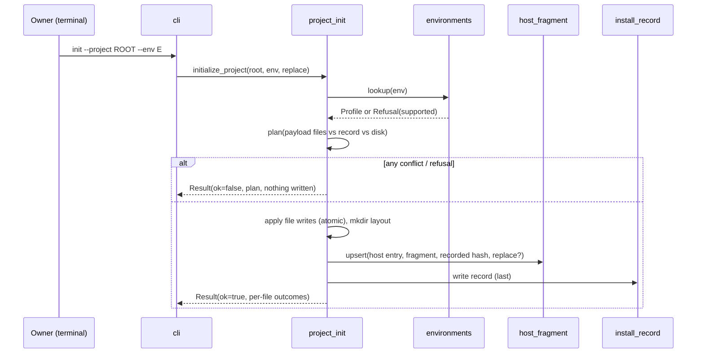
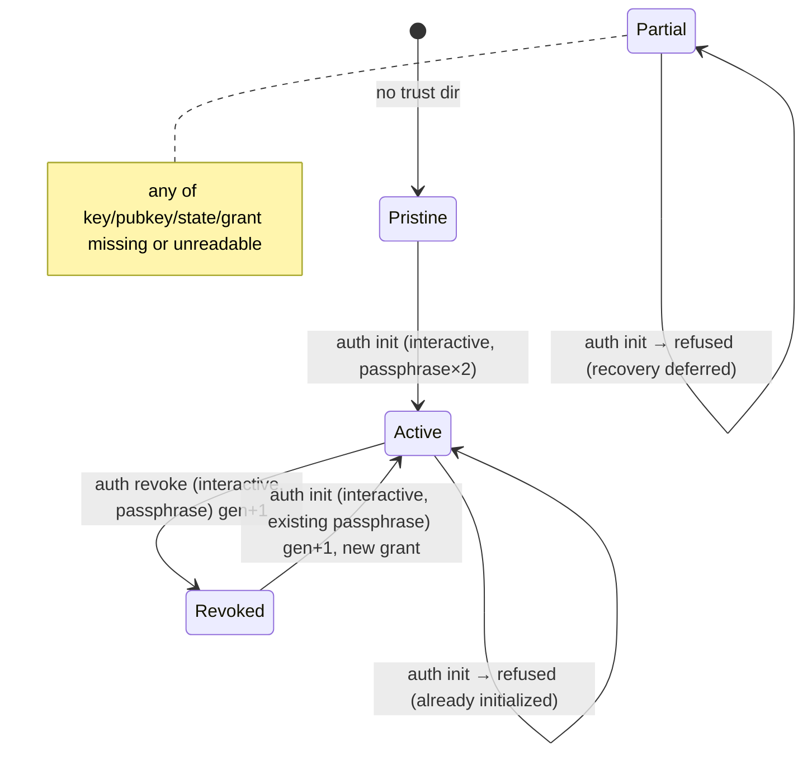

# Technical Design: Toolkit Install, Signed Owner Initialization & Status

> Feature ID: FEATURE-001-A | Version: v1.0 | Last Updated: 2026-10-19
> Specification: [specification.md v1.1](x-ipe-docs/requirements/EPIC-001/FEATURE-001-A/specification.md) · Task: TASK-005

## Version History

| Version | Date | Description |
|---------|------|-------------|
| v1.0 | 10-19-2026 | Initial design (specification v1.1 incl. CR-001) |

---

## Part 1: Agent-Facing Summary

> **📌 AI Coders:** Read Part 1 for intent and means, Part 2 for contracts, algorithms and tests.

### Scope & Boundaries

- **Feature:** FEATURE-001-A only — project initialization ("install"), owner authorization (init / verify / revoke) and read-only status.
- **program_type:** `cli` + `skills` (three SKILL.md skills; Framework skill carries a Python CLI/library in `scripts/`).
- **tech_stack:** Python ≥ 3.11 (uv-managed, `uv_build` backend), `cryptography` (Ed25519, encrypted PKCS#8), stdlib (`argparse`, `json`, `hashlib`, `getpass`, `ctypes`/`pwd`), pytest.
- **Non-goals:** knowledge maintenance (001-B), Policies (001-C), scanners/Adapters (002-*), single-source multi-carrier generation and rich diff handling (003-B), sandbox (003-C), recovery/uninstall (I-21, U-15), key rotation/backup (U-14 remainder), multi-user identity (U-01, U-13).
- **Decisions taken 10-19-2026 (user):** standalone product (not X-IPE-typed skills; built outside `x-ipe-meta-skill-creator`, whose validator requires subtype prefixes) with source in `ai-secure-code-toolkit/` at repo root; names `x-ipe-secure-code-toolkit-{framework,copilot,guard}`, CLI `secure-code`, namespace `x_ipe_secure_code`, distribution `ai-secure-code-toolkit`; Ed25519 via `cryptography` with passphrase-encrypted PKCS#8; per-OS user config dir without environment-variable override; revocation by signed trust state with generation counter; first-init residual risk accepted and made detectable; project init takes the environment explicitly from the calling agent (`--env`, required; no auto-detection); pre-generated scripts run via uv without an install step; commands `init`, `status`, `auth init|revoke|status`.

### Outcome / Goal Frame

| Goal ID | Parent / Source | Stakeholder | Desired Observable Outcome | Contribution / Selection | Success Evidence | Constraints / Non-goals | AC Links | Outcome State |
| --- | --- | --- | --- | --- | --- | --- | --- | --- |
| G-05 | Spec G-05; EPIC FR-24, FR-03 | Owner / Maintainer | Maintenance authority explicit, verifiable, not self-grantable after first init | `auth` package: Ed25519 grant + signed trust state (generation), interactive + passphrase gates, verification without private key | Scenario: non-interactive init refused; tampered/foreign/restored grants → User; owner init → Maintainer | U-13 local-write limit; first init on pristine machine detectable, not preventable | AC-001A-06a…g, 07a…f, 08a…d | not measured |
| G-03 / G-06 | Spec G-03/G-06; EPIC FR-03 | User, upstream agent | Each readiness gap visible with its next step | `status` collector, read-only, sectioned result | Scenario: fresh init → each condition with its own next step, no "Ready" | Not a health certificate | AC-001A-09a…e | not measured |
| G-06 | Spec G-06 (CR-001); EPIC FR-27/28 minimal | Maintainer | Agent environment knows the toolkit; user text untouched | `environments` profile lookup (explicit `--env`) + `host_fragment` upsert | Scenario: Copilot project with AGENTS.md → one fragment, rerun no change, user text byte-identical | Multi-carrier generation in 003-B | AC-001A-04f…i | not measured |
| G-08 | Spec G-08; EPIC NFR-01 | Upstream agent | Works in plain repos on macOS/Linux/Windows | Standalone uv project inside Framework skill; no X-IPE imports | Scenario: plain repo on each OS | — | AC-001A-04e, 10a | not measured |
| Safe upgrade | Spec "Safe upgrade" | Maintainer | Re-init never overwrites local edits or data | `install_record` + plan-then-apply | Scenario: edited skill file kept and reported; data byte-identical | — | AC-001A-05a…d | not measured |
| G-01/G-02 enabling | Spec; EPIC FR-01 | All | Skill boundaries explicit from first init | SKILL.md skeletons | Content check | Behaviour in later features | AC-001A-04d | not measured |

### Design Options and Tradeoffs

| Means | Selection | Goal / AC / Constraint Rationale |
| --- | --- | --- |
| Ed25519 + `cryptography`, encrypted PKCS#8 (`BestAvailableEncryption`) | selected (user) | Standard signature (U-10); wheels for all three OSes (NFR-001A-4); passphrase protects signing (AC-06f, 08a/b) |
| `ssh-keygen -Y sign`; ECDSA P-256 | rejected | External binary uneven on Windows; no benefit over Ed25519 |
| Trust dir from OS account database (POSIX `pwd`) / Windows Known Folder API | selected | User chose per-OS config dir **without env override**; `platformdirs`/`expanduser` honour `XDG_CONFIG_HOME`/`HOME`, letting a process redirect the trust root to a self-made one |
| `platformdirs` | rejected | Environment-variable driven (see above) |
| Revocation: signed `trust-state.json` with monotonically increasing `generation`; grant must match | selected (user) | Restored pre-revocation grant has an older generation → rejected (AC-08d) |
| Revocation list file | rejected | Same restore weakness, more state |
| First-init commit via staging directory + atomic directory rename | selected | Interrupted init leaves no partial trust state (NFR-001A-5, AC-06g) |
| Run scripts with `uvx --from <framework>/scripts secure-code …` (env in uv cache) | selected (user confirmed 10-19-2026) | User first chose "uv resolves deps on first run, no install". Plain `uv run --project <scripts>` creates `<scripts>/.venv` *inside the target project*, which breaks AC-09b (status must not create files). `uvx --from` gives the same no-install behaviour with the environment in uv's cache. `uv run --project` remains usable for toolkit development |
| Payload located from the running Framework skill (siblings or skill-meta `candidate/` layout) | selected | No package install; pre-generated skills copied as-is |
| Plan-then-apply with per-file SHA-256 install record | selected | Write nothing on refusal (AC-04b/04g); safe re-init (AC-05a…d) |
| Delimited HTML-comment fragment with byte-preserving upsert | selected | Fragment-level idempotency (AC-04h/i; I-12…I-14) |
| Interactive check `stdin.isatty() and stdout.isatty()` + `getpass` | selected | Spec AC-06b/08b; honest limit: pseudo-terminals look interactive → passphrase is the real gate after first init |

### Key Components Implemented

All under `ai-secure-code-toolkit/x-ipe-secure-code-toolkit-framework/scripts/src/x_ipe_secure_code/`.

| Component | Responsibility | Scope/Impact | Tags |
|-----------|----------------|--------------|------|
| `cli.py` | argparse entry `secure-code`; commands `init`, `status`, `auth init|revoke|status`; `--json`; exit codes | Public CLI contract | #cli #contract |
| `results.py` | `Result` envelope, text/JSON rendering, secret-safe messages | All commands | #contract #output |
| `paths.py` | Explicit root validation/normalization, containment, no parent search | Init, status | #paths #safety |
| `environments.py` | `Profile` table (`github-copilot`, `claude-code`), explicit lookup | Init, status | #environment |
| `payload.py` | Locate the three pre-generated skills; enumerate payload files with exclusions | Init | #install |
| `install_record.py` | Read/write install record (version, env, per-file SHA-256, fragment hash) | Init, status | #install #state |
| `project_init.py` | Plan-then-apply initialization and safe re-initialization | Init | #install #core |
| `host_fragment.py` | Byte-preserving fragment detect/upsert | Init, status | #integration |
| `atomic.py` | Atomic file write, atomic dir commit, exclusive lock | Init, auth | #reliability |
| `auth/trust_store.py` | Resolve per-OS trust dir (no env), file names, permissions | Auth, status | #auth #security |
| `auth/crypto.py` | Ed25519 keygen, encrypt/decrypt PKCS#8, canonical sign/verify | Auth | #auth #crypto |
| `auth/records.py` | Grant and trust-state schemas, canonicalization | Auth | #auth #schema |
| `auth/service.py` | `initialize`, `revoke`, `verify`, `require_maintainer` | Auth; reused by 001-B+ | #auth #core |
| `auth/interaction.py` | `Interaction` protocol: `is_interactive()`, passphrase prompts | Auth | #auth #tty |
| `status.py` | Read-only collectors per section | Status | #status |
| `adapters_registry.py` | Static registry of scanner Adapters (empty in 001-A) | Status | #tools |
| SKILL.md ×3 | Skill skeletons with responsibilities/non-responsibilities | All skills | #skills |

### Dependencies

| Dependency | Source | Design Link | Usage Description |
|------------|--------|-------------|-------------------|
| `cryptography` (≥ 42, Apache-2.0/BSD) | PyPI via uv | N/A | Ed25519, encrypted PKCS#8 |
| uv (≥ 0.5) | External tool | N/A | Resolves environment on first run (`uvx --from`), development (`uv run`, `uv lock`) |
| Python ≥ 3.11 | Runtime | N/A | stdlib only beyond `cryptography` |
| None (internal) | — | — | First feature; consumers: 001-B (`require_maintainer`), 003-B (fragment module), 003-C, 002-* (status sections, adapter registry) |

### Major Flow

1. **Project init:** `secure-code init --project <root> --env E [--replace PATH]…` → validate root → look up environment profile → locate payload → build plan (create/update/skip/edited/conflict) → refuse on any blocking item (write nothing) → apply files atomically → create layout → upsert fragment → write install record last → result.
2. **Authorization init:** `secure-code auth init` → require interactive → classify trust state (pristine / active / revoked / partial) → pristine: passphrase ×2 → keygen → sign state+grant in staging dir → atomic rename; revoked: existing passphrase → decrypt key → new generation grant + state; active/partial → refuse.
3. **Verify:** read trusted public key, trust state, grant → signatures, key id, status, generation, grant id → `Maintainer` or `User` + reason. Never opens the signing key.
4. **Revoke:** interactive + passphrase → decrypt key (proves owner) → state `revoked`, `generation+1`, signed → atomic replace.
5. **Status:** read-only collectors (install, authorization incl. created-at/OS user, Policies counts, default Preset, tools, host integration, problems) → sectioned result.

### Usage Example

```bash
# Toolkit source = folder containing the three pre-generated skills (e.g. a release folder,
# or this repo's .github/skills/ after authorized promotion)
FW=/path/to/toolkit/x-ipe-secure-code-toolkit-framework

uvx --from "$FW/scripts" secure-code init --project ~/code/shop --env github-copilot
uvx --from "$FW/scripts" secure-code auth init                           # interactive, passphrase ×2
uvx --from "$FW/scripts" secure-code status --project ~/code/shop --json

# Inside an initialized project (agents / skills):
uvx --from .github/skills/x-ipe-secure-code-toolkit-framework/scripts secure-code status --project . --json
```

```python
from x_ipe_secure_code.auth.service import require_maintainer
decision = require_maintainer(action="knowledge.import")   # re-verifies every call
if not decision.allowed:
    return decision.to_result()                            # role User + reason + next step
```

### Tool Capability Summary

- `stages.implement.technical_design` (tools.json): all six implementation tools enabled; `_extra_instruction`: consultation only, no code execution — respected.
- Matched: `x-ipe-tool-implementation-python` (Python CLI/library: PEP 8, type hints, pytest, ruff, AAA test contract). Consulted informationally.
- Not matched / excluded: html5, typescript, java (no such code), mcp (no MCP server), general (Python specific tool matches).
- Skill packages (SKILL.md ×3) are standalone product files (user decision 10-19-2026), not X-IPE skills: no `x-ipe-meta-skill-creator` candidate/publication; quality via the toolkit's own tests and independent review. Part 2 below is complete independent of tool availability.

---

## Part 2: Implementation Guide

### Source Layout (standalone product source)

```text
ai-secure-code-toolkit/                     # = toolkit payload root (three sibling skills)
├── README.md                               # how to run init/auth/status
├── x-ipe-secure-code-toolkit-framework/
│   ├── SKILL.md
│   ├── references/cli-contract.md          # commands, result envelope, exit codes
│   ├── references/environments.md          # profiles, markers, fragment format
│   └── scripts/
│       ├── pyproject.toml                  # name=ai-secure-code-toolkit, build-backend=uv_build,
│       │                                   # deps: cryptography>=42; [project.scripts] secure-code
│       ├── uv.lock
│       ├── src/x_ipe_secure_code/          # modules listed in Part 1
│       └── tests/                          # pytest; NOT copied into projects
├── x-ipe-secure-code-toolkit-copilot/SKILL.md
└── x-ipe-secure-code-toolkit-guard/SKILL.md
```

Nothing is written to this repository's `.github/skills/`. Distribution = copying or cloning `ai-secure-code-toolkit/`.

### Workflow Diagrams





### CLI Contract

| Command | Arguments | Behaviour | Exit |
|---|---|---|---|
| `secure-code init` | `--project PATH` (required), `--env {github-copilot,claude-code}` (required), `--replace PATH` (repeatable, project-relative), `--toolkit-source DIR`, `--json` | Project initialization / re-initialization | 0 ok; 1 refused; 2 usage |
| `secure-code status` | `--project PATH` (required), `--json` | Read-only sectioned status | 0 always when status could be produced; 2 usage |
| `secure-code auth init` | `--json` | Authorization initialization or post-revocation re-authorization | 0 / 1 |
| `secure-code auth revoke` | `--json` | Revocation | 0 / 1 |
| `secure-code auth status` | `--json` | Verification result only | 0 |

No option accepts a passphrase, key or trust-dir path. Passphrases come only from `getpass`.

**Result envelope** (`results.py`; same content for text and `--json`):

```json
{
  "schema": "ai-secure-code-toolkit/result/v1",
  "command": "init",
  "ok": false,
  "data": {},
  "problems": [{"code": "ENV_REQUIRED", "message": "No environment given"}],
  "next_steps": ["Re-run with --env github-copilot or --env claude-code"]
}
```

Problem codes (initial set): `ROOT_REQUIRED`, `ROOT_INVALID`, `ENV_REQUIRED`, `ENV_UNSUPPORTED`, `PAYLOAD_INCOMPLETE`, `SKILL_NAME_CONFLICT`, `LOCALLY_EDITED`, `FRAGMENT_EDITED`, `FRAGMENT_DUPLICATE`, `FRAGMENT_MALFORMED`, `HOST_ENTRY_UNREADABLE`, `NOT_INTERACTIVE`, `PASSPHRASE_MISMATCH`, `PASSPHRASE_WRONG`, `PASSPHRASE_TOO_SHORT`, `ALREADY_INITIALIZED`, `TRUST_PARTIAL`, `NOT_AUTHORIZED`, `LOCKED`, `IO_ERROR`.

### Environment Profiles (`environments.py`)

| Profile | Skills folder | Host entry file | MVP verification |
|---|---|---|---|
| `github-copilot` | `.github/skills/` | `AGENTS.md` | verified host (AC-33 in 003-B) |
| `claude-code` | `.claude/skills/` | `CLAUDE.md` | unverified |

`lookup(env)`: missing → `ENV_REQUIRED` (argparse also marks `--env` required); not in table → `ENV_UNSUPPORTED`. No project files are inspected to choose the environment; the calling agent knows its own host.

### Payload Location (`payload.py`)

1. `framework_dir`: if `Path(__file__)` up 3 contains `SKILL.md` (running from source) use it; otherwise (running via `uvx`/`uv tool`, where code is copied into uv's cache) read the PEP 610 `direct_url.json` of distribution `ai-secure-code-toolkit`, take its `file:` URL (`…/scripts`) and use its parent if it contains `SKILL.md`. No networking modules are imported.
2. If `--toolkit-source DIR` given use it; else source root = `framework_dir.parent` (sibling layout, e.g. `ai-secure-code-toolkit/` or an initialized project's skills folder).
3. For each skill name resolve `<root>/<name>/SKILL.md`; all three required (`PAYLOAD_INCOMPLETE`).
4. Enumerate files recursively, excluding: `scripts/tests/`, `.venv/`, `__pycache__/`, `*.pyc`, `.pytest_cache/`, `.ruff_cache/`, `dist/`, `build/`, `*.egg-info/`. Symlinks inside the payload are rejected.

### Install Record (`install_record.py`)

Location: `<root>/.x-ipe/private/secure-code/install-record.json` (toolkit-owned; never under `x-ipe-docs/secure-code/`).

```json
{
  "schema": "ai-secure-code-toolkit/install-record/v1",
  "toolkit_version": "0.1.0",
  "environment": "github-copilot",
  "skills_dir": ".github/skills",
  "host_entry": "AGENTS.md",
  "fragment_sha256": "…",
  "files": {".github/skills/x-ipe-secure-code-toolkit-guard/SKILL.md": "sha256…"},
  "initialized_at": "2026-10-19T10:00:00Z",
  "updated_at": "2026-10-19T10:00:00Z"
}
```

### Algorithms

**A. Plan-then-apply initialization (`project_init.py`)**

For each payload file `f` with target `t` and new hash `n`; recorded hash `r` (or none); disk hash `d` (or none):

| Condition | Outcome |
|---|---|
| `d` none | `create` |
| `d == n` | `current` (skip) |
| `r` exists and `d == r` and `n != r` | `update` (not locally edited) |
| `r` exists and `d != r` | `locally_edited` → keep, problem `LOCALLY_EDITED`; becomes `replace` only if `t` ∈ `--replace` |
| no record (or file not in record) and `d != n` | `conflict` → `SKILL_NAME_CONFLICT` (blocking); no provenance is guessed from names or content |

Blocking problems (root/env/payload/conflict/fragment duplicate/unreadable) → return before any write. Otherwise apply: atomic write per file (`create`/`update`/`replace`), `mkdir(parents, exist_ok)` for the layout (`knowledge/local`, `knowledge/reference`, `presets`, `tags`, `improvements`, `reports/copilot`, `reports/guard` under `x-ipe-docs/secure-code/`), fragment upsert, record written last. Files never touched under `x-ipe-docs/secure-code/` (only `mkdir`). Re-running after interruption converges: written files hash-equal to `n` are `current`.

**B. Fragment upsert (`host_fragment.py`)** — operates on bytes.

- Markers (one line each): `<!-- BEGIN ai-secure-code-toolkit: managed fragment, edits are reported not overwritten -->` and `<!-- END ai-secure-code-toolkit -->`.
- Content: short routing text — Copilot skill for design/implementation/fix/refactor, Guard only on explicit or authorized verification, Framework for knowledge/status/authorization; skills folder path.
- Decode as UTF-8 (strict) else `HOST_ENTRY_UNREADABLE`. Newline style = first newline found in file (CRLF/LF), default LF.
- Count BEGIN and END marker lines independently. Valid only as (0, 0) or (1, 1) with BEGIN before END; any other combination (unmatched, reversed, nested, ≥ 2) → `FRAGMENT_MALFORMED` / `FRAGMENT_DUPLICATE` (blocking, nothing written).
- (0, 0) → append `[sep] + fragment` where `sep` is one newline if file non-empty and not ending with newline, plus one blank line; prefix bytes unchanged. 1 → inner hash `h`: `h == new` → none; `h == record.fragment_sha256` → replace inner; else → `FRAGMENT_EDITED` (keep unless host entry path ∈ `--replace`).
- Absent file → create with fragment only.

**C. Trust store (`auth/trust_store.py`)**

- Base: POSIX → `pwd.getpwuid(os.getuid()).pw_dir` + (`Library/Application Support` on macOS | `.config` on Linux); Windows → `SHGetKnownFolderPath(FOLDERID_RoamingAppData)` via `ctypes`. Then `/ai-secure-code-toolkit/trust/`. No environment variable is read.
- Layout: `<base>/ai-secure-code-toolkit/trust/` containing `trusted-public-key.pem`, `signing-key.pem` (encrypted PKCS#8), `trust-state.json` and `grants/<grant_id>.json`. Lock file `<base>/ai-secure-code-toolkit/.trust.lock` lives **beside** `trust/`, so a pristine state (no `trust/`) stays pristine while locked.
- `trust-state.json` is the single commit point for every change after first init; grants are written as new files keyed by `grant_id` before the state that references them, so an interrupted write leaves the previous state fully valid.
- Permissions: POSIX dir `0700`, files `0600`; Windows relies on per-user profile ACL (documented).

**D. Records and signing (`auth/records.py`, `auth/crypto.py`)**

```json
// trust-state.json
{"schema":"ai-secure-code-toolkit/trust-state/v1","key_id":"<sha256(raw pubkey) hex[:32]>",
 "generation":1,"status":"active","current_grant_id":"<uuid4>",
 "created_at":"…Z","created_by":{"os_user":"alice","host":"mbp"},"updated_at":"…Z","signature":"<b64>"}
// grants/<grant_id>.json
{"schema":"ai-secure-code-toolkit/maintainer-grant/v1","grant_id":"<uuid4>","key_id":"…",
 "generation":1,"qualification":"maintainer","issued_at":"…Z","issued_to":{"os_user":"alice","host":"mbp"},"signature":"<b64>"}
```

Canonical bytes = domain prefix (`b"ai-secure-code-toolkit:<record-type>:v1\n"`) + `json.dumps(record_without_signature, sort_keys=True, separators=(",", ":"), ensure_ascii=False).encode("utf-8")`. Unknown fields are rejected. The grant has no public-key field; any `public_key` field → invalid.

**E. Verify (`auth/service.verify`)** — reads only public key, state, grant.

1. Trust dir absent → `User / not_initialized` (next: `secure-code auth init`).
2. Public key or state missing/unreadable → `User / invalid (partial trust state)`; grant = `grants/<state.current_grant_id>.json`, missing/unreadable → `User / invalid`.
3. State signature invalid or `key_id` ≠ `sha256(pubkey)` → `User / invalid`.
4. `state.status == "revoked"` → `User / revoked`.
5. Grant signature invalid, `key_id` mismatch, or unknown/extra fields → `User / invalid`.
6. `grant.generation != state.generation` or `grant.grant_id != state.current_grant_id` → `User / revoked (superseded grant)`.
7. → `Maintainer / valid`, plus `created_at`, `created_by`. No caching; `require_maintainer` calls `verify` each time and returns qualification only (BR-04).

**F. Authorization init / re-auth / revoke (`auth/service`)** — all under exclusive `.lock` (`LOCKED` if held).

- Require `interaction.is_interactive()` else `NOT_INTERACTIVE` (no file touched).
- Acquire `.trust.lock` (exclusive create beside `trust/`; `LOCKED` if held) and hold it for classification, staging cleanup, writes and commit.
- Classify with a dedicated full validator (not `verify`'s early exits): **pristine** = `trust/` absent (leftover `trust.staging-*` siblings removed); **active** = all files present and every signature/key id/schema valid, `status == active`, current grant matches generation; **revoked** = all files present and valid, `status == revoked`, current grant signature/key id/schema valid and `grant.generation == state.generation - 1`; **partial** = anything else (missing, unreadable, invalid signature, foreign key, unknown fields, generation mismatch).
- Pristine: passphrase twice (`PASSPHRASE_MISMATCH`; minimum 12 characters `PASSPHRASE_TOO_SHORT` — design choice, shown in prompt) → keygen → write public key, encrypted key, `grants/<id>.json` and `trust-state.json` into `trust.staging-<random>/` (same parent) → `os.rename(staging, trust)` while `trust/` is absent (atomic directory rename on POSIX and Windows when the target does not exist) = commit point.
- Revoked: existing passphrase → decrypt (`PASSPHRASE_WRONG` on failure) → write new `grants/<new_id>.json` (`generation = state.generation + 1`) → atomically replace `trust-state.json` (`active`, `generation = state.generation + 1` = the new grant's generation, `current_grant_id = new_id`) = commit point. Example: init gen 1 (grant 1) → revoke gen 2 (revoked, grant 1) → re-auth gen 3 (active, grant 3). Interruption before the state replace leaves the revoked state intact; the orphan grant is ignored and removed on the next locked operation.
- Active → `ALREADY_INITIALIZED`; partial → `TRUST_PARTIAL` (recovery deferred).
- Revoke: pristine → "nothing authorized", no change; revoked → "already revoked", no change; partial → `TRUST_PARTIAL`; active → passphrase → decrypt → atomically replace `trust-state.json` with `status = revoked`, `generation + 1` (current grant id unchanged) = commit point.
- Honest limit: restoring an *older signed trust-state file* together with its grant re-activates it — that is replacing trust configuration, outside protection (U-13). Restoring only a grant (AC-001A-08d) never passes: grants are selected by the state's `current_grant_id` and must match its generation.

**G. Status (`status.py`)** — every collector uses read-only file APIs; it never imports write helpers.

| Section | Content |
|---|---|
| Install | Root (normalized), record present → version, environment, skills folder, drift count; absent → "not installed" + `init` next step |
| Authorization | `verify` result, `created_at`, `created_by` (detectability of first init), next step |
| Policies | Local / Reference counts = number of rule directories at depth `<ns>/<version>/<id>` under `knowledge/local` and `knowledge/reference`; 0 → next step "Maintainer maintains Policies" |
| Default Preset | `presets/default.json` exists? |
| Tools | One line per `adapters_registry` entry (Opengrep, Trivy, Strix): "Adapter not provided by this toolkit version" → next step "use a toolkit version that provides it" |
| Host integration | Environment, fragment present/absent/modified/duplicate, "host effect not verified" |
| Problems | Missing layout folders, unreadable trust files, duplicate fragments, drifted toolkit files |

### Implementation Steps

1. **Scaffold (standalone product source in `ai-secure-code-toolkit/`):** three skill folders; Framework `scripts/pyproject.toml` (`uv_build`, `cryptography>=42`, script `secure-code`), `uv.lock`; Copilot/Guard SKILL.md skeletons (O-01…O-06 responsibilities/non-responsibilities, toolkit entry point, "behaviour delivered by later features").
2. **Foundations:** `results.py`, `atomic.py`, `paths.py` + unit tests.
3. **Auth:** `trust_store.py`, `crypto.py`, `records.py`, `interaction.py`, `service.py` + unit tests (injected trust dir and interaction).
4. **Project init:** `environments.py`, `payload.py`, `install_record.py`, `host_fragment.py`, `project_init.py` + unit tests.
5. **Status + registry:** `adapters_registry.py`, `status.py` + tests.
6. **CLI:** `cli.py`; integration tests via subprocess and test-only launcher.
7. **Cross-OS:** run suite on macOS, Linux, Windows (CI matrix or local), record results.

Estimated module sizes: each < 300 lines (800-line threshold respected).

`pyproject.toml` declares `[tool.uv] cache-keys` for `pyproject.toml` and `src/**/*.py` so `uvx` rebuilds when toolkit code changes (uv's default key is only `pyproject.toml`). Payload exclusions also skip `.coverage.*` data files.

### Edge Cases & Error Handling

| Scenario | Expected Behavior |
|----------|-------------------|
| Root missing / not dir / not given | `ROOT_INVALID` / `ROOT_REQUIRED`; nothing written |
| Root is symlink | Resolved once with `realpath`; reported; no parent search |
| Same-named non-toolkit skill folder | `SKILL_NAME_CONFLICT`; nothing written |
| Permission denied mid-apply | `IO_ERROR`; files already written are hash-equal to payload; record not written → next run converges |
| Two `auth init` concurrently | Second gets `LOCKED` (`.trust.lock` beside `trust/`); staging rename is single commit |
| Stale `.trust.lock` after crash | Reported `LOCKED` with path and creating PID/time; not auto-broken (owner removes) |
| Interrupted re-auth/revoke | Previous `trust-state.json` remains fully valid (single commit point); orphan grant removed later |
| `auth revoke` twice | Second is a no-op "already revoked" |
| Agent pseudo-terminal | Passes interactive check; still needs passphrase; first init detectable via `created_by`/`created_at` |
| Forgotten passphrase | Revoke/re-auth impossible (`PASSPHRASE_WRONG`); recovery deferred |
| Windows without console | `isatty` false → `NOT_INTERACTIVE` |
| Host entry CRLF | Fragment written with CRLF; outside bytes identical |

### Security, Tracing and Observability

- Passphrase only via `getpass`; never accepted from argv/env; cleared references after use; never logged.
- Private key decrypted only inside `initialize`/`revoke`; `verify` module does not import the decrypt function (enforced by test).
- Error messages contain codes and paths, never key bytes or passphrases; `cryptography` exceptions mapped to codes.
- No environment variable influences trust location; test seam is a test-only launcher in `scripts/tests/` (not shipped).
- Tracing: N/A for MVP — the toolkit is a short-lived CLI whose `Result` is the record; no log files are written (avoids secret leakage). Revisit when long-running Guard runs arrive (002-A).

### Goal / Acceptance / Design / Validation Coverage

| Source / Parent Goal | Story | AC ID | Component / Flow | Interface / Data / Algorithm | Planned Validation | Delivery State | Outcome State |
| --- | --- | --- | --- | --- | --- | --- | --- |
| G-03/G-06; O-09, K-29 | US-01 | AC-001A-04a | project_init, environments, payload | Alg A; profiles table | Integration `tests/test_cli_init.py::test_init_copilot_project_creates_skills_layout_fragment` | planned | not measured |
| S-04 | US-01 | AC-001A-04b | paths | `validate_root` | Integration `test_init_refuses_missing_or_invalid_root_writes_nothing` (tree hash before/after) | planned | not measured |
| O-09, I-20 | US-01 | AC-001A-04c | project_init | no network/auth calls | Integration `test_init_creates_no_trust_files_no_scanner` (socket guard + trust dir absent) | planned | not measured |
| O-01…O-06 | US-01 | AC-001A-04d | SKILL.md ×3 | skeleton sections | Unit `test_skill_skeletons.py` (required headings/phrases) | planned | not measured |
| NFR-01 | US-07 | AC-001A-04e | all | no X-IPE imports/paths | Integration `test_plain_repo_all_commands` + static check no `x-ipe-docs/planning` access | planned | not measured |
| CR-001 | US-01 | AC-001A-04f | environments | `lookup` | Integration `test_init_uses_explicit_env_independent_of_existing_agent_files` | planned | not measured |
| CR-001 | US-01 | AC-001A-04g | environments | `ENV_REQUIRED/UNSUPPORTED` | Integration `test_env_missing_or_unsupported_refuses_no_write` | planned | not measured |
| I-12…I-14 | US-08 | AC-001A-04h | host_fragment | Alg B | Unit `test_fragment_append_preserves_prefix_bytes` (LF/CRLF, missing file) | planned | not measured |
| I-12…I-14 | US-08 | AC-001A-04i | host_fragment | Alg B states | Unit `test_fragment_idempotent_and_edited_reported_replace_on_choice` | planned | not measured |
| Safe upgrade | US-02 | AC-001A-05a | project_init | Alg A `current` | Integration `test_reinit_same_version_no_change` | planned | not measured |
| Safe upgrade | US-02 | AC-001A-05b | project_init, install_record | Alg A `update` | Integration `test_reinit_new_version_updates_unedited` (two payload fixtures) | planned | not measured |
| Safe upgrade | US-02 | AC-001A-05c | project_init | `locally_edited`/`--replace` | Integration `test_reinit_keeps_edited_reports_replaces_on_flag` | planned | not measured |
| Safe upgrade | US-02 | AC-001A-05d | project_init | no writes under data | Integration `test_reinit_data_byte_identical` | planned | not measured |
| G-05 | US-03 | AC-001A-06a | auth.service | Alg F pristine, records | Unit `test_first_init_creates_encrypted_key_signed_state_grant` + Integration POSIX pty | planned | not measured |
| G-05 | US-03 | AC-001A-06b | interaction, service | `NOT_INTERACTIVE` | Integration `test_auth_init_piped_stdin_refused_no_files` | planned | not measured |
| G-05 | US-03 | AC-001A-06c | service | `ALREADY_INITIALIZED` | Unit `test_init_when_active_refused` | planned | not measured |
| G-05 | US-03 | AC-001A-06d | service | `PASSPHRASE_MISMATCH`, abort | Unit `test_init_mismatch_or_abort_creates_nothing` | planned | not measured |
| AC-27 | US-03 | AC-001A-06e | results, service | secret-safe output | Integration `test_init_output_has_no_key_or_passphrase` | planned | not measured |
| G-05 | US-03 | AC-001A-06f | service | Alg F revoked path | Unit `test_reauth_after_revoke_requires_existing_passphrase_same_key` | planned | not measured |
| U-15 | US-03 | AC-001A-06g | service | full classifier → `TRUST_PARTIAL` | Unit `test_init_partial_state_refused` (each file removed/corrupted; revoked state with foreign/corrupted grant; generation mismatch) | planned | not measured |
| U-11, I-20 | US-04 | AC-001A-07a | service.verify | Alg E step 1 | Unit `test_verify_no_trust_dir_user_next_step` | planned | not measured |
| U-10 | US-04 | AC-001A-07b | verify, records | Alg E 3,5 | Unit `test_verify_rejects_tampered_foreign_embedded_key_workspace_trust` | planned | not measured |
| U-11, AC-27 | US-04 | AC-001A-07c | verify | no private-key access | Unit `test_verify_never_opens_signing_key` (patched `open`/`os.open` audit hook) | planned | not measured |
| U-07, U-08 | US-04 | AC-001A-07d | trust_store | per-user dir | Integration `test_verify_same_result_from_two_projects` | planned | not measured |
| U-12 | US-04 | AC-001A-07e | require_maintainer | no caching | Unit `test_require_maintainer_reverifies_after_revoke` | planned | not measured |
| U-03, U-05 | US-04 | AC-001A-07f | require_maintainer | qualification-only result | Unit `test_decision_has_no_scope_network_budget_fields` | planned | not measured |
| U-12 | US-05 | AC-001A-08a | service.revoke | Alg F revoke | Unit + Integration pty `test_revoke_then_verify_user_revoked` | planned | not measured |
| U-12 | US-05 | AC-001A-08b | service.revoke | `NOT_INTERACTIVE`, `PASSPHRASE_WRONG` | Integration `test_revoke_non_interactive_or_wrong_passphrase_unchanged` | planned | not measured |
| U-12 | US-05 | AC-001A-08c | service.revoke | no-op | Unit `test_revoke_nothing_authorized` | planned | not measured |
| U-12 | US-05 | AC-001A-08d | verify | grant selected by `current_grant_id` + generation | Unit `test_restored_pre_revocation_grant_rejected_new_process` (copy old grant back over/beside current, subprocess verify) | planned | not measured |
| O-10, AC-03 | US-06 | AC-001A-09a | status | Alg G | Integration `test_status_fresh_init_sections_and_next_steps_no_ready` | planned | not measured |
| X-12 | US-06 | AC-001A-09b | status | read-only collectors; allow-list of read paths | Integration `test_status_changes_nothing_and_reads_only_metadata` (project + trust dir hashes before/after AND child `sys.addaudithook` logging `open` events, asserting every opened path is in the allow-list: install record, toolkit skill files, host entry file, trust files, `presets/default.json`; a planted business source file is never opened) | planned | not measured |
| X-11 | US-06 | AC-001A-09c | status | install/preset/problems | Integration `test_status_reports_root_entry_preset_problems` | planned | not measured |
| S-04 | US-06 | AC-001A-09d | status | not installed | Integration `test_status_not_installed_no_parent_lookup` | planned | not measured |
| U-11 | US-06 | AC-001A-09e | status | auth section | Integration `test_status_invalid_or_revoked_auth` | planned | not measured |
| NFR-001A-4 | US-07 | AC-001A-10a | all | paths with spaces/non-ASCII | Integration suite on macOS, Linux, Windows | planned | not measured |
| AC-27 | US-03/04 | AC-001A-10b | results | canary scan | Integration `test_no_secret_or_model_credential_in_any_output` (canary env `OPENAI_API_KEY`) | planned | not measured |
| Breakdown AC-001A-01…03 | — | (parents) | — | mapped in spec traceability | covered by 06a/07e, 07b, 04a/04d | planned | not measured |

### Outcome Scenario and Evidence Gaps

Owner on a Copilot project runs `init`, then `auth init`, then `status`: status lists skills placed, authorization valid with creation time and OS user, Policies 0 with the next step, three tools "not provided", and host fragment present. An agent-run `auth init` without a terminal is refused; a restored old grant after revocation yields User. **Outcome state: not measured** — no stakeholder observation exists; delivery tests will show engineering behaviour only. Windows interactive passphrase entry has no automated pseudo-terminal test (see Test Plan) — evidence gap to close by a recorded manual check.

### Test Plan

- Location: `ai-secure-code-toolkit/x-ipe-secure-code-toolkit-framework/scripts/tests/`; run `uv run --project <scripts> pytest`; lint `uv run --project <scripts> ruff check` (development `.venv` stays in the source folder, git-ignored and excluded from the payload).
- Unit tests use injected `trust_dir` and `Interaction` fakes; integration tests run the CLI as a subprocess through `tests/support/launcher.py`, which sets the trust dir for the child process (test-only, not shipped).
- Interactive positives on POSIX via stdlib `pty`; on Windows via injected `Interaction` (unit) plus subprocess non-interactive refusals; a manual interactive check on Windows is recorded.
- Network guard: integration tests for `init`/`status` install a socket-blocking `sitecustomize` in the child to prove no toolkit network calls.
- Read-only proofs: SHA-256 of every file in project and trust dir before/after, plus an `open`-event audit hook allow-list for status.
- Atomicity tests: inject failure between grant write and state replace (monkeypatched `os.replace`) and assert the previous state still verifies.

### Mockup-to-Component Mapping

N/A — no UI; specification lists no mockups.

### Delta and Evidence Invalidation

New design; no prior design or evidence. Specification v1.1 (CR-001) is the source; any later change to environment profiles or command names invalidates tests for AC-001A-04f…i and the CLI contract reference.

## Implementation Evidence (TASK-006, 2026-10-19)

- **Source:** [ai-secure-code-toolkit/](ai-secure-code-toolkit/README.md) — standalone product (user decision), not built through `x-ipe-meta-skill-creator`. Toolkit tree fingerprint (SHA-256 of sorted per-file SHA-256, excluding `.venv`, caches, `__pycache__`, `.coverage*`): `1bf2a22c64c58a50…`. Specification v1.1 SHA-256 prefix `2863bc525fd04d61`. Largest module 251 lines (800-line threshold respected).
- **TDD:** RED run before implementation — 5 test modules failed at collection (`ModuleNotFoundError` for the modules under test). Review regressions written first and failing (4 failed) before the fixes.
- **Commands and results (current revision):**
  - `uv run pytest --cov=x_ipe_secure_code` (macOS, Python 3.14): **82 passed**, coverage **93%** (subprocess coverage enabled).
  - `UV_PROJECT_ENVIRONMENT=<tmp> uv run --python 3.11 --group dev pytest` (macOS, Python 3.11): **82 passed**.
  - Docker `ghcr.io/astral-sh/uv:python3.12-bookworm-slim`, `uv run pytest` (Linux, Python 3.12): **82 passed**.
  - `uv run ruff check src tests`: **All checks passed**.
  - End-to-end `uvx --from <framework>/scripts secure-code init|status` on a fresh project (test `test_uvx_end_to_end_init_and_status`): passed; no `.venv` created in the project; toolkit source unchanged.
- **Not verified:** Windows (no Windows host available) — AC-001A-10a is verified for macOS and Linux only; Windows interactive passphrase entry and the Known Folder resolution remain unexecuted. Interactive positives run through a POSIX pseudo-terminal.
- **Independent code review:** 2 Medium findings (writes through symlinked `.x-ipe`/`x-ipe-docs`; crash after partial writes) fixed with regression tests (`PATH_UNSAFE`, `IO_ERROR` with `written_before_failure`). No authorization bypass found; restoring an older signed trust-state file re-activates access — accepted limit (replacing trust configuration, U-13).
- **Tracing:** skipped — the toolkit has no existing tracing infrastructure and the design records N/A (short-lived CLI, no log files to avoid secret leakage).
- **Outcome state:** not measured (engineering delivery only).

| AC group | Tests (scripts/tests/) |
|---|---|
| AC-001A-04a…04i | `test_project_init.py` (create/layout/fragment, invalid root, nested, plain repo, explicit env, env refusal, AGENTS.md preservation, fragment rerun/edit/replace, foreign skill conflict, unsafe paths), `test_host_fragment.py`, `test_skill_skeletons.py`, `test_payload.py` |
| AC-001A-05a…05d | `test_project_init.py::test_reinit_same_version_no_change`, `::test_reinit_updates_unedited_keeps_edited_and_never_touches_data` |
| AC-001A-06a…06g | `test_auth_service.py` (first init, non-interactive, active, mismatch/abort/short, re-auth, partial states, foreign grant), `test_auth_cli.py` (piped refusal, pseudo-terminal cycle) |
| AC-001A-07a…07f | `test_auth_service.py` (no trust dir, tampered/foreign/embedded key/workspace file, no signing-key access + module import check, re-verify after revoke, qualification only), `test_auth_cli.py::test_verify_same_result_from_two_projects` |
| AC-001A-08a…08d | `test_auth_service.py` (revoke, wrong passphrase/non-interactive, nothing authorized, twice, restored grant, interrupted re-auth, lock), `test_auth_cli.py` |
| AC-001A-09a…09e | `test_status.py` (sections/no Ready, read-only + open-audit allow-list, root/preset/problems, not installed, revoked/invalid) |
| AC-001A-10a, 10b | full suite on macOS + Linux; `test_auth_cli.py::test_no_secret_or_model_credential_in_any_output` |

---

## Design Change Log

| Date | Phase | Change Summary |
|------|-------|----------------|
| 2026-10-19 | Implementation (TASK-006) | Payload location falls back to PEP 610 `direct_url.json` when running from uv's cache (found by the end-to-end `uvx` test); uv `cache-keys` added; `.coverage.*` excluded from payload. Contracts unchanged. |
| 2026-10-19 | Initial Design (user decisions 2) | Standalone product: names `x-ipe-secure-code-toolkit-*`, source `ai-secure-code-toolkit/`, no skill-creator candidate flow; payload located as siblings only. |
| 2026-10-19 | Initial Design (user decisions) | Environment passed explicitly by the calling agent (`--env` required, no detection); runtime `uvx --from` confirmed. |
| 2026-10-19 | Initial Design (review fixes) | Independent review: lock moved beside `trust/`; full classifier for re-auth/revoke; grants stored by id with `trust-state.json` as single commit point; no-record differing files always conflict; BEGIN/END markers counted independently; status read allow-list audit test. |
| 2026-10-19 | Initial Design | Initial technical design created from specification v1.1 (CR-001); runtime invocation `uvx --from` proposed instead of `uv run --project` to keep projects unchanged (pending confirmation); trust dir resolved without environment variables instead of `platformdirs`. |
