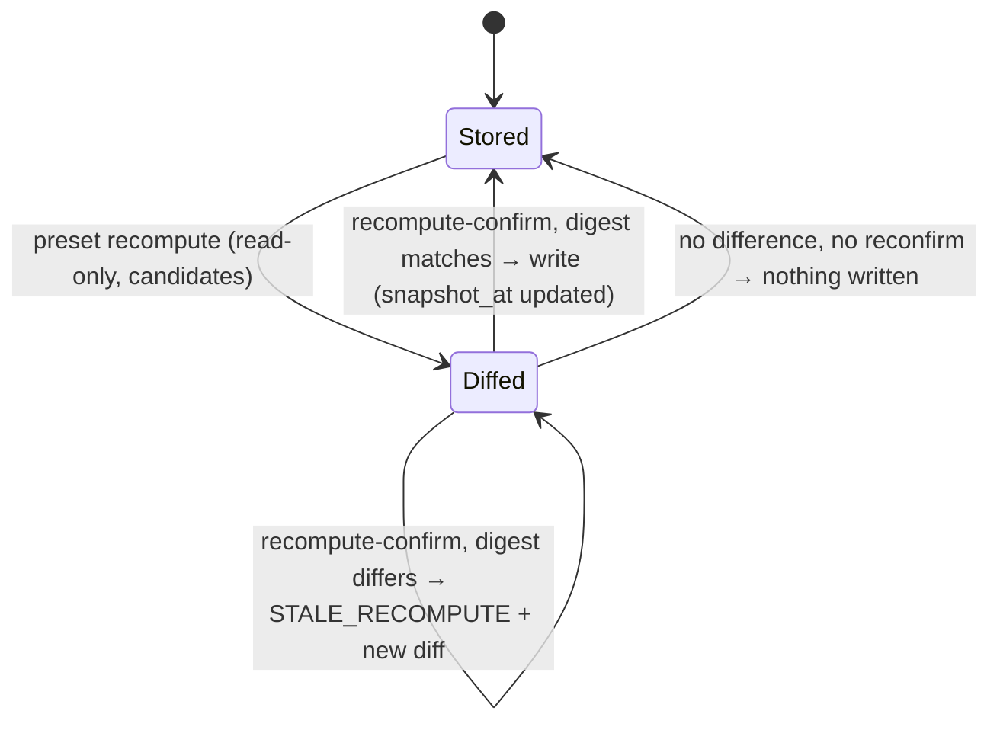

# Technical Design: Presets & Tags

> Feature ID: FEATURE-001-F | Epic: EPIC-001 | Version: v1.4 | Last Updated: 10-23-2026
> Task: TASK-067 (Technical Design), lifecycle owner Sage, interaction mode `dao-represent-human-to-interact`
> Authoritative specification: [specification.md](x-ipe-docs/requirements/EPIC-001/FEATURE-001-F/specification.md) v1.5, SHA-256 `e00d67215106d60aadeb07fc1f669ba354be593c3e7feb0171b0ee386805d2a9` (66 AC rows)
> Binding conditions: DAO-006 (refinement) in [decisions_made_feature_refinement.md](x-ipe-docs/dao/26-10-23/decisions_made_feature_refinement.md), condition (2) as corrected by DAO-006 (technical design), DAO-007 (001-D/001-C supersession and extension notes, `exit.links()` extension, re-run plan, Framework skill wording) and DAO-008 (two further Framework lines, spec v1.5 clarifications) in [decisions_made_technical_design.md](x-ipe-docs/dao/26-10-23/decisions_made_technical_design.md)

## Version History

| Version | Date | Description |
|---------|------|-------------|
| v1.4 | 10-23-2026 | CR-TASK-078 (human CR4 = yes): rebound to spec v1.6 for AC-001F-04l/BR-18 only; appended "CR-TASK-078 Design Delta" (one in-place `adoption` override in `preset_scope._proposal`, new test, no 001-C change). All earlier sections and evidence unchanged. |
| v1.3 | 10-23-2026 | Rebound to spec v1.5 (DAO-008 clarifications of AC-001F-05a and AC-001F-06e). Exact Framework text for `references/policy-selection.md` L19–20 (three default-Preset branches) and `SKILL.md` L110–111; Framework skill-text consistency test; pre-001-F links fixture test mapped to 06e; `test_exit_skill` reported superseded/re-run. Review nits: A9 `unsafe_store="finding"`, Security path statement qualified per A3a/A9/A10, full DAO-007 re-run obligation in Delta, inputs rebound to current hashes. |
| v1.2 | 10-23-2026 | Applied DAO-007 (AC-001D-02b supersession note, FR-001D-7 extension note, AC-001C-02e/BR-08 supersession notes; bounded `exit.links()` extension A10 with byte-identity proof and stop-rule; full 001-D acceptance re-run and regression plan; Framework-only skill wording) and the independent review findings R-1…R-8 (recompute digest binds all valid candidates; `guarded_write` uses `opt_dir` until all checks pass; link handling per operation; cross-source tag tests conditional on 001-E; pre-lock Maintainer fast-check + re-check under lock; parity test for the copied save sequence; explicit `preset resolve --default` orchestration; conditional skill wording). Spec v1.4 unchanged. |
| v1.1 | 10-23-2026 | Rebound to spec v1.4 (66 ACs). BLK-1 resolved by DAO-006 (technical design) as the anticipated 001-D plug-in (option A, not a CR): `impact.py` limited to dropping `presets`/`tags` from `UNSUPPORTED` + registering the providers; one 001-D test loop narrowed with a supersession note; one-time stale pre-upgrade preview stated and tested (AC-001F-06j); Implementation Step 7 un-held; DAO-006 condition (2) wording corrected. |
| v1.0 | 10-23-2026 | Initial two-part design for spec v1.3 (DAO-003/004/005/006). One blocking design conflict (BLK-1, exit-impact "not checked" set vs. delivered 001-D test) is raised for an owner/human decision; it is not resolved by this design. |

---

## Part 1: Agent-Facing Summary

> **Purpose:** Quick reference for AI agents navigating large projects.
> **📌 AI Coders:** Focus on this section for implementation context.

### Scope & Boundaries

- **Feature:** FEATURE-001-F only. **program_type:** `cli` (plus agent-skill instructions in the toolkit skill package). **tech_stack:** Python 3 (stdlib only, existing `x_ipe_secure_code` package, argparse CLI, pytest). No new dependency, no network.
- **Source root:** `ai-secure-code-toolkit/x-ipe-secure-code-toolkit-framework/` (abbreviated `FW/` below). Code `FW/scripts/src/x_ipe_secure_code/`, tests `FW/scripts/tests/`, skill text `FW/SKILL.md`, `FW/references/`.
- **In scope:** Preset store + maintenance (create, show, list, update, delete, recompute, recompute-confirm); tag store (Maintainer-only writes, open reads); Preset as 001-C scope input through ONE re-reading orchestration (`preset resolve`, `preset scope-save`); reserved `default` Preset branch (P-13, deferred from 001-C); `presets`/`tags` exit-impact providers and link-check reporting (001-D); skill instructions (save-as-Preset, recompute, applicability, known limits).
- **Non-goals (spec Out of Scope):** rule-body fingerprints/copies; background or automatic query execution; Preset ranking; toolkit change history; tags influencing severity/enforcement/membership; Reference-cache provider (001-E); cascade rewrites; cross-project sharing; Preset rename/display label; structured or save-validated Preset provenance (future CR candidate); filesystem-level protection of tag files (U-13).
- **DAO-006 constraints honoured:** (1) every Preset-based scope save goes through `policy/preset_scope.save()` which re-reads the Preset under the knowledge lock, places the *current* references in `decisions.considered`, keeps the confirmed `proposal_digest`, and lets the unchanged `scope.check_decisions` refuse drift as `STALE_CONFIRMATION` (tested, AC-001F-04j). A direct `scope save` by an agent stays an ordinary 001-C clues save; no Preset guarantee is claimed for it. (2) *As corrected by DAO-006 (technical design):* no delivered 001-C/001-D/002-A/003-A code or test change except plug-in points named in advance by the delivered spec/design, each with a supersession note — here exactly two 001-D extension points: A9 provider plug-in (BLK-1 resolution below, DAO-006 TD) and A10 `exit.links()` additive extension (DAO-007 (2), bounded by conditions (a)–(e)); 001-C gets only supersession notes plus the Framework skill wording (DAO-007 (4)); everything else is new modules or purely additive call sites. Any other delivered AC/schema/test change stops the work for a human CR. (3) Honest limits kept: tag-write restriction is toolkit-mediated only (001-A/U-13); metadata-only Preset drift is undetected (AC-001F-04k); no history beyond VCS; stakeholder outcome not measured.

#### BLK-1 — resolved: anticipated 001-D provider plug-in (DAO-006, technical design; not a CR)

| ID | Conflict (as raised in v1.0) | Evidence | Resolution (binding) |
| --- | --- | --- | --- |
| BLK-1 | AC-001F-06a/06b and FR-001F-9 require `presets`/`tags` to stop being reported "not checked in this version"; delivered 001-D holds them in `impact.UNSUPPORTED` (bound into the impact digest) and one delivered test asserts "not checked". | `FW/scripts/src/x_ipe_secure_code/knowledge/impact.py` L20, L196, L209 (sha `9d1dd81fee1e…`); `FW/scripts/tests/knowledge/test_exit_preview.py::test_empty_supported_not_unsupported` L185–186 (sha `87c33f156edc…`); the 001-D design names this plug-in in advance ("Preset/tag/Reference-cache providers (FEATURE-001-E/F only plug into the list)"); AC-001D-02b is worded "each impact kind *not yet supported*" and stays true. | Option A, decided by the delegated DAO representative; spec v1.4 corrected AC-001F-06i/FR-001F-9 and added AC-001F-06j. **(1) Code:** `impact.py` only drops `presets`/`tags` from `UNSUPPORTED` (→ `("reference_cache",)`) and registers the two 001-F providers; no other 001-D logic changes. **(2) Test:** in `test_empty_supported_not_unsupported` only the L185 loop is narrowed to `("reference_cache",)`, plus assertions that `presets`/`tags` are real kinds (empty → `count == 0`, `items == []`, never "not checked"); the edit carries the comment `# superseded per AC-001F-06a/06b (anticipated by 001-D)` and is reported as superseded, never as a plain pass. All other 001-D tests stay byte-identical and pass. **(3) Stale once:** previews opened before the upgrade are refused once as `STALE_IMPACT` (fail-safe re-preview); stored historical reports and scope records stay byte-identical (AC-001F-06j, tested). Option B rejected by DAO (would leave G-03/AC-09 unmet). |

Non-blocking interpretations and spec/code observations are listed in [Spec Ambiguities and Code Observations](#spec-ambiguities-and-code-observations).

### Outcome / Goal Frame

| Goal ID | Parent / Source | Stakeholder | Desired Observable Outcome | Contribution / Selection | Success Evidence | Constraints / Non-goals | AC Links | Outcome State |
| --- | --- | --- | --- | --- | --- | --- | --- | --- |
| G-03 | EPIC-001 G-03; FR-12 (P-03…P-07, P-09, P-11, T-01…T-04); FR-07/AC-09 (Preset/tag impact part) | Developer, Maintainer, upstream agent | Reusable explicit rule scopes without hidden drift; exits never silently break or rewrite Presets/tags | All required: `catalog` (shared safe store), `presets`, `tags`, `preset_scope` (scope input + single save orchestration), impact providers + link check, skill text | Planned scenario test (see Outcome Scenario) + per-AC integration tests | No body fingerprints; query never executed by CLI; tags never change severity; no cascade edits; no toolkit history | AC-001F-01a…08c, 09a, 09d…09g | not measured |
| G-03 (default-Preset branch) | EPIC-001 FR-10 / P-13, deferred to 001-F by 001-C (approved deferred scope per DAO-003) | Developer, upstream agent | With no clues a known default scope is proposed before Apply All and adopted only on confirmation | `preset resolve --default` + skill no-clue branch; `policy resolve --all` unchanged | AC-001F-04e, 04g tests | No auto-adoption; no automatic Apply All after an unusable default | AC-001F-04e, 04g | not measured |
| G-05 (enabling) | EPIC-001 G-05; P-02, U-04, U-05, K-03; 001-C BR-09 | Owner | Scope maintenance never grants knowledge-editing rights; tag writes least-privilege | Preset commands never call `require_maintainer` and never touch knowledge/pending; tag writes call `require_maintainer` (toolkit-mediated only) | AC-001F-07a…07d tests | Reads and tag-as-clue open to all; no filesystem isolation claim (U-13) | AC-001F-07a…07d | not measured |

### Design Options and Tradeoffs

| Means | Selection | Goal / AC / Constraint Rationale |
| --- | --- | --- |
| New `preset`/`tag` CLI groups; `policy resolve` and `scope save` untouched | **selected** | DAO-006 (2): adding `--preset` to `policy resolve` would edit 001-C validation (`bool(rules) == bool(apply_all)`); new groups are purely additive call sites. Spec Technical Considerations names the groups as suggestions. |
| `--preset` flag on `policy resolve` | rejected | Non-additive change to delivered 001-C code/tests. |
| Single orchestration `preset_scope.save()` re-implementing the 25-line `save_scope` sequence with delivered public functions (`resolve.snapshot/build`, `scope.check_decisions/build_record/publish`) | **selected** | DAO-006 (1) and (2): refactoring `service.save_scope` to accept a `Decisions` object would modify 001-C; the duplication is the price of zero delivered-code change (DRY trade-off recorded). |
| Writing a derived decisions file and calling `service.save_scope` | rejected | Adds a hidden file write and a second path; violates "one orchestration". |
| Preset store under the existing knowledge lock via `exit_journal.session(root, write=True)` | **selected** | FR-001F-10/BR-16: no new lock file, fixed order knowledge → scope, `LOCKED` on timeout, pending-exit recovery shared with all knowledge commands. |
| Per-file lock or optimistic write without lock | rejected | New lock files forbidden (02h/02j); exit serialization (06g/06i) needs the knowledge lock. |
| Default branch as `preset resolve --default` that returns `no_default_preset` + next step `policy resolve --all` when absent | **selected** | Keeps the 001-C Apply All proposal byte-identical (04e second half, 09a) and makes "Apply All only on separate explicit choice" (04g/BR-15) a distinct command. |
| Default branch inside `policy resolve --all` | rejected | Changes delivered 001-C behaviour (AC-001C-04a) → CR. |
| Request files (`--request FILE`, JSON) for create/update/recompute | **selected** | Free text (query intent, summary) and long reference lists avoid shell quoting; mirrors the existing `--decisions`/`--request` pattern (scope, guard, copilot). |
| Recompute = agent-supplied candidates validated by CLI, digest-guarded confirm | **selected** | P-05/P-06, AC-001F-03c…03f: the CLI never evaluates query text. |
| Impact providers in a new module, registered in `impact.PROVIDERS` | **selected** (anticipated 001-D plug-in, BLK-1 resolved) | Keeps the `impact.py` change to the named plug-in point (provider registration + `UNSUPPORTED`); provider logic testable in isolation. |
| Link-check extension A10: one additive call in `exit.links()` appending `preset_tag_links` only when Preset/tag files exist | **selected** (DAO-007 (2), second and last named 001-D extension point) | AC-001F-06e / EPIC AC-09; output byte-identical without Preset/tag files (condition (a)); existing keys, order, counts and next step untouched (condition (c)). A new hook (DAO-007 B) and deferring 06e (C) rejected by DAO. |

### Key Components Implemented

| Component | Responsibility | Scope/Impact | Tags |
|-----------|----------------|--------------|------|
| `knowledge/catalog.py` (new) | Shared Preset/tag file layer: slug validation, request-file loading, schema validation, deterministic serialization, file digest, safe no-follow list/read, digest-guarded atomic write/delete, reference validation via 001-C availability, impact providers and broken-link helper | Every Preset/tag read and write; exit preview and link check | #presets #tags #storage #security #no-follow |
| `knowledge/presets.py` (new) | `preset list/show/save/update/delete/recompute/recompute-confirm` services; no Maintainer check; never writes knowledge/pending | FR-001F-1…4, 12, 13 | #presets #cli #recompute |
| `knowledge/tags.py` (new) | `tag list/show/save/update/delete`; `require_maintainer` for writes (re-checked under the lock) | FR-001F-8 | #tags #auth #cli |
| `policy/preset_scope.py` (new) | `preset resolve NAME`, `preset resolve --default`, `preset scope-save NAME` — the single Preset-based proposal and save orchestration | FR-001F-5, 6, 11; DAO-006 (1) | #presets #policy #scope #001-C-reuse |
| `knowledge/impact.py` (delivered; anticipated plug-in point only) | Register `presets`, `tags` providers; `UNSUPPORTED = ("reference_cache",)` | 001-D exit preview/confirm digest | #exit #impact #001-D |
| `knowledge/exit.py` (delivered; DAO-007 extension point A10 only) | `links()` calls `catalog.links_extension(session.tree, lib)` inside its existing session and appends `data["preset_tag_links"]` only when not `None` | 001-D link check | #exit #links #001-D-extension |
| `cli.py` (delivered, additive) | Register `preset` and `tag` groups and dispatch | CLI surface | #cli |
| `FW/references/presets-and-tags.md` (new) + pointers in `FW/SKILL.md`, `FW/references/policy-selection.md`, `FW/references/cli-contract.md` | Agent instructions: save-as-Preset on explicit request, recompute via read operations, applicability comparison, default branch, tags as clues, known limits | AC-001F-02a, 03g, 04d, 04f, 04k, 09g | #skill #docs |

### Dependencies

| Dependency | Source | Design Link | Usage Description |
|------------|--------|-------------|-------------------|
| `resolve.snapshot`, `resolve.build`, `resolve.entry_for`, `resolve.evaluate`, `resolve.overall_status`, `resolve.proposal_digest` | FEATURE-001-C | [001-C design](x-ipe-docs/requirements/EPIC-001/FEATURE-001-C/technical-design.md) | Availability check (reasons `not_found`, `pending_decision`, `inconsistent`, `multiple_versions`, `invalid_reference`, `unreadable`, exit reasons), proposal contract and digest — called, never modified |
| `scope.load_decisions`, `scope.check_decisions`, `scope.build_record`, `scope.publish`, `scope.Decisions`, `scope.MAX_TEXT`, `service._finish` | FEATURE-001-C | same | Preset-based scope save and `--output` handling, unchanged |
| `parse_requested`, `is_utf8` | FEATURE-001-C (`policy/refs.py`) | same | Reference parsing / UTF-8 checks |
| `exit_journal.session`, `exit_journal.refusal`, `exit_journal.with_recovered` | FEATURE-001-D | [001-D design](x-ipe-docs/requirements/EPIC-001/FEATURE-001-D/technical-design.md) | Knowledge lock (`.x-ipe/private/secure-code/locks/knowledge.lock`, `DirLock` timeout 10.0 s = `atomic.LOCK_TIMEOUT`) + interrupted-exit recovery; refusal mapping (`LOCKED`, `PATH_UNSAFE`, `IO_ERROR`) |
| `impact.Context/Found/Provider/PROVIDERS`, `exit.links` | FEATURE-001-D | same | Provider extension and link check |
| `durable.Tree`, `durable.read/write/unlink/listdir/entry`, `durable.unsafe` | FEATURE-001-B/D | [001-B design](x-ipe-docs/requirements/EPIC-001/FEATURE-001-B/technical-design.md) | No-follow walk, atomic replace with fsync, `PATH_UNSAFE` |
| `auth.service.require_maintainer` → `Decision.to_result()` | FEATURE-001-B | same | `NOT_AUTHORIZED` + next step for tag writes |
| `projects.knowledge_root`, `results.Result/Problem` | FEATURE-001-A | [001-A design](x-ipe-docs/requirements/EPIC-001/FEATURE-001-A/technical-design.md) | Project root resolution, result envelope, `--json` |
| Guard `open_verification`, Copilot `open_collaboration`, `scope show` | FEATURE-002-A, FEATURE-003-A, 001-C | [002-A design](x-ipe-docs/requirements/EPIC-002/FEATURE-002-A/technical-design.md), [003-A design](x-ipe-docs/requirements/EPIC-003/FEATURE-003-A/technical-design.md) | Consumers loading a Preset-based `clues` record unchanged (regression tests only) |

### Major Flow

1. **Create Preset:** agent shows the concrete list + summary → user confirms → `preset save --request R --confirmed` → validate slug/request → knowledge lock → re-check every reference with the 001-C availability check → refuse or atomically write `x-ipe-docs/secure-code/presets/<slug>.json` (`snapshot_at` = now with offset) → return file digest.
2. **Update/Delete Preset:** `preset update NAME --request R --digest D --confirmed` / `preset delete NAME --digest D --confirmed` → knowledge lock → stale-digest check → (update) re-check references, summary decision for membership changes → atomic replace / durable unlink.
3. **Recompute:** agent turns query intent into candidate refs via `knowledge list/show`, `tag show`, `policy resolve` → `preset recompute NAME --request R` (read-only diff + `recompute_digest`) → user confirms subset → `preset recompute-confirm NAME --request R2 --confirmed` → under lock recompute again, digest must match → write.
4. **Preset → proposal → confirmed save:** `preset resolve NAME` (or `--default` when no clues) → 001-C proposal data + Preset info + generated clue → user confirms → agent writes the 001-C decisions file (clues = generated clue, considered = proposal refs) → `preset scope-save NAME --decisions F --confirmed` → under the knowledge lock re-read Preset, considered := current refs, keep proposal digest → unchanged `check_decisions` (stale → `STALE_CONFIRMATION`) → `publish` (scope lock inside) → `clues` record.
5. **Tags:** `tag list/show` for all; `tag save/update/delete` → `require_maintainer` → knowledge lock → re-check Maintainer + references → atomic write/unlink.
6. **Exit impact:** `knowledge exit-preview` → `impact.collect` includes `presets`/`tags` providers (referencing files by identity + file digest, unreadable findings) → bound into impact digest → `exit-confirm` refuses if any changed; Preset/tag files never edited; `knowledge links`, `preset show`, `preset resolve`, `tag show` report broken references.

### Usage Example

```bash
# Save a reusable Preset (user explicitly asked; list and summary shown and confirmed first)
cat > .x-ipe/private/secure-code/req-web.json <<'EOF'
{"schema": "ai-secure-code-toolkit/preset-request/v1", "name": "web-input",
 "rules": ["CWE/4.14/CWE-79", "CWE/4.14/CWE-89", "@ACME/v1/A-1"],
 "query_intent": "injection rules for HTTP input handling",
 "applicability_summary": "Web request handlers in Java/Python services"}
EOF
secure-code preset save --project . --request .x-ipe/private/secure-code/req-web.json --confirmed --json

# Reuse it as scope input, then save the confirmed scope through the single orchestration
secure-code preset resolve web-input --project . --language java --json
#   -> data.proposal_digest, data.preset.clue = "preset:web-input@sha256:…", "nothing adopted yet"
secure-code preset scope-save web-input --project . --decisions .x-ipe/private/secure-code/decisions.json --confirmed --json

# No clues: try the default Preset first; Apply All only on a separate explicit choice
secure-code preset resolve --default --project . --json
secure-code policy resolve --project . --all --json        # unchanged 001-C command

# Maintainer-only tag write
secure-code tag save --project . --request .x-ipe/private/secure-code/tag-injection.json --confirmed --json
```

### Tool Capability Summary

- Actual type/stack: `cli` / Python 3 stdlib + pytest (existing package; `FW/scripts/pyproject.toml`).
- `x-ipe-docs/config/tools.json` → `stages.implement.technical_design`: all six `x-ipe-tool-implementation-*` enabled; `_extra_instruction`: "Consultation mode: read tool capabilities for informational use only. Do not invoke tools for code execution."
- Matched and consulted (informational, sections *About* / *When to Use* only): `x-ipe-tool-implementation-python` — triggers "python CLI, python library"; built-in practices PEP 8, type hints, docstrings, import ordering, pytest; applied as conventions (type hints, Google-style docstrings as in delivered modules, pytest tests).
- Excluded as not matching the stack: html5, typescript, java, mcp; general fallback not needed. No tool was executed.

---

## Part 2: Implementation Guide

> **Purpose:** Human-readable details for developers.
> **📌 Emphasis on visual diagrams for comprehension.

### Files and Layout

| Path (under `FW/scripts/`) | Status | Est. lines | Content |
| --- | --- | --- | --- |
| `src/x_ipe_secure_code/knowledge/catalog.py` | new | ~380 | Constants, slug rules, request loader, validators, serializer, safe list/read, `guarded_write`, `guarded_delete`, `check_references`, `presets_provider`, `tags_provider`, `broken_links` |
| `src/x_ipe_secure_code/knowledge/presets.py` | new | ~470 | Preset services incl. recompute |
| `src/x_ipe_secure_code/knowledge/tags.py` | new | ~230 | Tag services |
| `src/x_ipe_secure_code/policy/preset_scope.py` | new | ~260 | `resolve_preset`, `resolve_default`, `save` |
| `src/x_ipe_secure_code/knowledge/impact.py` | plug-in point (DAO-006 TD) | 211 → ~214 | import `catalog`; 2 `Provider` entries appended; `UNSUPPORTED = ("reference_cache",)`; nothing else |
| `tests/knowledge/test_exit_preview.py` | superseded loop (DAO-006 TD) | ~+4 | `test_empty_supported_not_unsupported`: L185 loop → `("reference_cache",)`; `presets`/`tags` asserted as real empty kinds; comment `# superseded per AC-001F-06a/06b (anticipated by 001-D)` |
| `src/x_ipe_secure_code/knowledge/exit.py` | extension point A10 (DAO-007) | 656 → ~660 | `links()`: one call + one conditional assignment; nothing else |
| `src/x_ipe_secure_code/cli.py` | additive | 373 → ~470 | `preset`/`tag` parsers + `_presets()` dispatch |
| `tests/presets/` | new | — | `presethelp.py`, `test_preset_units.py`, `test_preset_store.py`, `test_preset_recompute.py`, `test_preset_scope.py`, `test_tags.py`, `test_preset_impact.py`, `test_preset_auth.py`, `test_preset_skill.py`, `test_preset_consumers.py`, `fixtures/pre_001f/` |
| `FW/references/presets-and-tags.md` | new | ~120 | Skill reference |
| `FW/SKILL.md`, `FW/references/policy-selection.md`, `FW/references/cli-contract.md` | doc edits | — | Replace "there are no Presets yet"/"Never create a Preset from clues" with the decided rules; exit-preview kinds "not checked": Reference cache only (after BLK-1); new commands |

All modules stay < 800 lines (`tests/test_module_size.py`). Project data (created by 001-A init; created on demand with no-follow walk if missing): `x-ipe-docs/secure-code/presets/<slug>.json`, `x-ipe-docs/secure-code/tags/<slug>.json`.

### Workflow Diagrams

```mermaid
sequenceDiagram
    participant U as User
    participant A as Agent (skill)
    participant P as preset_scope
    participant L as knowledge lock (exit_journal.session)
    participant C as 001-C resolve/scope (unchanged)
    A->>P: preset resolve web-input
    P->>L: session(write=True)
    P->>P: catalog.read_preset (no-follow) → refs, file digest
    P->>C: resolve.snapshot + build(refs, clues mode)
    P-->>A: proposal (digest D, clue preset:web-input@sha256:F, nothing adopted)
    A->>U: list + availability + summary vs task
    U-->>A: confirm
    A->>P: preset scope-save web-input --decisions F --confirmed
    P->>C: scope.load_decisions (001-C validation)
    P->>L: session(write=True)
    P->>P: re-read Preset → current refs
    P->>C: build(current refs) ; check_decisions(dec with considered=current refs, digest D)
    alt refs or rule state changed
        C-->>P: ScopeError STALE_CONFIRMATION (nothing written)
    else unchanged
        P->>C: build_record + publish (scope lock inside)
        P-->>A: scope_id (mode clues)
    end
```



### CLI Contract

All commands accept `--project DIR` and `--json`; text output is status and next step first (001-C/D style). Refusals use the existing `Result.refused(command, code, message, next_step, data)` envelope; nothing is written on any refusal.

| Command | Flags | Auth | Writes |
| --- | --- | --- | --- |
| `preset list` | — | none | nothing |
| `preset show NAME` | — | none | nothing |
| `preset save` | `--request FILE` `--confirmed` | none | one Preset file |
| `preset update NAME` | `--request FILE` `--digest D` `--confirmed` | none | that Preset file |
| `preset delete NAME` | `--digest D` `--confirmed` | none | removes that file |
| `preset recompute NAME` | `--request FILE` | none | nothing |
| `preset recompute-confirm NAME` | `--request FILE` `--confirmed` | none | that Preset file (if changed/reconfirmed) |
| `preset resolve NAME` / `preset resolve --default` | `--language L`* `--output FILE` | none | only `--output` file (as `policy resolve`) |
| `preset scope-save NAME` | `--decisions FILE` `--confirmed` | none | one scope record (001-C path) |
| `tag list` / `tag show NAME` | — | none | nothing |
| `tag save` | `--request FILE` `--confirmed` | Maintainer | one tag file |
| `tag update NAME` | `--request FILE` `--digest D` `--confirmed` | Maintainer | that tag file |
| `tag delete NAME` | `--digest D` `--confirmed` | Maintainer | removes that file |

`knowledge exit-preview` / `exit-confirm` / `links` keep names and flags; they gain the `presets` and `tags` kinds.

**Request files** (regular non-link file, ≤ 1 MiB, UTF-8 JSON object, exact `schema`, no unknown keys; text fields ≤ `scope.MAX_TEXT` = 4096 chars; otherwise `REQUEST_INVALID`):

```jsonc
{"schema": "ai-secure-code-toolkit/preset-request/v1",
 "name": "web-input",                       // save only; update: must be absent or equal NAME
 "rules": ["NS/VER/ID" | "NS/ID", "..."],   // save: required; update: optional (membership change)
 "query_intent": "text" | null,             // optional; absent = unchanged on update
 "applicability_summary": "text" | null,    // optional on save; see summary rule on update
 "keep_summary": true}                      // update/recompute-confirm only
```

```jsonc
{"schema": "ai-secure-code-toolkit/preset-recompute/v1",
 "candidates": ["NS/VER/ID", "..."],         // agent-produced from the intent via read operations
 "recompute_digest": "sha256:…",             // recompute-confirm only
 "accept_add": "all" | ["NS/VER/ID"],        // recompute-confirm only; default "all"
 "accept_remove": "all" | ["NS/VER/ID"],     // recompute-confirm only; default "all"
 "applicability_summary": "text", "keep_summary": true,   // one required when membership changes
 "reconfirm": false}                         // true + empty diff → snapshot_at updated
```

```json
{"schema": "ai-secure-code-toolkit/tag-request/v1", "name": "injection",
 "members": ["NS/VER/ID", "..."]}
```

**Result data (success):**

| Command | `data` keys |
| --- | --- |
| `preset list` | `presets: [{name, default, snapshot_at, applicability_summary, rule_count, status, file_digest}]` (name-sorted), `invalid: [{file, code, detail, next_step}]`, `ignored: [file]`, `history_note` |
| `preset show` | `name, default, file_digest, snapshot_at, snapshot_note, query_intent, query_intent_note, applicability_summary, status, counts{available,missing,unclear}, rules: [{source, rule, availability, reason?, renamed_to?, state_digest?}], broken: [{owner, name, target, reason, renamed_to?}], history_note` |
| `preset save` | `name, path, file_digest, snapshot_at, rule_count, becomes_default?, duplicates_ignored?` |
| `preset update` / `recompute-confirm` | `name, path, previous_digest, file_digest, membership_changed, snapshot_at, summary: "replaced"|"kept"|"unchanged", applied?{added, removed}, changed` |
| `preset delete` | `name, path, removed: true, note: "scope records saved from this Preset are unchanged"` |
| `preset recompute` | `name, file_digest, query_intent, query_intent_note, stored_count, add: [{rule, availability, state_digest}], remove: [{rule, availability, reason?}], unchanged_count, invalid: [{requested, reason, detail?, candidates?}], unchanged: bool, recompute_digest` |
| `preset resolve` | the unchanged 001-C proposal keys (`notices, status, mode="clues", library_size, pending_count, counts, adopted=[], adoption, proposal_digest, entries`) + `preset: {name, default, snapshot_at, snapshot_note, applicability_summary, query_intent, query_intent_note, file_digest, clue, clue_note}`; `--default` with no file → `{status: "no_default_preset", next: "policy resolve --all"}` |
| `preset scope-save` | the unchanged `scope save` keys (`scope_id, path, created, mode, adopted_rules, not_adopted, created_at, outside_confirmed_scope?`) + `preset: {name, clue, clue_note}` |
| `tag list` / `tag show` | `tags: [{name, member_count, file_digest}]`, `invalid`, `ignored` / `name, file_digest, members: [{source, rule, availability, reason?, renamed_to?}], broken`, `note: "tags never change severity, mandatory marking or Presets"` |
| `tag save/update/delete` | as Preset counterparts without snapshot/summary fields |

Fixed texts: `snapshot_note` = "last confirmed list change; does not freeze rule content"; `query_intent_note` = "intent text only — not run"; `history_note` = "The toolkit keeps no Preset/tag change history; version control is the history; snapshot_at is not a history"; `clue_note` = "information-only clue text generated by the toolkit from the Preset file it read; it is not part of the proposal digest and is not re-checked when the scope is saved". No output says bound/verified/tamper-evident (AC-001F-09g).

**Refusal codes:**

| Code | When | Next step |
| --- | --- | --- |
| `REQUEST_INVALID` | bad flags/request file/schema/unknown key/text too long/rename attempt/both summary options | Fix the request (see references/presets-and-tags.md) |
| `CONFIRMATION_REQUIRED` | write without `--confirmed` (existing code) | Save only after the user confirmed, then pass `--confirmed` |
| `IDENTITY_INVALID` | slug charset, separator, reserved device name, `default` for a tag (existing code name) | Choose a lowercase name of a–z, 0–9 and hyphens |
| `PRESET_EXISTS` / `TAG_EXISTS` | create of an existing identity, incl. case variant | Update the existing Preset/tag or choose another name |
| `PRESET_NOT_FOUND` / `TAG_NOT_FOUND` | update/delete/show/resolve/scope-save of an absent identity | `preset list` / `tag list` |
| `PRESET_INVALID` / `TAG_INVALID` | malformed/schema-invalid/name-mismatch file (`data.file`) | Restore it from version control or re-save it |
| `PATH_UNSAFE` | any link/non-regular entry on the read or write path (from `durable.unsafe`) | Replace the symbolic link or wrong entry with a real folder/file |
| `REFERENCES_INVALID` | ≥1 reference unusable; `data.references: [{requested, reason, detail?, candidates?}]` with reasons `dynamic_selector`, `invalid_reference`, `not_found`, `pending_decision`, `inconsistent`, `multiple_versions`, `unreadable`, `deactivated`, `deleted`, `renamed` (+`renamed_to` info) | Choose concrete, available references (version-qualified where several versions exist) |
| `MEMBERSHIP_EMPTY` | empty rules/members after validation | Add at least one rule, or delete the Preset/tag |
| `STALE_DIGEST` | `--digest` missing or not equal to the current file digest; `data.current_digest` | Show the current content to the user and retry with the current digest |
| `SUMMARY_DECISION_REQUIRED` | membership change without new summary or `keep_summary` | Provide a new applicability summary or explicitly keep the current one |
| `QUERY_INTENT_MISSING` | recompute of a Preset without query intent | Add a query intent (preset update) or edit the list directly |
| `STALE_RECOMPUTE` | recompute-confirm digest mismatch; `data` = new diff + digest | Show the new diff and ask for confirmation again |
| `STALE_CONFIRMATION` / `DECISIONS_INVALID` | from unchanged 001-C `scope` functions in `preset scope-save` (plus mode ≠ `clues` or clue not `preset:<NAME>@sha256:<64 hex>` → `DECISIONS_INVALID`) | 001-C texts; "copy the clue exactly from preset resolve" |
| `MAINTENANCE_NEEDED` | (problem, not refusal code) `preset resolve` with no usable reference, via `service._finish` | Repair the Preset/default Preset or choose another scope |
| `NOT_AUTHORIZED` | tag write by non-Maintainer (from `Decision.to_result()`), also on re-check under lock | Ask a Maintainer; or save the rules as a Preset |
| `LOCKED` | knowledge lock not obtained within 10.0 s (`DirLock` default = `atomic.LOCK_TIMEOUT`) | Retry when the other operation finished |
| `IO_ERROR` | OS error on read/write | Check folder permissions and retry |

### Storage Formats

Preset `x-ipe-docs/secure-code/presets/<slug>.json` (mode 0644 for new files; replaced files keep their mode):

```json
{
  "applicability_summary": "Web request handlers in Java/Python services",
  "name": "web-input",
  "query_intent": "injection rules for HTTP input handling",
  "rules": [
    {"rule": "@ACME/v1/A-1", "source": "local"},
    {"rule": "CWE/4.14/CWE-79", "source": "local"},
    {"rule": "CWE/4.14/CWE-89", "source": "local"}
  ],
  "schema": "ai-secure-code-toolkit/preset/v1",
  "snapshot_at": "2026-10-23T13:41:11+08:00"
}
```

Tag `x-ipe-docs/secure-code/tags/<slug>.json`:

```json
{"members": [{"rule": "CWE/4.14/CWE-79", "source": "local"}], "name": "injection",
 "schema": "ai-secure-code-toolkit/tag/v1"}
```

- `rule` is the fully qualified 001-C identity `NAMESPACE/VERSION/RULE_ID`; `source` is the source kind (`local` only until 001-E; any `reference` input is refused `invalid_reference` "Reference sources are not available"). No rule content, example or state digest is stored.
- Serialization: `json.dumps(obj, sort_keys=True, indent=2, ensure_ascii=False) + "\n"` UTF-8; `rules`/`members` sorted by `rule`, unique. File digest = `"sha256:" + sha256(file bytes)`.
- Validation on read: regular file, ≤ 1 MiB, UTF-8 JSON object, exact key set (`applicability_summary`/`query_intent` may be `null`), `schema` exact, `name` == file stem and valid slug, `rules` non-empty list of `{source:"local", rule: RuleRef.parse-able}` sorted/unique, `snapshot_at` ISO-8601 with offset (`datetime.fromisoformat(...).utcoffset() is not None`), text ≤ 4096. Any failure → invalid file (never treated as empty).

### Algorithms and State Transitions

**A1 Slug validation (`catalog.check_slug(name, kind)`):** regex `[a-z0-9](?:[a-z0-9-]{0,62}[a-z0-9])?` (1–64 chars, no leading/trailing hyphen); refuse with distinct reasons for separators (`/`, `\`), other characters/upper case, `name.upper()` in `identity.RESERVED` (CON, PRN, AUX, NUL, COM1–9, LPT1–9); `default` → accepted for Presets (`becomes_default: true`), refused for tags. Case collision: list the folder (A3) and refuse if any entry stem `.lower() == name` but is not exactly `name.json` (`PRESET_EXISTS`/`TAG_EXISTS` on create; `IDENTITY_INVALID` "differs only in letter case" otherwise).

**A2 Reference check (`catalog.check_references(lib, texts)`):** for each text: non-string → `invalid_reference`; starts with `reference:` → `invalid_reference` (Reference sources not available); contains no `/` or any of `* ? [ ] { } ( ) ! | & , ; = ~ #` or whitespace, or starts with `tag:`/`preset:` → `dynamic_selector`; else `resolve.entry_for(lib, parse_requested(text), [])` (version-less resolves to the single version; several → `multiple_versions` with candidates). Only `availability == "available"` passes; stored identity = `entry["rule"]`. Duplicates after normalization are dropped and counted. Any failure → `REFERENCES_INVALID` listing every reference's reason; empty result → `MEMBERSHIP_EMPTY`. Never reads tags or queries.

**A3 Safe list/read (`catalog.scan(tree, kind, *, unsafe_store)`, `catalog.read_one(tree, kind, name)`):** `fd = tree.opt_dir(REL)` (no-follow walk; never creates). Absent store → empty scan. A link or non-folder at `x-ipe-docs`, `x-ipe-docs/secure-code` or `presets|tags` raises `durable.unsafe` (`PATH_UNSAFE`): `unsafe_store="refuse"` propagates it; `unsafe_store="finding"` (A9/A10 only) turns it into one unreadable finding `{file: "presets/"|"tags/", detail: "not a real folder"}`. `durable.listdir(fd)`: names starting with `.` or not ending `.json` → `ignored`; a non-regular entry or link named `*.json` → invalid "not a regular file" (never opened); else `durable.read` + validate (Storage Formats). Reads only take `exit_journal.session(root, write=False)` (never creates the lock file) except `preset resolve` / `--default`, which mirror `policy resolve` (`write=True`, lock file only). Reads never call `durable.write/unlink` — read purity (NFR-001F-3).

**A3a Link handling per operation (review R-3).** "Store link" = link/non-folder at `presets/`, `tags/` or an intermediate parent; "file link" = link/non-regular entry at the target `<slug>.json`. Nothing is ever followed, created or written on a link.

| Operation | File link | Store link | Writes |
| --- | --- | --- | --- |
| `preset list` / `tag list` | entry in `invalid` ("not a regular file"), other files listed (08a) | `PATH_UNSAFE` refusal | none |
| `preset show`, `tag show`, `preset recompute` | `PATH_UNSAFE` refusal (restore/re-save next step) | `PATH_UNSAFE` | none |
| `preset resolve NAME` | `PATH_UNSAFE`, no proposal (08a) | `PATH_UNSAFE` | only `--output` file |
| `preset resolve --default` | `PATH_UNSAFE` with 04g next step (repair or other scope; Apply All only on explicit choice) | same | only `--output` file |
| `preset scope-save NAME` | `PATH_UNSAFE`, no record | `PATH_UNSAFE` | none |
| Preset/tag save, update, delete, recompute-confirm | `PATH_UNSAFE`, previous file byte-identical (02k) | `PATH_UNSAFE`, no folder created (A4 step 4/7) | none |
| exit preview/confirm providers (A9) | unreadable finding, bound into the impact digest (06f) | one unreadable finding for the store, bound into the digest; preview not refused by 001-F | none |
| `knowledge links` (A10) | finding in `preset_tag_links.unreadable` | finding; link check not refused | none |

Delivered behaviour is unchanged: a link at `x-ipe-docs` or `x-ipe-docs/secure-code` is already refused by the earlier delivered `scopes` provider / scope-record scan before the 001-F providers run (provider order kept: delivered six, then `presets`, `tags`).

**A4 Digest-guarded atomic write (`catalog.guarded_write(root, kind, name, build, expected_digest, *, create, authorize=None)`):**
1. Outside the lock: request validation, slug check (A1), `--confirmed` check. Tags: **fast Maintainer pre-check** `require_maintainer(f"tag.{op}")` → `Decision.to_result()` (`NOT_AUTHORIZED` + "ask a Maintainer") before any lock is requested — no lock file, no folder, nothing written (review R-5).
2. `with exit_journal.session(root, write=True) as s:` — knowledge lock (waits ≤ 10.0 s → `LockHeld` → `LOCKED`); interrupted exits are recovered first (shared 001-D behaviour).
3. Tags: **re-check under the lock** `require_maintainer(...)` (qualification may have been revoked while waiting, as in `knowledge/service.py` updates) → `NOT_AUTHORIZED`, nothing written.
4. `dfd = s.tree.opt_dir(REL)` — **no creation yet** (review R-2); a store link → `PATH_UNSAFE`; `current = durable.read(dfd, f"{name}.json") if dfd is not None else None` (file link/non-regular → `PATH_UNSAFE`).
5. Create: `current is not None` or a case-variant entry in `dfd` → `*_EXISTS`. Update/delete: `current is None` → `*_NOT_FOUND`; `expected_digest != digest(current)` (incl. missing) → `STALE_DIGEST` with `current_digest`.
6. `lib = resolve.snapshot(s.tree)`; `new = build(current, lib)` (runs A2 under the lock — re-check after a concurrent exit, AC-06g/06i).
7. Only after every check passed: create with `dfd is None` → `dfd = s.tree.dir(REL, create=True, mode=0o755)` (no-follow; the folder is created only now); then `durable.write(dfd, f"{name}.json", new, f".{name}.json.tmp", mode=0o644 if current is None else None)` (temp + fsync + `os.replace` + dir fsync) or `durable.unlink(dfd, f"{name}.json")`. A stale dot-temp from an interrupted write is removed by `durable.write`, and is ignored by A3.
Exceptions map through `exit_journal.refusal()`; a refused request leaves the project tree byte-identical apart from the knowledge lock file that `session(write=True)` may create (no folder, no temp, no backup/history file). `test_preset_store.py::test_refused_requests_create_no_folder` covers absent `presets/`/`tags/` with an invalid reference, a stale digest and `NOT_AUTHORIZED`.

**A5 Preset update semantics:** `rules` present → membership change: A2; require exactly one of `applicability_summary`/`keep_summary` (`SUMMARY_DECISION_REQUIRED`); `snapshot_at = now()` (timezone-aware `datetime.now().astimezone().isoformat(timespec="seconds")`, injectable `_now` for tests). `rules` absent → `query_intent`/`applicability_summary` replaced if present; membership and `snapshot_at` unchanged. `name` ≠ NAME → `REQUEST_INVALID` (no rename).

**A6 Recompute:** requires stored `query_intent` non-empty (else `QUERY_INTENT_MISSING`). `valid, invalid = A2'(candidates)` (A2 without refusing: invalid listed with reasons, excluded). `stored = set(rules)`; `add = valid − stored`; `remove = stored − valid`; `unchanged_count = |stored ∩ valid|`. `recompute_digest = sha256(canonical({schema, name, file_digest, valid:[{rule, state_digest}] for **every** valid candidate (added and unchanged), stored:[{rule, availability, reason?, state_digest?}] for every stored reference, invalid:[{requested, reason}], add:[rule], remove:[rule], unchanged_count}))` (sorted keys/lists; review R-1). Any Preset byte change, any rule-state change of an added, unchanged or stored rule, or any candidate turning valid/invalid therefore makes the confirmation stale (AC-001F-03d). The query text is only copied into output; no module of this feature imports `subprocess`, calls `eval/exec/compile`, or passes the text to any interpreter (checked by an AST unit test).
**Confirm:** under the lock (A4 step 2) recompute A6 with the same candidates against the current file and library; digest ≠ → `STALE_RECOMPUTE` with new diff. Else `accepted_add ⊆ add`, `accepted_remove ⊆ remove` (others → `REQUEST_INVALID`); `new = stored − accepted_remove ∪ accepted_add`; empty → `MEMBERSHIP_EMPTY`; if `new == stored`: write only when `reconfirm: true` (only `snapshot_at` changes), else `changed: false`, nothing written; else summary decision required (A5) and `snapshot_at = now()`.

**A7 Preset resolve (`preset_scope.resolve_preset`)**: `knowledge_root` → `session(write=True)` → `read_one(presets, NAME)` (invalid → refusal; never proposes from it) → `lib = resolve.snapshot` → `data = resolve.build(lib, [r["rule"] for r in rules], False, languages)` (unchanged digest over mode + considered entries; clue not included) → `data["preset"] = {…, clue: f"preset:{NAME}@{file_digest}"}`, `data["notices"].append({"code": "PRESET_PROPOSED", …})` → `service._finish("preset resolve", data, steps, output)`. Steps: 001-C `next_steps(data)` with the save step text replaced by `secure-code preset scope-save NAME --decisions FILE --confirmed`, plus "Compare the applicability summary with the current task before asking for confirmation".
**Default (`resolve_default`) — one read-only orchestration in one session (review R-7):**
1. `root = knowledge_root`; `with exit_journal.session(root, write=True) as s:` (same lock behaviour as `policy resolve`: only the lock file may be created).
2. `dfd = s.tree.opt_dir(PRESETS_REL)`; `found = durable.entry(dfd, "default.json") if dfd is not None else None` (lstat, no follow). Store link → `PATH_UNSAFE` refusal with the 04g next step.
3. `found is None` → `ok`, exit code 0, `data = {"status": "no_default_preset", "adopted": [], "adoption": "nothing proposed — no default Preset"}`; next step "No default Preset: propose Apply All with secure-code policy resolve --all". No library snapshot, no notice, no proposal digest: the Apply All proposal is produced only by the unchanged 001-C `policy resolve --all` (AC-001C-04a byte-identical, AC-001F-09a).
4. `found` is any entry → the A7 body in the same session with `NAME = "default"` (`read_one`: link/non-regular → `PATH_UNSAFE`; malformed/schema → `PRESET_INVALID`; all references missing → `MAINTENANCE_NEEDED` via `service._finish`) plus the highlighted notice `{"code": "DEFAULT_PRESET_PROPOSED", "highlight": true, "message": "The default Preset is proposed because no clues were given"}`. Every refusal/maintenance result carries "Repair the default Preset or choose another scope; Apply All only if the user explicitly chooses it (secure-code policy resolve --all)".
5. It never calls `service.resolve_policies` and never builds an `apply_all` proposal.
Agent flow (skill): no clues → `preset resolve --default` → (a) proposal → user confirms → `preset scope-save default`; (b) `no_default_preset` → `policy resolve --all`; if that result's `APPLY_ALL_PROPOSED` notice reports `default_preset_exists: true` (a default appeared meanwhile; 001-C checks with `is_file`), go back to `preset resolve --default` instead of proposing Apply All; (c) refusal/`maintenance_needed` → explain, offer repair or another scope; Apply All only on the user's separate explicit choice (BR-15). Tests: `test_preset_scope.py::test_default_orchestration_paths[absent|valid|link|malformed|all_missing]`.

**A8 Single Preset scope-save orchestration (`preset_scope.save`, DAO-006 (1))**:
1. `--confirmed` else `CONFIRMATION_REQUIRED`; `root = knowledge_root`; `dec = scope.load_decisions(path)` (unchanged 001-C validation).
2. `dec.mode != "clues"` → `DECISIONS_INVALID`; `dec.clues` must fullmatch `preset:<NAME>@sha256:[0-9a-f]{64}` (format and name only; the digest part is stored as given, not re-checked — AC-001F-09e).
3. `with exit_journal.session(root, write=True) as s:` → `preset = read_one(s.tree, presets, NAME)` (absent/invalid/link → refusal) → `current = [r["rule"] for r in preset.rules]` → `dec2 = dataclasses.replace(dec, considered=current)` (proposal digest retained) → `lib = resolve.snapshot(s.tree)` → `data = resolve.build(lib, current, False, dec.language_context)` → `store._pause_point("preset_scope_save_locked")` → `adopted, not_adopted, outside = scope.check_decisions(dec2, data, lib, s.tree)` (membership or rule-state drift → `STALE_CONFIRMATION`; the delivered single-exit exception still applies exactly as for `scope save`) → `record = scope.build_record(dec2, …, created_at)` → `scope.publish(root, record, s.tree)` (scope lock inside: knowledge → scope order).
4. Error mapping identical to `service.save_scope`. Record: mode `clues`, no new field, id by the unchanged 001-C rule; Preset references appear as the decided `adopted`/`not_adopted` entries.
This is the only code path that saves a Preset-based scope; `preset resolve` output names it as the save step. A direct `scope save` with a typed `preset:` clue remains an ordinary clues save (AC-001F-04i).
**Parity of the copied sequence (review R-6):** after the Preset re-read, A8 calls the same delivered functions in the same order with the same arguments and the same exception → code mapping as `service.save_scope` (`ScopeError` → its code; `LockHeld` → `LOCKED`; `StoreError` → its code; `OSError` → `IO_ERROR`; recovered exit attached via `with_recovered`). `test_preset_scope.py::test_scope_save_parity_with_001c_save` saves identical decisions (clue + current Preset refs) once through `scope save` and once through `preset scope-save` in two identical project copies with a fixed clock and asserts equal `scope_id`, record bytes and result data apart from `command` and the added `preset` key; `::test_scope_save_refusal_parity[confirmation|decisions_invalid|stale|locked|path_unsafe]` and `::test_scope_save_parity_single_exit_exception` assert the same codes/next steps and the same accepted single-exit not-adopted exception. A drift of `service.save_scope` in a later delivered change fails these tests.

**A9 Impact providers (`catalog.presets_provider/tags_provider(ctx)`, anticipated 001-D plug-in)**: `scan(ctx.tree, kind, unsafe_store="finding")` under the preview/confirm session (a store link becomes one unreadable finding; never a refusal, never followed — A3a); `items = [{"name", "file_digest"}]` for valid files whose `rules`/`members` contain `ctx.ref.rel` (sorted by name); `extra = {"unreadable": [{"file", "detail", "content_digest"?}]}` for invalid/link files (`content_digest` only if bytes were readable). `Found.fingerprint()` covers items + unreadable → any add/change/remove of a referencing file or unreadable file changes the impact digest (AC-06c/06f). Rename/exit never touches these files (providers are read-only; `_plan` in exit.py is unchanged → AC-06d).
`impact.py` delta: `from . import catalog`; `Provider("presets", catalog.presets_provider)`, `Provider("tags", catalog.tags_provider)` appended to `PROVIDERS`; `UNSUPPORTED = ("reference_cache",)`. No other 001-D logic changes (`collect`, `view`, `digest`, `exit.prepare/confirm/_plan` untouched).
**One-time stale preview (AC-001F-06j):** `impact.digest` binds the provider fingerprints and the `unsupported` list, so its value changes once for every exit when 001-F is installed. An `impact_digest` from a preview opened before the upgrade no longer equals the digest `exit.confirm` recomputes → the delivered check (`exit.py` L323) refuses with `STALE_IMPACT` and `STALE_STEP` ("Preview again …"); nothing is confirmed against the outdated impact list and no file is written. This is fail-safe; the Maintainer re-previews once. Nothing persisted is migrated or rewritten: stored historical reports, exit memory/journal records and scope records keep their bytes (digests inside them are historical values, never recomputed).

**A10 Broken links — second and last named 001-D extension point (DAO-007 (2))**
- Shared helper `catalog.broken_refs(lib, owner, name, rules)` → `[{owner: "preset"|"tag", name, target: rule, reason, renamed_to?}]` for every non-available reference; reason from the same `resolve.evaluate` table used by scope records (`deactivated`, `deleted`, `renamed`, `not_found`, `pending_decision`, `unreadable`, `inconsistent`); `renamed_to` information only; never substituted. Feeds `preset show`, `tag show` (`broken`) and the link check; `preset resolve` already carries 001-C reasons per entry.
- `catalog.links_extension(tree, lib) -> dict | None`: scans both stores with `unsafe_store="finding"`. If neither store has any candidate entry (folder absent, empty, or only ignored dot/non-`.json` entries) → `None`. Otherwise `{"presets": [...], "tags": [...], "unreadable": [{"kind", "file", "detail"}], "counts": {"presets", "tags", "unreadable"}}`, lists sorted by `(name, target)`.
- `exit.links()` delta (the only change): inside the existing `with exit_journal.session(root, write=False) as session, _scope_lock(session.tree):` block, `extension = catalog.links_extension(session.tree, lib)`; after the delivered `data` dict is built unchanged, `if extension is not None: data["preset_tag_links"] = extension` (appended last). Existing keys, their order, `counts`, next step `[REPAIR_STEP]`, the text renderer and error handling are untouched; no new lock, no write.
- Condition (a) proof: `test_preset_impact.py::test_links_output_byte_identical_without_preset_tag_files[absent|empty|dot_temp_only]` compares `knowledge links --json` and text stdout bytes with `fixtures/pre_001f/links.json` / `links.txt` captured at Step 1 from the pre-001-F revision (project with a broken relation and a scope adopting an exited rule).
- Condition (b): `::test_links_reports_broken_preset_tag_refs_and_unreadable` (entries only when files exist; reasons/renamed_to; unreadable file and store link as findings; tree hash unchanged; no new lock file).
- Condition (c): `tests/knowledge/test_exit_links.py` and every other delivered 001-D test unchanged and passing (only the DAO-006 superseded loop differs).
- Condition (d): extension note appended to FR-001D-7 (001-D spec v1.1); this is not a general licence for further 001-D changes.
- **Stop-rule (e):** if (a) or (c) cannot hold, stop: remove the A10 call, park only AC-001F-06e as a human CR, and continue the rest of 001-F.

**Concurrency summary:** every Preset/tag write, `preset scope-save`, `scope save`, `exit-confirm` hold the knowledge lock; scope lock only inside publish/exit (fixed order knowledge → scope) → no deadlock. Preview/confirm vs. Preset write: whoever takes the knowledge lock first wins; the other sees a changed impact digest (`stale`) or re-checks the rule (A4 step 6) and is refused with its reason (AC-06g/06i).

### Implementation Steps (test-first)

1. **Fixtures first (09a, A10 (a)):** before any code change, generate `tests/presets/fixtures/pre_001f/` from the current revision: one `clues` and one `apply_all` proposal (`policy resolve --json`) and their saved scope records with a fixed clock (monkeypatch `policy.service.datetime`), plus `knowledge links` JSON and text stdout for a project with a broken relation and a scope adopting an exited rule; commit nothing (owner handles Git).
2. **Units (red → green):** `test_preset_units.py` — slug (A1), selector detection (A2), serializer determinism, request loader, query-never-executed AST scan; implement `catalog.py` primitives.
3. **Preset store:** `test_preset_store.py` → `presets.py` save/show/list/update/delete via A3/A4/A5.
4. **Recompute:** `test_preset_recompute.py` → A6.
5. **Scope input:** `test_preset_scope.py` (incl. 04j drift test, 04k known limit, 09a fixtures, 09e/09g) → `preset_scope.py` A7/A8.
6. **Tags + auth:** `test_tags.py`, `test_preset_auth.py` → `tags.py`.
7. **Impact and links (un-held):** write `test_preset_impact.py` (incl. 06j and A10 (a)/(b)) and the superseded-loop edit in `test_exit_preview.py::test_empty_supported_not_unsupported` first (red), then the A9 plug-in in `impact.py` and the A10 extension in `exit.py` (green); run the full `tests/knowledge` suite. If A10 (a) or (c) fails → stop-rule (e).
8. **CLI:** register groups in `cli.py`; CLI-level tests via `conftest.run_cli`.
9. **Skill text (Framework package only, DAO-007 (4) + DAO-008 Q1):** apply the exact wording in [Skill Text Changes](#skill-text-changes-framework-package-only); add `FW/references/presets-and-tags.md` and the `cli-contract.md` command entries; `test_preset_skill.py`. No Copilot or Guard skill text changes.
10. **Consumers, regression and re-runs:** `test_preset_consumers.py`; then the Test Plan re-run set (full 001-D acceptance re-run, full regression, module size, 001-C 02e and 001-D `test_exit_skill` evidence).

### Skill Text Changes (Framework package only)

DAO-007 (4), extended by DAO-008 Q1 to the two consistency lines; the safety rule stays conditional (review R-8). Delivered phrase checks stay satisfied: `tests/policy/test_policy.py` (AC-001C-02e) requires "never create a preset" and "apply all" (lower-cased) in the SKILL section + reference; `tests/knowledge/test_exit_skill.py` (AC-001D-06c) regexes are unaffected (the "show … impact … Maintainer" sentence is kept). No Copilot/Guard skill text contains these phrases; none is changed.

| Location (at hash) | Delivered text | New text |
| --- | --- | --- |
| `FW/SKILL.md` L137–138 (`5a444baacf69…`) | "**No clues:** there are no Presets yet, so propose **Apply All** with `policy resolve --all` and show its highlighted notice: Policy scope only, never all project files." | "**No clues:** run `secure-code preset resolve --default`. If a default Preset exists, its highlighted notice says it is proposed because no clues were given; propose it and adopt it only after the user confirms (`secure-code preset scope-save default --decisions FILE --confirmed`). If there is no default Preset, propose **Apply All** with `policy resolve --all` and show its highlighted notice: Policy scope only, never all project files. If the default Preset is unusable (refused or `maintenance_needed`), offer to repair it or choose another scope; propose Apply All only when the user separately and explicitly chooses it." |
| `FW/SKILL.md` L150 | "Never create a Preset from clues." | "Never create a Preset from clues unless the user explicitly asks to make them reusable (then follow references/presets-and-tags.md: show the concrete list with reasons and the applicability summary, and save only after the user confirms)." |
| `FW/references/policy-selection.md` L53 (`5a015418cb4c…`) | "Never create a Preset from clues." | same conditional sentence as above |
| `FW/references/policy-selection.md` L19–20 (`5a015418cb4c…`) | "1. **Collect clues.** Rule IDs, a description of the work, the artifact languages. If the user gives no clues, go to step 3 with `--all`." | Verbatim block below (DAO-008 Q1) |
| `FW/SKILL.md` L108–111 (`5a444baacf69…`) | "… and **show the whole impact to the Maintainer first**: rules relating to it, adopted scopes, open Guard verifications and Copilot collaborations, pending decisions, document-index entries, and the kinds "not checked in this version" (Presets, tags, Reference cache)." | "… and **show the whole impact to the Maintainer first**: rules relating to it, adopted scopes, open Guard verifications and Copilot collaborations, pending decisions, document-index entries, Presets and tags that reference it, and the kind "not checked in this version" (Reference cache)." — the "show … impact … Maintainer" sentence and everything before it unchanged |
| `FW/references/presets-and-tags.md` (new) | — | Save-as-Preset on explicit request (02a); recompute via `knowledge list/show`, `tag show`, `policy resolve` → diff → explicit confirmation (03g); applicability comparison and pause on clear mismatch (04d); name-sorted unranked Preset offers (04f); tags expanded into concrete references at proposal time, tag writes Maintainer-only and toolkit-mediated only (05e, 07c); known limits: metadata-only drift undetected (04k), provenance clue is information-only text, never bound/verified/tamper-evident (09g), no history beyond version control (01g) |

Exact replacement for `FW/references/policy-selection.md` L19–20 (Markdown list item; consistent with the new SKILL.md L137 text; the conditional "Never create a Preset from clues unless …" sentence at L53 and the phrase "Apply All" stay present):

```markdown
1. **Collect clues.** Rule IDs, a description of the work, the artifact languages. If the user
   gives no clues, run `secure-code preset resolve --project . --default --json` first:
   - **A default Preset exists:** show its highlighted notice and propose it; nothing is adopted
     until the user confirms, then save with
     `secure-code preset scope-save default --decisions FILE --confirmed`.
   - **No default Preset** (`no_default_preset`): go to step 3 with `--all` (Apply All).
   - **The default Preset is unusable** (refused or `maintenance_needed`): explain the reason and
     offer to repair it or to choose another scope. Never propose Apply All automatically; go to
     step 3 with `--all` only when the user separately and explicitly chooses Apply All.
```

**Consistency test (DAO-008 Q1):** `test_preset_skill.py::test_framework_package_has_no_stale_preset_text` reads every `*.md` in `FW/` (SKILL.md and `references/`) lower-cased and asserts that "there are no presets yet" is absent and that no not-checked list naming Presets/tags remains (regex `presets,\s*tags,\s*reference cache` absent; `"not checked in this version" (reference cache)` present); `::test_policy_selection_no_clue_branches` asserts the three branches (`preset resolve`, `--default`, `no_default_preset`, `--all`, "never propose apply all automatically") and that "apply all" and "never create a preset" remain in the combined AC-001C-02e text. Copilot and Guard skill packages are not changed (the test does not read or modify them).

### Edge Cases & Error Handling

| Scenario | Expected Behavior |
|----------|-------------------|
| Referenced rule later deleted/renamed/deactivated | Preset file unchanged; show/resolve report `missing` with reason; `renamed_to` information only |
| Version-less ref matching several versions | `REFERENCES_INVALID` `multiple_versions` with candidates |
| Reference knowledge before 001-E | `invalid_reference` "Reference sources are not available" |
| `default.json` absent / malformed / link / all missing | `no_default_preset` → agent runs `policy resolve --all`; else refusal or `MAINTENANCE_NEEDED`, never automatic Apply All |
| Typed `preset:x@sha256:…` clue on `policy resolve`/`scope save` | Ordinary clue text (001-C untouched) |
| Summary/intent/`snapshot_at` edited between proposal and save, refs unchanged | `preset scope-save` succeeds; undetected (known limit, AC-04k) |
| Knowledge lock busy > 10 s | `LOCKED`, nothing written |
| Recompute candidate pending/unclear | Listed in `invalid` with reason; cannot be accepted |
| Two users edit the same file | Second carries a stale digest → `STALE_DIGEST` + current digest |
| `CON`, `lpt1`, `a/b`, `My_Preset`, tag `default`/`Default` | `IDENTITY_INVALID` with reason |
| User asks to create a tag | `NOT_AUTHORIZED`; next step: ask a Maintainer or save as Preset |
| Dot-file or non-JSON in `tags/`/`presets/` | Listed as `ignored`; never used |
| Every reference missing | `status: maintenance_needed`; file unchanged |
| Empty query intent on recompute | `QUERY_INTENT_MISSING` |
| Very large Preset | Allowed (request ≤ 1 MiB); clue text stays short because references are not copied into `clues` |
| Interrupted write | Previous or new complete file (atomic replace); stale dot-temp removed on next write |
| Preset deleted between resolve and scope-save | `PRESET_NOT_FOUND`; nothing written |
| Exit preview opened before 001-F was installed, confirmed after | Refused once `STALE_IMPACT`, next step re-preview; nothing confirmed or written; stored reports/scope records unchanged (AC-001F-06j) |

### Goal / Acceptance / Design / Validation Coverage

Test paths are relative to `FW/scripts/tests/presets/`; all "planned" — no implementation evidence exists yet. Outcome state for every row: not measured.

| Source / Parent Goal | Story / Subgoal | AC ID | Component / Flow | Interface / Data / Algorithm | Planned Validation | Delivery State |
| --- | --- | --- | --- | --- | --- | --- |
| G-03 | US-01 | AC-001F-01a | presets.save | Storage Formats; A2/A4 | Integration `test_preset_store.py::test_save_writes_one_file_fully_qualified_no_content` — 3 refs → one file, `rules[].rule/source`, no `content`/`state_digest` keys | planned |
| G-03 | US-01 | AC-001F-01b | catalog.check_references | A2 `dynamic_selector` | Integration `test_preset_store.py::test_save_refuses_dynamic_selectors` — `injection`, `tag:x`, `CWE/*`, `CWE/4.14/CWE-79 or CWE-89` → `REFERENCES_INVALID`, tree hash unchanged | planned |
| G-03 | US-03 | AC-001F-01c | presets.save | A5 `now()` | Integration `test_preset_store.py::test_save_stores_intent_summary_and_offset_snapshot` | planned |
| G-03 | US-02/03 | AC-001F-01d | A3 read purity | A3, A7, A9 | Integration `test_preset_store.py::test_reads_resolve_preview_leave_preset_bytes_identical` (list/show/resolve/exit-preview) | planned |
| G-03 | US-03 | AC-001F-01e | presets.show | `snapshot_note`, per-ref availability | Integration `test_preset_store.py::test_show_states_snapshot_meaning_and_current_availability` (rule updated after save) | planned |
| G-03 | US-01 | AC-001F-01f | catalog.check_references | A2 → 001-C reasons | Integration `test_preset_store.py::test_save_refuses_unavailable_reference_reasons[not_found|pending_decision|inconsistent|multiple_versions]` | planned |
| G-03 | US-03 | AC-001F-01g | presets.show / A4 | `history_note`; no backup files | Integration `test_preset_store.py::test_two_updates_show_current_only_no_history_files` | planned |
| G-03 | US-01 | AC-001F-02a | skill text | presets-and-tags.md §Save-as-Preset | Integration `test_preset_skill.py::test_skill_creates_preset_only_on_explicit_request` | planned |
| G-03 | US-01 | AC-001F-02b | presets save/update/delete | `CONFIRMATION_REQUIRED` | Integration `test_preset_store.py::test_writes_without_confirmed_refused[save|update|delete]` | planned |
| G-03 | US-03 | AC-001F-02c | presets.update | A5 | Integration `test_preset_store.py::test_membership_update_sets_snapshot_metadata_update_keeps_it`, `::test_update_refuses_rename` | planned |
| G-03 | US-01 | AC-001F-02d | A1/A4 create | `PRESET_EXISTS` | Integration `test_preset_store.py::test_create_existing_identity_refused_incl_case_variant` | planned |
| G-03 | US-01 | AC-001F-02e | presets.delete | A4 unlink | Integration `test_preset_store.py::test_delete_removes_file_scope_records_identical_and_load` | planned |
| G-03 | US-01 | AC-001F-02f | A2 | `MEMBERSHIP_EMPTY` | Unit `test_preset_units.py::test_empty_membership_refused` | planned |
| G-03 | US-01/05 | AC-001F-02g | A1 | slug rules, `default` | Unit `test_preset_units.py::test_slug_rules[CON|lpt1|a/b|My_Preset|tag-default|tag-Default|preset-default]` | planned |
| G-03 | US-03 | AC-001F-02h | A4 step 5 | `STALE_DIGEST`; no new lock file | Integration `test_preset_store.py::test_update_delete_require_current_digest` (missing/wrong/right digest; lock-folder listing unchanged) | planned |
| G-03 | US-03 | AC-001F-02i | A5/A6 | `SUMMARY_DECISION_REQUIRED`, `summary: kept` | Integration `test_preset_store.py::test_membership_change_requires_summary_decision` | planned |
| G-03 | US-01 | AC-001F-02j | A4 step 2 | knowledge lock, 10.0 s = `LOCK_TIMEOUT` | Integration `test_preset_store.py::test_write_refused_locked_when_knowledge_lock_held` (hold `knowledge.lock` via `ExclusiveLock`, monkeypatched short `DirLock` timeout) + `test_preset_units.py::test_dirlock_default_equals_lock_timeout` | planned |
| G-03 | US-01 | AC-001F-02k | A4 step 4 | `Tree.dir` no-follow | Integration `test_preset_store.py::test_write_paths_with_links_refused[file|presets|tags|x-ipe-docs|secure-code]` — outside-target hash unchanged | planned |
| G-03 | US-03 | AC-001F-03a | A3/A7/A9 | stored list only | Integration `test_preset_recompute.py::test_query_not_evaluated_on_read_resolve_preview` (intent names other rules; considered == stored) | planned |
| G-03 | US-03 | AC-001F-03b | A6 | no interpreter | Unit `test_preset_units.py::test_query_text_never_executed` (`$(touch PWNED)`, `__import__('os')…` → no file created) + `::test_no_exec_eval_subprocess_in_feature_modules` (AST) | planned |
| G-03 | US-03 | AC-001F-03c | presets.recompute | A6 diff/digest | Integration `test_preset_recompute.py::test_recompute_diff_availability_digest_no_write` | planned |
| G-03 | US-03 | AC-001F-03d | recompute-confirm | A6 confirm | Integration `test_preset_recompute.py::test_confirm_subset_applies_and_stale_refused` (Preset edited / candidate rule updated between steps) | planned |
| G-03 | US-03 | AC-001F-03e | recompute-confirm | `unchanged`, `reconfirm` | Integration `test_preset_recompute.py::test_no_difference_keeps_snapshot_unless_reconfirmed` | planned |
| G-03 | US-03 | AC-001F-03f | A2' | invalid excluded | Integration `test_preset_recompute.py::test_candidates_validated_invalid_listed_and_excluded` | planned |
| G-03 | US-03 | AC-001F-03g | skill text | §Recompute | Integration `test_preset_skill.py::test_skill_recompute_via_read_operations_and_confirmation` | planned |
| G-03 | US-02 | AC-001F-04a | preset resolve | A7 | Integration `test_preset_scope.py::test_preset_resolve_001c_contract_clue_and_unchanged_digest` (digest == `policy resolve --rule` same refs) | planned |
| G-03 | US-02 | AC-001F-04b | preset resolve | 001-C BR-11 | Integration `test_preset_scope.py::test_preset_resolve_mixed_availability_file_unchanged` | planned |
| G-03 | US-02 | AC-001F-04c | A8 | clues record | Integration `test_preset_scope.py::test_scope_save_clues_record_unaffected_by_later_preset_change_or_delete` | planned |
| G-03 | US-04 | AC-001F-04d | skill text | §Applicability | Integration `test_preset_skill.py::test_skill_compares_applicability_and_waits` | planned |
| G-03 default | US-02 | AC-001F-04e | resolve_default | A7 default | Integration `test_preset_scope.py::test_no_clues_default_proposed_highlighted_saved_as_clues`, `::test_no_default_points_to_unchanged_apply_all` (Apply All result equals fixture) + skill consistency `test_preset_skill.py::test_policy_selection_no_clue_branches`, `::test_framework_package_has_no_stale_preset_text` | planned |
| G-03 | US-04 | AC-001F-04f | presets.list + skill | name sort | Integration `test_preset_store.py::test_list_name_sorted_every_call_with_summary` + `test_preset_skill.py::test_skill_lists_matching_presets_unranked` | planned |
| G-03 default | US-02 | AC-001F-04g | resolve_default | A7 unusable | Integration `test_preset_scope.py::test_unusable_default_refused_no_apply_all[malformed|schema|link|all_missing]` | planned |
| G-03 | US-02 | AC-001F-04h | — | superseded by DAO-005 | superseded — no test | n/a |
| G-03 | US-02 | AC-001F-04i | A7/A8 | generated clue; 001-C unchanged | Integration `test_preset_scope.py::test_generated_clue_and_lookalike_user_clue_is_ordinary` | planned |
| G-03 | US-02 | AC-001F-04j | A8 (DAO-006 (1)) | considered := current refs | Integration `test_preset_scope.py::test_membership_change_between_proposal_and_save_is_stale` (add/remove rule via `preset update` → `STALE_CONFIRMATION`, no record) + `::test_rule_content_change_between_proposal_and_save_is_stale` | planned |
| G-03 | US-02 | AC-001F-04k | A8 known limit | — | Integration `test_preset_scope.py::test_metadata_only_change_not_detected_known_limit` + `test_preset_skill.py::test_skill_states_metadata_drift_limit` | planned |
| G-03 | US-05 | AC-001F-05a | tags.save | tag format | Integration `test_tags.py::test_tag_save_one_file_concrete_members_across_local_namespaces` (CWE + `@ACME`, Local); `::test_reference_member_refused_before_001e` (`invalid_reference` with its next step — spec v1.5 clause); `::test_tag_members_across_local_and_reference_sources` conditional — `pytest.mark.skipif` until FEATURE-001-E provides Reference knowledge (review R-4) | planned (Reference part conditional on 001-E) |
| G-03 | US-05 | AC-001F-05b | tags.save | A2 | Integration `test_tags.py::test_tag_member_unavailable_refused` | planned |
| G-03 | US-05 | AC-001F-05c | tags vs presets | independence | Integration `test_tags.py::test_tag_changes_leave_preset_bytes_identical` | planned |
| G-03 | US-05 | AC-001F-05d | resolve unchanged | tags never read by resolve | Integration `test_tags.py::test_policy_resolution_identical_with_and_without_tags` | planned |
| G-03 | US-05 | AC-001F-05e | skill + tag show | expansion at proposal time | Integration `test_tags.py::test_tag_clue_expanded_at_proposal_scope_record_stable` | planned |
| G-03 | US-05 | AC-001F-05f | tags.list/show | A3 | Integration `test_tags.py::test_tag_list_show_availability_read_only` | planned |
| G-03 | US-06 | AC-001F-06a | A9 plug-in | providers | Integration `test_preset_impact.py::test_preview_lists_exact_referencing_presets_tags[deactivate|reactivate|delete|rename]` | planned |
| G-03 | US-06 | AC-001F-06b | A9 plug-in | empty lists; reference_cache not checked | Integration `test_preset_impact.py::test_preview_empty_lists_reference_cache_not_checked` + superseded loop in `tests/knowledge/test_exit_preview.py::test_empty_supported_not_unsupported` (reference_cache only; presets/tags `count == 0`, never "not checked") + `test_preset_skill.py::test_framework_package_has_no_stale_preset_text` (no Presets/tags not-checked list in the Framework package); `tests/knowledge/test_exit_skill.py` re-run reported superseded/re-run | planned |
| G-03 | US-06 | AC-001F-06c | A9 fingerprint | impact digest | Integration `test_preset_impact.py::test_preset_or_tag_change_after_preview_confirm_stale` | planned |
| G-03 | US-06 | AC-001F-06d | exit confirm unchanged | no cascade | Integration `test_preset_impact.py::test_confirmed_exits_leave_preset_tag_files_identical` | planned |
| G-03 | US-06 | AC-001F-06e | A10 (DAO-007 extension point) | `broken_refs`, `links_extension`, `preset_tag_links` | Integration `test_preset_impact.py::test_broken_references_reported_never_substituted` (preset show, preset resolve, tag show) + `::test_links_reports_broken_preset_tag_refs_and_unreadable` + `::test_links_output_byte_identical_without_preset_tag_files[absent|empty|dot_temp_only]` (pre-001-F fixture; covers the v1.5 clause "knowledge links output is byte-identical for projects without Preset/tag files") | planned (stop-rule (e) parks only 06e) |
| G-03 | US-06 | AC-001F-06f | A9 unreadable | digest binding | Integration `test_preset_impact.py::test_unreadable_preset_tag_reported_and_bound_into_digest` | planned |
| G-03 | US-06 | AC-001F-06g | A4 + exit lock | serialization | Integration `test_preset_impact.py::test_preset_and_tag_save_serialized_with_exit_confirm` (`SECURE_CODE_TEST_PAUSE_AT` both orders) | planned |
| G-03 | US-06 | AC-001F-06h | A3/A7 | availability re-evaluated | Integration `test_preset_impact.py::test_deactivate_reactivate_restores_availability_file_unchanged` | planned |
| G-03 | US-06 | AC-001F-06i | A4 knowledge → scope | no deadlock | Integration `test_preset_impact.py::test_preset_write_and_exit_confirm_serialized_no_deadlock` (create/update/delete × both orders) + full `tests/knowledge` run: every 001-D test unchanged except the superseded loop (reported as superseded per AC-001F-06a/06b) | planned |
| G-03 | US-06 | AC-001F-06j | A9 one-time stale preview | delivered `exit.confirm` digest check → `STALE_IMPACT` | Integration `test_preset_impact.py::test_pre_upgrade_preview_stale_once_then_repreview` — preview with `impact.PROVIDERS`/`UNSUPPORTED` monkeypatched to the delivered pre-001-F values, restore, confirm with that digest → refused `STALE_IMPACT` with "Preview again" step, `tree_hashes` of knowledge/scopes/reports/runs unchanged; re-preview + confirm succeeds; stored historical reports and scope records byte-identical (incl. 09a fixtures) | planned |
| G-05 | US-07 | AC-001F-07a | presets (no auth) | knowledge/pending untouched | Integration `test_preset_auth.py::test_user_preset_ops_succeed_without_knowledge_writes` (`conftest.tree_hashes`) | planned |
| G-05 | US-07 | AC-001F-07b | 001-B unchanged | `NOT_AUTHORIZED` | Integration `test_preset_auth.py::test_user_after_preset_save_knowledge_import_refused` | planned |
| G-05 | US-05/07 | AC-001F-07c | tags writes | `require_maintainer` pre-lock fast-check + re-check under lock (A4 1/3) | Integration `test_preset_auth.py::test_tag_writes_maintainer_only[save|update|delete]` (User refused before any lock file/folder exists) + `::test_maintainer_revoked_while_waiting_refused_under_lock` (`SECURE_CODE_TEST_PAUSE_AT`) | planned |
| G-05 | US-05 | AC-001F-07d | tags reads | open reads | Integration `test_preset_auth.py::test_user_reads_tags_and_uses_tag_as_clue` | planned |
| G-03 | US-01 | AC-001F-08a | A3 | invalid/link files | Integration `test_preset_store.py::test_invalid_or_linked_file_refused_others_work` | planned |
| G-03 | US-01 | AC-001F-08b | serializer | determinism | Unit `test_preset_units.py::test_serialization_deterministic` (fixed `_now`) | planned |
| G-03 | US-01 | AC-001F-08c | A4 atomic | `SECURE_CODE_TEST_FAIL_AT` | Integration `test_preset_store.py::test_interrupted_write_previous_or_new_complete[temp_fsync|replace|dir_fsync]` | planned |
| G-03 | FR-001F-11 | AC-001F-09a | 001-C untouched | fixtures | Integration `test_preset_scope.py::test_pre_001f_fixtures_byte_identical` | planned |
| G-03 | FR-001F-11 | AC-001F-09b | — | superseded by DAO-004 | superseded — no test | n/a |
| G-03 | FR-001F-11 | AC-001F-09c | — | superseded by DAO-004 | superseded — no test | n/a |
| G-03 | FR-001F-11 | AC-001F-09d | regression | unchanged suites | Integration: regression command below with delivered `tests/policy`, `tests/guard`, `tests/copilot` files unmodified (owner diff check) | planned |
| G-03 | FR-001F-11 | AC-001F-09e | A8 record | clues, no new field | Integration `test_preset_scope.py::test_preset_scope_record_clues_mode_no_new_field_id_rule` | planned |
| G-03 | FR-001F-11 | AC-001F-09f | consumers | unchanged load path | Integration `test_preset_consumers.py::test_scope_show_loads_preset_scope_after_delete`, `::test_guard_opens_with_preset_scope`, `::test_copilot_opens_with_preset_scope` | planned |
| G-03 | FR-001F-11 | AC-001F-09g | outputs + skill | `clue_note` wording | Integration `test_preset_scope.py::test_provenance_only_clue_text_no_binding_claims` + `test_preset_skill.py::test_skill_makes_no_binding_claims` | planned |

Row count: 66 (01:7, 02:11, 03:7, 04:11, 05:6, 06:10, 07:4, 08:3, 09:7); superseded 04h, 09b, 09c have no test.

### Outcome Scenario and Evidence Gaps

Developer saves `web-input` from clues on explicit request; a Maintainer later adds those rules to tag `injection`; the developer reuses `web-input` via `preset resolve` → `preset scope-save`; recomputes on request and confirms a diff; a Maintainer renames `CWE-89`. Observable: the Preset file is unchanged until the confirmed update; the rename preview lists `web-input` and `injection` first; afterwards `preset show` and `knowledge links` report `renamed` with the new ID as information. Planned as `test_preset_impact.py::test_outcome_scenario_end_to_end`. This is a delivery check; whether developers actually reuse scopes with less effort (stakeholder outcome) is **not measured** — no observation source exists.

### Test Plan

- Locations: `FW/scripts/tests/presets/*` (names above), reusing `conftest.py` fixtures `project`, `trust_paths`, `tree_hashes`, `run_cli`, and knowledge/exit helpers `tests/knowledge/exithelp.py` (`Env`), `tests/policy` loaders (imported, not modified).
- Test types follow the spec (Unit vs Integration per AC). Concurrency uses the delivered `SECURE_CODE_TEST_PAUSE_AT` / `SECURE_CODE_TEST_FAIL_AT` hooks.
- Planned commands (from `FW/scripts`): `uv run pytest tests/presets -q`; regression `uv run pytest -q` (whole suite, including `tests/policy` (001-C), `tests/knowledge` (001-B/001-D), `tests/guard` (002-A), `tests/copilot` (003-A), `tests/test_module_size.py`).
- **Regression plan:** delivered test files of 001-B/C/D, 002-A, 003-A remain byte-identical and pass; the only exception is the anticipated plug-in edit in `tests/knowledge/test_exit_preview.py::test_empty_supported_not_unsupported` (loop narrowed to `reference_cache`, presets/tags real-kind assertions), reported as "superseded per AC-001F-06a/06b (anticipated by 001-D)", never as a plain pass.
- **Re-run set at the implementation revision (DAO-007 (3)):** (1) full 001-D acceptance suite (`x-ipe-docs/requirements/EPIC-001/FEATURE-001-D/acceptance-test-cases.md`, incl. host and container black-box runs as delivered); every preview digest changes, so AC-001D-02b and any fixed digest vector are reported "superseded per AC-001F-06a/06b — re-run" (no hard-coded digest literal exists in the delivered `.py` tests — grep); (2) full 001-B, 001-C, 001-D, 002-A, 003-A regression (`uv run pytest -q`); (3) `tests/test_module_size.py`; (4) skill evidence: 001-C AC-001C-02e (`tests/policy/test_policy.py`, re-run) and 001-D AC-001D-06c (`tests/knowledge/test_exit_skill.py`, re-run and reported "superseded/re-run per AC-001F-06a/06b" because SKILL.md L110–111 changes), plus the Framework consistency tests. Earlier acceptance evidence files are never edited; new runs are stored as new files and superseded/re-run markers are appended that reference them. Any other 001-D failure is a defect: stop, do not rewrite tests or evidence.
- No result is claimed here; all checks are planned.

### Mockup-to-Component Mapping

N/A — CLI and agent-skill feature; specification Linked Mockups: N/A.

### Security, Tracing and Observability

- **Paths:** nothing is ever followed or created on a link: every read and write uses `durable.Tree` no-follow walks (`opt_dir`/`dir`, `read`, `write`, `unlink`). Direct Preset/tag operations follow A3a: list reports a linked `*.json` entry as invalid and refuses a store link; show, recompute, `preset resolve`/`--default`, `preset scope-save` and every write refuse a file or store link with `PATH_UNSAFE`, writing nothing inside or outside the project (AC-02k, 08a). The exit providers (A9) and the link check (A10) never refuse for a Preset/tag link: they report it as a no-follow unreadable finding (bound into the impact digest for A9). Names come only from validated slugs, never from file content.
- **Request/decisions files:** regular non-link files, ≤ 1 MiB, UTF-8, exact schema (same model as `scope.load_decisions`).
- **No execution:** query intent is inert text; AST guard test forbids `eval/exec/compile/subprocess/os.system` in feature modules; no network.
- **Authorization:** tag writes `require_maintainer` before and under the lock; Preset commands never touch knowledge/pending; limit stated in skill and outputs: toolkit-mediated only (001-A/U-13).
- **Privacy:** files hold references, intent and summary only; skill keeps the 001-B pre-check expectation for free text (no secrets).
- **Tracing:** N/A — the toolkit has no tracing/logging infrastructure; observability is the result envelope (status, problems, next steps) already used by 001-C/D. Error messages carry file names and codes only, never file content or free text.

### Spec Ambiguities and Code Observations

| ID | Observation | Design handling (spec unchanged) |
| --- | --- | --- |
| OBS-1 | BLK-1 (above): 06a/06b/FR-9 vs. delivered `impact.UNSUPPORTED` + `test_exit_preview.py` L185–186 | Resolved by DAO-006 (technical design) as the anticipated plug-in; spec v1.4 corrected 06i/FR-9; Step 7 un-held |
| OBS-2 | AC-001F-04c "clues are the canonical clue plus the Preset's concrete references as rule clues": the 001-C record has one `clues` string (≤ 4096 chars) and no `considered` field | `clues` = canonical clue only; references are the rule clues passed as `considered` and recorded as `adopted`/`not_adopted`. Copying references into `clues` would refuse large Presets (`DECISIONS_INVALID`) |
| OBS-3 | AC-001F-04e "WHEN Policies are resolved without clues" | Realised as the agent's no-clue step `preset resolve --default`; `policy resolve --all` (001-C) stays byte-identical and is the explicit Apply All choice |
| OBS-4 | Delivered skill text "there are no Presets yet" / "Never create a Preset from clues" (`FW/SKILL.md` L137, L150; `policy-selection.md` L53); delivered AC-001C-02e/BR-08 say never | DAO-007 (4): Framework-only conditional wording (Skill Text Changes); supersession notes appended to AC-001C-02e and BR-08 (001-C spec v1.1); delivered phrase tests stay unchanged and pass |
| OBS-5 | `exit_journal.session()` uses `DirLock` default `timeout=10.0`, equal to but not referencing `atomic.LOCK_TIMEOUT` | Reused as is; a unit test asserts equality so drift is detected |
| OBS-6 | AC-01a "source kind": 001-C identities have no source-kind component | Stored as `{"source": "local", "rule": "NS/VER/ID"}` |
| OBS-7 | Spec silent on empty tags, tag description, duplicate refs, slug length | Empty tags refused (`MEMBERSHIP_EMPTY`), no description field (YAGNI), duplicates dropped and counted, slug 1–64 chars |
| OBS-8 | `preset scope-save` checks the clue's format and Preset name (not its digest) | Format/name consistency only; digest stored as given (09e "not re-checked") |
| OBS-9 | Impact digest value changes for all exits once providers are registered | Now specified by AC-001F-06j: one-time `STALE_IMPACT` refusal, re-preview; persisted records untouched (A9) |
| OBS-10 | Two further Framework lines would contradict 001-F after implementation: `policy-selection.md` L19–20 ("no clues … `--all`") and `SKILL.md` L110–111 (not-checked kinds list) | Approved by DAO-008 Q1 (Framework only, DAO-007 (4) conditions); exact text in Skill Text Changes; consistency test added |
| OBS-11 | AC-001F-05a "members from one or several sources": before 001-E only Local knowledge exists | Clarified in spec v1.5 (DAO-008 Q2a); several Local namespaces tested now, Reference member refused with next step, Reference-source test conditional on 001-E |

### Delta and Evidence Invalidation

- v1.1 delta (spec v1.3 → v1.4): affected only AC-001F-06i (reworded), new AC-001F-06j, FR-001F-9 and the BLK-1 sections (Scope DAO-006 (2), options, components, files, A9, Step 7, coverage rows 06a…06j, regression plan, OBS-1/OBS-9). All other mappings, algorithms and contracts are unchanged from v1.0. No implementation evidence existed, so none is invalidated.
- v1.2 delta (spec v1.4 unchanged): DAO-007 conditions (1)–(4) and review findings R-1…R-8 → affected A3/A3a, A4, A6, A7 default, A8 parity, A10, Skill Text Changes, Steps 1/7/9/10, coverage rows 05a/06e/07c, Test Plan re-run set, OBS-4/10/11.
- v1.3 delta (spec v1.4 → v1.5, DAO-008): AC-001F-05a and AC-001F-06e clarified (no AC added/removed; 66 rows) → coverage rows 05a/06e (plus 04e/06b skill consistency checks), Skill Text Changes (policy-selection.md L19–20 verbatim, SKILL.md L108–111), Test Plan item (4), A9 wording, Security paths bullet, OBS-10/11. No other design content changed; no implementation evidence exists, so none is invalidated.
- Inputs bound at v1.3: spec v1.5 SHA `e00d67215106d60aadeb07fc1f669ba354be593c3e7feb0171b0ee386805d2a9`; DAO records `decisions_made_technical_design.md` sha `8a00c52c132d…` (after DAO-008), `decisions_made_feature_refinement.md` sha `dbf7ee2a1f90…`; 001-C spec v1.1 `6f629d1f2514…`, 001-D spec v1.1 `68ad02ac6276…`; sources re-hashed unchanged at v1.3: `impact.py 9d1dd81fee1e`, `exit.py 384a98531dd9`, `durable.py 6468cdfca716`, `exit_journal.py 95172124d6c3`, `policy/service.py 2876bd77a7fc`, `policy/scope.py 1c5aa564b559`, `policy/resolve.py f1dcdd6e3afb`, `cli.py f0f6ca23994d`, `tests/knowledge/test_exit_preview.py 87c33f156edc`, `FW/SKILL.md 5a444baacf69`, `FW/references/policy-selection.md 5a015418cb4c` (SHA-256 prefixes). Independent review must be (re-)run at these hashes (DAO-008).
- Downstream evidence obligation when implemented (DAO-007 (3), complete): (1) full 001-D acceptance re-run at the implementation revision — every exit preview/confirm case and every case using an impact digest (AC-001D-02a…02f, the 03/04 action cases whose confirmations carry a preview digest, host and container black-box runs), with AC-001D-02b, `test_empty_supported_not_unsupported` and any fixed digest vector reported "superseded per AC-001F-06a/06b — re-run"; (2) 001-D AC-001D-06c `test_exit_skill` re-run, reported superseded/re-run; (3) 001-C AC-001C-02e re-run (skill text changed); (4) full 001-B/001-C/001-D/002-A/003-A regression and `tests/test_module_size.py`. Earlier evidence is never edited; new run files are added and superseded/re-run markers appended. Any other 001-D failure is a defect: stop, do not rewrite. 002-A/003-A evidence stays valid if their suites pass unchanged. A change of any listed source hash before implementation requires re-checking the affected algorithm section.
- Any delivered 001-C/001-D/002-A/003-A AC, schema, code or test change beyond the two named 001-D extension points (A9, A10), the DAO-006 superseded test loop and the DAO-007 Framework skill wording stops the work for a human CR (DAO-006 (2) as corrected, DAO-007, BR-11).

---

## Design Change Log

| Date | Phase | Change Summary |
|------|-------|----------------|
| 10-23-2026 | Initial Design | Initial technical design created for spec v1.3 (TASK-067); BLK-1 raised for owner/human decision. |
| 10-23-2026 | Design Update (v1.1) | Rebound to spec v1.4 (SHA `8f622c37…`, 66 ACs). BLK-1 resolved per DAO-006 (technical design) as the anticipated 001-D plug-in: `impact.py` limited to `UNSUPPORTED` + provider registration; one 001-D test loop narrowed to `reference_cache` with presets/tags real-kind assertions, marked "superseded per AC-001F-06a/06b (anticipated by 001-D)"; exit previews opened before the upgrade become stale once (fail-safe re-preview, `STALE_IMPACT`), historical reports/scope records byte-identical — mapped to AC-001F-06j test; Step 7 un-held; DAO-006 condition (2) corrected to "no delivered code/test change except plug-in points named in advance by the delivered spec/design, each with a supersession note". |
| 10-23-2026 | Design Update (v1.2) | Applied DAO-007: AC-001D-02b supersession note + FR-001D-7 extension note (001-D spec v1.1) and AC-001C-02e/BR-08 supersession notes (001-C spec v1.1), attributed to the DAO representative; A10 `exit.links()` recorded as the second and last 001-D extension point with conditions (a)–(e) and stop-rule; full 001-D acceptance re-run + regression + module-size plan with "superseded — re-run" reporting; Framework-only conditional skill wording. Applied review findings R-1 (recompute digest binds all valid candidates and stored refs), R-2 (`opt_dir` until checks pass), R-3 (link handling per operation, A3a), R-4 (Reference-source tag test conditional on 001-E), R-5 (pre-lock Maintainer fast-check + re-check), R-6 (save-sequence parity tests), R-7 (`preset resolve --default` orchestration), R-8 (conditional skill wording). |
| 10-23-2026 | Design Update (v1.3) | Rebound to spec v1.5 (`e00d67215106…`, DAO-008 clarifications of AC-001F-05a/06e). Verbatim Framework text for `policy-selection.md` L19–20 (default exists / no default / unusable default) and `SKILL.md` L108–111; Framework consistency tests; pre-001-F links fixture test mapped to 06e; `test_exit_skill` superseded/re-run. Nits: A9 `unsafe_store="finding"`, Security paths qualified per A3a/A9/A10, full DAO-007 re-run obligation, inputs rebound (DAO record `8a00c52c132d…`). |
| 10-23-2026 | History erratum (Code Implementation, TASK-069; DAO-009 (5)) | The BLK-1 row in Part 1 still says AC-001D-02b "is worded 'each impact kind *not yet supported*' and stays true" (DAO-006 wording). DAO-007 corrected this: AC-001D-02b enumerates "Presets, tags, Reference cache", and 001-D spec v1.1 carries the DAO-007 supersession note "from FEATURE-001-F, Presets and tags are supported kinds (AC-001F-06a/06b); this AC continues to apply to the Reference cache until FEATURE-001-E". The row is kept as written (history) and is read with this erratum. No other design content changed. |
| 10-23-2026 | Design Update (v1.4, CR-TASK-078) | Spec v1.6 (CR-TASK-078, human CR4): `preset resolve` `adoption` value names `preset scope-save NAME`; override in `preset_scope._proposal` only; `resolve.py` and plain `policy resolve` unchanged. See section "CR-TASK-078 Design Delta (appended)". |

---

## Implementation Evidence (TASK-069, Code Implementation, appended)

> Worker under lifecycle owner Sage; free mode; no board, Git or memory writes; no network (container runs use `--network none`). SESSION = `~/.copilot/session-state/081276d7-fac0-4983-a366-46d60bec1fe5/files`. All logs below are under `SESSION/impl-001f/`. Earlier evidence of other features was not edited.

### Delivery state: BLOCKED (DAO-009 condition (2) stop; human CR needed)

Ten delivered FEATURE-003-B tests fail: `tests/carriers/test_project_lock.py::test_plain_init_with_unavailable_lock_identical_to_001a_baseline` (×8), `tests/carriers/test_carriers_preservation.py::test_04i_windows_simulated_carriers_lock_unavailable_init_unchanged` and `tests/carriers/test_record_compat.py::test_08c_member_less_project_record_and_output_identical`.

- **Cause.** These tests build a "FEATURE-001-A-era" toolkit copy from the *current* toolkit tree. They remove only the four 003-B files listed in `tests/carriers/carhelp.py::ERA_001A_REMOVED`, then compare `init` output with `tests/carriers/fixtures/init_001a_baseline.json`. That fixture records the payload file count as `<94 files>`. The five files 001-F adds to the payload make the count `<99 files>`; nothing else in the output differs:
  - `knowledge/catalog.py`, `knowledge/presets.py`, `knowledge/tags.py`, `policy/preset_scope.py`;
  - `references/presets-and-tags.md`.
- **Why the work stops.** No named plug-in covers this (DAO-009 (2)), and the design requires the new files. So the delivered tests were **not** changed.
- **CR candidate, evidence only, not applied.** In a scratch copy outside the toolkit (`SESSION/impl-001f/scratch-cr`, diff `cr-candidate-carhelp.diff`), the five 001-F files were added to `ERA_001A_REMOVED`. Result: the three carriers test files passed, 76/76; the fixture was unchanged.
  - Alternative: re-record the fixture count.
  - The human decides. The product code would be unaffected either way.
- **Stop-rule (e) for A10 did not trigger.** Byte-identity holds and every 001-D test except the named superseded loop is unchanged and passing.

### Inputs verified (SHA-256, before work and again at the end)

| Input | SHA-256 |
| --- | --- |
| specification.md v1.5 | `e00d67215106d60aadeb07fc1f669ba354be593c3e7feb0171b0ee386805d2a9` |
| technical-design.md v1.3 (before this appendix) | `353b0f3053328b4380ffaef341bde63015b9d1deed22170699f6fd8fb1c4ad2b` |
| decisions_made_technical_design.md (DAO-006…DAO-009) | `03828e43d9a8fdbd1d160ddd7bc6e2123adc590221cb53165e6a41ef47d13008` |
| Delivered sources bound by v1.3 (re-hashed before Stage A) | `impact.py 9d1dd81fee1e…`, `exit.py 384a98531dd9…`, `durable.py 6468cdfca716…`, `exit_journal.py 95172124d6c3…`, `policy/service.py 2876bd77a7fc…`, `policy/scope.py 1c5aa564b559…`, `policy/resolve.py f1dcdd6e3afb…`, `cli.py f0f6ca23994d…`, `test_exit_preview.py 87c33f156edc…`, `SKILL.md 5a444baacf69…`, `policy-selection.md 5a015418cb4c…` (all equal to the design's bound prefixes; `product-hashes-before.txt`) |

### Stages and counts (commands from `FW/scripts`: `PYTHONDONTWRITEBYTECODE=1 UV_OFFLINE=1 uv run --offline python -m pytest -p no:cacheprovider -q -o addopts="" --basetemp=SESSION/impl-001f/tmp/…`; `uv run --offline ruff check --no-cache`)

| Stage | Result | Evidence |
| --- | --- | --- |
| A. Baseline | 2051 passed, 3 skipped, 23 deselected (exit 0); 101 test files hashed | `baseline.log`, `test-hashes-before.txt` |
| A. Step 1 fixtures | Six pre-001-F fixtures were generated twice from the unchanged revision with a fixed clock; the two runs were byte-identical. They were copied to `tests/presets/fixtures/pre_001f/`, and the temporary generator was removed. | `pre_001f-fixture-hashes.txt`, `generator-test_zz_generate_pre_001f.py` |
| A. Red | 214 new tests in `tests/presets/` plus the superseded loop: 197 failed, 12 errors, 5 passed, 1 skipped (see the red-run note below) | `red.log`, `test-hashes-stageA.txt`, copies in `stageA-tests/` |
| B. Green | Implemented in the design's step order: catalog → presets → recompute → preset_scope → tags/auth → impact/links plug-ins → CLI → Framework skill text. Five genuine test defects were fixed (table below). | `g1.log`, `g2.log` |
| C. Full suite run 1 | 2254 passed, **10 failed (the 003-B blocker only)**, 4 skipped (incl. 1 conditional on 001-E), 23 deselected | `green-full1.log` |
| C. Full suite run 2 (with coverage) | Same: 2254 passed, the same 10 failed, 4 skipped | `green-full2-cov.log` |
| C. Lint / size | `ruff check --no-cache .`: All checks passed. Modules (all < 800 lines; `test_module_size` passes): catalog 612, presets 475, tags 206, preset_scope 250, impact 213, exit 659, cli 476 | — |
| C. Coverage of new or changed code (statements) | catalog 94 %, presets 93 %, tags 90 %, preset_scope 92 %, impact 91 %, exit 96 %, cli 96 % | `coverage-new-code.txt` |

**Red-run note (Stage A).**
- **Right-reason failures:**
  - `ModuleNotFoundError` for `catalog`, `presets`, `tags` and `preset_scope`;
  - missing `references/presets-and-tags.md` and skill text;
  - the `preset`/`tag` CLI groups not existing yet;
  - the superseded loop failing with a `TypeError`, because `presets` was still the string "not checked".
- **The five tests that already passed** guard behaviour the change must keep, so they pass before and after:
  - `test_pre_001f_fixtures_byte_identical` (09a);
  - `test_links_output_byte_identical_without_preset_tag_files` ×3 (06e, DAO-007 (2a));
  - `test_dirlock_default_equals_lock_timeout` (OBS-5).

**Test-defect edits after Stage A** (assertions kept; before → after SHA-256; diff `test-defect-edits.diff`):

| File | Defect and fix | Before → after |
| --- | --- | --- |
| `test_preset_impact.py` | `_race` read the Preset digest after the exit holder already held the lock. The arguments are now built before the holder is spawned. | `1c40d421…` → `45c7c6f3…` |
| `test_preset_recompute.py` | Expected list order `[R1, R2, R3]`, but the design stores `rules` sorted by rule. Now compares with `sorted(...)`. | `2046264a…` → `7ba17968…` |
| `test_preset_store.py` | Three fixes: (1) the same sorted-order expectation (×3); (2) `pupdate(name=…)` was bound to the helper's identity parameter, so the rename request is now written directly; (3) the `presets` link case wrongly expected the unlinked `tags` store to refuse. | `ff1afd10…` → `d184823f…` |
| `test_preset_units.py` | The AST guard flagged `re.compile`. It now flags builtin `eval`/`exec`/`compile`/`__import__` names and `os.system`/`popen`/`exec*`-style attributes. | `13234926…` → `02da0814…` |
| `test_preset_scope.py` | The absent-Preset case reused the clue of another Preset, so it got `DECISIONS_INVALID` before reaching `PRESET_NOT_FOUND`. It now uses a clue naming the absent Preset. | `0576057f…` → `c73264c3…` |

One implementation change came from the red/green cycle, not a test change: `check_slug` now checks reserved device names before the charset rule, so `CON` is refused with its reserved-name reason (spec edge-case row).

### Changed / added product files (final SHA-256)

| File (under `FW/`) | Status | SHA-256 |
| --- | --- | --- |
| `scripts/src/x_ipe_secure_code/knowledge/catalog.py` | new | `6fcacd5e346fa7e579b0bdb18e8a587ae05ddfd11caa408d5718d223d369314f` |
| `scripts/src/x_ipe_secure_code/knowledge/presets.py` | new | `50cf6cda593eb3fe0476b71aab944ef0eb97f4f81c177602f93aaf5d2f733261` |
| `scripts/src/x_ipe_secure_code/knowledge/tags.py` | new | `469aae5b22bbed6edecb4c48ef6a5f47aed1ae55aecd2e2f9c44e8e8c47001d2` |
| `scripts/src/x_ipe_secure_code/policy/preset_scope.py` | new | `aa9b0bbb27bfa0fc6f8ff8a51b8b8d26ef40c31c1977e771c492709dec755a91` |
| `scripts/src/x_ipe_secure_code/knowledge/impact.py` | A9 plug-in only: import, two `Provider` entries, `UNSUPPORTED = ("reference_cache",)` | `906c4562f13f8aeb906bdef30a8aacbdfbb2b8c5fb5cd4d65fcf3f575c5ba128` |
| `scripts/src/x_ipe_secure_code/knowledge/exit.py` | A10 only: import, one call in `links()`, one conditional assignment | `165b78658c361281517e6e899340c864d47d8692bc445ab1f9d6a6904c4906f2` |
| `scripts/src/x_ipe_secure_code/cli.py` | additive `preset`/`tag` groups and `_presets` dispatch | `a1e8d924f70e7ab7b7678aecb1a598cad3e1fc710ff56de065a5b7af3dd817d3` |
| `SKILL.md` | Framework text per DAO-007 (4) / DAO-008 Q1 (Exiting step 2; Selecting steps 2 and 5) | `af2638ab55acfa30601acb5d9dd9a1c7ba0d2950b8f0ed06ceee2675ae1daf45` |
| `references/policy-selection.md` | step 1 verbatim per design; step 5 conditional sentence | `6f9c29d25ad83c397f72fa8ef1a731ec9b16e0096fd318316a2851241ca91509` |
| `references/cli-contract.md` | new command rows; `presets`/`tags` impact kinds; `preset_tag_links` | `75f3c14687c983862f19a8528c58a59b5028399687b6c8cad87c84a2e299c501` |
| `references/presets-and-tags.md` | new | `6d4df848809fba768a44a03a759e5d7e31714e438b1316a4a5a2f068477f539e` |
| `scripts/tests/knowledge/test_exit_preview.py` | the one superseded loop (DAO-006 TD) | `87c33f15…` → `49c61bce4683dde90fd45294f4ed7598368c6b50d92a3203809f0bfc139104b5` |
| `scripts/tests/presets/*` (10 Python files and 6 fixtures) | new | `test-hashes-after.txt` |

- Diffs of the delivered files against their originals are in `orig/`; the originals were restored by hash, `impact.py` and `exit.py` from the uv archive.
- `test-hashes-before.txt` against `test-hashes-after.txt`: the only delivered test file that changed is `test_exit_preview.py`.
- The delivered `tests/policy`, `tests/guard` and `tests/copilot` files are byte-identical (AC-001F-09d).
- Copilot and Guard skill packages are untouched.

**Toolkit file-list hash.** `39e426c7f005bab06dfb10e8e4314fc3e5a686c82bccb8d7a2fbc85012a71d79` (222 files).
- Method: `cd ai-secure-code-toolkit; find . -type f` excluding `.venv`, `__pycache__`, `.pytest_cache`, `.ruff_cache` and `.coverage`; `-exec shasum -a 256 {} +`; strip `./`; `LC_ALL=C sort -k2`; `shasum -a 256`. List: `toolkit-file-list.txt`.
- Taken after cleaning. My runs created no caches. Pre-existing caches from Oct 19–22 (`.pytest_cache`, `.ruff_cache`, `.coverage`, `__pycache__`) were removed (list: `cleaned-preexisting-caches.txt`). The project `.venv` was refreshed by `uv run` (excluded from the hash).

### A10 byte-identity proof (DAO-007 (2a)/(c); stop-rule (e) not triggered)

- **(a) Fixture match.** Pre-001-F fixtures `links.json` (`ea10c06d…`) and `links.txt` (`b5f67e4a…`) were captured before any code change. They equal the post-change `knowledge links --json` and text stdout for all three cases: `test_links_output_byte_identical_without_preset_tag_files[absent|empty|dot_temp_only]`.
- **(c) Delivered 001-D tests.** `tests/knowledge/test_exit_links.py` and all other delivered 001-D tests are unchanged and pass. The only exception is the superseded loop.
- **Black-box evidence.**
  - The 001-D runner's links checks pass in the container (TC-D-01/09) and on the host.
  - `preset_tag_links` appears only when Preset/tag files exist, appended last: `test_links_reports_broken_preset_tag_refs_and_unreadable`.

### DAO-009 (3) re-runs at this revision (new run files only; earlier evidence untouched)

| Item | Run (SESSION/impl-001f/…) | Result | Reported as |
| --- | --- | --- | --- |
| Full 001-D acceptance, container (`fat-uv-git:py312`, `--network none`, `UV_OFFLINE=1`, new cache volume `fat-uv-cache-001f` seeded from `fat-uv-cache-001d` with all toolkit entries removed, built offline from current source; `fat/cache-warmup-verify.log` shows `catalog/impact/exit.py` hashes equal to the product) | `fat/rerun-001D-container-linux.jsonl` (stderr empty) | 12/16 cases; 266/273 checks. The 7 failing checks are exactly the AC-001D-02b clauses asserting `presets`/`tags` = "not checked in this version": TC-D-01 ×1, TC-D-02 ×3 (incl. the compound reactivate check, whose only failing clause is that one), TC-D-03 ×1, TC-D-04 ×2 (incl. the text check). | **superseded per AC-001F-06a/06b — re-run**, never a plain pass. Diagnostic: a scratch runner copy with only that clause narrowed to `reference_cache` (`fat/diag-runner.diff`) passes TC-D-01…04, 4/4 (`fat/diag-001D-container-TC01-04.jsonl`). Every other 001-D black-box case passes. |
| Full 001-D acceptance, host (never-authorized User) | `fat/rerun-001D-host-macos.jsonl` (stderr empty) | 2/2 (TC-D-15 skill inspection, TC-D-17); **byte-identical** to `evidence-host-macos.jsonl` (`1c1171cd…`) | TC-D-15 (AC-001D-06c skill text) **superseded per AC-001F-06a/06b — re-run** (SKILL.md L110–111 changed); passes |
| `tests/knowledge/test_exit_preview.py::test_empty_supported_not_unsupported` | run 1, run 2 | pass | **superseded per AC-001F-06a/06b — re-run** (narrowed loop; `presets`/`tags` asserted as real empty kinds) |
| 001-D `tests/knowledge/test_exit_skill.py` (AC-001D-06c) | run 1, run 2 | 5/5 pass, file unchanged | **superseded per AC-001F-06a/06b — re-run** |
| 001-C `tests/policy/test_policy.py::test_skill_package_describes_scope_selection` (AC-001C-02e) | run 1, run 2 | pass, file unchanged | re-run (skill text changed; DAO-007 (4)) |
| Fixed digest vectors in delivered `.py` tests | grep | none exist | n/a |
| Full 001-B/001-C/001-D/002-A/003-A regression (pytest) | `green-full1.log`, `green-full2-cov.log` | all pass. The only failures in the whole suite are the 10 FEATURE-003-B tests named in the blocker. | pass (003-B: blocked) |
| `tests/test_module_size.py` | runs 1 and 2 | pass | pass |
| Black-box regressions 001-B / 001-C / 002-A / 003-A (unchanged runners; container + host; `fat/run_regressions.sh`) | `fat/regression-{001B,001C,002A,003A}-{container-linux,host-macos}.jsonl`, all stderr empty | 14/14 + 1/1, 14/14 + 1/1, 26/26 + 2/2, 11/11 (107 Copilot commands) + 2/2. All 8 logs are **byte-identical** to the original acceptance evidence (`5bca7a83…`, `259f5fb9…`, `03b11dd3…`, `3ef8a509…`, `404ada17…`, `b87e492e…`, `4b978585…`, `e2e89141…`). | pass |

### AC → test map (`tests/presets/`; every scoped AC has ≥ 1 executed test; all pass in runs 1 and 2 unless stated)

| AC | Tests |
| --- | --- |
| 01a | `test_preset_store.py::test_save_writes_one_file_fully_qualified_no_content` |
| 01b | `test_preset_store.py::test_save_refuses_dynamic_selectors[×5]`, `test_preset_units.py::test_dynamic_selector_detection[×12]` |
| 01c | `test_preset_store.py::test_save_stores_intent_summary_and_offset_snapshot`, `::test_save_without_optional_fields_stores_nulls` |
| 01d | `test_preset_store.py::test_reads_resolve_preview_leave_preset_bytes_identical` |
| 01e | `test_preset_store.py::test_show_states_snapshot_meaning_and_current_availability` |
| 01f | `test_preset_store.py::test_save_refuses_unavailable_reference_reasons[not_found\|pending_decision\|inconsistent\|multiple_versions]` |
| 01g | `test_preset_store.py::test_two_updates_show_current_only_no_history_files`, `test_preset_skill.py::test_skill_states_metadata_drift_limit` |
| 02a | `test_preset_skill.py::test_skill_creates_preset_only_on_explicit_request` |
| 02b | `test_preset_store.py::test_writes_without_confirmed_refused[save\|update\|delete]` |
| 02c | `test_preset_store.py::test_membership_update_sets_snapshot_metadata_update_keeps_it`, `::test_update_refuses_rename` |
| 02d | `test_preset_store.py::test_create_existing_identity_refused_incl_case_variant` |
| 02e | `test_preset_store.py::test_delete_removes_file_scope_records_identical_and_load` |
| 02f | `test_preset_units.py::test_empty_membership_refused`, `::test_empty_membership_refused_by_save` |
| 02g | `test_preset_units.py::test_slug_rules[×13]`, `::test_slug_accepted[×5]`, `test_preset_store.py::test_save_identity_invalid_writes_nothing[×4]`, `::test_default_preset_identity_accepted_and_announced` |
| 02h | `test_preset_store.py::test_update_delete_require_current_digest[×4]` |
| 02i | `test_preset_store.py::test_membership_change_requires_summary_decision`, `test_preset_recompute.py::test_confirm_refuses_unknown_acceptance_and_missing_summary` |
| 02j | `test_preset_store.py::test_write_refused_locked_when_knowledge_lock_held[×6]`, `test_preset_units.py::test_dirlock_default_equals_lock_timeout` |
| 02k | `test_preset_store.py::test_write_paths_with_links_refused[file\|presets\|tags\|x-ipe-docs\|secure-code]`, `::test_refused_requests_create_no_folder` |
| 03a | `test_preset_recompute.py::test_query_not_evaluated_on_read_resolve_preview` |
| 03b | `test_preset_units.py::test_query_text_never_executed[×5]`, `::test_no_exec_eval_subprocess_in_feature_modules` |
| 03c | `test_preset_recompute.py::test_recompute_diff_availability_digest_no_write` |
| 03d | `test_preset_recompute.py::test_confirm_subset_applies_and_stale_refused`, `::test_confirm_refused_stale_with_new_diff[preset_edited\|candidate_updated\|stored_rule_exited]` |
| 03e | `test_preset_recompute.py::test_no_difference_keeps_snapshot_unless_reconfirmed` |
| 03f | `test_preset_recompute.py::test_candidates_validated_invalid_listed_and_excluded`, `::test_recompute_without_intent_refused` |
| 03g | `test_preset_skill.py::test_skill_recompute_via_read_operations_and_confirmation` |
| 04a | `test_preset_scope.py::test_preset_resolve_001c_contract_clue_and_unchanged_digest` |
| 04b | `test_preset_scope.py::test_preset_resolve_mixed_availability_file_unchanged` |
| 04c | `test_preset_scope.py::test_scope_save_clues_record_unaffected_by_later_preset_change_or_delete` |
| 04d | `test_preset_skill.py::test_skill_compares_applicability_and_waits` |
| 04e | `test_preset_scope.py::test_no_clues_default_proposed_highlighted_saved_as_clues`, `::test_no_default_points_to_unchanged_apply_all`, `::test_default_orchestration_paths[×5]`, `test_preset_skill.py::test_policy_selection_no_clue_branches`, `::test_framework_package_has_no_stale_preset_text` |
| 04f | `test_preset_store.py::test_list_name_sorted_every_call_with_summary`, `test_preset_skill.py::test_skill_lists_matching_presets_unranked` |
| 04g | `test_preset_scope.py::test_unusable_default_refused_no_apply_all[malformed\|schema\|link\|all_missing]` |
| 04h | superseded by DAO-005 — no test |
| 04i | `test_preset_scope.py::test_generated_clue_and_lookalike_user_clue_is_ordinary` |
| 04j | `test_preset_scope.py::test_membership_change_between_proposal_and_save_is_stale[add\|remove]`, `::test_rule_content_change_between_proposal_and_save_is_stale` |
| 04k | `test_preset_scope.py::test_metadata_only_change_not_detected_known_limit[summary\|intent\|snapshot]`, `test_preset_skill.py::test_skill_states_metadata_drift_limit` |
| 05a | `test_tags.py::test_tag_save_one_file_concrete_members_across_local_namespaces`, `::test_reference_member_refused_before_001e`; `::test_tag_members_across_local_and_reference_sources` is **skipped (conditional on FEATURE-001-E)** |
| 05b | `test_tags.py::test_tag_member_unavailable_refused[×3]`, `::test_tag_member_multiple_versions_refused` |
| 05c | `test_tags.py::test_tag_changes_leave_preset_bytes_identical` |
| 05d | `test_tags.py::test_policy_resolution_identical_with_and_without_tags` |
| 05e | `test_tags.py::test_tag_clue_expanded_at_proposal_scope_record_stable`, `test_preset_skill.py::test_skill_tags_as_clues_and_maintainer_only` |
| 05f | `test_tags.py::test_tag_list_show_availability_read_only` |
| 06a | `test_preset_impact.py::test_preview_lists_exact_referencing_presets_tags[deactivate\|reactivate\|delete\|rename]` |
| 06b | `test_preset_impact.py::test_preview_empty_lists_reference_cache_not_checked`; superseded loop `tests/knowledge/test_exit_preview.py::test_empty_supported_not_unsupported`; `test_preset_skill.py::test_framework_package_has_no_stale_preset_text` |
| 06c | `test_preset_impact.py::test_preset_or_tag_change_after_preview_confirm_stale[×6]` |
| 06d | `test_preset_impact.py::test_confirmed_exits_leave_preset_tag_files_identical[deactivate\|delete\|rename]` |
| 06e | `test_preset_impact.py::test_broken_references_reported_never_substituted[×3]`, `::test_links_reports_broken_preset_tag_refs_and_unreadable`, `::test_links_output_byte_identical_without_preset_tag_files[absent\|empty\|dot_temp_only]` |
| 06f | `test_preset_impact.py::test_unreadable_preset_tag_reported_and_bound_into_digest` |
| 06g | `test_preset_impact.py::test_preset_and_tag_save_serialized_with_exit_confirm[preset\|tag × write\|exit]` (real processes, pause hooks, lock probe) |
| 06h | `test_preset_impact.py::test_deactivate_reactivate_restores_availability_file_unchanged` |
| 06i | `test_preset_impact.py::test_preset_write_and_exit_confirm_serialized_no_deadlock[create\|update\|delete × write\|exit]`; full `tests/knowledge` unchanged except the superseded loop |
| 06j | `test_preset_impact.py::test_pre_upgrade_preview_stale_once_then_repreview` |
| 07a | `test_preset_auth.py::test_user_preset_ops_succeed_without_knowledge_writes` |
| 07b | `test_preset_auth.py::test_user_after_preset_save_knowledge_import_refused` |
| 07c | `test_preset_auth.py::test_tag_writes_maintainer_only[save\|update\|delete]`, `::test_maintainer_revoked_while_waiting_refused_under_lock` |
| 07d | `test_preset_auth.py::test_user_reads_tags_and_uses_tag_as_clue` |
| 08a | `test_preset_store.py::test_invalid_or_linked_file_refused_others_work`, `::test_invalid_or_linked_tag_file_refused_others_work`, `test_preset_units.py::test_request_loader_refuses_bad_files[×10]` |
| 08b | `test_preset_units.py::test_serialization_deterministic`, `::test_serialization_deterministic_across_saves` |
| 08c | `test_preset_store.py::test_interrupted_write_previous_or_new_complete[preset\|tag × temp_fsync\|replace\|dir_fsync]` (CLI processes, failure-injection hook) |
| 09a | `test_preset_scope.py::test_pre_001f_fixtures_byte_identical` (pre-001-F fixtures captured at Step 1) |
| 09b, 09c | superseded by DAO-004 — no test |
| 09d | Regression evidence: the delivered `tests/policy`, `tests/guard` and `tests/copilot` files are byte-identical and pass (runs 1 and 2), and the 001-C, 002-A and 003-A black-box regressions are byte-identical. **Except** the 10 FEATURE-003-B carriers tests in the blocker. |
| 09e | `test_preset_scope.py::test_preset_scope_record_clues_mode_no_new_field_id_rule` |
| 09f | `test_preset_consumers.py::test_scope_show_loads_preset_scope_after_delete`, `::test_guard_opens_with_preset_scope`, `::test_copilot_opens_with_preset_scope` |
| 09g | `test_preset_scope.py::test_provenance_only_clue_text_no_binding_claims`, `test_preset_skill.py::test_skill_makes_no_binding_claims` |
| Parity (R-6) | `test_preset_scope.py::test_scope_save_parity_with_001c_save`, `::test_scope_save_refusal_parity[confirmation\|decisions_invalid\|stale\|locked\|path_unsafe]`, `::test_scope_save_parity_single_exit_exception` |
| Outcome scenario | `test_preset_impact.py::test_outcome_scenario_end_to_end` (delivery check only) |
| CLI | `test_preset_store.py::test_cli_preset_and_tag_commands` |

### Deviations and observations (design contracts otherwise followed)

1. **`preset recompute` data adds one key, `diff`.**
   - It holds `+ rule` / `- rule` lines plus a `+N -M =K` count line, to meet the spec UI line "recompute prints `+` additions and `-` removals with counts".
   - It is additive and appears only in a new command.
2. **New test-only pause points.**
   - Added: `preset_write_locked`, `tag_write_locked`, `tag_write_authorized`; `preset_scope_save_locked` is the one the design names.
   - They use the delivered `SECURE_CODE_TEST_PAUSE_AT` hook, and data is never changed.
   - New writes also name the failure-injection step `preset_write` / `tag_write` for the delivered `SECURE_CODE_TEST_FAIL_AT` hook.
3. **Next steps on some refusals.**
   - `preset show` of a linked file gives `PATH_UNSAFE` with the next step "Replace the symbolic link with a real file: restore it from version control or re-save it" (A3a).
   - `preset resolve --default` refusals give the 04g repair-or-explicit-Apply-All step.
4. **Framework `SKILL.md` "Status of This Skill" is not changed.** It still says "Reference knowledge, Presets/tags and Adapters are delivered by later features". DAO-007 (4) and DAO-008 Q1 do not name this line. Owner/human decision recommended together with the CR above.
5. **No tracing.** The toolkit has no tracing infrastructure (design: N/A).

### Honest limits (DAO-009 (4))

- Tag writes are Maintainer-only only through the toolkit (toolkit-mediated). There is no filesystem-level protection (001-A / U-13).
- A metadata-only Preset change between proposal and save (summary, intent, `snapshot_at`) is not detected. This is asserted as behaviour by `test_metadata_only_change_not_detected_known_limit` and stated in `references/presets-and-tags.md`.
- The provenance clue is information-only text: it is not bound by any digest, not re-checked at save and not tamper-evident.
- There is no Preset/tag history beyond version control.
- The Reference-source part of AC-001F-05a is conditional on FEATURE-001-E (skipped test).
- Concurrency and crash tests ran on macOS (host); Linux Maintainer paths were exercised only through the 001-D black-box container run. Windows paths are not verified.
- **Stakeholder outcome: not measured.** All evidence above is delivery evidence.

### Implementation Evidence Update — DAO-002 (code implementation) applied (appended 10-23-2026)

The **blocker above is resolved** by DAO-002 in `x-ipe-docs/dao/26-10-23/decisions_made_code_implementation.md` (record `d7708266…`; the delegated DAO representative's ruling, not the human; it amends DAO-009 (2) for exactly this change). The text above is unchanged history.

- **Q1 (A).** In `tests/carriers/carhelp.py::ERA_001A_REMOVED`, only the 5 FEATURE-001-F payload paths were appended, plus a comment: the list removes every payload file added after the recorded baseline.
  - Hash: `c661ff55fa3cd5abcb75c79631a0616159ff10051eae2cd4d4c0c16ba01763d8` → `ed1fc988df40b1ce590ea918b519c78dbf9ef772ba623c94b28f2b8c6aa501be`.
  - No other 003-B test or helper changed. The fixture, assertions, ACs and schema are unchanged.
  - **Maintenance note** (appended to the FEATURE-003-B technical design, attributed to the DAO representative): *every later payload-adding feature appends its payload paths to `ERA_001A_REMOVED`; the fixture and assertions are never re-recorded for this reason.* A re-run note was appended to the 003-B acceptance report (existing evidence not edited); 003-B stays parked on B7/B11.
- **Q2.** Framework `SKILL.md` "Status of This Skill" now states the following; `SKILL.md` `af2638ab…` → `980c9ff6a1c00308624104a3fe322ce4c82154afae37643392c60c74a597a5c9`:
  - FEATURE-001-F delivers Presets and tags, with the delivered command names `secure-code preset list/show/save/update/delete/recompute/recompute-confirm/resolve/scope-save` and `secure-code tag list/show/save/update/delete` (tag writes Maintainer-only).
  - Reference knowledge and Adapters stay later features ("status reports them honestly as empty or not provided" kept for those).
  - No status-command change is claimed.
  - Copilot and Guard skill text is untouched.
- **Stop rule.** It did not trigger: all 10 formerly failing tests pass, and nothing else differs.

| Run at this revision (session folder `impl-001f/`) | Result |
| --- | --- |
| The 10 FEATURE-003-B tests | 10/10 pass (`dao002-ten.log`) |
| Full Framework suite (run 3) | **2264 passed, 0 failed**, 4 skipped (one conditional on FEATURE-001-E), 23 deselected (`green-full3-dao002.log` `620164cc…`) |
| `ruff check --no-cache .` | All checks passed |
| Framework skill tests (`test_preset_skill.py`, 001-C `test_skill_package_describes_scope_selection`, 001-D `test_exit_skill.py` — superseded per AC-001F-06a/06b — re-run), Copilot `test_copilot_skill.py`, Guard `test_guard_skill.py`, `test_skill_skeletons.py`, the full 003-B `tests/carriers`, `test_module_size.py` | 291 passed (`dao002-skills-003B.log`) |
| FEATURE-003-B black-box runner (unchanged), container and host | 23/23 (337 checks) and 24/24 (350 checks), stderr empty; equal to the 003-B evidence except measured durations (`fat/rerun-003B-*.jsonl`) |
| Earlier re-runs (001-D container and host, 001-B/001-C/002-A/003-A black-box regressions) | Unchanged and still valid: product code is unchanged since those runs. Only the `SKILL.md` Status paragraph (read by TC-D-15 only for its "Exiting Knowledge" section) and a test helper changed. |

- **Toolkit file-list hash.** `34a1bef86537e3862e0825bd81fee865a2b24da8dbba4069c3face8689c1db83` (222 files; same method). Against `39e426c7…`, only `SKILL.md` and `tests/carriers/carhelp.py` differ.
- **Cleanliness.** No `__pycache__`, `.pytest_cache`, `.ruff_cache`, `.coverage` or temp folders under `ai-secure-code-toolkit/` (`.venv` excluded).
- **Delivery state.** Implementation verified for all scoped ACs, with the honest limits above unchanged. Stakeholder outcome is **not measured**.

### Implementation Evidence — Code-Review Fixes (TASK-069, 2026-10-23, appended by Sage)

Independent code review verdict PASS-WITH-FIXES; both findings fixed test-first (red log `SESSION/impl-001f/review-fix-red.log`: 4 failed for the right reason — `RecursionError`, wrong first next step).

| Finding | Fix | Test |
| --- | --- | --- |
| Major — a deeply nested Preset/tag file (`'[' * 100000`, < 1 MiB) raised `RecursionError` out of `scan`/`read_one`/`load_request`, crashing exit-preview, `knowledge links`, `preset list`, `tag list` (AC-001F-06f/06e/08a) | `catalog._BAD` and the `load_request` except now include `RecursionError` | new `test_preset_impact.py::test_deeply_nested_preset_tag_files_are_unreadable_findings` |
| Minor — refused non-Maintainer tag write never got "ask a Maintainer" (AC-001F-07c, design A4 step 1) | `tags._authorizer` always puts `ASK_STEP` first (deduplicated) | `test_preset_auth.py::test_tag_writes_maintainer_only` strengthened to assert `ASK_STEP` first |

Hashes after fix: `knowledge/catalog.py` `79e0c69e7c4f77b24e8e66eb36d55522007455d1ca52e171f3768d08a7d1f29b`; `knowledge/tags.py` `34b5b8d99f2ea9eb550224ddae0b1958f60921e0604df2446e14feb254e1d731`; `tests/presets/test_preset_impact.py` `45c7c6f3…` → `654eeec6c05b7499a45575d4a89c97cb8d96193eebd435961dccd85f32ecb3af`; `tests/presets/test_preset_auth.py` `590168b5…` → `8cca4edfe5800c12d69920bb286e95d4afefc872f8b8a423611ae390e3b4c950`.

Full suite at this revision: **2265 passed, 4 skipped, 23 deselected, 0 failed** (`SESSION/impl-001f/review-fix-full.log`); ruff clean. Toolkit file-list hash `ebe3ce4491f1248bb07f7fcf6ac00fadfd979407c7bfd7fb10baec37ee7bb521` (222 files); no caches inside `ai-secure-code-toolkit/`.

### Implementation Evidence — Closing-Review Fix (TASK-071, 2026-10-23, appended by Sage)

Closing review (re-review of the code-review fixes) verdict PASS-WITH-FIXES: both earlier fixes confirmed; one new Major finding.

| Finding | Fix | Test / evidence |
| --- | --- | --- |
| Major — a file name that is not valid UTF-8 (raw bytes, legal on Linux and kept by Git) in `presets/` or `tags/` reached `Found.fingerprint` → `lifecycle.canonical` and raised `UnicodeEncodeError`, crashing `exit-preview`/`exit-confirm` (AC-001F-06f/08a) | `catalog.scan` detects undecodable names first: `.json` names become `{KIND}_INVALID` findings ("file name is not valid UTF-8") with a printable `backslashreplace` name and are never read; ignored names are listed with the printable name | new `test_preset_impact.py::test_non_utf8_file_name_is_invalid_finding_not_crash` (red: `UnicodeEncodeError`, `SESSION/impl-001f/closing-fix-red.log`); real Linux raw-bytes file names in an offline container: `acceptance/closing-fix-nonutf8-container-linux.jsonl` 5/5 checks (preview, links, preset/tag list, exit-confirm) against a fresh build containing `catalog.py` `824b5106…` |

Hashes: `knowledge/catalog.py` `79e0c69e…` → `824b51069b8b3dcf2b209feff08d9f8d75543998cd13a50df0641edcc02a2fe0` (627 lines); `tests/presets/test_preset_impact.py` `654eeec6…` → `6e7a84c939ab23322c9397c75d62ddf275175cbb85650d380481ea30a461872f`. Full suite: **2266 passed, 4 skipped, 23 deselected, 0 failed** (`SESSION/impl-001f/closing-fix-full.log`); ruff clean. Toolkit file-list hash `c8da9c6fb97cb42a2b0315f43a55db506c061104685d6882c3c76c1edf17fe4e` (222 files). Only `catalog.py` (product, 001-F module) and one 001-F test changed since acceptance revision `ebe3ce44…`; acceptance evidence at `ebe3ce44…` remains valid for all other paths and is supplemented by the container check above.

Final delta (closing re-review Minor, Windows surrogates): `_undecodable` keeps the POSIX `surrogateescape` stand-in and falls back to `backslashreplace` for any other unpaired surrogate; new parametrized unit test `test_preset_units.py::test_undecodable_name_stand_in` (red log `closing-fix2-red.log`). `knowledge/catalog.py` → `a21a34d342c53f0419291b36e617eba7dcb62ffc2966dc2009be57341fd1f1d3` (633 lines); `tests/presets/test_preset_units.py` → `109186a9729f963929072711311efdd9e954aeddab5f35fe8708871326e8c568`. Full suite 2271 passed / 0 failed; ruff clean. Final toolkit file-list hash `0358fd097302938ab2d38c1af9d649213b1bc9ddebd09598c4df6a1d7b6f957c` (222 files).

---

## CR-TASK-078 Design Delta (appended 10-23-2026, TASK-078, owner Sage)

> Source: [CR-TASK-078](x-ipe-docs/requirements/EPIC-001/FEATURE-001-F/CR-TASK-078-adoption-text.md); human CR4 = yes (`x-ipe-docs/dao/26-10-23/human_decisions.md`). Binds spec v1.6 for AC-001F-04l and BR-18 only; every other section of this design stays bound to spec v1.5 content, which v1.6 does not change.

**Problem (O-2).** `_proposal` returns `resolve.build(...)` data, whose `adoption` (`policy/resolve.py` L354) names `secure-code scope save --confirmed`, while `_steps` names `secure-code preset scope-save NAME --decisions FILE --confirmed`.

**Change (DEC-1 A, DEC-2 A, DEC-4 A).** In `scripts/src/x_ipe_secure_code/policy/preset_scope.py`:

```python
ADOPTION = (
    "nothing adopted yet — the user must confirm, then: "
    "secure-code preset scope-save {} --decisions FILE --confirmed"
)
# in _proposal, immediately after: data = resolve.build(lib, entry.rels, False, languages)
data["adoption"] = ADOPTION.format(name)
```

- In-place assignment keeps the key position, so JSON key order and the 001-C key set are unchanged; `proposal_digest` (mode + entries) is unaffected.
- Applies to `resolve_preset` and `resolve_default` (both call `_proposal`), for every status including `maintenance_needed` (001-C text is status-independent too). `service._finish` writes the same `data` to `--output`, so the file carries the new value.
- Not changed: `policy/resolve.py`, `policy/service.py`, `policy/scope.py`, the no-default answer (`"nothing proposed — no default Preset"`), `_steps`, `save`, any 001-C/002-A/003-A code, test or fixture.

**Tests (TDD: red before code).** Add `# AC-001F-04l` `test_preset_resolve_adoption_names_preset_scope_save` to `scripts/tests/presets/test_preset_scope.py` (after the AC-001F-04a test): exact literal for a named Preset, `default` Preset and a `maintenance_needed` Preset proposal; `--output` file value; shared-key order equal to plain `policy resolve` of the same references (`[k for k in data if k in plain] == list(plain)`) and full key order equal to the delivered pre-change `preset resolve` order (the 001-F-only `preset` key keeps its position); the exact `adoption` value is the only assertion expected to be red before the code change; `proposal_digest`/entries/`next_steps` unchanged; plain `policy resolve` keeps the exact 001-C literal; no-default text unchanged. Existing `test_preset_scope.py:66` (substring "nothing adopted yet"), `test_pre_001f_fixtures_byte_identical` (L284), `test_preset_impact.py:225`, fixtures `pre_001f/*-proposal.json` and `tests/policy/test_policy.py:201` stay unchanged and must pass. Regression: `tests/presets`, `tests/policy`, full suite; ruff.

**Skill text (DEC-3 A).** No change required — `SKILL.md` L137–139, `references/presets-and-tags.md` L105–113 and `references/policy-selection.md` L20–23 already instruct `preset scope-save`; optional later clause for `references/cli-contract.md` L26.

**Evidence invalidation.** Only the `adoption` value of `preset resolve` output in prior acceptance/closing evidence (AC-001F-04a scenarios, O-2) becomes stale after implementation; re-run AC-001F-04a/04e/04g/04l and 09a/09d. Other evidence is unaffected.
