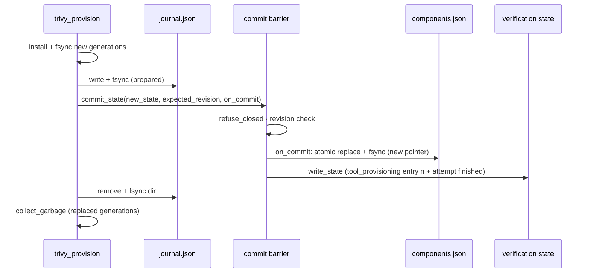
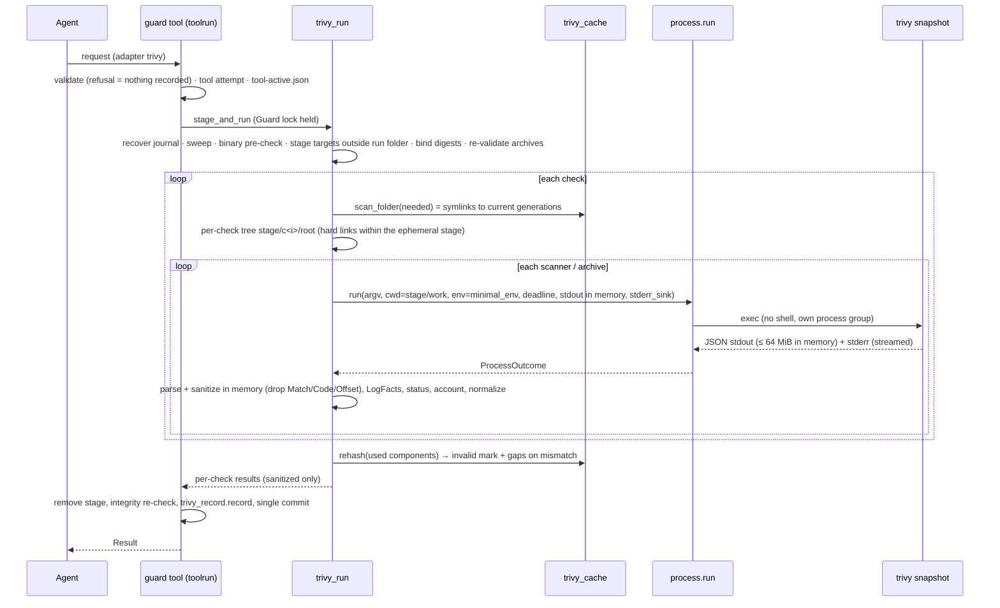
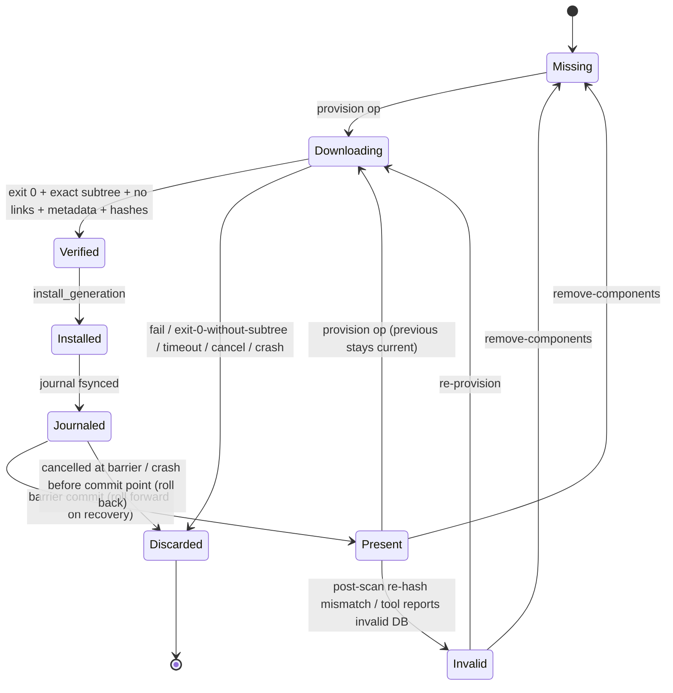

# Technical Design: Trivy Adapter

> Feature ID: FEATURE-002-D | Epic: EPIC-002 | Version: v1.0 | Last Updated: 2026-10-23
> Specification: [specification.md](x-ipe-docs/requirements/EPIC-002/FEATURE-002-D/specification.md) (v1.0, SHA-256 `229cc76e4ff651a7474da288371fc37865701413be02bfaa776ac7c170f213fe`, 46 ACs; confirmed 10-22-2026 incl. human delta D-a…D-f and the DAO-001 known-host decision) · Tool validation: [tool-validation/README.md](x-ipe-docs/requirements/EPIC-002/FEATURE-002-D/tool-validation/README.md) (`4857937097c98d58…`, driver `32017334a1fdcad1…`, results `00f432845f13bef0…`) · DAO log: [decisions_made_technical_design.md](x-ipe-docs/dao/26-10-23/decisions_made_technical_design.md) · Task: TASK-056 (owner Sage; free-mode; interaction mode `dao-represent-human-to-interact` since 10-23-2026) · Depends on: [FEATURE-002-B design](x-ipe-docs/requirements/EPIC-002/FEATURE-002-B/technical-design.md), [FEATURE-002-C design](x-ipe-docs/requirements/EPIC-002/FEATURE-002-C/technical-design.md), [FEATURE-002-A design](x-ipe-docs/requirements/EPIC-002/FEATURE-002-A/technical-design.md)

## Version History

| Version | Date | Description |
|---------|------|-------------|
| v1.0 | 10-22-2026 | Initial design (TASK-056), bound to specification `28b2dcba…` (41 ACs) |
| v1.0 | 10-23-2026 | Revision after independent design review and the specification delta (no implementation evidence existed): rebound to specification `229cc76e…` (46 ACs) and tool-validation README `48579370…`; human decisions D-a…D-f and DAO-001 (known hosts per repository, decided by the DAO representative under delegation) applied; review blockers fixed — strict `docker save` archive validation (8 GiB, explicit file targets), crash-atomic provisioning journal with deterministic recovery, components read in place with full post-scan re-hash and invalid mark, JSON-only misconfiguration accounting, in-memory stdout and staging outside the run folder, mandatory real-binary provisioning acceptance with a defined host-observation method; component removal command and on-disk sizes; ACs added to coverage: 02h, 03g, 03h, 03i, 08c |
| v1.0 | 10-24-2026 | Erratum DAO-006 (TASK-058 acceptance): the mandatory real-binary gate may be met by TC-G-01 or by a check-by-check equivalent from executed real-binary evidence (TC-L-01 plus the TC-D container cases) confirmed by an independent evidence review; uncovered assertions are disclosed limits; an uncovered assertion that matters for a confirmed AC stops closing. Original gate text kept; erratum notes added at Implementation Step 12, the gate heading and gate item 7 |

---

## Part 1: Agent-Facing Summary

> **Purpose:** Quick reference for AI agents navigating large projects.
> **📌 AI Coders:** Read both parts; Part 2 holds the binding contracts.

### Scope & Boundaries

- **Feature:** FEATURE-002-D — the Trivy v0.76.1 Adapter on the FEATURE-002-B contract: Maintainer registration (`tools register --tool trivy`); Maintainer provisioning of the vulnerability database, Java database and checks bundle into the project's private cache under FEATURE-002-C `tool_update` grants covering every known host of the repository (`tools provision`); Maintainer removal of provisioned components (`tools remove-components`); offline scans through the existing `guard tool` path (`"adapter": "trivy"`) with components read in place and re-hashed after every scan; per-check × scanner coverage accounting; normalization into per-check `runtime` evidence and findings; `status` tools section with component state and on-disk sizes; Guard report sections and limits; Guard skill and reference updates.
- **program_type:** `cli` + `library` (new `adapters/trivy*.py` modules, additive extensions of `adapters/` and `guard/`) + `skills` (Guard SKILL.md and references, Framework references).
- **tech_stack:** Python ≥ 3.11 standard library (`subprocess`, `os` descriptor APIs, `hashlib`, `json`, `re`, `shutil`, `stat`, `datetime`, `threading`); the tar structure is parsed by a small bounded reader of the toolkit (no `tarfile` extraction); existing PyYAML dependency unchanged and unused here; pytest, ruff (line length 110, py311). Trivy v0.76.1 is an external, Maintainer-installed binary.
- **Non-goals (spec Out of Scope):** license/SBOM/VEX/compliance, severity filters, ignore files/policies, compose misconfiguration analysis, secret/misconfig in image archives, pure OCI layouts, registry/daemon/live images, macOS/Windows execution, other Linux architectures, repositories other than the official ones, automatic fallback, standing grants, any FEATURE-002-C contract change, OS-level isolation, staleness threshold, proxy support for the launched tool, formal evaluation (AC-28, FEATURE-003-C), custom checks/secret rules, signature verification.
- **Threat model (inherited, D-e):** protects against an unknown or swapped binary, silent downloads or lookups by scans, project files steering the tool, modification of originals, fabricated tool evidence by the agent, secret plaintext in stored artefacts and malformed image archives. The authentic, digest-verified binary is **trusted not to write** to the provisioned components; any change is **detected after the fact** by re-hashing, not prevented. A local attacker writing the private toolkit folders concurrently, and contacts of the launched tool outside the validated known-host list, are out of scope (stated limits, never presented as enforcement).

### Outcome / Goal Frame

| Goal ID | Parent / Source | Stakeholder | Desired Observable Outcome | Contribution / Selection | Success Evidence | Constraints / Non-goals | AC Links | Outcome State |
| --- | --- | --- | --- | --- | --- | --- | --- | --- |
| G-02 | Spec G-02 (EPIC-001 G-02; FR-16, FR-18; AC-24) | Developer, upstream agent | Dependency, container, configuration and secret risks covered alongside code rules by trustworthy evidence; no false pass | All-required: offline Trivy processes per check × scanner on ephemeral per-check trees; accounting only from the tool's own statements (JSON per-file results; debug lines only for secret coverage, skipped packages, OS detection and fallback); strict `docker save` validation; normalization with a fixed severity map; component state, repository and digest in provenance | Scenario (spec): WebGoat `pom.xml` vuln check → findings needing review + failed method naming the unversioned packages; secret check lists skipped test files; compose in a misconfig check → unsupported-type gap | No Policy→scanner mapping; tool never decides a verdict; no detection-quality claim | AC-002D-01a…01f, 03a…03i, 04a…04e, 05a…05i, 06a…06d, 08a…08c | not measured |
| G-05 (enabling) | Spec G-05 (EPIC-001 G-05; FR-20, FR-24, A-08, A-09) | Owner, Maintainer, Developer | No download or network use without purpose grants; only the authentic tool runs; secrets and originals protected | All-required: digest trust root (libc-independent static entries); Linux-only platform gate; validated offline flag set on every scan; provisioning as a separate Maintainer command, one repository per operation, every known host of the repository covered by a `tool_update` grant (DAO-001), refusals recorded `used: false` (D-f); crash-atomic cache journal; post-scan full re-hash (D-e); secret value never persisted; raw tool output never on disk | Scenario (spec): no grant covering the Java DB repository → refused, nothing downloaded; a `ghcr.io` operation without a grant for its blob host → refused naming the host; fake credential absent everywhere | No OS network isolation; known hosts are a configuration-level expectation | AC-002D-01a…01f, 02a…02h, 04a…04c, 05c | not measured |
| G-04 (supporting) | Spec G-04 (EPIC-001 G-04; FR-16, FR-21) | Developer | Trivy used only where cheapest sufficient, within the shared budget | Reuse 002-B `method_choice`/`method_changes`; scans register `tool` attempts; provisioning registers an internal `tool_update` attempt; both stop on cancel | Scenario (spec): Trivy selected with a reason for a dependency check; cancelled provisioning keeps the old DB and its time appears in the report | Budget mechanics owned by FEATURE-002-C | AC-002D-02b, 04d, 04e, 06c, 06d | not measured |

Outcome is **not measured** for every goal: this design and its planned tests are engineering means; stakeholder observation belongs to acceptance/closing.

### Design Options and Tradeoffs

| Means | Selection | Goal / AC / Constraint Rationale |
| --- | --- | --- |
| Coverage only from the tool's own statements: per-file JSON results for `vuln`/`misconfig`; v0.76.1 debug lines only where JSON has no statement (secret-scanned files, skipped packages, OS not detected, embedded fallback) | **selected** | AC-002D-05a; validation KI 3–5. For `misconfig` a debug `Scanned config file` line is diagnostic only (review blocker 5) |
| Pre-computed expected-file sets from documented skip rules | rejected | Guesses on the tool's behalf; could mark unanalysed files as covered |
| One process per check × scanner (per archive in `image_archive`) on a per-check tree mirroring project-relative paths | **selected** | Isolates fatal component errors (AC-002D-02e); unambiguous attribution; ≤ 0.61 s per process observed |
| Raw stdout captured in a bounded in-memory pipe (64 MiB); `Match`/`Code`/`Offset` dropped before anything is written | **selected** | AC-002D-05c/FR-002D-9: secret context never reaches disk (review blocker 6) |
| Staging (target snapshots, home, tmp, scan cache) in an ephemeral private area **outside** the retained run folder, removed after the run and swept at startup/recovery | **selected** | AC-002D-05c forbids plaintext in the private run folder; staged copies of project files would otherwise sit there during a run |
| Components read **in place**: per-scan disposable `--cache-dir` containing directory symlinks to the current generation subtrees; full SHA-256 re-hash of every used component after every scan; mismatch → affected checks failed + component marked invalid | **selected** (D-e) | Trivy accepts one `--cache-dir` while components are stored as independent generations; symlinks give in-place reads without copies or hard links; any scan cache Trivy writes lands in the disposable folder (AC-002D-04a); re-hash ≈ 0.5 s per DB warm (README) |
| Hard-link views (previous revision) | rejected | No longer justified: scans, provisioning, GC and removal are serialized by the project Guard lock, so no concurrent swap exists; hard links would raise link counts that integrity checks must reject |
| Copy components per scan / read-only modes as the guarantee | rejected | ≈ 3.2 GB per scan; root bypasses modes — D-e chose detection |
| Immutable per-component generations + atomically replaced `components.json` + fsynced **journal** with deterministic roll-back/roll-forward keyed on the verification state | **selected** | Crash atomicity of "cache swap" + "verification record" (review blocker 3, AC-002D-02c/04e) |
| Provisioning as a separate Maintainer command bound to an open verification | **selected** (human decisions 3, H1) | Grants per verification, budget charge, report entry; scans never download |
| Known-host table per (tool version, registry) with one covering `tool_update` grant per host; blob-host grant scope = the origin root | **selected** (DAO-001) | Every host the operation is known to contact is granted and reported; origin root is the only scope known in advance that the real `egress._under` coverage can match (Part 2) |
| One allowed declaration per operation listing all known hosts (`known_hosts`), created `used: false` and switched to `used: true` in a commit just before the operation spawns | **selected** | AC-002D-02b "an allowed declaration … listing every known host"; the audit record never claims use before launch |
| Internal budget attempt kind `tool_update` (no check pairs) | **selected** | Existing `tool` attempts need ≥ 1 planned (check, method) pair |
| Hold the project Guard lock for the whole scan/provisioning/removal | **selected** | Proven 002-B/002-C pattern; serializes all cache readers and writers |
| Own bounded tar header reader through a no-follow descriptor | **selected** | AC-002D-03h needs exact member typing, name rules and bounded pax/long-name headers; stdlib `tarfile` reads pax headers into memory without a bound |
| Acceptance host observation by DNS sinkhole + TLS SNI-logging relay on a Docker `--internal` network | **selected** | Observes the toolkit-launched tool without `HTTPS_PROXY` (the toolkit passes a minimal environment and the spec defines no proxy support) |
| Toolkit option to pass a proxy to provisioning | rejected | Not in the specification (would be invented behaviour) |

### Key Components Implemented

All under `ai-secure-code-toolkit/x-ipe-secure-code-toolkit-framework/scripts/src/x_ipe_secure_code/`. Every module stays < 800 lines (`tests/test_module_size.py`); new modules < 420 lines.

| Component | Responsibility | Scope/Impact | Tags |
|-----------|----------------|--------------|------|
| `adapters/trivy.py` (new) | v0.76.1 constants (scanners, modes, config types, repositories, known hosts, severity map, offline flags), scan/provision argv, JSON well-formedness, process status, sanitizing, normalization incl. secret masking | runs, provisioning | #trivy #core #normalization |
| `adapters/trivy_log.py` (new) | Streaming parser of v0.76.1 stderr → `LogFacts` | runs, provisioning | #trivy #coverage #parsing |
| `adapters/trivy_account.py` (new) | Per-check × scanner accounting and gap texts | runs | #trivy #coverage |
| `adapters/trivy_archive.py` (new) | Bounded `docker save` structure validation through a no-follow descriptor | request validation, staged re-check | #trivy #validation #security |
| `adapters/trivy_cache.py` (new) | Cache layout, `components.json`, component state/size/age, symlink scan folder, post-scan re-hash and invalid mark, generation install, removal, GC | runs, provisioning, removal, status | #trivy #cache #integrity |
| `adapters/trivy_fs.py` (new) | Descriptor-based no-follow creation, exclusive leaves, link-safe sweep/removal and identity re-check for Trivy private folders (composes `knowledge/durable.py`) | staging, cache, GC | #trivy #security #filesystem |
| `adapters/trivy_journal.py` (new) | Durable provisioning journal, deterministic recovery, lock-free coherent read for `status` | provisioning, runs, removal, conclude, status | #trivy #atomicity #recovery |
| `adapters/trivy_request.py` (new) | Trivy request schema, image-archive rules, config-type overrides | `guard tool` | #trivy #validation |
| `adapters/trivy_run.py` (new) | Execution inside `guard tool`: ephemeral staging, pre-check, per-check trees, scan folders, processes, accounting, re-hash | `guard tool` | #trivy #execution |
| `adapters/trivy_record.py` (new) | Evidence, findings, manifest/output, run entry | `guard tool` | #trivy #evidence |
| `adapters/trivy_provision.py` (new) | `tools provision` and `tools remove-components` bodies | provisioning, removal | #trivy #egress #budget |
| `guard/toolctl.py` (new, extracted from `toolrun.py`) | `start_attempt`, `ToolCancelled`, `ack`, `cancelled_error`, active marker | `guard tool`, provisioning | #cancel #budget #refactor |
| `adapters/__init__.py`, `digests.py`, `registry_store.py`, `process.py` (extended) | `AdapterSpec.platforms/platform_gap`, static entries, platform gate, `register_step`, `stderr_sink`, in-memory stdout, `minimal_env` | 002-B | #contract #trust #execution |
| `guard/toolreq.py`, `guard/toolrun.py` (extended) | Extracted helpers; dispatch to Trivy validation, staging location, execution and recording | 002-B | #dispatch |
| `guard/budget.py`, `guard/cancel.py`, `guard/runs.py` (extended) | Internal attempt kind `tool_update`; cancel lists it as toolkit-owned; `commit_state(on_commit=…)`; recovery hook in `finalize_locked` | 002-C | #budget #cancel |
| `guard/engine.py`, `guard/report.py` (extended) | `LIMITS` text; `tool_provisioning` pass-through; Trivy columns, component state, provisioning and known-host egress rendering | 002-A | #report |
| `status.py`, `tools_service.py`, `cli.py` (extended) | Trivy status with components and sizes; `tools provision`, `tools remove-components`; platform refusal for register | 001-A/002-B | #cli #status |
| Guard `SKILL.md`, `references/guard-records.md`; Framework `SKILL.md`, `references/cli-contract.md`; toolkit `README.md` | Agent procedure, formats, commands, error codes | Agent | #skills #docs |

### Dependencies

| Dependency | Source | Design Link | Usage Description |
|------------|--------|-------------|-------------------|
| Adapter contract, `ToolBuild`/`TABLE`, `registry_store`, `safe_io`, `process.run`, `targets.stage`, `toolreq`/`toolrun` recording path, reserved namespace, `method_choice` | FEATURE-002-B (closed) | [design](x-ipe-docs/requirements/EPIC-002/FEATURE-002-B/technical-design.md) | Reused; additive extensions only (static entries, platforms, stderr sink, in-memory stdout, dispatch hooks) |
| Budget attempts, time-limit cap, cancel marker/ack/commit barrier, egress grants + `coverage()` + `canonical_url`, `tool_update`, `metadata`, `adapter_network_check` | FEATURE-002-C (closed) | [design](x-ipe-docs/requirements/EPIC-002/FEATURE-002-C/technical-design.md) | Grant model and coverage unchanged; additive internal attempt kind, `on_commit` hook, `known_hosts` field on toolkit declarations |
| Run state, plan methods, evidence/finding shape, Reviewer rules, verdict engine, `mask_text`, evidence quota, report, Guard lock | FEATURE-002-A (closed) | [design](x-ipe-docs/requirements/EPIC-002/FEATURE-002-A/technical-design.md) | Existing shapes; report sections and `LIMITS` text updated |
| `require_maintainer`, `Result`, `atomic_write_bytes`, `ProcessLock`, private data area, read-only `status` | FEATURE-001-A | [design](x-ipe-docs/requirements/EPIC-001/FEATURE-001-A/technical-design.md) | Gates, envelope, writes; status stays read-only (journal evaluated, never resolved, by status) |
| Trivy v0.76.1 static Linux binaries; repositories `mirror.gcr.io/aquasec/{trivy-db:2,trivy-java-db:1,trivy-checks:2}` and `ghcr.io/aquasecurity/…` (+ blob host) | external | [tool validation](x-ipe-docs/requirements/EPIC-002/FEATURE-002-D/tool-validation/README.md) | Executed only as a digest-matched snapshot; repositories contacted only during granted provisioning |

### Major Flow

1. **Register (Maintainer, Linux):** platform gate → Maintainer → no-follow digest → table entry (`trivy` 0.76.1, libc `None`) → existing record. Never executed.
2. **Grant (user, own terminal):** `guard allow-egress --purpose tool_update --recipient https://mirror.gcr.io --data metadata --scope https://mirror.gcr.io/aquasec/trivy-db:2 …`; for `ghcr.io` additionally `--recipient https://pkg-containers.githubusercontent.com --scope https://pkg-containers.githubusercontent.com`.
3. **Provision (Maintainer):** platform gate → Guard lock → recovery → verification accepted? (else refused, nothing recorded) → Maintainer, arguments, known-host list for (v0.76.1, registry), grant coverage of every known host, binary pre-check → any failure: refused `used: false` declarations committed → else commit `tool_update` attempt + allowed declarations (`used: false`) → per component: commit `used: true`, run one operation with exactly one repository, verify the subtree strictly, install a read-only generation → journal → commit barrier swaps `components.json` and records outcomes → remove journal → GC.
4. **Plan (agent):** check with method `trivy` (runtime) selected in `method_choice`.
5. **Scan (`guard tool`):** validate request (refusal = nothing recorded) → `tool` attempt → Guard-lock recovery + ephemeral sweep → pre-check (platform, record, binary snapshot, components per check) → stage targets outside the run folder, bind digests, re-validate archives → per check: per-check tree + symlink scan folder → per scanner: offline process, stdout in memory, stderr parsed in stream → accounting + normalization → post-scan full re-hash of used components (mismatch → invalid mark + failed checks) → sanitized output + manifest → cleanup, integrity re-check → single commit.
6. **Remove (Maintainer):** Guard lock (busy → refused) → recovery → pointer rewrite without the components → GC → bytes freed.
7. **Judge:** ledger, Reviewer for verdict-affecting/`unknown` findings, conclude (FEATURE-002-A).

### Usage Example

```bash
FW=.github/skills/x-ipe-secure-code-toolkit-framework
VID=gv-20261023T010000Z-1a2b3c4d
uvx --from "$FW/scripts" secure-code tools register --project . --tool trivy --path /usr/local/bin/trivy        # Maintainer, Linux
uvx --from "$FW/scripts" secure-code guard allow-egress --project . --run $VID --purpose tool_update \
    --recipient https://mirror.gcr.io --data metadata \
    --scope https://mirror.gcr.io/aquasec/trivy-db:2 --scope https://mirror.gcr.io/aquasec/trivy-checks:2 \
    --reason "Trivy DB and checks for dependency/config checks"                                                 # user, own terminal
uvx --from "$FW/scripts" secure-code tools provision --project . --tool trivy --run $VID \
    --component vulnerability_db --component checks_bundle --time-limit 600 --json                             # Maintainer
uvx --from "$FW/scripts" secure-code guard tool --project . --run $VID --request .x-ipe/private/secure-code/tmp/trivy-1.json --json
uvx --from "$FW/scripts" secure-code status --project . --json                                                  # tools.trivy.components, sizes
uvx --from "$FW/scripts" secure-code tools remove-components --project . --tool trivy --component java_db --json # Maintainer
```

```json
{"schema": "ai-secure-code-toolkit/guard-tool/v1", "adapter": "trivy", "time_limit_seconds": 600,
 "checks": [
   {"check": "C1", "scanners": ["vuln"], "mode": "filesystem", "targets": ["pom.xml"]},
   {"check": "C2", "scanners": ["misconfig"], "mode": "filesystem", "targets": ["Dockerfile_desktop"],
    "config_types": [{"path": "Dockerfile_desktop", "type": "dockerfile"}]},
   {"check": "C3", "scanners": ["secret"], "mode": "filesystem", "targets": ["src/main/resources"]},
   {"check": "C4", "scanners": ["vuln"], "mode": "image_archive", "targets": ["dist/app-image.tar"]}]}
```

### Tool Capability Summary

- `x-ipe-docs/config/tools.json` `stages.implement.technical_design` (`6df39210e203507a…`): explicit booleans enable python, html5, typescript, java, mcp, general; `_order` ignored; `_extra_instruction` "Consultation mode: read tool capabilities for informational use only. Do not invoke tools for code execution." respected.
- **Matched:** `x-ipe-tool-implementation-python` (SKILL.md `061a3c6462452ad9…`), read informationally only: PEP 8, type hints, docstrings, import ordering, pytest Arrange-Act-Assert, CLI/library detection — consistent with the project (ruff `E,F,W,I,B,UP`, line length 110). Not invoked.
- **Excluded:** html5, typescript, java (no such stack), mcp (no MCP server), general (a specific Python match exists). Part 2 is complete independent of tool availability.

---

## Part 2: Implementation Guide

> Paths are relative to `ai-secure-code-toolkit/x-ipe-secure-code-toolkit-framework/scripts/` unless they start with `ai-secure-code-toolkit/`, `x-ipe-docs/` or `.x-ipe/`.

### Files and Layout

| Path | Change | Est. lines after |
|---|---|---|
| `src/x_ipe_secure_code/adapters/trivy.py` | new | ≈ 360 |
| `src/x_ipe_secure_code/adapters/trivy_log.py` | new | ≈ 170 |
| `src/x_ipe_secure_code/adapters/trivy_account.py` | new | ≈ 230 |
| `src/x_ipe_secure_code/adapters/trivy_archive.py` | new | ≈ 230 |
| `src/x_ipe_secure_code/adapters/trivy_cache.py` | new | ≈ 380 |
| `src/x_ipe_secure_code/adapters/trivy_journal.py` | new | ≈ 230 |
| `src/x_ipe_secure_code/adapters/trivy_fs.py` | new | ≈ 140 |
| `src/x_ipe_secure_code/guard/targets.py` | additive `dest_fd` parameter of `stage()` | 457 → ≈ 475 |
| `src/x_ipe_secure_code/adapters/trivy_request.py` | new | ≈ 200 |
| `src/x_ipe_secure_code/adapters/trivy_run.py` | new | ≈ 360 |
| `src/x_ipe_secure_code/adapters/trivy_record.py` | new | ≈ 270 |
| `src/x_ipe_secure_code/adapters/trivy_provision.py` | new | ≈ 410 |
| `src/x_ipe_secure_code/guard/toolctl.py` | new (extracted from `toolrun.py`) | ≈ 110 |
| `src/x_ipe_secure_code/guard/toolrun.py` | extraction (−≈ 70) + dispatch (+≈ 20) | 749 → ≈ 700 |
| `src/x_ipe_secure_code/guard/toolreq.py` | helpers extracted; dispatch | 146 → ≈ 165 |
| `src/x_ipe_secure_code/adapters/__init__.py`, `digests.py`, `registry_store.py`, `process.py` | additive | 33→45, 77→100, 140→165, 181→235 |
| `src/x_ipe_secure_code/guard/budget.py`, `cancel.py`, `runs.py`, `engine.py`, `report.py` | additive | 378→392, 187→195, 340→350, 428→430, 530→610 |
| `src/x_ipe_secure_code/status.py`, `tools_service.py`, `cli.py`, `adapters_registry.py` | additive | 137→175, 50→95, 327→355, 14→14 |
| `tests/adapters/fake_trivy.py`, `tests/adapters/fixtures/trivy/*`, `tests/support/obs_relay.py` | new test double, recorded shapes, acceptance relay | — |
| `tests/adapters/test_trivy_units.py`, `tests/adapters/test_trivy_archive.py`, `tests/adapters/test_trivy_fs.py`, `tests/guard/test_guard_trivy.py`, `tests/guard/test_trivy_provision.py`, `tests/guard/test_trivy_recovery.py`, `tests/guard/test_trivy_real.py` | new | — |
| `tests/test_status.py`, `tests/guard/test_guard_tool.py`, `tests/adapters/test_adapters_units.py`, `tests/guard/test_guard_skill.py`, `tests/guard/test_guard_report.py`, `tests/conftest.py` (option `--require-real-trivy`) | updated | — |
| `ai-secure-code-toolkit/x-ipe-secure-code-toolkit-guard/SKILL.md`, `…/references/guard-records.md`, `ai-secure-code-toolkit/x-ipe-secure-code-toolkit-framework/SKILL.md`, `…/references/cli-contract.md`, `ai-secure-code-toolkit/README.md` | docs | — |

Private data (project-local, `.x-ipe/private/secure-code/`): `tools/trivy.json` (existing registration record); `tools/trivy-cache/` (cache, journal); `adapter-stage/trivy/` (ephemeral staging, outside every run folder); `guard/<vid>/evidence/trivy-<n>-{manifest,output}.json` (existing naming, sanitized only).

### FEATURE-002-B Contract Extensions (additive; AC-002B-* unchanged except the Trivy part of 06b)

```python
# adapters/__init__.py
@dataclass(frozen=True)
class AdapterSpec:
    name: str
    max_time_limit: int = 1800
    network: dict | None = None                                  # scan network need (002-C); Trivy: None
    platforms: tuple[tuple[str, str], ...] | None = None         # (os, arch); None = all POSIX (Opengrep unchanged)
    platform_gap: str | None = None

ADAPTERS = {"opengrep": AdapterSpec("opengrep"),
            "trivy": AdapterSpec("trivy", 1800, None, (("linux", "x86"), ("linux", "aarch64")),
                                 "Trivy execution is supported only on Linux x86-64 and Linux arm64 in this version"),
            "strix": None}
```

- `digests.matches(build, host)`: `build.os == host["os"] and build.arch == host["arch"] and (build.os != "linux" or build.libc is None or build.libc == host["libc"])` — Opengrep Linux entries all carry a libc value → exact matching unchanged (AC-002D-01f). New entries; `TRIVY_ARCHIVES` keeps the archive SHA-256 per asset (AC-002D-07b):

| Digest key | tool | version | os | arch | libc | asset | validated |
|---|---|---|---|---|---|---|---|
| `sha256:b422130ea54e53e142e65c838662e48919ce9c3f23f17d80066b43e70550cb85` | trivy | 0.76.1 | linux | aarch64 | None | `trivy_0.76.1_Linux-ARM64.tar.gz` (archive `e174dff2…16a1f`) | True |
| `sha256:d1dfca6ae10a1ad4540bb94e64f0510077c47008920a9b554986b39dca573d83` | trivy | 0.76.1 | linux | x86 | None | `trivy_0.76.1_Linux-64bit.tar.gz` (archive `c7cbe313…d9c0`) | False |

- `registry_store.platform_gap(tool, host) -> Gap | None` (`ADAPTER_PLATFORM_UNSUPPORTED`, `spec.platform_gap`, next step "Run on a Linux x86-64 or arm64 host, or use another method for these checks"); called first in `register()` and before loading the record in `check()`; Windows refusal kept for Adapters without `platforms`. `register_step(tool)` replaces the Opengrep-only `REGISTER_STEP` text (constant kept for compatibility).
- `process.run(argv, cwd, env, deadline, stdout_path: Path | None, stdout_cap, should_stop=None, stderr_sink=None)`: `stdout_path=None` captures stdout through a pipe drained by a thread into a `bytearray` (cap enforced while reading → group kill, `oversized`); `ProcessOutcome` gains `stdout: bytes | None = None`; `stderr_sink(chunk)` receives every stderr chunk before the 4 KiB tail is trimmed. Defaults keep the 002-B behaviour. `minimal_env(stage, home)` moves here from `toolrun._env` (identical output).
- `guard/toolreq.py`: `planned_method(...)` and `bind_targets(...)` extracted unchanged; `validate()` dispatches to `trivy_request.validate(root, state, doc, ck)` for `adapter == "trivy"`.
- `guard/toolrun.py`: `_execute` asks `trivy_run.stage_root(root)` for the staging folder (outside the run folder) and calls `trivy_run.stage_and_run` instead of `_stage_and_run`; `_record` keeps the common integrity prefix (staging left, originals, context, `c.get("rule_files", [])`) and delegates the body to `trivy_record.record(...)`; run-level status fallback `or ["precheck_failed"]` (never reached by Opengrep).

### FEATURE-002-C / 002-A Extensions (additive; their ACs unchanged)

- `budget.register(..., internal=True)` accepts kind `tool_update` with `covers = {"pairs": [], "findings": [], "na": [], "components": [...]}`, `extra = 0`.
- `cancel.finalize_frozen`: `agent_attempts` excludes kinds `tool` and `tool_update`. `cancel.finalize_locked` (under the Guard lock) runs `trivy_journal.recover(root)` first. The lock-free `cancel()` path does not resolve the journal; correctness holds because the verification state is the commit point of the journal decision (Part 2, Provisioning Journal).
- `runs.commit_state(root, state, *, expected_revision, on_commit=None)`: `on_commit()` runs inside the barrier after `refuse_closed` and the revision check, before `write_state`.
- Toolkit egress declarations may carry the additive field `known_hosts: [{"host", "origin", "scope", "grant"}]` and `operation`; `report._egress_section` renders `known_hosts` after the recipient. Grants, `coverage()`, `_under()` and the user-facing `allow-egress`/`egress` commands are unchanged.
- `engine.LIMITS` Adapters entry becomes: "Adapters: Opengrep and Trivy run only as the registered official binaries on staged copies; their file-system and network access are not OS-enforced; Trivy runs on Linux x86-64/arm64 only, scans offline, reads the provisioned components in place (changes are detected by re-hashing after each scan, not prevented) and its provisioning hosts are a configuration-level expectation; Strix is not available yet". `engine.conclude` passes `tool_provisioning`.
- `report.render`: Adapter Runs table gains `Scanners`/`Mode`; new "Trivy Component State" and "Tool Provisioning" sections; regression assertion in `tests/guard/test_guard_report.py` on the new limits text.
- Findings carry `tool.rule_id` (= tool identifier) because `report.py` renders it unconditionally.

### CLI Contract

| Command | Arguments | Behaviour | Exit |
|---|---|---|---|
| `secure-code tools register` | `--project`, `--tool opengrep\|trivy`, `--path PATH`, `--json` | Trivy: platform gate first (`ADAPTER_PLATFORM_UNSUPPORTED`); otherwise 002-B behaviour; returns `tool, version, asset, platform{os,arch,libc:null}, platform_validated, path, digest` | 0 / 1 |
| `secure-code tools provision` (new) | `--project`, `--tool trivy`, `--run ID`, `--component vulnerability_db\|java_db\|checks_bundle` (repeatable, ≥ 1, unique), `--registry mirror.gcr.io\|ghcr.io` (default `mirror.gcr.io`, one registry per command), `--time-limit SECONDS` (1…3600, capped by remaining budget), `--json` | Provisions the components under covering grants for every known host; one operation per component | 0 executed (any outcome) · 1 refused (refusal recorded as `used: false` declarations when the verification was accepted; otherwise nothing recorded) |
| `secure-code tools remove-components` (new) | `--project`, `--tool trivy`, `--component NAME` (repeatable) or `--all`, `--json` | Removes components from the project's private cache; returns removed components and bytes freed | 0 / 1 |
| `secure-code guard tool` | `--project`, `--run ID`, `--request FILE`, `--json` | `"adapter": "trivy"`: offline scan; per-check evidence and findings | 0 recorded · 1 refused |
| `secure-code status` | `--project`, `--json` | `tools.trivy`: provided, registration/pre-check, execution support, component state, sizes; never writes, executes or downloads | 0 / 1 |

`tools provision` result `data`: `{"verification_id", "provisioning": n, "attempt", "registry", "time_limit", "time_limit_capped", "operations": [{"component", "repository", "tag", "known_hosts", "grants", "declaration", "outcome": "completed|failed|timed_out|not_run", "previous": "replaced|kept|missing", "size_bytes", "content_digest", "seconds", "metadata", "reason"}], "limit", "budget"}`. Refusal `data`: `{"verification_id", "declarations": [ids], "components": {name: {"missing": "maintainer|argument|component|known_hosts|purpose|recipient|data|scope|binary", "host"?: str, "reason"}}}`.

### Run Request Schema (`ai-secure-code-toolkit/guard-tool/v1`, `"adapter": "trivy"`)

| Field | Rule (refusal = `TOOL_REQUEST_INVALID` unless noted; nothing recorded) |
|---|---|
| top level | keys `schema`, `adapter`, `time_limit_seconds`, `checks`; `include_ignored` and any other key refused |
| `time_limit_seconds` | int 1…1800; capped by remaining budget at attempt start (AC-002C-01g) |
| `checks[]` | 1…50; keys `check`, `scanners`, `mode`, `targets`, optional `config_types`; duplicates refused |
| `check` | planned check with a selected/activated `trivy` runtime method (`METHOD_NOT_PLANNED` / `METHOD_NOT_SELECTED`) |
| `scanners` | non-empty unique subset of `vuln`, `misconfig`, `secret`; `license` refused ("license scanning is out of scope in this version") |
| `mode` | `filesystem` \| `image_archive`; `image_archive` requires `scanners == ["vuln"]` |
| `targets` (both modes) | `bind_targets`: verification targets or inside a folder target, together equal to the check object; context/suggested/Copilot-report/unrelated/deleted refused (`TARGETS_MISMATCH`); `targets.normalize` rejects URLs, references, sockets, NUL, shell text |
| `targets` (`image_archive`) | each must equal an **explicitly declared file target** of the verification (`artifact.targets[i].path == t` and `kind == "file"`; a `.tar` inside a folder target is refused, AC-002D-03i); `.tar` suffix; size ≤ 8 GiB via `fstat` on a no-follow descriptor (refusal names size and maximum, `IMAGE_ARCHIVE_TOO_LARGE`, AC-002D-03g); structure valid (`IMAGE_ARCHIVE_INVALID` naming the violation, AC-002D-03h) |
| `config_types[]` | `{path, type}`; `path` is a file of this check's object, `scanners` includes `misconfig`, `type` ∈ `CONFIG_TYPES` (exactly the 9 `--misconfig-scanners` values of the real v0.76.1 `trivy fs --help`, incl. `ansible`, verified at acceptance TASK-058 and fixed in Bug Fix TASK-059; compose never); one override per path |

Validated check passed to execution: `{"check", "check_def", "scanners", "mode", "targets", "config_types", "rule_files": []}`.

### Image Archive Validation (`adapters/trivy_archive.py`, AC-002D-03c/03g/03h)

`validate_archive(fd, size) -> ArchiveInfo | ArchiveError` reads through the **no-follow descriptor** from `safe_io.open_nofollow(root, rel)` (regular file checked on the descriptor); the same function re-validates the staged snapshot before execution (failure → that check failed, gap names the violation).

1. `size ≤ 8 GiB` (else `IMAGE_ARCHIVE_TOO_LARGE`). Not gzip/bzip2/xz/zstd (magic bytes) — uncompressed tar only.
2. Stream 512-byte headers with the toolkit's bounded reader: header checksum verified; size field octal (base-256 refused); `offset + padded size ≤ file size` (no truncation, no expansion beyond the file); ≤ 100,000 members; end = two zero blocks (trailing zeros allowed).
3. Header types: `0`/NUL regular file, `5` directory accepted. Header extensions: `x` (pax per-file, ≤ 64 KiB, records parsed strictly as `"<len> <key>=<value>\n"`; allowed keys `path`, `size`, `mtime`, `atime`, `ctime`, `uid`, `gid`, `uname`, `gname`, `comment`; `path` and `size` are **applied exactly as a POSIX consumer applies them** — they replace the ustar name/size of the immediately following member, which is then validated with the effective values; any other key such as `linkpath`, `hdrcharset`, `GNU.sparse.*`, `SCHILY.*`, `LIBARCHIVE.*` → refused; an `x` header not followed by a regular/directory member, or two consecutive extension headers for one member, → refused) and `L` (GNU long name, ≤ 4 KiB, same "applies to the next member" rule). **Global pax headers (`g`) are refused** ("global pax header not supported"): `docker save` archives do not need them, and a global `path`/`size` would otherwise change how every later member is read by a consumer while a validator that ignored it would see different names/sizes (bypass). `1` hard link, `2` symlink, `3`/`4` devices, `6` FIFO, `7` contiguous, `K` long link name, `S` sparse, `V`/`M`/`N`, any other → refused ("link or special member"/"sparse member").
4. Names decoded strictly as UTF-8; POSIX-clean: relative, no leading `/`, no `\`, no NUL, no empty, `.` or `..` segment (a single trailing `/` allowed for directories); normalized name unique (also across file/directory forms); a regular member's name must not be a prefix directory of another member (file-used-as-folder ambiguity) → refused.
5. `manifest.json` must exist as a top-level regular member, ≤ 1 MiB, JSON array (1…64 entries) of objects with string `Config` and a non-empty string list `Layers` (`RepoTags` optional); every `Config`/`Layers` value is POSIX-clean and names exactly one existing **regular** member. `oci-layout`, `index.json`, `blobs/…` are allowed alongside; a pure OCI layout (no `manifest.json`) is refused ("pure OCI layout archives are not supported; use `docker save`").
6. Result `ArchiveInfo{members, manifest_entries, layers, config}` recorded (counts only) in the run manifest.

### Private Cache (`adapters/trivy_cache.py`)

```text
.x-ipe/private/secure-code/tools/trivy-cache/        (0700; store.ensure_safe on every path)
  components.json                                    current pointer (atomic replace + fsync)
  journal.json                                       present only during/after an interrupted final commit
  gen/vulnerability_db/<gen-id>/db/{trivy.db,metadata.json}
  gen/java_db/<gen-id>/java-db/{trivy-java.db,metadata.json}
  gen/checks_bundle/<gen-id>/policy/{content/**,metadata.json}
  staging/op-<hex>/                                  in-progress downloads (never referenced)
.x-ipe/private/secure-code/adapter-stage/trivy/stage-<hex>/   ephemeral scan staging (src/, c<i>/root, c<i>/cache, work, home, tmp)
```

`<gen-id>` = `<UTC yyyymmddThhmmssZ>-<8 hex>`; generations are never modified after install (files 0444, dirs 0555 as hardening; the guarantee is the re-hash, D-e).

`components.json` (schema `ai-secure-code-toolkit/trivy-cache/v1`, metadata split per component):

```json
{"schema": "ai-secure-code-toolkit/trivy-cache/v1", "tool_version": "0.76.1", "revision": 7,
 "components": {
  "vulnerability_db": {"generation": "20261023T010203Z-1f2e3d4c", "registry": "mirror.gcr.io",
     "repository": "mirror.gcr.io/aquasec/trivy-db", "tag": "2", "provisioned_at": "…", "verification_id": "gv-…",
     "provisioning": 1, "grants": ["g-1"], "size_bytes": 1627246745, "disk_bytes": 1627250688,
     "content_digest": "sha256:…",
     "files": {"db/trivy.db": {"sha256": "sha256:…", "size": 1627246592},
               "db/metadata.json": {"sha256": "sha256:…", "size": 153}},
     "metadata": {"Version": 2, "UpdatedAt": "2026-10-22T13:15:26Z", "NextUpdate": "2026-10-23T13:15:26Z", "DownloadedAt": "…"},
     "invalid": null},
  "java_db": {"…": "same shape; files java-db/trivy-java.db, java-db/metadata.json; metadata Version 1, UpdatedAt, NextUpdate, DownloadedAt"},
  "checks_bundle": {"…": "same envelope; files policy/metadata.json + every policy/content/** file",
     "metadata": {"MajorVersion": 2, "Digest": "sha256:b591e919…", "DownloadedAt": "…"}}}}
```

`content_digest` = SHA-256 over the sorted lines `<relpath>\0<sha256>\n` — cited (with registry, repository and tag) in evidence, reports and status, because registries are not interchangeable (README KI 18: different checks-bundle digests). `invalid` = `{"reason", "detected_at", "verification_id", "run"}` or `null`.

Functions:

- `component_state(root, name, now, pointer=None) -> {"state": "present"|"missing"|"unreadable", "reason", "registry", "repository", "tag", "generation", "metadata", "content_digest", "size_bytes", "disk_bytes", "age_seconds"?, "age"?}`. `missing`: no entry/pointer. `unreadable`: entry has `invalid` (reason "invalid: <reason>; re-provision"), generation folder or a recorded file missing, an unexpected entry in the generation, a file not regular or with link count ≠ 1, size differs, `metadata.json` hash or schema differs. Pre-check and status use this stat-level check plus the `metadata.json` hash; full content hashes are verified **after every scan** (D-e) and at provisioning.
- Metadata schemas: databases require `Version` (int = tag), `UpdatedAt`, `NextUpdate`, `DownloadedAt` (RFC 3339, nanoseconds trimmed); checks bundle requires `MajorVersion` (int = tag), `Digest` (`sha256:` + 64 hex), `DownloadedAt`. Age only for databases: `age_seconds = time − UpdatedAt` (`age` text `"<d> d <h> h"`); no threshold or "stale" flag (BR-05).
- `scan_folder(root, needed, dest_fd) -> (dict[name, state] | Gap)`: requires each needed component `present`; `dest_fd` is the descriptor of the per-check `cache/` folder created inside the stage leaf (Staging Root Safety); one **directory symlink** per needed component is created with `os.symlink(target, name, dir_fd=dest_fd)` (`dest/db → …/gen/vulnerability_db/<id>/db`, `dest/java-db`, `dest/policy`) using absolute targets; Trivy opens the provisioned files in place through them; anything Trivy writes into `dest/` (e.g. `fanal/`) is disposable. Only components the scanner/mode needs are linked (`vuln` fs → db; `vuln` image → db, java-db; `misconfig` → policy; `secret` → none).
- `rehash(root, used) -> dict[name, list[str]]`: runs in the `finally` block of `trivy_run.stage_and_run` for every component linked into any scan folder of the request — after normal completion, timeouts, process failures, unexpected exceptions **and cancellation** (`ToolCancelled` is re-raised only after the re-hash and any `mark_invalid`; a cancelled run still records no evidence, but a detected change still marks the component invalid); it is never skipped by the deadline. For every used component: walk the generation with `lstat` (no follow) — same file set, regular files, link count 1 — and full SHA-256 of every file (1 MiB reads) compared with `files`; any difference → `mark_invalid(root, name, reason, vid, run)` (pointer rewrite under the Guard lock with `invalid` set) and the gap "provisioned <component> changed since provisioning: <file> (<reason>); re-provision" for every check that used it. Cost ≈ 0.5 s per database warm (README KI 19; cold not measured) — counted in the verification's wall-clock budget.
- `install_generation(root, component, op)`: strict subtree check (below), `os.rename` of the subtree into `gen/<component>/<gen-id>/`, modes, `fsync` of files and directories, file records with SHA-256 computed during verification.
- `remove(root, names) -> {name: freed_disk_bytes}`: pointer rewrite without the names (atomic), then GC.
- `collect_garbage(root)`: delete generations not referenced by `components.json` **and** not referenced by a journal's `new_pointer` (recovery always runs first), and `staging/op-*`, with `trivy_fs.remove_tree_at` (descriptor-based, no traversal of links; `fchmod` `u+w` on each opened real folder before deleting its entries). Only under the Guard lock.
- Disk sizes: `disk_bytes` = Σ `st_blocks × 512` of the generation's files and folders (on-disk, AC-002D-08c); `size_bytes` = Σ file sizes.

### Staging Root Safety (`adapters/trivy_fs.py`, reusing `knowledge/durable.py`)

All Trivy-owned private folders (`adapter-stage/trivy/`, `tools/trivy-cache/`, `tools/trivy-cache/staging/`, `gen/<component>/`) are created, opened, swept and removed only through descriptors, reusing the existing no-follow primitives of `x_ipe_secure_code/knowledge/durable.py` (already used by `knowledge/store.py`, `lifecycle.py`, `exit_journal.py`): `durable.Tree(root)` (one project-root handle), `Tree.dir(rel, create=True, mode=0o700)` (walks every component with `O_DIRECTORY|O_NOFOLLOW` relative to the parent descriptor, creates missing ones with `os.mkdir(dir_fd=…)` + parent `fsync`, raises `PATH_UNSAFE` for a symlinked or non-folder component), `durable.listdir`/`entry` (never follow), `durable.open_child`, `durable.readlink`, `durable.unlink` (regular files only), `durable.rmdir_empty`, and the fault-injection hooks `durable.set_step`/`_inject` for tests. New helpers in `adapters/trivy_fs.py` (≈ 140 lines) only compose them:

| Helper | Behaviour |
|---|---|
| `open_root(tree, rel)` | `tree.dir(rel, create=True)`; then `fstat` must be a folder owned by the current user with mode `0700` (`fchmod` to `0700` when the toolkit created it); returns the descriptor |
| `make_leaf(root_fd, prefix)` | `name = f"{prefix}{secrets.token_hex(8)}"`; `os.mkdir(name, 0o700, dir_fd=root_fd)` (exclusive: `FileExistsError` → new name, ≤ 5 tries); `durable.open_child(root_fd, name)`; `fstat` identity (`st_dev`, `st_ino`) must equal `entry(root_fd, name)`; returns `(name, fd, identity)`. Sub-folders inside the leaf are created the same way (`os.mkdir(dir_fd=…)` + `open_child`) |
| `copy_into(leaf_fd, rel, src_fd, limit)` | creates intermediate folders with `mkdir(dir_fd)`/`open_child` and the file with `os.open(name, O_WRONLY|O_CREAT|O_EXCL|O_NOFOLLOW, 0o600, dir_fd=…)`, hashing while copying (same hash lines as `safe_io.copy_hash`); used by Trivy staging through an additive `dest_fd` parameter of `targets.stage` (Opengrep keeps the path-based form) |
| `unlink_link(dfd, name, expected)` | `entry(dfd, name)` must be `S_ISLNK` and `durable.readlink(dfd, name) == expected`; `os.unlink(name, dir_fd=dfd)` removes the link itself — the target is never opened or traversed. Used for the intentional component links in `c<i>/cache/` before the stage is removed |
| `remove_tree_at(dfd, name, expected)` | **identity-bound** removal; `expected = (st_dev, st_ino)` of the folder the caller means. (1) `entry(dfd, name)` must be a real folder whose `(st_dev, st_ino) == expected`; (2) `open_child(dfd, name)` (no-follow), then `fstat(fd)` must again equal `expected` **before any entry is touched** — this closes the window between `entry` and `open_child`; (3) `fchmod 0o700`; for every child from `listdir(fd)`: a folder recurses with its own identity taken from that `listdir` stat (same two checks), symbolic links and other non-folders are unlinked as entries (`os.unlink(dir_fd=fd)`, never followed); (4) `rmdir_empty(dfd, name)` only after a final `entry(dfd, name)` identity re-check. Any mismatch → `IdentityChanged`: nothing at the current name is deleted (the replacement is never touched), the caller records the gap |
| `empty_by_fd(leaf_fd)` | removes the contents of an already opened, identity-bound folder through its descriptor only (same child rules as `remove_tree_at`); used when the leaf name no longer refers to our folder |
| `sweep(root_fd, pattern)` | `listdir(root_fd)`; for names matching `^stage-[0-9a-f]{16}$` (`^op-[0-9a-f]{16}$` for cache staging): real folder → `remove_tree_at(root_fd, name, identity from that listdir stat)` (a replacement between listing and opening is skipped and reported, never deleted); symbolic link or other entry → unlinked as an entry only (warning recorded in the next Result); non-matching names are left untouched and reported as a problem `STAGING_UNEXPECTED` |
| `leaf_matches(root_fd, name, leaf_fd, identity)` | before cleanup: `entry(root_fd, name)` is a real folder and its `(st_dev, st_ino)`, `fstat(leaf_fd)` and the identity saved by `make_leaf` are all equal; `root_fd` itself is re-checked against `tree.dir(rel)` identity (ancestor not replaced) |

The Trivy process necessarily receives path strings (argv, `--cache-dir`, `HOME`, `TMPDIR`, cwd); these are the leaf's paths, which were verified link-free at creation and are re-verified by `leaf_matches` before cleanup — a concurrent local attacker able to replace private folders during a run remains outside the threat model (stated limit), but every toolkit-side create, write, sweep and delete is descriptor-relative and never follows a link. Order in `finally`:

1. post-scan re-hash (always);
2. `unlink_link` of every intentional component link (through the per-check `cache/` descriptors, which are identity-bound children of `leaf_fd`);
3. `leaf_matches(root_fd, leaf, leaf_fd, identity)`;
4. match → `remove_tree_at(root_fd, leaf, expected=identity)`; then verify `entry(root_fd, leaf) is None` — otherwise `staging_left` gap ("staging not removed after the run");
5. mismatch (at step 3, or `IdentityChanged` raised inside step 4) → the current occupant of the leaf name is **never deleted**; the original folder's contents are removed with `empty_by_fd(leaf_fd)` (descriptor-relative, so the target snapshots do not survive wherever the folder was moved); a run-level gap "staging location changed during the run; the replacement was not deleted; the emptied original folder may remain at an unknown location" is recorded — every check's evidence is a failed method — and the problem `STAGING_LEFTOVER` names the leaf for the user;
6. close all descriptors.

### Provisioning Journal and Recovery (`adapters/trivy_journal.py`, AC-002D-02c, 04e)

Journal `tools/trivy-cache/journal.json` (schema `ai-secure-code-toolkit/trivy-journal/v1`), written with temp file + `fsync` + `os.replace` + directory `fsync` **after** every new generation is installed and fsynced and **before** the final commit:

```json
{"schema": "ai-secure-code-toolkit/trivy-journal/v1", "op": "provision", "verification_id": "gv-…",
 "provisioning": 3, "attempt": "a-5-1a2b3c4d", "expected_revision": 41, "intended_revision": 42,
 "old_pointer": {"sha256": "sha256:…", "bytes_b64": "…"} , "new_pointer": {"sha256": "sha256:…", "bytes_b64": "…"},
 "new_generations": ["vulnerability_db/20261023T010203Z-1f2e3d4c"], "replaced_generations": ["vulnerability_db/2026…"],
 "created_at": "…"}
```

(`old_pointer` is `null` when no `components.json` existed.) Final commit sequence (inside `runs.commit_state(..., on_commit=swap)`; the barrier already refused a cancelled/finished verification and checked `expected_revision`):



**Commit point:** the verification state contains `tool_provisioning[]` with `n == journal.provisioning and attempt == journal.attempt`. `recover(root)` (Guard lock held; idempotent; deterministic):

| State of the verification `journal.verification_id` | Action |
|---|---|
| contains the entry (committed) | **roll forward**: if `components.json` ≠ `new_pointer` bytes → write them (atomic + fsync); remove the journal; GC `replaced_generations` |
| does not contain the entry, or the state is missing/unreadable | **roll back**: if `components.json` ≠ `old_pointer` → restore its bytes (or remove the file when `old_pointer` is `null`); delete `new_generations`; remove the journal; if the verification is still open, commit a `tool_provisioning` entry `{n, attempt, "outcome": "interrupted", "previous": "kept"}` (AC-002D-02c "interrupted … reported as such"); the unfinished attempt keeps the existing 002-C semantics |

Crash points and expected result (tests in `tests/guard/test_trivy_recovery.py`):

| Crash injected | `components.json` | state | Recovery |
|---|---|---|---|
| before swap (journal written) | old | old | roll back: new generations deleted, previous kept |
| after swap, before `write_state` | new | old | roll back: old pointer restored |
| after state replacement | new | new (entry) | roll forward: journal removed, replaced generations collected |
| before journal removal (after GC started) | new | new | roll forward (idempotent) |

`recover` runs, under the Guard lock, **before**: every Trivy scan pre-check, provisioning, component removal, GC and `cancel.finalize_locked`/`conclude`. The lock-free `guard cancel` path needs no resolution: the cancelled result is built from the frozen state, which is exactly the commit point, so the later recovery decision always agrees with it. Ephemeral leftovers (`adapter-stage/trivy/stage-*`, `trivy-cache/staging/op-*`) are swept in the same places (Staging Root Safety).

**Read-only coherent snapshot for `status` (`trivy_journal.evaluate(root)`, lock-free, never writes — FEATURE-001-A).** Writers change three objects in a fixed order: journal created → `components.json` swapped → verification state committed → journal removed → GC of unreferenced generations. `evaluate` reads them with a seqlock-style double read:

```text
for attempt in 1..5:
    j1 = durable.read(cache_fd, "journal.json")            # bytes or None (no-follow)
    p1 = durable.read(cache_fd, "components.json")
    s1 = (state revision, entry present?) of j1.verification_id if j1 else None   # runs.read_state, read-only
    view = decide(j1, p1, s1)                             # committed → new_pointer; else old_pointer; no journal → p1
    comp = component_state(...) for view                  # stat-level checks of the referenced generations
    j2, p2 = re-read journal and pointer bytes; s2 = re-read state revision/entry if j2 else None
    if (j1, p1, s1) == (j2, p2, s2): return {**comp, "recovery_pending": j1 is not None, "cache": "coherent", "attempts": attempt}
    sleep(0.05 * 2**(attempt-1))                          # ≤ ≈ 1.55 s in total
return {"cache": "busy", "recovery_pending": None, components: {name: {"state": "unreadable",
        "reason": "busy: the cache changed during every read attempt (provisioning or recovery in progress); retry status"}}}
```

Properties: a returned snapshot reflects one instant at which no transition happened between the two reads (a generation collected by GC after the swap is never referenced by an accepted snapshot because the pointer bytes would differ, and a reader still holding the old pointer re-reads changed bytes and retries); `recovery_pending: true` is reported whenever a journal exists, including a live provisioning, never hidden; when the cache keeps changing, `status` says "busy" instead of mixing states. Status still never executes, downloads or writes anything.

### Pre-check of an Accepted Run (`trivy_run.stage_and_run`, AC-002D-01c…01e, 02e)

1. Guard lock is held (`guard tool`); `trivy_journal.recover(root)`; `trivy_fs.sweep` of `adapter-stage/trivy/` (Staging Root Safety).
2. `registry_store.check(root, "trivy", stage/bin/trivy)`: platform gate → `ADAPTER_PLATFORM_UNSUPPORTED`; record; table entry matching host (libc-independent); snapshot hash-while-copy; snapshot = record = table. Any Gap → run-level gap → `precheck_failed` for every requested check, next step `register_step("trivy")` or the platform text.
3. Stage owning targets into the ephemeral stage and bind digests (existing loop; non-archive bound 512 MiB / 50,000 files unchanged; each image archive ≤ 8 GiB, `statvfs` free-space check first → `STAGE_NO_SPACE` gap); `STAGE_TOO_LARGE`/`STAGE_UNSAFE` → run-level gap; re-validate staged archives (`trivy_archive`).
4. Per check: `needed` = `vuln` → `vulnerability_db` (+ `java_db` in `image_archive`); `misconfig` → `checks_bundle`. A needed component not `present` → that check `precheck_failed` with `TRIVY_COMPONENT_MISSING`/`TRIVY_COMPONENT_UNREADABLE` "<component> <state>: <reason>" and next step "Ask the user for `tool_update` grants covering every known host of <repository>:<tag>, then a Maintainer runs `secure-code tools provision --tool trivy --run <vid> --component <component>`"; other checks run unaffected.
5. Nothing is downloaded, installed or re-registered automatically; a passed pre-check is never described as a security pass (AC-002D-01e).

### Scan Execution (`trivy_run.stage_and_run`)



- **Ephemeral stage** `.x-ipe/private/secure-code/adapter-stage/trivy/stage-<hex>/` (0700, created and removed only through the descriptor protocol of Staging Root Safety): `src/` (target snapshots), `c<i>/root/` (per-check tree of hard links to `src/` files — `os.link(..., src_dir_fd=…, dst_dir_fd=…, follow_symlinks=False)`, same filesystem, ephemeral), `c<i>/cache/` (scan folder with component symlinks), `work/` (empty cwd), `home/`, `tmp/`. Removed in `finally` (after the re-hash); removal verified (`staging_left` gap); leftovers swept under the Guard lock before the next scan, provisioning or removal. AC-002D-05c names evidence, findings, the private run folder and reports — none of these contain plaintext: target snapshots live only in this ephemeral area during the run (the same bytes the project already holds), which AC-002D-05c does not forbid; raw tool output never reaches any disk.
- **Environment:** `minimal_env(stage, stage/"home")` → `HOME`, `XDG_CONFIG_HOME`, `XDG_CACHE_HOME`, `TMPDIR`, `PATH=os.defpath`, `LANG=C.UTF-8`, `TZ=UTC` only (no `TRIVY_*`, no proxy variables; `TZ=UTC` because Trivy formats log records and checks-bundle `DownloadedAt` in the process's local zone — code review TASK-057).
- **Deadline:** one monotonic deadline per request; per process `--timeout <ceil(deadline − now) + 60>s` (tool deadline never shorter, KI 6); a process not started before the deadline → `timed_out` "not run before the time limit". The post-scan re-hash always runs in `finally` (see `rehash`), including on cancellation and errors.

Scan argv (`adapters/trivy.py`, exact validated flags for v0.76.1):

```python
OFFLINE = ["--skip-db-update", "--skip-java-db-update", "--skip-check-update", "--offline-scan",
           "--skip-version-check", "--disable-telemetry"]                    # validated: zero outbound attempts
COMMON = ["--no-progress", "--format", "json", "--debug",
          "--config", "", "--ignorefile", "", "--secret-config", ""]         # validated as accepted (KI 8)

def scan_argv(binary, scanner, mode, root_or_archive, scan_folder, timeout_s, patterns=()):
    sub = ["fs"] if mode == "filesystem" else ["image", "--input", str(root_or_archive)]
    argv = [str(binary), *sub, "--scanners", scanner, *OFFLINE, *COMMON,
            "--cache-dir", str(scan_folder), "--timeout", f"{timeout_s}s"]
    if scanner == "vuln":
        argv.append("--list-all-pkgs")
    if mode == "image_archive":
        argv += ["--cache-backend", "memory"]                                # validated (KI 9)
    for p in patterns:                                                       # misconfig overrides only
        argv += ["--file-patterns", f"{p.type}:{re.escape(p.path)}"]
    return argv + ([str(root_or_archive)] if mode == "filesystem" else [])
```

Never passed: `--exit-code`, `--severity`, `--ignore-unfixed`, `--skip-files`, `--skip-dirs`, `--vex`, `--compliance`, `--server`, repository options, `--include-non-failures`. A unit test asserts the exact argv per scanner/mode.

### Debug-Log Parsing (`adapters/trivy_log.py`)

- v0.76.1 record format `^(?P<ts>\d{4}-\d\d-\d\dT[0-9:.]+Z)\t(?P<lvl>DEBUG|INFO|WARN|ERROR|FATAL)\t(?P<msg>[^\t]*)(?:\t(?P<fields>.*))?$`; fields `key=value` with Go-quoted values (decoded as JSON strings; undecodable → record kept unparsed). Non-matching lines are continuations (stack traces), counted, never persisted; lines > 64 KiB truncated. Memory bounded (≤ 50,000 paths, ≤ 200 messages).
- Facts: scanner anchors (`[vuln] Vulnerability scanning is enabled`, `[misconfig] Misconfiguration scanning is enabled`, `[secret] Secret scanning is enabled`); `secret_scanned` (`[secret] Using streaming scanner` → `file_path`); `skipped_paths` (`Skipping path`); `skipped_packages` (`[<analyzer>] Skipping vulnerability scan as no version is detected for the package` → analyzer, name); `remote_pom_skipped`; `os_not_detected` (`OS is not detected.`); `embedded_fallback` (`Falling back to embedded checks`); `config_scanned` (`Scanned config file` — **diagnostic only**); counts (`Number of language-specific files`, `Detected config files`); WARN/ERROR/FATAL messages masked (≤ 300 chars):
  - benign (recorded, no gap): `Unable to get vulnerability details`, `file too large` (the file still has a streaming line); plus, only as WARN and only for a registered v0.76.1 binary, the two exact observed messages pip "License detection is skipped" and "Using severities from other vendors" (Bug Fix TASK-059, acceptance evidence);
  - degrading (gap, `completed_with_errors`): `Dependency version cannot be determined`, `Falling back to embedded checks`, every other WARN/ERROR;
  - fatal: FATAL; mapped component errors `failed to open db`/`invalid database` → vulnerability_db unreadable (tool) (also `mark_invalid`), `--skip-db-update cannot be specified on the first run` → vulnerability_db missing (tool), `--skip-java-db-update cannot be specified on the first run` → java_db missing (tool); `context deadline exceeded` → timed out.
- Unrecognized format (exit 0 but the scanner anchor is missing, or no record matched) → gap "tool log format not recognized for Trivy v0.76.1; coverage cannot be established" (failed method).

### Coverage Accounting (`adapters/trivy_account.py`, AC-002D-05a/05b/05h/05i)

Per check × scanner output `{scanner, mode, analysed, skipped[{path,reason}], unrecognized[…], unsupported[…], unaccounted[…], packages{target: n}, skipped_packages[{analyzer,name,reason}], misconf{target: {successes, failures}}, checks_source, image{archive, os, package_types}, diagnostics, notes}`.

| Scanner / mode | Counts as analysed (tool's own statement) | Named gaps |
|---|---|---|
| `vuln` / `filesystem` | object file equals a `Results[].Target` with `Class` `lang-pkgs` (its `Packages` counted) | otherwise `unrecognized` "not recognized as a dependency manifest or lockfile"; `.jar/.war/.ear` → `unsupported` "Java archives are analysed only in image_archive mode (v0.76.1)"; each skipped package; degrading messages; `Number of language-specific files` ≠ number of `lang-pkgs` results → gap; `pom` results add the note "transitive dependencies not listed in the manifest are not analysed offline" |
| `misconfig` / `filesystem` | object file equals a `Results[].Target` with `Class` `config` **and** a valid `MisconfSummary` (`Successes`, `Failures` non-negative ints); checks source `provisioned` only if the bundle was linked **and** no `embedded_fallback` line | compose names (`compose.yaml`, `compose.yml`, `docker-compose*.yaml`, `docker-compose*.yml`) → `unsupported` "configuration type not supported by Trivy v0.76.1" + next step "use another method such as Guard semantic review" (AC-002D-05h); a file named only in a debug `Scanned config file` line → `unaccounted` "reported only in the debug log; no per-file result" (diagnostic recorded); other files → `unrecognized` "not recognized as a configuration file (a configuration-type override may apply)"; bundle missing or fallback → gap "checks bundle missing / embedded-checks fallback — provision the checks bundle" for every misconfig check (AC-002D-05i); module-level results (e.g. terraform `.`) are recorded but never account a file |
| `secret` / `filesystem` | object file ∈ `secret_scanned` | under `skipped_paths` → `skipped` with that reason; otherwise `unaccounted` "not reported as scanned by the secret scanner (built-in skip rules; the tool gives no reason)"; compose files are ordinary files here |
| `vuln` / `image_archive` | the archive, when JSON `Metadata.OS` (`Family`, `Name`) is present; package types from `os-pkgs`/`lang-pkgs` | `OS not detected` (no `Metadata.OS` or `os_not_detected`); skipped packages; degrading messages |

Every scanner also inherits: irregular object entries, empty object, process status ≠ `completed`, unparseable output, unrecognized log format, post-scan re-hash mismatch of a used component. A check is `ok` only with no gap in any requested scanner and status `completed`; gaps never cross checks.

### Process Status (FR-002D-8, AC-002D-04d, 05f)

| Observation | Process status | Check effect |
|---|---|---|
| Adapter deadline (group killed) or FATAL `context deadline exceeded` | `timed_out` | failed method |
| exit ≠ 0, stdout empty/unparseable, stdout over 64 MiB | `failed` (masked FATAL text; component errors name the component and the provisioning step) | failed method |
| exit 0, parsed, degrading message | `completed_with_errors` | failed method; findings kept |
| exit 0, parsed, nothing degrading | `completed` | `ok` only with complete accounting and an unchanged re-hash |
| run-level / check-level pre-check gap | `precheck_failed` | all / that check failed |

Well-formed JSON (v0.76.1): object with int `SchemaVersion`, str `ArtifactName`, str `ArtifactType`, optional `Results` list (each with str `Target`, `Class` ∈ {`lang-pkgs`, `os-pkgs`, `config`, `secret`}, object lists when present), image `Metadata` object. Check status = worst process status (`completed` < `completed_with_errors` < `failed` < `timed_out` < `precheck_failed`); run status = worst executed check, else `precheck_failed`.

### Normalization and Secret Masking (`adapters/trivy.py`, AC-002D-05c/05d, FR-002D-9)

Order of operations: `ProcessOutcome.stdout` (memory) → `json.loads` → **drop** every `Secrets[].Match`, `Secrets[].Code`, `Secrets[].Offset` and `Misconfigurations[].CauseMetadata.Code` → compute the secret's masked length → normalize → `mask_text` on every remaining string → write only the sanitized document. The raw bytes object is released after parsing; nothing raw is written anywhere (not even the ephemeral stage).

Severity map (documented in `guard-records.md`): `CRITICAL→critical`, `HIGH→high`, `MEDIUM→medium`, `LOW→low`, `UNKNOWN`/other → `unknown`.

| Scanner | Finding fields (002-A shape as written by `toolrun`) | `tool` provenance |
|---|---|---|
| `vuln` | `title` = `VulnerabilityID: Title`; `location.path` = manifest (fs) or archive (image) project-relative path; `location.line` = matching package `Locations[0].StartLine` when given; `cwe` = first `CweIDs`; `description` = masked `Description` (≤ 8 KiB) | `adapter`, `run`, `scanner`, `rule_id` = `VulnerabilityID`, `tool_severity`, `end_line`, `package {name, installed, fixed}`, `pkg_path`, `layer` (`Layer.DiffID`), `target` (stage prefix stripped), `cwe_ids`, `fingerprint` (hex only), `data_source`, `component` (`registry`, `repository:tag`, `content_digest`) |
| `misconfig` | only `Status == "FAIL"`; `title` = `ID: Title`; path = `Target`; line = `CauseMetadata.StartLine`; `description` = masked `Message` | `rule_id` = `ID`, `tool_severity`, `end_line`, `type`, `resolution` (masked), `component` |
| `secret` | `title` = `RuleID: Title`; path = `Target`; line = `StartLine`; `description` = `"<Category> secret (value masked, <n> characters)"` | `rule_id` = `RuleID`, `category`, `tool_severity`, `end_line`, `secret {"representation": "masked", "length": n}` |

`n` = length of the longest `*` run in `Match` before it is dropped (Trivy replaces the detected value with asterisks of equal length — validated); no hash is stored (low-entropy values would be recoverable). Findings sorted by `(check, scanner, path, rule_id, package.name, line)` (NFR-002D-3); attributed to the producing check (`rule` = `check_def["rule"]`).

### Recording (`adapters/trivy_record.py`, single commit through `toolrun`, AC-002D-05e)

- Evidence per check: existing 002-B item shape (`trivy-<n>-<k>`, `runtime`, method `trivy`, `ok|failed`, `checks`, `paths`, `summary`, `stored` = shared sanitized output `trivy-<n>-output.json`, `stored_bytes`, `masked`, `masked_types`, `adapter_run`). `summary` (masked, ≤ 8 KiB): version, platform validation, scanners, mode, status, analysed/total, gaps, components used (`registry`, `repository:tag`, `content_digest`, DB `Version`/`UpdatedAt`/age or bundle `MajorVersion`/`Digest`), re-hash result, findings count.
- Manifest `trivy-<n>-manifest.json` and `state["adapter_runs"][]` entry: `{n, adapter, version, asset, platform, platform_validated, binary_digest, time_limit, requested_time_limit, time_limit_capped, staged_digests, archives{path: ArchiveInfo}, components{name: state at run start}, rehash{name: "unchanged"|reason}, checks{cid: {status, method_status, scanners, mode, config_types, processes[{scanner, archive?, exit, seconds, status, messages}], accounting, components_used, counts{scanned, skipped, unaccounted}, gaps}}, manifest{path, digest}, gap}`. `counts`: `scanned` = analysed; `skipped` = skipped + unrecognized + unsupported + skipped packages; `unaccounted`.
- Findings `trivy-<n>-f<m>`, `source` `trivy` (reserved namespace, AC-002D-06b). Global gaps (staging left, originals/context changed, evidence quota) fail every check (existing rule).

### Provisioning (`adapters/trivy_provision.py`, AC-002D-02a…02c, 04e)

Repositories and known hosts (`trivy.REPOSITORIES`, `trivy.KNOWN_HOSTS`, pinned to the tool version):

| Registry | `vulnerability_db` | `java_db` | `checks_bundle` | Known hosts (v0.76.1, README provisioning table) |
|---|---|---|---|---|
| `mirror.gcr.io` (default) | `mirror.gcr.io/aquasec/trivy-db:2` | `mirror.gcr.io/aquasec/trivy-java-db:1` | `mirror.gcr.io/aquasec/trivy-checks:2` | `mirror.gcr.io` |
| `ghcr.io` | `ghcr.io/aquasecurity/trivy-db:2` | `ghcr.io/aquasecurity/trivy-java-db:1` | `ghcr.io/aquasecurity/trivy-checks:2` | `ghcr.io`, `pkg-containers.githubusercontent.com` |

`KNOWN_HOSTS = {("0.76.1", "mirror.gcr.io"): ("mirror.gcr.io",), ("0.76.1", "ghcr.io"): ("ghcr.io", "pkg-containers.githubusercontent.com")}`; a lookup with another version (from the registered build) or registry → refusal `known_hosts` (DAO-001).

**Grant coverage per operation (real FEATURE-002-C code, unchanged).** `egress.coverage(state, "tool_update", origin, ["metadata"], [scope], None)` filters grants by purpose, then `recipient == origin`, then `data ⊆ grant.data`, then requires every requested scope entry to be `_under` a granted entry (equal, or below it at a `/` boundary); a grant holds exactly one recipient. Hence:

- repository host: `origin = https://<registry>`, `scope = https://<registry>/<path>:<tag>` (e.g. `https://ghcr.io/aquasecurity/trivy-db:2`; `canonical_url` accepts the `:` in the path) — covered by a grant scope equal to it or a prefix such as `https://ghcr.io/aquasecurity/`;
- each other known host (blob host): `origin = https://pkg-containers.githubusercontent.com`, `scope = https://pkg-containers.githubusercontent.com/` (the origin root). Justification: the blob paths are redirect targets unknown before the download, so no narrower entry can be requested in advance; with `_under`, a requested entry can only be covered by an equal or higher granted entry, so the root is the minimal requestable form that a user grant can cover; the user's `--scope https://pkg-containers.githubusercontent.com` is canonicalized by `_scope_entry` to exactly this root; and `adapter_network_check` already uses `[origin + "/"]` for whole-origin needs (precedent). A narrower user grant (e.g. a path prefix) does not cover the root → refused, which is the conservative outcome. One grant per host, no 002-C change (DAO-001 condition 2).

Algorithm:

1. **Before anything is recorded** (envelope `ok=false`, nothing written): `--tool` ≠ `trivy` → `TOOL_UNKNOWN`; platform → `ADAPTER_PLATFORM_UNSUPPORTED` (AC-002D-01c); Guard lock busy → `LOCKED`; under the lock `recover(root)`, then the verification is not accepted (unknown, finished, cancelled, paused, out of time) → its existing code.
2. **Refusals after acceptance → recorded** (D-f, AC-002D-02a/02b): no Maintainer (`NOT_AUTHORIZED`), invalid argument/component (`PROVISION_REQUEST_INVALID`), no known-host list for (registered version, registry) (`TRIVY_KNOWN_HOSTS_UNKNOWN`), any known host not covered (`EGRESS_NOT_AUTHORIZED`, naming the host and missing element), binary pre-check gap (its code). All checks run for all components first; then one commit appends one toolkit declaration per requested component (one for the request when no component is valid): `{"id", "by": "toolkit", "operation": "trivy-provision-<k>", "purpose": "tool_update", "recipient": <registry origin or null>, "data": ["metadata"], "items": ["trivy <component> provisioning <repo>:<tag>"], "scope": [...], "known_hosts": [...], "decision": "refused", "missing": "...", "host": "<uncovered host>"|null, "grant": null, "at", "used": false}`. No attempt, no budget charge, no process, cache unchanged. Exit 1 with `data.declarations`.
3. **Accepted:** `toolctl.start_attempt(kind="tool_update", covers={"components": [...]})` (time limit capped by remaining budget) and one allowed declaration per operation with `known_hosts` = every host `{host, origin, scope, grant}`, `grant` = repository grant id, `decision: "allowed"`, `used: false`, `note` = configuration-level text; commit; write `tool-active.json`.
4. **Per component, sequentially** (shared deadline; `should_stop` = cancel marker):
   1. commit the operation's declaration `used: true` (+ `used_at`) **immediately before spawning** (a refused commit — cancellation — means the operation never starts);
   2. op folder `tools/trivy-cache/staging/op-<hex>/` with `work/` (empty), `home/`, `tmp/`, `cache/`, `empty/`;
   3. argv exactly as validated (README "Component Provisioning"; `<repo>` one value, so the default priority list and its fallback are replaced; `--timeout` = remaining + 60 s instead of the fixed 1800 s):
      - `vulnerability_db`: `image --download-db-only --db-repository <repo:2> --skip-version-check --disable-telemetry --no-progress --cache-dir <op>/cache --timeout <t>s`
      - `java_db`: `image --download-java-db-only --java-db-repository <repo:1> --skip-version-check --disable-telemetry --no-progress --cache-dir <op>/cache --timeout <t>s`
      - `checks_bundle`: `fs --scanners misconfig --checks-bundle-repository <repo:2> --skip-db-update --skip-java-db-update --offline-scan --skip-version-check --disable-telemetry --no-progress --format json --cache-dir <op>/cache --timeout <t>s <op>/empty`
      stdout in memory (discarded after the run), stderr through `LogParser`; `minimal_env`, cwd `work/`, no project path;
   4. **verify** (exit 0 is never sufficient — KI 16): exit 0; `<op>/cache` contains **exactly** the expected subtree (`db/{trivy.db,metadata.json}`; `java-db/{trivy-java.db,metadata.json}`; `policy/metadata.json` + non-empty `policy/content/**`) and nothing else; walking with `lstat` every entry is a directory or a regular file with link count 1 (any symlink, hard link, device, FIFO or unexpected name → reject); names POSIX-clean; metadata schema and `Version`/`MajorVersion` = tag; for the checks bundle no `Falling back to embedded checks` line; SHA-256 of every file;
   5. `install_generation`; failure, timeout or cancellation → op folder removed, outcome recorded, previous generation untouched (or `missing`).
5. **Final commit:** journal written → `runs.commit_state(new_state, expected_revision, on_commit=swap)` with the `tool_provisioning` entry and the attempt finished → journal removed → GC → `tool-active.json` removed. Barrier refusal (cancelled) → in-process roll back (pointer untouched or restored, new generations deleted, journal removed), `toolctl.ack`, `RUN_CANCELLED` (AC-002D-04e).
6. **Cancellation while a process runs:** `process.run` kills the group, op folder removed, ack, `RUN_CANCELLED`; nothing recorded beyond the earlier commits; `cancel.finalize_frozen` marks the attempt `cancelled`.

`state["tool_provisioning"][]` entry: `{"n", "adapter": "trivy", "attempt", "maintainer": {"action": "tools.provision", "role": "maintainer", "authorization_created_at", "authorization_created_by" (masked)}, "version", "binary_digest", "platform_validated", "registry", "time_limit", "time_limit_capped", "started_at", "finished_at", "operations": [<CLI result items>], "limit": "The repository and its known hosts (v0.76.1 tool-level validation) are a configuration-level expectation of the launched tool, not network enforcement; requests and redirects are not individually gated and contacts outside the known-host list cannot be detected at runtime. Registries are not interchangeable: the repository, tag and digest actually used are recorded."}`.



### Component Removal (`tools remove-components`, AC-002D-02h)

1. `--tool trivy` only; components unique and valid, or `--all` (`PROVISION_REQUEST_INVALID`/`TOOL_UNKNOWN`).
2. `require_maintainer("tools.remove_components")` → `NOT_AUTHORIZED`.
3. Acquire the project Guard lock with the standard timeout; held (a scan or provisioning holds it for its whole duration, so busy ⇔ in progress or another Guard operation) → `TRIVY_CACHE_BUSY` "a scan, provisioning or other Guard operation of this project is in progress; nothing was removed".
4. Under the lock: `recover(root)`; `remove(root, names)` → pointer rewrite (atomic) then GC; returns `{"removed": [{"component", "generation", "freed_disk_bytes"}], "freed_disk_bytes_total"}`. Missing components are listed as `not_present` (no error). No project file, registration record or verification record is touched; nothing executed or downloaded; works on any platform (no execution). Crash after the pointer rewrite leaves only unreferenced generations, collected by the next GC.

### Status (`status.py`, AC-002D-08a/08b/08c)

`tools.trivy` (never writes, executes or downloads; journal evaluated read-only):

```json
{"state": "provided", "registered": true, "version": "0.76.1", "asset": "trivy_0.76.1_Linux-ARM64.tar.gz",
 "platform_validated": true, "check": "ok", "execution": "supported", "recovery_pending": false,
 "components": {
   "vulnerability_db": {"state": "present", "registry": "mirror.gcr.io", "repository": "mirror.gcr.io/aquasec/trivy-db", "tag": "2",
                        "content_digest": "sha256:…", "metadata": {"Version": 2, "UpdatedAt": "…", "NextUpdate": "…", "DownloadedAt": "…"},
                        "age_seconds": 93600, "age": "1 d 2 h", "disk_bytes": 1627250688, "next_step": "None"},
   "java_db": {"state": "missing", "next_step": "Ask the user for tool_update grants covering every known host of mirror.gcr.io/aquasec/trivy-java-db:1, then a Maintainer runs secure-code tools provision --tool trivy --run <vid> --component java_db"},
   "checks_bundle": {"state": "unreadable", "reason": "invalid: policy/content/… changed since provisioning; re-provision", "source": "ghcr.io/aquasecurity/trivy-checks:2",
                     "metadata": {"MajorVersion": 2, "Digest": "sha256:b0e12d00…", "DownloadedAt": "…"}, "disk_bytes": 1310720, "next_step": "…"}},
 "cache_disk_bytes_total": 1628561408, "next_step": "None"}
```

`disk_bytes` is reported for `present` and `unreadable` components and summed (AC-002D-08c). On macOS/Windows/other architectures: `execution` = "not supported on this platform in this version", `check` = the platform gap, components still read. Unregistered: `registered: false`, `next_step` = `register_step("trivy")`. `tools.strix` unchanged ("adapter not provided by this toolkit version", AC-002D-08b).

### Report (`guard/report.py`)

- Adapter Runs: + `Scanners`, `Mode`.
- Trivy Component State (per run): component, state, registry, repository:tag, `content_digest`, DB `Version`/`UpdatedAt`/`NextUpdate`/`DownloadedAt`/age at scan time or bundle `MajorVersion`/`Digest`/`DownloadedAt`, post-scan re-hash result; bullets: "No staleness threshold is applied; Guard judged sufficiency in the ledger", "Components are read in place; changes are detected by re-hashing after each scan, not prevented; the digest-verified binary is trusted not to write to them".
- Tool Provisioning: per operation component, registry, repository:tag, known hosts and grants, outcome, previous state, size, seconds, metadata, `content_digest`; refused declarations appear in the egress section; bullets: budget (attempt, time), the `limit` text, "registries are not interchangeable", masking limits (NFR-002A-2).
- Egress table: recipient column appends `known_hosts` hosts; `used` column added.
- `limits` from the updated `engine.LIMITS`.

### Guard Skill and Reference Changes (AC-002D-06d)

- Guard `SKILL.md`: "Trivy and Strix are not available yet" → "Strix is not available yet"; new step **5b "Running Trivy"**: covers dependency vulnerabilities, misconfigurations (Dockerfile, Kubernetes, IaC) and secrets in `filesystem` mode, and vulnerabilities only for `docker save` image archives declared explicitly as file targets (≤ 8 GiB); no compose misconfiguration analysis, no registry or daemon images, no license scanning; list only files the chosen scanner analyses as a check's object; use another method (e.g. semantic review) for compose files; read the component state, **judge and record whether the reported database age is sufficient**; when a component is missing or unreadable, ask the user for `tool_update` grants covering every known host of the repository (for `ghcr.io` also `pkg-containers.githubusercontent.com`) and the Maintainer to provision — never proceed without it; never run Trivy by default; never record `trivy` evidence or findings yourself; scans are offline; Linux x86-64/arm64 only.
- `references/guard-records.md`: Trivy request schema and refusals, image-archive rules, `config_types`, result ids, severity map, accounting categories, component state and re-hash, secret masking, method name `trivy`, grant commands per known host.
- Framework `SKILL.md`: Opengrep and Trivy provided, Strix later; `references/cli-contract.md`: `tools register --tool opengrep|trivy`, `tools provision`, `tools remove-components`, `guard tool` (Trivy), status fields, new codes; toolkit `README.md`.

### Error Codes and Next Steps

| Code | Where | Kind | Next step |
|---|---|---|---|
| `ADAPTER_PLATFORM_UNSUPPORTED` | register, provision (refusal, nothing recorded); run pre-check (gap) | refusal / gap | "Run on a Linux x86-64 or arm64 host, or use another method for these checks" |
| `TOOL_PATH_INVALID`, `TOOL_DIGEST_UNKNOWN`, `TOOL_PLATFORM_MISMATCH` | register (existing) | refusal | register the official v0.76.1 binary (not the archive) |
| `TOOL_NOT_REGISTERED`, `TOOL_RECORD_INVALID`, `TOOL_DIGEST_MISMATCH` | run pre-check (gap), provision (recorded refusal), status | gap / refusal | `register_step("trivy")` |
| `NOT_AUTHORIZED` | register, remove (nothing recorded); provision (recorded `used: false`) | refusal | Maintainer authorization (FEATURE-001-A) |
| `TOOL_REQUEST_INVALID`, `TARGETS_MISMATCH`, `METHOD_NOT_PLANNED`, `METHOD_NOT_SELECTED`, `PLAN_REQUIRED`, `RUN_FINISHED`, `RUN_CANCELLED`, `RUN_PAUSED`, `BUDGET_TIME_EXHAUSTED`, `RUN_NOT_FOUND` | `guard tool`, provision acceptance (existing) | refusal | as in 002-A/002-B/002-C |
| `IMAGE_ARCHIVE_INVALID`, `IMAGE_ARCHIVE_TOO_LARGE` (new) | request validation (refusal); staged re-validation (gap) | refusal / gap | "Pass an explicitly declared `docker save` .tar file target of at most 8 GiB" |
| `PROVISION_REQUEST_INVALID` (new) | provision (recorded), remove (nothing recorded) | refusal | fix components/registry/time limit |
| `TRIVY_KNOWN_HOSTS_UNKNOWN` (new) | provision (recorded `used: false`) | refusal | "Use Trivy v0.76.1 with mirror.gcr.io or ghcr.io; another version needs tool-level re-validation first" |
| `EGRESS_NOT_AUTHORIZED` (existing code) | provision (recorded `used: false`, names component, host and missing element) | refusal | "Ask the user: secure-code guard allow-egress --purpose tool_update --recipient https://<host> --data metadata --scope <scope>" |
| `TRIVY_COMPONENT_MISSING`, `TRIVY_COMPONENT_UNREADABLE` (new gap codes) | run pre-check; tool FATAL mapping; post-scan re-hash | gap | provisioning step naming component, repository:tag and known hosts |
| `TRIVY_CACHE_BUSY` (new) | remove | refusal | retry when the scan/provisioning has finished |
| `STAGE_TOO_LARGE`, `STAGE_UNSAFE`, `STAGE_NO_SPACE` (new), `EVIDENCE_QUOTA`, `ID_COLLISION`, `STAGING_LEFTOVER`, `ORIGINALS_CHANGED` | run | gap / problem | as in 002-B; free disk space |
| `LOCKED`, `IO_ERROR` | all (existing) | refusal | retry / check permissions |

### Edge Cases & Error Handling

| Scenario | Expected Behavior |
|---|---|
| Release archive, other version/architecture registered | `TOOL_DIGEST_UNKNOWN`/`TOOL_PLATFORM_MISMATCH`; not executed |
| Binary replaced after registration | run: `TOOL_DIGEST_MISMATCH` gap → all checks `precheck_failed`; provision: recorded refusal |
| Linux musl host | static Trivy entry matches; Opengrep still exact |
| No vulnerability DB; request with `vuln` and `secret` checks | vuln checks failed "vulnerability_db missing" + step; secret checks run |
| Tool FATAL `invalid database` | process `failed`; component marked invalid; gap with re-provision step |
| Provisioned DB modified between scans or during a scan | post-scan re-hash mismatch → checks that used it failed; component `unreadable` "invalid: …" until re-provisioned |
| Image archive, Java DB missing | that check `precheck_failed` (spec: Java DB required for `image_archive`) |
| Checks bundle missing / fallback line | misconfig checks failed "checks bundle missing / embedded-checks fallback"; findings kept |
| Config file only in a debug `Scanned config file` line | `unaccounted` gap (diagnostic recorded) |
| DB past `NextUpdate` | scanned offline; age reported; no threshold |
| `pom.xml` with parent-managed versions | skipped packages named; transitive note; failed |
| Secret scan over `tests/`, Markdown, binaries | `unaccounted`; `.git` never staged (002-A exclusion) |
| `Dockerfile_desktop` without/with override | `unrecognized` / analysed via `--file-patterns` |
| Compose in misconfig / secret check | `unsupported` gap + next step / scanned as text |
| `.jar` in `filesystem` vuln | `unsupported` gap |
| hello-world archive (no OS) | gap "OS not detected" |
| Docker ≥ 25 archive (`manifest.json` + `oci-layout`/`index.json`/`blobs/`) | accepted; `manifest.json` authoritative |
| Pure OCI layout, link/device/FIFO/sparse member, absolute or `..` name, duplicate or file-as-folder name, dangling `Config`/`Layers` reference, compressed tar, truncated tar | `IMAGE_ARCHIVE_INVALID` naming the violation |
| Archive > 8 GiB | `IMAGE_ARCHIVE_TOO_LARGE` with size and maximum |
| `.tar` inside a folder target | refused in `image_archive`; ordinary file in `filesystem` |
| Archive changed after validation | staged digest ≠ open digest → check failed; staged re-validation → gap |
| Project contains `trivy.yaml`, `.trivyignore`, `trivy-secret.yaml` | never loaded (empty cwd + empty-string flags + minimal env) |
| Tool's own deadline | `timed_out` |
| Debug log without the scanner anchor | gap "tool log format not recognized" |
| Provisioning: repository unreachable | operation `failed`; previous kept; no fallback; `--registry ghcr.io` is a separate command under its own grants |
| Checks-bundle download refused but exit 0 | `failed` (no `policy/` subtree / fallback line) |
| Provisioning output with a symlink, hard link or extra file | rejected, operation `failed`, nothing installed |
| `ghcr.io` without a grant for `pkg-containers.githubusercontent.com` | refused before launch; `used: false` declaration names the host; no attempt/budget/process |
| Registered build of another version (no known-host list) | refused before launch, `TRIVY_KNOWN_HOSTS_UNKNOWN` |
| Crash at any point of the final commit | journal recovery (roll back/forward) before the next scan/provision/removal/GC/conclude; `status` shows the effective state and `recovery_pending` |
| Toolkit killed during a scan | ephemeral stage swept under the Guard lock before the next Trivy operation |
| Removal during a scan/provisioning | `TRIVY_CACHE_BUSY`; nothing removed |
| `HTTPS_PROXY` required to reach a registry | unsupported (minimal environment; no proxy option in the spec) → operation fails and is reported (stated limit) |
| Toolkit runs as root | file modes do not stop writes; post-scan re-hash detects changes (D-e) |

### Security, Tracing and Observability

- **Security controls:** digest trust root before execution; per-Adapter platform gate; snapshot executed; no shell; minimal environment; disposable cwd/home/tmp/scan folder outside run folders; validated offline flag set on every scan (exact-argv unit test); scans declare no network need (`adapter_network_check` → `none` even with a `tool_update` grant); provisioning under Maintainer qualification and per-host grant coverage, declarations `used: false` until spawn; strict provisioning-output and archive validation (no links/special members, bounded headers); journal-protected atomic cache updates; post-scan full re-hash with invalid mark (detection, D-e); raw stdout only in memory, secret context dropped before serialization, masked length only, `mask_text` on all stored strings; reserved `trivy` namespace.
- **Tracing/observability:** the toolkit has no tracing infrastructure (FEATURE-001-A/002-A/002-B/002-C); adding one is out of scope (YAGNI). The audit trail is the run entry/manifest (per-process exit, seconds, status, masked messages, accounting, re-hash), egress declarations (refused/allowed, `used`, known hosts), budget attempts, `tool_provisioning` entries, report sections and `status`. The tool's debug log is parsed in memory; only bounded masked facts are stored. **N/A** for tracing instrumentation, with this rationale.

### Implementation Steps (test-first: write failing tests, implement, run the targeted suite)

1. **002-B extensions:** `test_01f_*`, `test_07b_*`, platform gate, `register_step`, `process.run` in-memory stdout cap and `stderr_sink` → implement; extract `guard/toolctl.py` and `toolreq` helpers without behaviour change → run `tests/adapters/test_adapters_units.py`, `tests/guard/test_guard_tool.py` (updated Trivy expectations), `tests/test_module_size.py`.
2. **002-C/002-A hooks:** `tool_update` attempt kind, cancel filter, `commit_state(on_commit)`, `known_hosts` rendering, `LIMITS` text + report assertion → run budget/cancel/egress/commit/report suites.
3. **`trivy_archive.py`** with `tests/adapters/test_trivy_archive.py` (synthetic tars built in tests: every rule of AC-002D-03h, size bound via sparse test file, Docker ≥ 25 layout).
4. **`trivy_cache.py`, `trivy_journal.py`** with unit tests and `tests/guard/test_trivy_recovery.py` (crash injection by monkeypatching the step functions to raise `SystemExit` at the four points; recovery in a fresh call).
5. **`trivy_log.py`, `trivy_account.py`, `trivy.py`** with recorded fixtures (`tests/adapters/fixtures/trivy/`: reduced JSON shapes and log excerpts from `results-linux-aarch64.jsonl`; credentials generated at test time).
6. **`trivy_request.py` + dispatch:** AC-002D-03a…03i tests.
7. **`fake_trivy.py`, `trivy_run.py`, `trivy_record.py`, `toolrun` dispatch:** AC-002D-01c…01e, 02d…02g, 04a…04e (scan), 05a…05i, 06a…06c.
8. **`trivy_provision.py`, `tools_service`, `cli.py`:** AC-002D-02a…02c, 02h, 04e (provisioning), the four DAO-001 tests.
9. **`status.py`, report:** AC-002D-08a…08c.
10. **Skills/docs:** `test_002d_06d_*`.
11. **Regression:** `cd ai-secure-code-toolkit/x-ipe-secure-code-toolkit-framework/scripts && uv run pytest && uv run ruff check src tests`.
12. **Mandatory real-binary acceptance** (FEATURE acceptance task): `uv run pytest -m trivy_real --require-real-trivy tests/guard/test_trivy_real.py` in the topology below — a gate, not optional.

> **Erratum (DAO-006, 2026-10-24):** the gate is TC-G-01 or a check-by-check equivalent from executed real-binary evidence (TC-L-01 plus the TC-D container cases) confirmed by an independent evidence review; uncovered assertions become disclosed limits; an uncovered assertion that matters for a confirmed AC stops closing. (Original text above kept unchanged; applied in TASK-058 — see `acceptance-test-cases.md`, TC-G-01 gate map.)

### Test Plan

**Fake binary (`tests/adapters/fake_trivy.py`)** — copied into an executable with an absolute interpreter and an embedded CONFIG path (as `fake_opengrep.py`); registered via `monkeypatch.setitem(digests.TABLE, digest, ToolBuild("trivy", "0.76.1", "linux", host_arch, None, "fake-asset", False))`; in-process tests monkeypatch `digests.host_platform` to Linux (runs on the macOS dev host and Linux CI). It reproduces observed v0.76.1 behaviour: appends `{argv, env keys, cwd, cwd listing, cache-dir listing (lstat), resolved component paths}` to `invocations.jsonl`; FATAL on unknown flags; records `network-attempt` if an offline flag is missing; `fs` emits `lang-pkgs` results for `pom.xml`/`requirements.txt`/`package-lock.json` (missing `<version>` → skip debug line + WARN), `config` results with `MisconfSummary` for `Dockerfile`, `kind:` YAML, `.tf` and `--file-patterns` files, never compose; mode `debug-only-config` emits only `Scanned config file` lines; secret streaming lines except under `tests/`, `test/`, `examples/`, `node_modules/`, `.md`, binary; masked `Secrets` (Match/Code with clear neighbours) for a runtime-generated fake key; `image --input` reads a marker in the test tar; requires `db/metadata.json` reachable through `--cache-dir` for `vuln`, `java-db/` for image jars, `policy/content` for misconfig (else ERROR fallback, exit 0); download modes write the component subtree (variants: ok, fail exit 1, checks-bundle refused exit 0 with fallback line and empty cache, slow, extra file, symlink, hard link, wrong metadata); modes `sleep` (with a child), `tool-deadline`, `garbage`, `empty`, `huge`, `unanchored-log`, `write-component` (appends to a provisioned file through the symlink — proves re-hash detection).

**Mandatory real-binary acceptance gate (Linux arm64 container; required before closing; not skippable in that task).** `tests/guard/test_trivy_real.py` is marked `trivy_real`; normal CI deselects the marker; with `--require-real-trivy` (conftest) any missing prerequisite **fails**. Host observation follows the README principle (an `--internal` Docker network whose only reachable peer is an observing container, so every contacted host is logged and nothing else is reachable), adapted because the toolkit launches Trivy with a minimal environment and supports no proxy (spec defines none; not invented):

> **Erratum (DAO-006, 2026-10-24):** the gate is TC-G-01 or a check-by-check equivalent from executed real-binary evidence (TC-L-01 plus the TC-D container cases) confirmed by an independent evidence review; uncovered assertions become disclosed limits; an uncovered assertion that matters for a confirmed AC stops closing. (Original text above kept unchanged; applied in TASK-058 — see `acceptance-test-cases.md`, TC-G-01 gate map.)

1. **Topology.** Network `tvx-int` (`docker network create --internal`). Container `tvx-obs` (`--cap-add NET_ADMIN`) on `tvx-int` and the default bridge runs `tests/support/obs_relay.py`: (a) a DNS server on its `tvx-int` address (UDP and TCP 53) that logs every query `(window, client, qname, qtype)` and answers every name with its own `tvx-int` address (A) and NODATA for AAAA; (b) a TCP relay on `:443` that reads the TLS ClientHello SNI without terminating TLS, logs `(window, client, sni)`, applies the test's allow/refuse list (refused → RST, to exercise failure paths) and splices allowed connections to the real `host:443` resolved by its own upstream resolver on the bridge (those upstream lookups are not part of the sinkhole log); (c) `iptables -t nat -A PREROUTING -i <tvx-int iface> -p tcp ! --dport 443 -j REDIRECT --to-ports 9999` plus a catch-all listener on `:9999` that logs `(window, client, original port via SO_ORIGINAL_DST)` and closes — so **any** TCP attempt other than 443, including port 80, is recorded; (d) `iptables -A INPUT -i <tvx-int iface> -p udp ! --dport 53 -j LOG/ACCEPT` counters for non-DNS UDP (e.g. QUIC). A control command `docker exec tvx-obs obs_relay ctl reset|dump` (bridge side only; not reachable from `tvx-run`) resets and returns the logs and counters.
2. **Client container.** `tvx-run` (toolkit + registered official binary, Maintainer authorization in a test trust dir) is attached **only** to `tvx-int`, started with `--dns <tvx-obs address> --dns-search . --dns-option ndots:1` (no search domains, so a query is never expanded with `.<search-domain>` suffixes), no `HTTPS_PROXY`, and no other process performing network I/O; certificates validate end to end (no interception); IP-literal connections have no route and fail.
3. **Docker infrastructure lookups, accounted explicitly.** On a user-defined network Docker's embedded resolver (`127.0.0.11` in `tvx-run`) answers container/network names itself and forwards every other name to `tvx-obs`; therefore container-name lookups never reach the sinkhole log, and every name that does reach it was requested by a process in `tvx-run`. The harness verifies this before the first window: a control window in which `tvx-run` only runs `getent hosts tvx-obs` must produce **zero** sinkhole entries, and an idle window of 10 s must produce zero DNS, SNI, catch-all and UDP entries (no background resolver, NTP or package-manager traffic). Any entry in either control window fails the gate.
4. **One log window per operation.** Before each provisioning operation (one component, one registry) and before each scan, the harness runs `ctl reset`; after the toolkit command returns it runs `ctl dump`. Operations never overlap (the Guard lock serializes them and the harness runs them sequentially).
5. **Assertions per window** (names lower-cased, trailing dot removed):
   - provisioning with registry `R`: the set of DNS query names (A/AAAA, any type) **⊆** `KNOWN_HOSTS[("0.76.1", R)]`; the SNI set **==** `KNOWN_HOSTS[("0.76.1", R)]` (mirror → {`mirror.gcr.io`}; ghcr → {`ghcr.io`, `pkg-containers.githubusercontent.com`}); zero catch-all entries (no port 80 or other TCP port); zero non-DNS UDP; any DNS name or SNI outside the set (e.g. `check.trivy.dev`, a fallback registry) **fails** — unexplained names are never tolerated;
   - provisioning with the repository refused by the relay: outcome `failed`, SNI set == {repository host}, DNS ⊆ known hosts, no other host;
   - every scan window: zero DNS, zero SNI, zero catch-all, zero UDP entries (the `--network none` variant is also run);
   - the window evidence (`dump` output) is attached to the acceptance report.
6. **Functional assertions:** each component subtree, metadata and `content_digest` recorded; the checks-bundle refused case is `failed` despite exit 0; WebGoat/marathon/fixture/image counts match the validation; project `trivy.yaml`/`.trivyignore`/`trivy-secret.yaml` (target root and cwd) not loaded; full re-hash unchanged after all scans; fake credential absent from every stored file; clean `.tf` accounting; `CONFIG_TYPES` equals the `--help` list; timeouts mapped.
7. Downloads in this gate occur only inside disposable containers, within the user's recorded validation authorization (README header; DAO-001 workflow order). If that authorization is not available when the gate runs, the gate is **blocked**, not skipped, and the feature cannot close.

> **Erratum (DAO-006, 2026-10-24):** the gate is TC-G-01 or a check-by-check equivalent from executed real-binary evidence (TC-L-01 plus the TC-D container cases) confirmed by an independent evidence review; uncovered assertions become disclosed limits; an uncovered assertion that matters for a confirmed AC stops closing. (Original text above kept unchanged; applied in TASK-058 — see `acceptance-test-cases.md`, TC-G-01 gate map.)

**Regression:** whole suite on Linux CI and the macOS dev host. FEATURE-002-B: `tests/guard/test_guard_tool.py`, `tests/adapters/test_adapters_units.py` (Opengrep unchanged; only Trivy-not-provided assertions change); FEATURE-002-C: `tests/guard/test_guard_budget.py`, `test_budget_units.py`, `test_guard_cancel.py`, `test_guard_egress.py`, `test_runs_commit.py`; FEATURE-002-A: `tests/guard/test_guard.py`, `test_guard_engine.py`, `test_guard_units.py`, `test_guard_report.py` (new `LIMITS` assertion), `test_guard_skill.py`; FEATURE-001-A: `tests/test_status.py`, `tests/test_project_init.py`; `tests/test_module_size.py`; ruff.

### Goal / Acceptance / Design / Validation Coverage

Test files: **U** `tests/adapters/test_trivy_units.py` · **A** `tests/adapters/test_trivy_archive.py` · **F** `tests/adapters/test_trivy_fs.py` · **G** `tests/guard/test_guard_trivy.py` · **P** `tests/guard/test_trivy_provision.py` · **C** `tests/guard/test_trivy_recovery.py` · **K** `tests/guard/test_guard_skill.py` · **S** `tests/test_status.py` · **R** `tests/guard/test_trivy_real.py` (mandatory acceptance gate). Test types follow the specification. All delivery states **planned**; all outcome states **not measured**.

| Source / Parent Goal | Story / Subgoal | AC ID | Component / Flow | Interface / Data / Algorithm | Planned Validation | Delivery State | Outcome State |
| --- | --- | --- | --- | --- | --- | --- | --- |
| G-05 | US-03 | AC-002D-01a | `tools_service.register` → `registry_store.register` | platform gate → digest → `TABLE` (libc `None`) → record with `asset` archive | Integration G `test_01a_register_trivy_records_asset_without_executing` | planned | not measured |
| G-05 | US-03 | AC-002D-01b | same | refusals before hashing/recording | Integration G `test_01b_register_refusals_execute_nothing` [no Maintainer, unknown digest, release archive, symlink, missing, folder] | planned | not measured |
| G-05 | US-03 | AC-002D-01c | `platform_gap`; provision gate; run pre-check | `AdapterSpec.platforms` | Integration G `test_01c_non_linux_register_provision_refused_run_precheck_failed` [macos, windows, linux-riscv]; provision refusal records nothing | planned | not measured |
| G-05, G-02 | US-03 | AC-002D-01d | `trivy_run` pre-check | snapshot = record = table; components per check; staging no-follow | Integration G `test_01d_precheck_failures_recorded_per_check` [unregistered, binary changed, stage unsafe, component missing → only that check] | planned | not measured |
| G-05 | US-03, US-04 | AC-002D-01e | pre-check gaps, next steps | no automatic download/install/re-registration; Maintainer steps; no "pass" wording | Integration G `test_01e_no_automatic_action_and_maintainer_next_steps` | planned | not measured |
| G-05 | US-03 | AC-002D-01f | `digests.matches` | libc `None` = any Linux libc; Opengrep exact | **Unit** U `test_01f_static_build_matches_any_libc_opengrep_exact` + 002-B regression | planned | not measured |
| G-05 | US-04 | AC-002D-02a | `trivy_provision` acceptance + refusal recording | verification acceptance; Maintainer/argument/grant refusals → `used: false` declarations per component (or per request); nothing else | Integration P `test_02a_refusals_recorded_used_false_without_attempt` [no Maintainer, invalid component, invalid time limit, no grant, other origin, other purpose, no `metadata`, scope other tag] + `test_02a_unaccepted_verification_or_platform_records_nothing` [unknown, finished, cancelled, paused, out of time, macOS] | planned | not measured |
| G-05, G-04 | US-04 | AC-002D-02b | operations, known hosts, declarations, attempt, report | one repository; validated argv; per-host coverage (repo scope; blob-host origin root); declaration `used: false`→`true` before spawn; `known_hosts` listed; budget; report limit text | Integration P `test_02b_operation_argv_declaration_budget_report`, **`test_dao001_ghcr_refused_when_blob_host_lacks_grant`**, **`test_dao001_egress_record_lists_both_hosts`**, **`test_dao001_mirror_gcr_io_unchanged_single_host`**, **`test_dao001_unknown_tool_version_refused_before_launch`**, `test_02b_declaration_used_only_when_spawned`; Integration R (DNS names ⊆ known hosts, SNI set == known hosts, no port-80/other TCP/UDP, per-operation windows) | planned | not measured |
| G-05 | US-04, US-05 | AC-002D-02c | strict verification → install → journal → barrier swap | per-component metadata split; outcome/size/time/grant/Maintainer; failures keep previous; partial never used; interrupted reported | Integration P `test_02c_result_metadata_and_failures_keep_previous` [exit 1, checks bundle exit 0 without subtree, timeout, cancel, extra file, symlink, hard link, wrong metadata]; Integration C `test_crash_before_swap_rolls_back`, `test_crash_after_swap_rolls_back`, `test_crash_after_state_replacement_rolls_forward`, `test_crash_before_journal_removal_rolls_forward`, `test_recovery_runs_before_scan_provision_remove_gc_conclude`, `test_status_evaluates_journal_read_only` | planned | not measured |
| G-05 | US-04 | AC-002D-02d | `scan_argv`, `AdapterSpec.network=None` | exact offline flags; no egress need even with a grant | Integration G `test_02d_scans_offline_without_egress_even_with_tool_update_grant` + Unit U `test_scan_argv_exact_offline_flags`; R zero DNS/SNI entries during scans | planned | not measured |
| G-05, G-02 | US-04, US-05 | AC-002D-02e | component pre-check; FATAL mapping | missing/unreadable/invalid → only needing checks failed with provisioning step | Integration G `test_02e_missing_component_fails_only_needing_checks` [vuln DB, Java DB image, checks bundle, invalid mark, metadata changed, tool "invalid database"] | planned | not measured |
| G-02 | US-05 | AC-002D-02f | `component_state`, evidence | DB metadata + age; bundle MajorVersion/Digest/DownloadedAt/source; registry + `content_digest`; no threshold | Integration G `test_02f_component_state_and_age_in_evidence_no_threshold` + Unit U `test_age_and_metadata_schema_split` | planned | not measured |
| G-05 | US-04, US-08 | AC-002D-02g | `scan_folder` (in place), `rehash`, `mark_invalid`, report text | full SHA-256 after every scan; mismatch → checks failed + `unreadable` until re-provisioned | Integration G `test_02g_rehash_detects_change_marks_invalid_until_reprovisioned` (fake `write-component`), `test_02g_components_read_in_place_unchanged_after_scans`, `test_02g_rehash_runs_in_finally_on_cancel_timeout_and_error` (change + cancellation → invalid mark, no evidence); R full re-hash unchanged | planned | not measured |
| G-05 | US-04 | AC-002D-02h | `tools remove-components` | Maintainer; Guard lock busy → refused; recovery; pointer rewrite + GC; bytes freed | Integration P `test_02h_remove_components_frees_bytes_status_missing`, `test_02h_remove_refusals_remove_nothing` [no Maintainer, unknown component, lock held by a running scan/provisioning] | planned | not measured |
| G-02 | US-02 | AC-002D-03a | `trivy_request.validate` | named fields only | Integration G `test_03a_request_schema_refusals` [unknown field, missing, wrong type, license, severity, ignorefile, skip-files, argv text, include_ignored] | planned | not measured |
| G-02 | US-02 | AC-002D-03b | `toolreq.bind_targets` | cover object; target role | Integration G `test_03b_targets_cover_object_and_roles` [context, suggested, deleted, unrelated, partial] | planned | not measured |
| G-02 | US-02 | AC-002D-03c | image-archive rules | `vuln` only; explicit docker-save `.tar` ≤ 8 GiB; non-archive references refused; nothing pulled | Integration G `test_03c_image_archive_mode_rules` [secret/misconfig in image mode, pure OCI, folder, image name, digest ref, socket, URL] | planned | not measured |
| G-02 | US-02 | AC-002D-03d | `config_types` | file in object, `misconfig`, type ∈ `CONFIG_TYPES` | Integration G `test_03d_config_type_override_rules` (refusals; accepted override reaches argv) | planned | not measured |
| G-02, G-04 | US-02 | AC-002D-03e | limit check + `toolctl.start_attempt` cap | 1…1800; capped by remaining budget | Integration G `test_03e_time_limit_bounds_and_budget_cap` | planned | not measured |
| G-02 | US-02 | AC-002D-03f | two-phase refusal | no attempt/budget/evidence/execution | Integration G `test_03f_refusals_register_nothing` [not open, no plan, method not selected, each 03a…03e/03g…03i refusal] | planned | not measured |
| G-02 | US-02 | AC-002D-03g | `trivy_archive` size bound; per-archive staging bound | > 8 GiB refused naming size and maximum; ≤ 8 GiB staged; other limits unchanged | Integration G `test_03g_archive_size_bound_and_staging` (sparse 8 GiB + 1 B file; 512 MiB non-archive bound unchanged) + Unit A `test_size_limit` | planned | not measured |
| G-02, G-05 | US-02 | AC-002D-03h | `trivy_archive.validate_archive` (no-follow descriptor) | manifest authoritative; OCI members allowed; name rules; member types; unique references; bounded headers | Integration G `test_03h_archive_structure_refusals` + Unit A `test_docker25_layout_accepted`, `test_pure_oci_refused`, `test_link_and_special_members_refused`, `test_unclean_and_duplicate_names_refused`, `test_dangling_or_ambiguous_references_refused`, `test_sparse_truncated_compressed_refused`, `test_oversized_pax_and_longname_refused`, `test_global_pax_header_refused` [global `path` rename of a later member, global `size` changing member boundaries — refused, never applied or ignored], `test_pax_path_size_applied_to_next_member_only`, `test_unknown_pax_keys_refused`, `test_staged_copy_revalidated` | planned | not measured |
| G-02 | US-02 | AC-002D-03i | explicit file-target rule | `artifact.targets[i].kind == "file"` and path equal; `.tar` in folder = ordinary file in `filesystem` | Integration G `test_03i_archive_only_as_explicit_file_target` | planned | not measured |
| G-05 | US-08 | AC-002D-04a | ephemeral stage outside run folder, `minimal_env`, neutralization flags, symlink scan folder | staged paths only; project config never loaded; disposable scan cache; components in place; cleanup; originals identical | Integration G `test_04a_staged_paths_disposable_dirs_project_config_ignored` (fake logs cwd, env keys, argv paths under `adapter-stage/`, resolved component paths = generations; stage removed; run folder holds no snapshot); Unit F `test_symlinked_ancestor_refused` [each of `.x-ipe`, `private`, `secure-code`, `adapter-stage`, `trivy` replaced by a symlink → `PATH_UNSAFE`, nothing created outside], `test_leaf_created_exclusively`, `test_sweep_unlinks_symlink_stage_entries_without_traversal` (target folder outside untouched), `test_sweep_leaves_unexpected_names_and_reports`, `test_component_links_unlinked_without_touching_generations` (generation re-hash unchanged, still present), `test_replacement_before_cleanup_not_deleted` (leaf renamed away and a decoy folder with a marker file placed at its name before step 3 → decoy and marker intact, original emptied via `leaf_fd`, run-level gap, all checks failed), `test_replacement_between_entry_and_open_child_not_deleted` (swap injected through the `durable` fault hook after the `entry` check and before `open_child` → `IdentityChanged`, decoy intact, gap), `test_nested_folder_replaced_during_removal_not_deleted`, `test_leaf_absent_after_successful_removal`, `test_sweep_skips_replaced_entry` + R | planned | not measured |
| G-05 | US-08 | AC-002D-04b | digest binding (002-B) | staged ≠ open digest → check failed, not run | Integration G `test_04b_target_changed_since_open` | planned | not measured |
| G-05 | US-05 | AC-002D-04c | offline argv + component state | outdated metadata scanned offline; age reported | Integration G `test_04c_outdated_db_runs_offline_reports_age` | planned | not measured |
| G-04 | US-06 | AC-002D-04d | `process.run` deadline, `--timeout`, FATAL mapping | `timed_out`; group killed; re-hash still runs | Integration G `test_04d_timeouts` [Adapter deadline with child, tool deadline FATAL] | planned | not measured |
| G-04 | US-06 | AC-002D-04e | `ToolCancelled`; provisioning cancel + barrier | terminate, remove staging, no evidence; previous component kept | Integration G `test_04e_cancel_scan_records_nothing`; Integration P `test_04e_cancel_provisioning_keeps_previous_state` [during download, at the barrier] | planned | not measured |
| G-02 | US-06 | AC-002D-05a | `trivy_log`, `trivy_account` | per-scanner categories; misconfig only via per-file JSON `config` + valid `MisconfSummary` | Integration G `test_05a_accounting_per_scanner` [secret skip rules, unrecognized manifest, misconfig debug-only → unaccounted, skipped packages, image OS] + Unit U `test_log_parser_v0761_lines`, `test_account_misconfig_requires_json_summary` | planned | not measured |
| G-02 | US-06 | AC-002D-05b | `ok` rule | complete → ok; any gap → failed; other checks unaffected | Integration G `test_05b_complete_ok_gap_fails_only_that_check` | planned | not measured |
| G-05 | US-07 | AC-002D-05c | in-memory stdout, drop before write, masked length, ephemeral stage | no plaintext/context in evidence, findings, run folder, reports | Integration G `test_05c_secret_plaintext_never_stored` (runtime fake key; scan state, evidence, manifest, output, report, Result, whole run folder; assert no stdout file ever created) + Unit U `test_secret_sanitize_drops_match_code_offset` | planned | not measured |
| G-02 | US-01 | AC-002D-05d | normalization | fields, severity map, CWE, attribution | Integration G `test_05d_findings_normalized_and_attributed` + Unit U `test_severity_mapping_unknown_fallback` | planned | not measured |
| G-02 | US-01, US-05 | AC-002D-05e | `trivy_record` | evidence per check; shared sanitized output; provenance incl. re-hash and `content_digest` | Integration G `test_05e_evidence_provenance_and_shared_output` | planned | not measured |
| G-02 | US-06 | AC-002D-05f | status table | errors/unparseable/degrading → failed; partial findings kept | Integration G `test_05f_tool_errors_and_degrading_messages` [exit 1, garbage, empty, huge, undetermined-version WARN, unanchored log] | planned | not measured |
| G-02 | US-06 | AC-002D-05g | engine (002-A) unchanged | zero findings ≠ Pass; failed required method never met | Integration G `test_05g_clean_run_and_failed_method_rules` | planned | not measured |
| G-02 | US-06 | AC-002D-05h | compose detection | misconfig unsupported gap + next step; secret: text | Integration G `test_05h_compose_unsupported_in_misconfig_text_in_secret` | planned | not measured |
| G-02, G-05 | US-05, US-06 | AC-002D-05i | checks source | bundle missing/invalid/fallback → failed + provisioning step; findings kept | Integration G `test_05i_embedded_checks_fallback_is_a_gap` [missing, invalid mark, fallback line] | planned | not measured |
| G-02 | US-02 | AC-002D-06a | `planned_method` | open + plan + selected `trivy` runtime | Integration G `test_06a_request_only_for_selected_trivy_runtime_method` | planned | not measured |
| G-02 | US-01 | AC-002D-06b | reserved namespace, engine | Reviewer rules; agent cannot alter | Integration G `test_06b_trivy_findings_follow_review_rules_agent_cannot_alter` | planned | not measured |
| G-04 | US-02 | AC-002D-06c | 002-B method choice, report | recorded and shown | Integration G `test_06c_method_choice_and_changes_reported` | planned | not measured |
| G-04, G-05 | US-02, US-04 | AC-002D-06d | Guard SKILL.md, guard-records.md | required instructions incl. per-host grants | Integration K `test_002d_06d_trivy_instructions` | planned | not measured |
| G-05 (S-07) | US-09 | AC-002D-07a | tool-validation record | all required items; driver SHA in README = `validate.py` = results meta | Integration U `test_07a_validation_record_complete_and_bound_to_driver` (skips only when `x-ipe-docs` is absent; mandatory in acceptance) + document review | evidence recorded (pre-implementation); planned check | not measured |
| G-05 | US-09 | AC-002D-07b | `digests.TABLE`, `TRIVY_ARCHIVES` | entries match recorded archives; Linux only; libc `None`; `validated`; AC-28 pending in docs | Integration U `test_07b_trivy_table_matches_validation_record` | planned | not measured |
| G-02, G-05 | US-03, US-05 | AC-002D-08a | `status._tool("trivy")`, `component_state`, `trivy_journal.evaluate` | provided, registration/pre-check, execution support, component states; no write/execute/download | Integration G `test_08a_status_reports_trivy_without_executing` [registered/unregistered, Linux/macOS, present/missing/unreadable/invalid, recovery pending]; Integration C `test_status_coherent_read_retries_on_journal_creation`, `…_on_pointer_swap`, `…_on_state_commit`, `…_on_journal_removal` (transition injected between the two reads → retry, result equals the post-transition snapshot, never mixed), `test_status_reports_busy_when_cache_keeps_changing` (transition injected on every attempt → `cache: busy`, components `unreadable` "busy: …", nothing written) | planned | not measured |
| G-02 | US-03 | AC-002D-08b | `status` | Strix not provided | Integration S `test_status_reports_strix_not_provided` | planned | not measured |
| G-05 | US-05 | AC-002D-08c | `component_state.disk_bytes`, total | on-disk bytes for present/unreadable components and total; no execution/download | Integration G `test_08c_status_reports_component_disk_sizes` | planned | not measured |

### Outcome Scenario and Evidence Gaps

- **G-02 (spec):** a Guard verification of WebGoat selects Trivy for `pom.xml` with a recorded reason; the report shows 36 vulnerability findings needing review, and the check's Trivy evidence is a failed method naming the 18 packages not versioned offline and stating that transitive dependencies are not analysed; a secret check of a folder lists the skipped test files; a misconfig check including a compose file shows "configuration type not supported by Trivy v0.76.1".
- **G-05 (spec, DAO-001):** without a grant covering the Java DB repository, provisioning is refused, recorded `used: false`, and nothing is downloaded; a `ghcr.io` operation without a grant for `pkg-containers.githubusercontent.com` is refused naming that host; without a DB, vulnerability checks fail with the provisioning step while secret checks run; a fake credential appears nowhere.
- **G-04:** a cancelled provisioning leaves the previous DB in place; its time is in the report.
- **Evidence state:** not measured. Fake-binary tests verify engineering delivery only; the mandatory real-binary gate on Linux arm64 is the closest observable check; Linux x86-64 execution stays unobserved (hash only); cold-cache re-hash time is unmeasured; no stakeholder observation exists; detection quality is out of scope (AC-28).

### Mockup-to-Component Mapping

N/A — no UI (specification Linked Mockups: none; program_type cli/library/skills).

### Delta and Evidence Invalidation

- **This revision vs. the first v1.0 design (`f71d8aa9…`):** rebound to specification `229cc76e…` and README `48579370…`. Replaced: hard-link scan views (now symlinked in-place reads + full post-scan re-hash, D-e); stdout spooled to the stage (now in memory); staging inside the run folder (now `adapter-stage/`); journal-less swap (now journaled recovery); "docker-save recognition" (now strict `trivy_archive`, 8 GiB, explicit file targets — D-b/D-c/D-d); misconfig accounting via debug lines (now diagnostic only); provisioning refusals recording nothing (now `used: false`, D-f); single-host grants (now known hosts, DAO-001); unvalidated provisioning argv (now the README's validated argv; former F-11 resolved); real-binary tests opt-in (now a mandatory gate with a defined observation method). Added: removal command (D-a, AC-002D-02h), sizes in status (08c), ACs 03g/03h/03i rows. No implementation or test evidence existed, so nothing beyond the design is invalidated.
- **FEATURE-002-B (closed, TASK-033):** additive changes (`matches` libc `None`, `AdapterSpec.platforms/platform_gap`, `register_step`, `process.run` in-memory stdout and `stderr_sink`, `minimal_env` move, `toolreq`/`toolctl` extraction, `toolrun` dispatch and staging location). The Trivy part of **AC-002B-06b is superseded** by AC-002D-08a — its acceptance evidence is invalidated; tests `tests/test_status.py` (lines 36–38), `tests/guard/test_guard_tool.py` (lines 202, 716), `tests/adapters/test_adapters_units.py` (line 35) change; `tests/guard/test_guard_tool.py` line 243 is expected to keep `TOOL_REQUEST_INVALID`. Rerun all 002-B suites at the implementation revision.
- **FEATURE-002-C (closed, TASK-040):** additive `tool_update` attempt kind, cancel filter and `finalize_locked` recovery hook, `commit_state(on_commit)`, `known_hosts`/`operation` fields on toolkit declarations and their rendering; grant model, `coverage()` and ACs unchanged; rerun budget/cancel/egress/commit suites.
- **FEATURE-002-A (closed):** `LIMITS` text (Trivy available on Linux with its limits; only Strix unavailable) — prior report evidence quoting the old text is superseded; report sections; reserved namespace now also covers `trivy`; rerun 002-A suites.
- **FEATURE-001-A:** status tools section for `trivy` (additive fields); status stays read-only; rerun status tests.

### Design Findings (reported; specification unchanged)

| ID | Finding | Handling |
|---|---|---|
| F-1 | (former: spec header said "draft") | **Resolved** — the specification now reads "Confirmed by the human 10-22-2026" (`229cc76e…`) |
| F-2 | `registry_store.REGISTER_STEP` hard-codes `--tool opengrep` | `register_step(tool)` |
| F-3 | `registry_store.check` refuses only Windows; no per-Adapter platforms | `AdapterSpec.platforms/platform_gap` |
| F-4 | `digests.matches` compares libc exactly | libc `None` = any (AC-002D-01f) |
| F-5 | `process.run` keeps a 4 KiB stderr tail and spools stdout to a file | additive `stderr_sink` and in-memory stdout |
| F-6 | budget `tool` attempts need a planned pair; cancel counts non-`tool` attempts as agent work | internal kind `tool_update` + cancel filter |
| F-7 | `guard/toolrun.py` is 749 lines with inline Opengrep logic | extract `guard/toolctl.py`; dispatch to Trivy modules |
| F-8 | `report.py` renders `finding.tool.rule_id` unconditionally | Trivy findings carry `rule_id` |
| F-9, F-10, F-16, F-17, F-18, F-20 | archive target form, OCI layouts, refused-provisioning recording, staging bound, cache location, DB integrity | **Superseded by human decisions D-d, D-c, D-f, D-b, D-a, D-e** (specification `229cc76e…`) and implemented above |
| F-11 | provisioning argv unvalidated | **Resolved** by the extended validation (README "Component Provisioning", KI 15–19) |
| F-12 | clean `.tf` files as own targets unvalidated | per-file JSON only; possible false gaps (safe direction); checked in the mandatory gate |
| F-13 | misconfiguration type list not recorded | `CONFIG_TYPES` pinned from `--help` in a version fixture; asserted in the gate |
| F-14 | AC-002D-08a lists three states; AC-002D-02e/02g name "invalid" | invalid reported as `unreadable` with reason `invalid: …` (as the spec's D-e wording says) |
| F-15 | "Maintainer action" has no per-person identity in FEATURE-001-A | record action, role and authorization metadata |
| F-19 | existing tests assert Trivy not provided | updated per Delta |
| F-21 | Java DB required for every `image_archive` vuln check (tool needs it only for Java archives) | follows the specification (stricter) |
| F-22 | `status` must never write (FEATURE-001-A) while the journal needs recovery | status evaluates the journal read-only and reports `recovery_pending`; writers recover under the Guard lock |
| F-23 | The README's host observation used `HTTPS_PROXY`; the toolkit launches Trivy with a minimal environment and the spec defines no proxy support | acceptance uses DNS sinkhole + SNI relay on an `--internal` network (no toolkit proxy option invented); proxy-only networks are unsupported (stated limit) |
| F-24 | Removal "while a scan or provisioning is in progress" — the toolkit cannot distinguish them from other Guard operations holding the lock | a busy Guard lock refuses removal (`TRIVY_CACHE_BUSY`), slightly stricter than the AC wording |
| F-25 | Review (10-23): global pax headers, status snapshot coherence, staging-root link safety, acceptance DNS/port observation | refused `g` headers; seqlock-style read for `status`; `trivy_fs` descriptor protocol on `knowledge/durable.py`; DNS ⊆ / SNI == / catch-all / per-window assertions |

### Context and Verification Evidence

- **Read (SHA-256 prefixes):** specification `229cc76e4ff651a7`; tool-validation README `4857937097c98d58`, results `00f432845f13bef0`, driver `32017334a1fdcad1`; DAO logs `x-ipe-docs/dao/26-10-23/decisions_made_technical_design.md` (DAO-001) and `decisions_made_workflow_task_execution.md` (DAO-001); designs 002-A `56d8e2a4e13f3db3`, 002-B `1ee056d394c84175`, 002-C `6d64c8aef36a94c3`; sources `adapters/__init__.py` `c37e6c77ba187cd3`, `digests.py` `c9becac05e257868`, `registry_store.py` `f9f017e7a2c49e58`, `process.py` `72a1cfed9e822fc2`, `guard/toolreq.py` `1103035532b32fb6`, `guard/toolrun.py` `0c6c9e2c5a1bb351`, `guard/budget.py` `cde5a60cce1f15c6`, `guard/cancel.py` `6a94d7c23160c696`, `guard/egress.py` `836f8b36a35b6418` (`coverage`, `_under`, `_scope_entry`, `adapter_network_check` read for the scope decision), `guard/runs.py` `9c9f8426059fa169`, `guard/report.py` `3a10aa74e8e9d92c`, `guard/engine.py` `6cc3ab0cb49dc6ec` (`LIMITS`), `status.py` `37d8a95ac54c7d3e`, `tools_service.py` `0f948374906c7a10`, `cli.py` `fb8a385cd6d2e8d3`; tools.json `6df39210e203507a`.
- **Not done in this task:** no code/test/board/Git/network changes; Trivy not run; no subagents. No new DAO question was needed (the owner fixed the decisions; the remaining choices are design means within this skill). **Independent re-review at this revision is pending** before the owner claims design completion.

## Implementation Evidence (TASK-057)

> Code Implementation, owner Sage, free-mode, interaction mode `dao-represent-human-to-interact` (DAO-002 binding: FEATURE-002-B/002-C changes additive only). Stage A (RED test suite) and Stage B (implementation, owner GO with decisions 1–4) are recorded below. Delivery state of every AC except the real-binary gate: **GREEN with the fake trivy (implemented, tests passing)**; AC parts that need the real binary (R gate, `CONFIG_TYPES`, host observation): **not executed — pending the owner-run acceptance gate**; outcome state: **not measured**. Tests paths are relative to `ai-secure-code-toolkit/x-ipe-secure-code-toolkit-framework/scripts/`.

**Inputs bound (SHA-256 prefixes, re-hashed 2026-10-23):** specification `229cc76e4ff651a7`; this design `71954146bece34f8` (before this section was added); tool-validation README `4857937097c98d58`, results `00f432845f13bef0`, driver `32017334a1fdcad1`; skills `x-ipe-task-based-code-implementation/SKILL.md` `bee41cabd2064c6b`, `x-ipe-tool-implementation-python/SKILL.md` `061a3c6462452ad9` (read; routing = Python, used as practice guidance only).

**Commands (hygiene: no bytecode, no cache provider, basetemp and reports in the session folder only):**

```bash
cd ai-secure-code-toolkit/x-ipe-secure-code-toolkit-framework/scripts
PYTHONDONTWRITEBYTECODE=1 UV_OFFLINE=1 uv run --offline python -m pytest -p no:cacheprovider -o addopts="" -q \
  --basetemp=<session>/files/impl-002d/bt-<name> [--junitxml=<session>/files/impl-002d/<name>.xml]
PYTHONDONTWRITEBYTECODE=1 UV_OFFLINE=1 uv run --offline ruff check --no-cache src tests      # All checks passed
PYTHONDONTWRITEBYTECODE=1 UV_OFFLINE=1 uv run --offline ruff format --no-cache --check <new/changed test files>
```

| Run | Result |
|---|---|
| Baseline (before any change) | **1447 passed, 3 skipped** (93 s) — matches the expected baseline |
| RED (after Stage A) | 1452 passed, 3 skipped, 105 failed, 196 errors, 23 deselected (103 s): all **1447 existing tests still pass unchanged**; new: 5 pass, 301 RED; 23 = real-binary gate deselected (marker `trivy_real`, not executed) |

New tests passing before implementation (expected, not vacuous): 4 self-checks of the test double (`tests/adapters/test_fake_trivy.py`, prove the fixtures reproduce the recorded tool behaviour) and `test_07a_validation_record_complete_and_bound_to_driver` (AC-002D-07a evidence already recorded pre-implementation).

**RED by reason (all = missing production behaviour/module, none a fixture or collection error; collection is clean):** 196 errors + 9 failures — `tools register --tool trivy` refused `TOOL_UNKNOWN` (Trivy not provided; the shared `trivy` fixture registers the fake); 40 `adapters.trivy_archive` missing; 16 `adapters.trivy_fs` missing; 11 `adapters.trivy_cache` missing; 5 `adapters.trivy`; 2 `adapters.trivy_log`; 1 `adapters.trivy_account`; 7 `registry_store.platform_gap` missing; 1 each: `register_step`, `process.minimal_env`, `process.run` in-memory stdout/`stderr_sink`, `digests.matches` libc-`None`, Trivy digest entries, `ADAPTERS["trivy"]`, budget kind `tool_update`, `commit_state(on_commit)`, CLI `tools provision`/`remove-components`, status Trivy not provided; 2 `engine.LIMITS` text; 2 Guard skill/references not updated. A diagnostic-only probe (pytest plugin in the session folder, never shipped) that pretends Trivy is provided with libc-independent matching moved the integration tests to their next missing behaviour: 136 `tools_service.provision` missing, 11 Trivy request refused by the Opengrep-only validator, 3 platform gate missing, 1 status components missing, 1 CLI, 2 provisioning next-step/licence message — again missing behaviour only. Under that probe 52 refusal-type tests pass because the Opengrep-only validator refuses every Trivy request; they are meaningful together with the positive acceptance tests (03b, 03c, 03d, 03h), which stay RED.

**AC → test map** (U `tests/adapters/test_trivy_units.py`, A `…/test_trivy_archive.py`, F `…/test_trivy_fs.py`, G `tests/guard/test_guard_trivy.py`, P `…/test_trivy_provision.py`, C `…/test_trivy_recovery.py`, K `…/test_guard_skill.py`, S `tests/test_status.py`, Rp `…/test_guard_report.py`, R `…/test_trivy_real.py` gate, not run):

| AC | Tests |
|---|---|
| 01a | G `test_01a_register_trivy_records_asset_without_executing` |
| 01b | G `test_01b_register_refusals_execute_nothing` [no-maintainer, unknown-digest, release-archive, symlink, missing, folder] |
| 01c | G `test_01c_non_linux_register_provision_refused_run_precheck_failed` [macos, windows, linux-riscv64]; P `test_02a_unaccepted_…[macos]`; U `test_platform_gap_per_adapter`, `test_adapter_contract_trivy_provided_linux_only_no_scan_network` |
| 01d | G `test_01d_precheck_failures_recorded_per_check` [unregistered, binary-changed, stage-unsafe, component-missing] |
| 01e | G `test_01e_no_automatic_action_and_maintainer_next_steps`; U `test_register_step_names_the_tool_and_keeps_the_constant` |
| 01f | U `test_01f_static_build_matches_any_libc_opengrep_exact`; G `test_01f_trivy_build_matches_host_of_any_libc`; 002-B regression |
| 02a | P `test_02a_refusals_recorded_used_false_without_attempt` [8 cases], `test_02a_unaccepted_verification_or_platform_records_nothing` [6 cases] |
| 02b | P `test_02b_operation_argv_declaration_budget_report`, `test_02b_declaration_used_only_when_spawned`, `test_dao001_ghcr_refused_when_blob_host_lacks_grant` [no grant, narrower scope], `test_dao001_egress_record_lists_both_hosts`, `test_dao001_mirror_gcr_io_unchanged_single_host`, `test_dao001_unknown_tool_version_refused_before_launch`, `test_provisioning_time_is_charged_to_the_verification`; U `test_repositories_and_known_hosts_pinned_to_v0761`; R `test_provisioning_contacts_exactly_the_known_hosts`, `test_refused_repository_fails_without_fallback` |
| 02c | P `test_02c_result_metadata_and_failures_keep_previous` [7 variants × previous/none], `test_02c_partial_download_never_used_by_a_scan`, `test_02c_successful_result_records_maintainer_grant_size_and_metadata`; C all crash/recovery tests |
| 02d | G `test_02d_scans_offline_without_egress_even_with_tool_update_grant`; U `test_scan_argv_exact_offline_flags`; R `test_scans_are_offline_and_match_the_validation` |
| 02e | G `test_02e_missing_component_fails_only_needing_checks` [vuln DB, Java DB image, checks bundle, invalid mark, metadata changed, tool "invalid database"] |
| 02f | G `test_02f_component_state_and_age_in_evidence_no_threshold`; U `test_age_and_metadata_schema_split` |
| 02g | G `test_02g_rehash_detects_change_marks_invalid_until_reprovisioned`, `test_02g_components_read_in_place_unchanged_after_scans`, `test_02g_rehash_runs_in_finally_on_cancel_timeout_and_error`; U `test_component_state_unreadable_cases` |
| 02h | P `test_02h_remove_components_frees_bytes_status_missing`, `test_02h_remove_refusals_remove_nothing` [no-maintainer, unknown component, scan running, provisioning running]; P `test_cli_tools_provision_and_remove_components` |
| 03a | G `test_03a_request_schema_refusals` [21 cases], `test_03a_license_scanner_refusal_names_scope` |
| 03b | G `test_03b_targets_cover_object_and_roles` [5], `test_03b_target_inside_folder_target_accepted` |
| 03c | G `test_03c_image_archive_mode_rules` [11], `test_03c_valid_archive_scanned_from_staged_copy_with_memory_cache` |
| 03d | G `test_03d_config_type_override_rules` [8], `test_03d_override_needs_misconfig_scanner_and_reaches_argv`; U `test_config_types_pinned_without_compose` |
| 03e | G `test_03e_time_limit_bounds` [7], `test_03e_time_limit_capped_by_remaining_budget` |
| 03f | G `test_03f_refusals_register_nothing` [concluded, no plan, not selected, not planned, non-runtime `trivy` method]; every 03a…03i refusal asserts nothing recorded/executed |
| 03g | G `test_03g_archive_size_bound_and_staging`; A `test_size_limit` |
| 03h | G `test_03h_archive_structure_refusals` [8], `test_03h_docker25_archive_with_oci_members_accepted`; A all 18 tests (incl. `test_global_pax_header_refused`, `test_pax_path_size_applied_to_next_member_only`, `test_unknown_pax_keys_refused`, `test_staged_copy_revalidated`) |
| 03i | G `test_03i_archive_only_as_explicit_file_target` |
| 04a | G `test_04a_staged_paths_disposable_dirs_project_config_ignored`, `test_04a_staging_replaced_during_run_not_deleted`; F all 12 tests; R |
| 04b | G `test_04b_target_changed_since_open` |
| 04c | G `test_04c_outdated_db_runs_offline_reports_age` |
| 04d | G `test_04d_timeouts` [adapter deadline with child, tool deadline] |
| 04e | G `test_04e_cancel_scan_records_nothing`; P `test_04e_cancel_provisioning_keeps_previous_state` [during download, at the barrier] |
| 05a | G `test_05a_accounting_per_scanner` [7]; U `test_log_parser_v0761_lines`, `test_log_parser_unrecognized_format_and_bounds`, `test_account_misconfig_requires_json_summary` |
| 05b | G `test_05b_complete_ok_gap_fails_only_that_check` |
| 05c | G `test_05c_secret_plaintext_never_stored`; U `test_secret_sanitize_drops_match_code_offset` |
| 05d | G `test_05d_findings_normalized_and_attributed` (incl. NFR-002D-3 determinism); U `test_severity_mapping_unknown_fallback` |
| 05e | G `test_05e_evidence_provenance_and_shared_output` |
| 05f | G `test_05f_tool_errors_and_degrading_messages` [exit 1, garbage, empty, huge, undetermined-version WARN, unanchored log] |
| 05g | G `test_05g_clean_run_and_failed_method_rules` |
| 05h | G `test_05h_compose_unsupported_in_misconfig_text_in_secret`; U `test_account_misconfig_requires_json_summary` |
| 05i | G `test_05i_embedded_checks_fallback_is_a_gap` [missing, invalid mark, fallback line] |
| 06a | G `test_06a_request_only_for_selected_trivy_runtime_method`; `test_03f_…[reading-kind]` |
| 06b | G `test_06b_trivy_findings_follow_review_rules_agent_cannot_alter` |
| 06c | G `test_06c_method_choice_and_changes_reported` |
| 06d | K `test_002d_06d_trivy_instructions`, `test_002d_trivy_request_examples_validate` |
| 07a | U `test_07a_validation_record_complete_and_bound_to_driver` (passes: evidence pre-exists) |
| 07b | U `test_07b_trivy_table_matches_validation_record` |
| 08a | G `test_08a_status_reports_trivy_without_executing` [5]; C `test_status_evaluates_journal_read_only`, `test_status_coherent_read_retries_on_transition` [journal creation, pointer swap, state commit, journal removal], `test_status_reports_busy_when_cache_keeps_changing`; S `test_status_reports_strix_not_provided` |
| 08b | S `test_status_reports_strix_not_provided` |
| 08c | G `test_08c_status_reports_component_disk_sizes` |

Design-specified support tests: 002-B/002-C/002-A hooks — U `test_process_run_in_memory_stdout_cap_and_stderr_sink`, `test_minimal_env_matches_the_former_toolrun_environment`, `test_budget_internal_tool_update_attempt`, `test_commit_state_on_commit_runs_inside_the_barrier`, `test_limits_text_names_trivy_limits`; Rp `test_002d_limits_text_names_trivy_and_only_strix_unavailable`; G `test_report_trivy_sections_and_limits`; P cancellation asserts `tool_update` attempts are not listed as agent attempts. Real-binary gate R (9 tests + `tests/support/obs_relay.py`) is written per the design topology and **deselected by default** (`tests/conftest.py`: marker `trivy_real`, option `--require-real-trivy`; missing prerequisites fail); it was **not executed** (owner-run later, offline topology, download authorization required).

**Test double and fixtures:** `tests/adapters/fake_trivy.py` reproduces the recorded v0.76.1 behaviour (each behaviour cites its results case); `tests/adapters/fixtures/trivy/` holds verbatim recorded data: `help-options.json` (option names of `fs`/`image --help`), `component-metadata.json` (recorded `metadata.json` of the three components incl. the `ghcr.io` checks-bundle digest), `version.json`, `stderr/*.txt` (recorded stderr tails and two excerpts assembled only from recorded lines). Fake credentials are generated at test time. `tests/adapters/trivytar.py` builds `docker save`/malformed tars (checked against Python's `tarfile` as a POSIX consumer). Helpers: `tests/guard/trivyhelp.py`.

**Existing-test changes:** none edited. Four files received **append-only** additions (original bytes are an exact prefix; all their original tests pass): `tests/conftest.py`, `tests/test_status.py`, `tests/guard/test_guard_skill.py`, `tests/guard/test_guard_report.py`. Tests asserting "Trivy not provided" (superseded part of AC-002B-06b) are reported to the owner with proposed before/after and **not yet edited**: `tests/test_status.py` L36–38, `tests/guard/test_guard_tool.py` L202 and L716, `tests/adapters/test_adapters_units.py` L35; `tests/guard/test_guard_tool.py` L243 stays `TOOL_REQUEST_INVALID`.

**Findings for the owner (reported, not resolved by relaxing acceptance):** (1) **DAO-002 risk:** the Digest-table rows in "FEATURE-002-B Contract Extensions" would, if added to `digests.TABLE`, break the 002-B test `tests/adapters/test_adapters_units.py::test_digest_table_matches_validation_record` (asserts `len(TABLE) == 7`, versions `{"1.31.0"}`, validated `["opengrep_manylinux_aarch64"]`), which is not listed in the design's delta; an additive alternative (Trivy entries in a separate mapping consulted by `digests.lookup`) keeps it unchanged — the new 07b test accepts either placement. (2) `CONFIG_TYPES` cannot be pinned from the recorded validation (only option names were recorded, not the `--misconfig-scanners` values); the unit test asserts only the observed `dockerfile`/`kubernetes`/`terraform` and no compose, the exact list is asserted by the real gate. (3) The benign log message is recorded as "The size of the scanned file is too large", not "file too large" (design wording); the recorded Java-DB FATAL quotes the flag (`'--skip-java-db-update' cannot be specified`) unlike the design text; tests use the recorded texts. (4) Crash point 4 "before journal removal (after GC started)" conflicts with the final-commit order (journal removed, then GC); the test injects the crash at GC start and expects roll-forward plus collection by the next GC. (5) `disk_bytes` "files and folders": the test accepts the sum with or without the generation folder itself. (6) Observable additive changes already in the design that touch delivered features, needing explicit owner acknowledgement under DAO-002: `engine.LIMITS` text (all reports), Adapter Runs table columns `Scanners`/`Mode` (Opengrep reports too), status `tools.trivy`, reserved `trivy` namespace; the existing heading-order test requires the new report sections to appear only for verifications with Trivy runs/provisioning. (7) Test-side Python names chosen within the design where it fixes behaviour but not signatures: `tools_service.provision/remove_components`, `trivy.SEVERITY/guard_severity/sanitize` (`MaskedLength`), `trivy_log.LogParser.feed/finish` fact names, `trivy_account.account(...)` keywords, accounting as per-scanner entries, journal reads through `durable.read`, swaps through `durable.open_child`, and the provisioning final commit as the only `commit_state` call with `on_commit`.

**Hygiene:** `ai-secure-code-toolkit/` compared by path/mtime/size before and after all runs: only the new test files/fixtures and the four append-only test files changed; no `__pycache__`, `.pytest_cache`, `.ruff_cache`, `.coverage`, logs, junit, temp folders, symbolic links, FIFOs or sockets were created there (pre-existing caches from earlier runs left untouched). Scratch, basetemps, junit and probe live under the session folder only. No board, Git, network, `.github/skills` or memory change; Trivy not run; nothing downloaded.

**SHA-256 of new/changed test files (Stage A):**

| File | SHA-256 |
|---|---|
| `tests/adapters/fake_trivy.py` | `f14a792d52243e9f775cc777b244f9948b5ec1d59781d887d386efc4123c4d7c` |
| `tests/adapters/trivytar.py` | `236850537ae7c71d244deff0be139984671014e12ee4cc2067f0bb146be82b3c` |
| `tests/adapters/test_fake_trivy.py` | `933cccd90f9412b1df91f411e0bc780302a48bc4108e957823608c1c9b644704` |
| `tests/adapters/test_trivy_units.py` | `2290b72b91a616241b2f56d2e82790f22c69e7964602a681860cc251f949b708` |
| `tests/adapters/test_trivy_archive.py` | `8dbe89300d5c642875f4853fc2401a1fe1e656c3159d91847aed2f16f4b6911d` |
| `tests/adapters/test_trivy_fs.py` | `1b80a66b3ba4ad3a8f42cd3800525eec4e83b5c95c93feacc7058bf83ae4138f` |
| `tests/adapters/fixtures/trivy/**` (sorted `shasum` list) | `bbb7a404122d32f924c663b9f0b2df21961911aa06a3a5bc4e4eefeeeb22b4e7` |
| `tests/guard/trivyhelp.py` | `8ae5589bbbfe056250aa9d252c2cb3fe6aefa64f52de182d587dae66487b77d7` |
| `tests/guard/test_guard_trivy.py` | `0a8d5fb818a6b6e4dd99050f0e32200d57fd99066d8cf50292c0a90626be362b` |
| `tests/guard/test_trivy_provision.py` | `7aa6a47c155ce55b8fdcec0e44038e3abc2b2e3eff0b940017ce357a2558c0dc` |
| `tests/guard/test_trivy_recovery.py` | `0b6ecac99a9a58718e9b0e4d5f3c721816dd1262a567fcfa07329d9b5a494eac` |
| `tests/guard/test_trivy_real.py` | `a02faa0da31eaabdfe3e1ce4e4da1339bf37e060f639a65bd5d949579b3eaa42` |
| `tests/support/obs_relay.py` | `bc7b16c0df86239175351e27bc89e2a040991b78650eb97ad3eea0f38fa9b8e8` |
| `tests/conftest.py` (append-only) | `99b3f77775aa9d705ddf842ffb8bfc7304020592559aa0ecf77fe3c3d1b163f4` |
| `tests/test_status.py` (append-only) | `a0c80c69c70bb873e96afaadedeb680ba90b53b7e46088baf8bc70057db90086` |
| `tests/guard/test_guard_skill.py` (append-only) | `4999c6b4b570ff63246b001edd6c7c7c1f919b23a1e9c264d8259e7453e3e657` |
| `tests/guard/test_guard_report.py` (append-only) | `6225fc7ea407e0a81d662cc26e1a8ef3ef27ce953a1b0dd896945b95241de724` |

### Stage B — implementation (GREEN)

**Owner decisions applied (DAO-002, additive only):** (1) Trivy digests in a separate mapping `digests.TRIVY` (+ `TRIVY_ARCHIVES`) consulted by `digests.lookup` after the unchanged `digests.TABLE`; `test_digest_table_matches_validation_record` untouched. (2) Exactly the four approved assertion edits (below). (3) Opengrep-only verifications render byte-identical reports: the `Scanners`/`Mode` columns appear only when a Trivy run exists, "Trivy Component State" only with a Trivy run, "Tool Provisioning" only when the result carries `tool_provisioning` (engine passes the key only when the state has it), and the egress table gains `Known hosts`/`Used` only when a declaration carries `known_hosts`; `engine.LIMITS` text and status `tools.trivy` changed as approved. (4) Ambiguities 2–5 and 7 kept as handled in Stage A.

**Approved test edits (the only test changes in Stage B; all other test files re-hashed equal to the Stage A table above):** `tests/test_status.py` L37–40 (Strix not provided; Trivy `provided`, unregistered, next step) → `32771fbd8df43f25b37739a285dad075c52bf01c13886ac997f769002f9c43b6`; `tests/guard/test_guard_tool.py` L202 (`"trivy"` → `"strix"`, still `TOOL_UNKNOWN`) and L716–717 (Strix not provided; Trivy `provided`) → `06437c061ab353caffa1ca8bf80383408f6a100a191e0d8151e8c90597d4ddf7`; `tests/adapters/test_adapters_units.py` L35 (`provided() == ["opengrep", "trivy"]`, `ADAPTERS["trivy"]` set, Strix `None`) → `da5241e0c4c0ae1aa82446ff0a90293fe700da5af1858155c05f3e0ae3acdd67`.

**Results (same hygiene commands as Stage A):**

| Run | Result |
|---|---|
| Full suite, checkpoint (before docs) | 1751 passed, 2 failed (K docs tests only, docs not yet written), 3 skipped, 23 deselected |
| Full suite, final run 1 | **1753 passed, 3 skipped, 23 deselected** (304 s) |
| Full suite with coverage (`COVERAGE_FILE=<session>/files/impl-002d/cov/.coverage`, `--cov=x_ipe_secure_code --cov-report=`) | **1753 passed, 3 skipped, 23 deselected** (309 s); total 93 % |
| Full suite, final run 2 | **1753 passed, 3 skipped, 23 deselected** (303 s) |
| `ruff check --no-cache src tests` (twice) | All checks passed |

1753 = 1447 baseline tests (unchanged except the four approved assertions) + 306 new tests; 23 deselected = real-binary gate R (`trivy_real`), **not executed**. `tests/test_module_size.py` passes (largest module `guard/toolrun.py` 691 lines). `ruff format --check` is not a project gate (59 pre-existing files would be reformatted); the new `adapters/trivy*.py` and `guard/toolctl.py` modules are `ruff format`-clean, modified existing modules were edited in their own style.

**Coverage of new/changed modules (line %):** `trivy.py` 96, `trivy_account.py` 94, `trivy_archive.py` 94, `trivy_cache.py` 92, `trivy_fs.py` 90, `trivy_journal.py` 92, `trivy_log.py` 92, `trivy_provision.py` 91, `trivy_record.py` 93, `trivy_request.py` 93, `trivy_run.py` 91, `guard/toolctl.py` 97, `guard/toolrun.py` 89, `guard/toolreq.py` 94, `digests.py` 100, `registry_store.py` 91, `process.py` 95, `guard/budget.py` 100, `guard/cancel.py` 87, `guard/runs.py` 89, `guard/engine.py` 98, `guard/report.py` 98, `guard/targets.py` 88, `status.py` 88, `tools_service.py` 88, `cli.py` 97 — all ≥ 80 %.

**Deviations from the design text (reported for review, acceptance not relaxed):** (a) `guard/service.py` (not in the design's file list) gains one additive call: `conclude` runs `trivy_journal.recover` under the Guard lock before reading the result, as required by "recovery runs before scan, provisioning, removal, GC and conclude" (test C `test_recovery_runs_before_scan_provision_remove_gc_conclude[conclude]`); no effect without a journal. (b) `trivy_archive` refusal text names the manifest field (`manifest.json Config reference … does not name an existing regular member`) so the G refusal test's expected `Config` violation is matched. (c) Interrupted provisioning entries (recovery roll-back) render as one row in "Tool Provisioning" with their outcome. (d) `CONFIG_TYPES` stays the provisional list (no `ansible`, no compose) pending the real gate.

**Docs updated (product package, authorized):** Guard `SKILL.md` (Strix-only unavailability, step 5b "Running Trivy") `cdbfc5bc9c312604641380feff7f8e704a158c97701bacfad7cd4927fd1da292`; `references/guard-records.md` (Trivy run section: request schema and examples, refusals, image-archive rules, `config_types`, result ids, severity map, accounting, component state/re-hash, secret masking, method name, per-host grant and provisioning commands) `78317f4a1f6bb7e0ee8ee5d7a4be4882045bfae9152d2ad1cfddfda319474adc`; Framework `SKILL.md` `c8f8af097c1519eff0f544cdaafe1af1bd850f6c239d4a7cc4e4f8cfc88b1a33`; `references/cli-contract.md` (status fields, `guard tool` Trivy, `tools register|provision|remove-components`, codes) `c23568c31c481ec4d94d4c83ddc0a0b8161901ba266b1ae6532de8ba9cb141f5`; toolkit `README.md` (register/provision Trivy) `82b46d3a89b359a62400e49b0e45f2076320d6211bab9be00a09f1f5a9ef244a`.

**Hygiene (Stage B):** path listing of `ai-secure-code-toolkit/` (excluding `.venv`) compared with the pre-Stage-A snapshot: the only new paths are the new source modules and the Stage A test files/fixtures; nothing removed; no `__pycache__`, `.pytest_cache`, `.ruff_cache`, `.coverage`, build or `*.egg-info` folders, logs, junit, symbolic links, FIFOs or sockets created there (uv's editable rebuilds wrote only into `.venv`). Coverage data, basetemps and logs are in the session folder. No board, Git, network, `.github/skills` or memory change; Trivy not run; nothing downloaded.

**Source SHA-256 (Stage B, paths below `src/x_ipe_secure_code/`):**

| File | Lines | SHA-256 |
|---|---|---|
| `adapters/__init__.py` | 41 | `48f369c5d6b7686a3bad50488c70cc67e00ecf62df075dbcb3163ef9d466319e` |
| `adapters/digests.py` | 99 | `4e949cf37b481c291b7c5c167b4bd83761dbb3b456d5a532c271b2272a93cef1` |
| `adapters/registry_store.py` | 168 | `e26a36aca7475c3c94fb2ee7296a55459ffcca119ee41da630c5e65282aa9237` |
| `adapters/process.py` | 224 | `8890554a9f5d7866c4823200e502b8680a285d681264b9a4095a38a3d352ddf4` |
| `adapters/trivy.py` (new) | 355 | `a18376513bbc253b49af6d90a013c397c34be780d7beadb4343402c31edfa757` |
| `adapters/trivy_account.py` (new) | 190 | `bea0d9d876fd8ed1a8f7a032b657f7c556d4a799276860b1641685d84cd53a07` |
| `adapters/trivy_archive.py` (new) | 264 | `abafe8e62dec64d01cd358d167cd1a380d599300b3903e3023a5fc6dfedd6f06` |
| `adapters/trivy_cache.py` (new) | 412 | `b171d6d3ec20dcef273c5b80ec11e2e053e232a536a1d6049f48bc0fa228583f` |
| `adapters/trivy_fs.py` (new) | 200 | `da57c4a31c55229dc62e801eebd638bbdaa3bbd1ded9815d84dd1ce4ba1f1e0d` |
| `adapters/trivy_journal.py` (new) | 220 | `269c68e45f84115c559562bb834d1d364a8f81669aebdb8c96d418f5c284a3e4` |
| `adapters/trivy_log.py` (new) | 169 | `26124037ec8bce1cf0c7e2ce4cc507a85db58a3df23e26110851a34fd312c33e` |
| `adapters/trivy_provision.py` (new) | 564 | `38657bdcc3344692d0ff198628e7a580371df0ee5faa883529d9db28a10ee4e2` |
| `adapters/trivy_record.py` (new) | 223 | `86023a92c41e3d8e17c062c69a5d5a9ea27c8c1ef99ec0ea6be42f52ad3bed3c` |
| `adapters/trivy_request.py` (new) | 139 | `416bf338ac2009081e0992abd6ecb417db91eb103967a1334ff9864ff4aebd6a` |
| `adapters/trivy_run.py` (new) | 490 | `19bf3c7a84aec23939ac364524d62e55e5f7c0fb60d15e54f3a197b9fe39ced3` |
| `adapters_registry.py` (docstring) | 14 | `16d52608409dffb99808701fa7ba3041c5028c039f82b7130e6f689a7396b6e5` |
| `guard/toolctl.py` (new, extracted) | 84 | `7fd28edc83be9e8b110d7079313859adef6e9b4b6ebf19541c0b072248e6afad` |
| `guard/toolrun.py` | 691 | `06d1fdd1e9f23e8421084f58d820ced664b87f56ebd4a981e2baea474837a8a4` |
| `guard/toolreq.py` | 163 | `2405a5cb93dfc66184607e1d58db22844b90b13c51d7b6f07066784371ff5250` |
| `guard/runs.py` | 347 | `3ce5967b0bc484cb6ce37216d2a45ec622c6dff0daa7a8ebaf8e523b38e93f5a` |
| `guard/budget.py` | 387 | `1cbc6833a8a7643ee6edd5c6f7b57c8ad13e1b51eeb34c7052ed98c4d51fc27d` |
| `guard/cancel.py` | 187 | `b25af0a64c1c35071da1094e35c959936d39936c91124995561fcea03118788b` |
| `guard/engine.py` | 433 | `c7d1000299bb4ff7d4e0fea971bbb8cd6297287f98dfab4b07336bb26d8a9606` |
| `guard/report.py` | 632 | `ce3cc4e54b92b73d6e9e46c62e50d8be3d1ddfed9259f96df6b0210f57a16296` |
| `guard/targets.py` | 473 | `b55f231776e97caa97a86bc2becf3d8201df2dfe40eaa43f2d8058eb2beb5088` |
| `guard/service.py` | 599 | `8f3d7303d58182feef198fd615df00ef884a575341476c406f171089a62320fb` |
| `status.py` | 179 | `1966adebadb53c1df32ac5692de82b0356e27be81fd55a7ba24fc0dffb1e1416` |
| `tools_service.py` | 76 | `e64e955a6e6186230ab7e87e694dee03087dfd4912ac2af45968e565cfb5eb25` |
| `cli.py` | 352 | `f513610654e9bc034a16abc3b2cc0175c9977dfbf9811a054a8d0e90dd304f8e` |

**Next:** independent code review (owner); then the owner-run real-binary acceptance gate R (offline topology, download authorization) — required before closing.

### Code review fixes (after the owner's independent review)

Three defects reported by the review were fixed test-first (RED → GREEN) under DAO-002 (additive test-side changes only).

| # | Defect | Fix |
|---|---|---|
| 1 (blocking) | Trivy writes log timestamps and the checks-bundle `DownloadedAt` in the process's local zone (Go `time.Now()`); the parser and `parse_time` required `Z`, so on a non-UTC host every log line was unrecognized and checks-bundle provisioning was refused | `trivy.tool_env` = shared minimal environment + `TZ=UTC` for every Trivy process (scan and provisioning; Opengrep unchanged); `trivy_log.RECORD` and `trivy_cache.parse_time` accept `±hh:mm` offsets (hours ≤ 23, minutes ≤ 59) and convert to UTC; malformed zones are still rejected |
| 2 | Debug-format FATAL (`…\tFATAL\tFatal error` without fields, then `  - %+v` continuation lines) lost the tool message (AC-002D-05f), the component error → invalid path (02e) and deadline detection (04d) | A field-less FATAL collects the following continuation lines (message lines only; stack frames indented ≥ 4 dropped; at most 64 lines / 4 KiB), closed by the next record or the end of the log, before component/timeout checks; the text is masked and bounded as before; field-form FATAL unchanged |
| 3 | An explicit `image_archive` file target inside a folder target staged by another check was copied twice, the folder copy hitting the 512 MiB non-archive limit → whole request `precheck_failed` (AC-002D-03g) | Archive owners are staged once at their own path within the 8 GiB archive maximum; a containing folder target hashes them into its digest without copying or counting them (new optional `targets.stage(..., skip=frozenset())`, default unchanged for Opengrep) |

**Tests (new file `tests/guard/test_trivy_review_fixes.py`, 24 cases):** offsets in log records (3) and malformed zones still rejected (3); `parse_time` offsets → UTC; checks-bundle metadata with local `DownloadedAt`; every launched process has `TZ=UTC`; non-UTC host provisioning + scan (`+08:00`, `-05:00`); offsets accepted even if `TZ` were ignored (`+08:00`, `-05:30`); parser debug FATAL for invalid DB, first-run vulnerability DB, first-run Java DB, deadline (4); closing by the next record, masking and bounds; field-form FATAL unchanged; `guard tool` with debug-format FATAL for `invalid-db`, `first-run`, `tool-deadline` (3); nested archive staged once with the folder limit scaled down (`MAX_STAGE_BYTES` patched to 32 KiB for the 600 MiB case); an ordinary `.tar` in a folder still counts against the folder limit. **RED before the fixes: 19 failed, 5 passed** (the 5 are regression guards: malformed zones ×3, field-form FATAL, ordinary `.tar`); failure reasons were the defects themselves (unrecognized offset lines, `DownloadedAt is not an RFC 3339 time`, `tz` `None`, `Fatal error` without detail / `failed` instead of `timed_out`, `STAGE_TOO_LARGE: dist/app.tar exceeds 32768 bytes`). After the fixes: 24 passed.

**Test double (additive, opt-in; defaults unchanged):** `tests/adapters/fake_trivy.py` config `tz_offset` (+ `force_offset`) simulates a non-UTC host (log times, `CreatedAt`, provisioned `DownloadedAt` with nanoseconds; honours `TZ=UTC` like Go), `fatal_format: "debug"` prints FATAL in the debug handler form, mode `first-run`, and the invocation log records `tz`.

**Approved existing-assertion edits (owner, this review round; nothing else in those tests changed):**

| File | Before | After |
|---|---|---|
| `tests/guard/test_guard_trivy.py` L91 | `MINIMAL_ENV = {"HOME", "XDG_CONFIG_HOME", "XDG_CACHE_HOME", "TMPDIR", "PATH", "LANG"}` | `MINIMAL_ENV = {"HOME", "XDG_CONFIG_HOME", "XDG_CACHE_HOME", "TMPDIR", "PATH", "LANG", "TZ"}` |
| `tests/guard/test_trivy_provision.py` L265–272 | `set(c["env"]) - {"__CF_USER_TEXT_ENCODING"} == {"HOME", "XDG_CONFIG_HOME", "XDG_CACHE_HOME", "TMPDIR", "PATH", "LANG"}` | same set plus `"TZ"` |

Before approval these two were the only failures (1775 passed); a diagnostic-only probe in the session folder (hiding the `TZ` key) showed the rest of both tests passing. The design's Environment line and Design Change Log row were updated by the owner.

**Results:** full suite **1777 passed, 3 skipped, 23 deselected** twice (318 s; 321 s) plus once under coverage (1777 passed; `COVERAGE_FILE` in the session folder); `ruff check --no-cache src tests` all checks passed (twice); `tests/test_module_size.py` passes (changed modules: `trivy_log.py` 205, `trivy_cache.py` 422, `trivy.py` 365, `trivy_run.py` 502, `guard/targets.py` 479 lines). Coverage: `trivy_log.py` 94 %, `trivy_cache.py` 93 %, `trivy.py` 96 %, `trivy_run.py` 91 %, `guard/targets.py` 88 %, other Trivy modules unchanged (90–94 %); total 93 %. Hygiene: the only new path in `ai-secure-code-toolkit/` is the new test file; no caches, logs, links, FIFOs or build folders created; no board, Git, network, `.github/skills` or memory change; Trivy not run; nothing downloaded.

| File (after fixes) | SHA-256 |
|---|---|
| `src/x_ipe_secure_code/adapters/trivy_log.py` | `646eb8c8a2a9400acb07025bbabf4b03aa006e0d739ed4b9ec00c731488173b1` |
| `src/x_ipe_secure_code/adapters/trivy_cache.py` | `af45f45b43d2eecad45cc6e5debc887b215d9655409be2b45b875ba3858c082d` |
| `src/x_ipe_secure_code/adapters/trivy.py` | `0eef3797418d773b2fe355d406d7e3b60443ec09b4518f0ca389eff3866fb92a` |
| `src/x_ipe_secure_code/adapters/trivy_run.py` | `daeb462cfcc387d364737dc6b0eab8098c65924841685813a112dbb08d11359f` |
| `src/x_ipe_secure_code/adapters/trivy_provision.py` | `70ededeb58f55f8bf170487a2daaf56a331c6afd8b6f9c76d8f9e85260362cf3` |
| `src/x_ipe_secure_code/guard/targets.py` | `4fbcc3ce56c97c3388d02335e5ebe509aeac28a9085ff65447aa53dd56ae31a6` |
| `tests/adapters/fake_trivy.py` | `0742f4a9222c842ffe707c0aea827c9562d8d8ec66f78bd54b8f82637c4069d9` |
| `tests/guard/test_trivy_review_fixes.py` (new) | `4c206b29480d3ea868825a5fa9c3d9d20dd42516f4cd0d980d04e7d08c849d37` |
| `tests/guard/test_guard_trivy.py` | `4eefabcb61cf7f139eacadc6f8f6cd692a78829867105b096525391fc5c2666f` |
| `tests/guard/test_trivy_provision.py` | `64065bf9a14b83e19a6bdb3556baa5e3ae5fc25424d3ace018ebb24500479bf7` |

All other test files re-hash equal to the Stage A table (plus the Stage B approved `tests/test_status.py`, `test_guard_tool.py`, `test_adapters_units.py`).

### Bug Fix TASK-059 (acceptance findings F-1, F-2)

Report: [bug-report-TASK-059.md](x-ipe-docs/requirements/EPIC-002/FEATURE-002-D/bug-report-TASK-059.md); authority DAO-001 (`x-ipe-docs/dao/26-10-23/decisions_made_feature_acceptance_test.md`), no specification change.

- **F-1 (AC-002D-03d):** `trivy.CONFIG_TYPES` = exactly the 9 `--misconfig-scanners` defaults of the real v0.76.1 `--help` (adds `ansible`; FF-01 `acceptance/tool-level/ff-help-tf.jsonl`); compose still refused; `guard-records.md` list updated. No existing test asserted the provisional 8-type list (`test_config_types_pinned_without_compose` asserts a subset and stays unchanged).
- **F-2 (AC-002D-05b/05f):** `trivy_log.BENIGN_EXACT["0.76.1"]` = the two exact observed WARN messages ("[pip] Unable to find python `site-packages` directory. License detection is skipped." and "Using severities from other vendors for some vulnerabilities. Read https://trivy.dev/docs/v0.76/guide/scanner/vulnerability#severity-selection for details."); `LogParser(version=…)` from the registered build; WARN level and exact equality only; any other message, level or version stays analysis-degrading.
- **Design text lag (for the owner):** the log-classification sentence ("every other WARN/ERROR" degrading) and the "provisional" `CONFIG_TYPES` remark in Part 2 now differ from the code by the two exact v0.76.1 exceptions and the verified 9-type list; not edited here (Evidence section only).
- **Tests:** new `tests/guard/test_trivy_bugfix_task059.py` (19 cases); test double additions opt-in (`warnings`, `ansible` type). RED on unfixed sources (`trivy.py` `0eef3797…`, `trivy_log.py` `646eb8c8…`, `trivy_run.py` `daeb462c…`): 12 failed (3 behavioural: 8-type list, `ansible` refused, fully analysed pip check `completed_with_errors`; 9 parser tests on the missing `version` keyword), 7 guards passed. GREEN: 19 passed. Full suite **1796 passed, 3 skipped, 23 deselected** twice; ruff clean twice; module size passes; hygiene clean (only the new test file added). After-fix SHA-256: `trivy.py` `b06073d86f87d321925d8d672d1337cf80b24ddd379510bc075c7965a78d7e09`, `trivy_log.py` `44ff4d1e3fb1077f37999b4fd47f2e88e01871f7fbc2233e7f4c4f7737910b16`, `trivy_run.py` `7b1072c73a9d3f11797b76172fceecc0e3c6697dd3f21c6bd4dc6c6946636192`, test `2374100f863b221f637498e9cb1de9d2ba721e51381ab22b9d6d43e93b46f7b0`, `fake_trivy.py` `1d1f0fcea229fef09f95233c3e57190e91611c24e348b81d1b5062dd620d5cf5`, `guard-records.md` `868f2da821fd93e54060ea0c707fe0cd84203c4a332d103f865456cf36f33f85`.
- **Pending:** independent review of the fix; acceptance rerun of TC-D-07/TC-D-10 with a real `ansible` override and the real WARNs (offline); outcome not measured.

---

## Design Change Log

| Date | Phase | Change Summary |
|------|-------|----------------|
| 2026-10-22 | Technical Design | Initial technical design (TASK-056) bound to specification `28b2dcba…`: Trivy v0.76.1 Adapter on the FEATURE-002-B contract with additive extensions; offline per-check × scanner scans with debug-log-assisted accounting; generation cache with hard-link views; `tools provision` under `tool_update` grants with an internal budget attempt; status, report and skill updates; 41 ACs mapped; findings F-1…F-21. |
| 2026-10-23 | Technical Design | Revision after independent design review and the specification delta (`229cc76e…`, 46 ACs; D-a…D-f human, DAO-001 delegated): strict bounded `docker save` validation (8 GiB, explicit file targets, member/name/reference rules); crash-atomic journal with commit point in the verification state and deterministic roll-back/forward under the Guard lock (status read-only evaluation); in-place component reads via symlinked scan folder + full post-scan re-hash and invalid mark; JSON-only misconfiguration accounting; in-memory stdout and staging outside run folders; validated provisioning argv, exact-subtree/no-link verification, exit-0 checks-bundle failure handling; known hosts per (version, registry), one grant per host, blob-host scope = origin root (matches `egress._under`); refusals recorded `used: false`, declarations switched to `used: true` before spawn; removal command and disk sizes; `LIMITS` text; mandatory real-binary acceptance gate with DNS-sinkhole/SNI-relay host observation; coverage extended to 46 ACs; findings F-1/F-11 resolved, F-9/10/16/17/18/20 superseded, F-22…F-24 added. |
| 2026-10-23 | Technical Design | Focused re-review fixes (4 blockers): (1) global pax (`g`) headers refused; `x`/`L` extensions applied exactly as a consumer to the next member only, unknown pax keys refused; bypass tests added. (2) `status` coherent lock-free snapshot: double read of journal, pointer and state with bounded retry (5 attempts, backoff), honest `recovery_pending` and `cache: busy`; transition-injection tests at journal creation, pointer swap, state commit, journal removal. (3) Staging root safety: new `adapters/trivy_fs.py` composing `knowledge/durable.py` (`Tree.dir`, `open_child`, `listdir`, `entry`, `readlink`, `unlink`, `rmdir_empty`) — no-follow ancestors, exclusive leaf, descriptor-relative copies (additive `dest_fd` on `targets.stage`), link-only unlinking of component links, sweep of real child folders only, post-run identity check; re-hash stated to run in `finally` incl. cancellation/errors; tests added. (4) Acceptance observation: DNS names ⊆ known hosts plus exact SNI set, catch-all for port 80/other TCP and UDP counters, per-operation log windows, Docker embedded-DNS behaviour and control windows accounted. |
| 2026-10-23 | Technical Design | Re-check fix (staging finalization): replaced the impossible `remove_tree_at(stage)` → `still_same` order with identity-bound removal — saved `(st_dev, st_ino)` compared with `entry(root_fd, leaf)` and `fstat(leaf_fd)` before deletion, `remove_tree_at(dfd, name, expected)` re-checks `fstat` after `open_child` before touching entries (also for nested folders and sweep), a replacement is never deleted (original emptied via its descriptor, run-level staging-change gap), and `entry(root_fd, leaf) is None` verified after removal; tests for replacement before cleanup and between `entry` and `open_child` added. |
| 2026-10-23 | Code Implementation | Code review fixes (TASK-057, owner-approved): every Trivy process (scan and provisioning) runs with `TZ=UTC` in its minimal environment, and the log parser and component-metadata time parser also accept `±hh:mm` offsets (converted to UTC), because Trivy writes local-zone timestamps; field-less debug-format `FATAL` records collect their bounded, masked continuation lines before component-error and timeout detection; an explicit `image_archive` file target nested inside a staged folder target is staged once under the 8 GiB archive limit and excluded from the folder copy (hashed for change detection). The two Stage A environment assertions add `TZ` to their exact expected sets |
| 2026-10-23 | Bug Fix | TASK-059 (acceptance TASK-058 F-1/F-2, DAO acceptance decision): `CONFIG_TYPES` is the verified 9-type v0.76.1 list incl. `ansible`; two exact v0.76.1 WARN messages (pip license detection skipped; severities from other vendors) are benign, every other or unknown WARN/ERROR and any other version remain degrading |
| 2026-10-24 | Feature Acceptance Test | Erratum DAO-006 (TASK-058; human B17 = A, apt not authorized, so TC-G-01 cannot run): the mandatory real-binary gate is TC-G-01 or a check-by-check equivalent from executed real-binary evidence (TC-L-01 plus the TC-D container cases) confirmed by an independent evidence review; uncovered assertions become disclosed limits; an uncovered assertion that matters for a confirmed AC stops closing. Non-destructive: original gate text (Step 12, gate heading, item 7 "blocked, not skipped … cannot close") kept with erratum notes |
