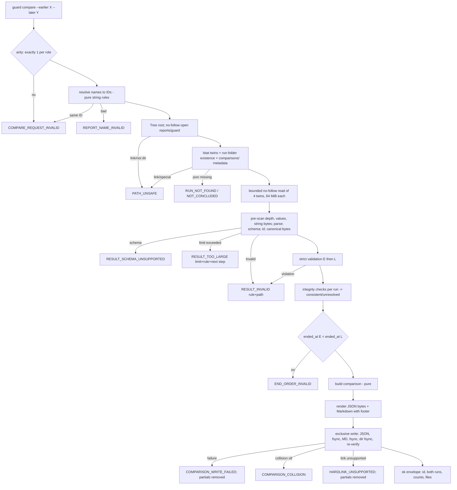

# Technical Design: Cross-run Report Comparison

> Feature ID: FEATURE-002-G | Epic: EPIC-002 | Version: v1.3 | Last Updated: 10-23-2026
> Task: TASK-075 (Technical Design), lifecycle owner Sage, interaction mode `dao-represent-human-to-interact` (no human waited for; open choices listed as DEC-n)
> Authoritative specification: [specification.md](x-ipe-docs/requirements/EPIC-002/FEATURE-002-G/specification.md) v1.2.4, SHA-256 `476d41566857866c4cfabcb99138813521d3d1884f1b9722e3a9ffb4655ceb6f` (76 AC rows). Earlier bindings: design v1.0 → spec v1.2.1 (`e140350e…`), v1.1 → v1.2.2 (`92fdc5f2…`), v1.2 → v1.2.3 (`39f1abec…`); the v1.2.4 delta (AC-002G-07g, FR-002G-9, NFR-002G-5, two Honest Limits, status line) is applied below
> Binding rulings: DAO-010, DAO-011, DAO-012 in [decisions_made_feature_refinement.md](x-ipe-docs/dao/26-10-23/decisions_made_feature_refinement.md) (frozen clock mandatory, test-side patching only, no clock hook in delivered code) and DAO-010 / DAO-011 in [decisions_made_technical_design.md](x-ipe-docs/dao/26-10-23/decisions_made_technical_design.md) (DEC-01/03/04/05/06 A, DEC-02 B without fall-back, stricter merge back-reference rule approved, DEC-07 A applied as spec v1.2.3, bounded input limits accepted with conditions).
> Independent design review of v1.0 (FAIL, findings 1–7) applied in v1.1; re-review of v1.1 / spec v1.2.2 PASS-WITH-NITS, nits applied in v1.2 / spec v1.2.3; delta re-review of v1.2 / v1.2.3 FAIL (one blocker, two majors) applied in v1.3 / spec v1.2.4 by Sage (lifecycle owner), continuing DAO-011 (1)/(4) — the DAO representative confirms at design confirmation. The v1.3 / v1.2.4 delta still needs independent re-review.

## Version History

| Version | Date | Description |
| --- | --- | --- |
| v1.0 | 10-23-2026 | Initial two-part design from spec v1.2.1 (e140350e…) under DAO-010/011/012; worker under lifecycle owner Sage (TASK-075). Design only; no product code, board, Git, memory or skill-package writes |
| v1.3 | 10-23-2026 | Rebound to spec v1.2.4; applied the v1.2 delta re-review (FAIL): blocker — path-based removal of a moved-away `comparisons/` removed (files/temps only through the held handle; folder only while still the same entry under `reports/guard/`; empty command-created folder may remain where moved, all platforms); major 1 — "one maximal Adapter run" renamed "supported large-run envelope", figures stated as design capacity targets not enforced by delivered writers; major 2 — value limit back to 2 000 000, streaming pre-scan enforces depth, value count and decoded string length before `json.loads`, no binds-first claim beyond measured shapes, peak-RSS measurement with a stated minimum-memory expectation and limit-lowering rule. Same worker, TASK-075 round 4 |
| v1.2 | 10-23-2026 | Rebound to spec v1.2.3; applied DAO-011 (technical design) and re-review nits: DEC-07 A adopted in the spec (07g/FR-002G-9 final-effect wording, residual-race Honest Limit); bounded input limits justified numerically (one maximal Adapter run, ordinary records, measured test flows), value limit 4 000 000, `RESULT_TOO_LARGE` refusal naming limit/rule/next step without declaring the run invalid, just-below/just-above limit tests; removal of a command-created `comparisons/` folder moved out by another process; stricter merge rule and DEC-02 B recorded as approved. Same worker, TASK-075 round 3 |
| v1.1 | 10-23-2026 | Rebound to spec v1.2.2; applied DAO-010 (technical design): DEC-02 B (merge chains resolved to the final survivor, re-merge disagreement noted), DEC-03/06 clarifications; applied independent review findings 1–7: durable write order with per-link identity checks and crash points, per-candidate ID artefacts, global vs per-candidate comparability, consumed-leaf contract + derived tests, attacker model and DEC-07, bounded input policy, hard-link prerequisite. Same worker, TASK-075 round 2 |

---

## Part 1: Agent-Facing Summary

> **Purpose:** Quick reference for AI agents navigating large projects.
> **📌 AI Coders:** Focus on this section for implementation context.

### Scope & Boundaries

- **In scope:** one new read-only-on-inputs command `secure-code guard compare --earlier <name> --later <name>` that compares exactly two concluded Guard results of one project; strict validation of every consumed `guard-result/v1` field; three integrity checks per run (canonical serialization, footer, full Markdown vs canonical rendering); deterministic identity, pairing, comparability and four-class classification; one structured comparison (`ai-secure-code-toolkit/guard-comparison/v1`) and its Markdown twin written exclusively into `x-ipe-docs/secure-code/reports/guard/comparisons/`; one appended, self-contained "Comparing two reports" section in the Guard `SKILL.md`.
- **Plug-in points only (DAO-010, DAO-011 (d)):** (1) `cli.py` — one new `guard` sub-parser `compare` and one dispatch branch in `_guard`; (2) new modules `guard/compare*.py`; (3) one section appended at the end of the Guard `SKILL.md`.
- **Stop rule (BR-16):** no byte of delivered 002-A…D code, tests, schemas, reports, folders or existing skill text changes. Delivered modules are imported read-only (`model`, `runs.run_rel`/`sha256_hex`, `report.render`/`footer_digest`/`md_text`, `mask.mask_text`, `targets.owning_target`/`path_role`, `atomic.dumps_json`, `knowledge/durable.py` primitives, `adapters.provided`/`reserved_name`, `paths.validate_root`, `results.Result`). If implementation finds any other change necessary → stop, human CR.
- **Read boundary (BR-02, AC-002G-01a):** content reads only of `<E>.json`, `<E>.md`, `<L>.json`, `<L>.md`; metadata only for the path components from the project root to `reports/guard/`, the four twins, each run folder's existence and `comparisons/`. No target, run-folder content, other report, knowledge, Policy, tool, network or model access. `projects.knowledge_root` is not used (it stats knowledge/private folders outside the boundary); the root is validated with `paths.validate_root`.
- **Out of scope:** more than two reports, trends/scores, Copilot reports, viewer/`show` for comparisons, deletion of comparisons, any change to Guard results (e.g. renderer version — optional human CR candidate, DAO-011 (c)).

### Outcome / Goal Frame

| Goal | Source | Contribution of this design (means) | Planned evidence | Outcome state |
| --- | --- | --- | --- | --- |
| G-02 — change between two runs understood without a false "fixed" claim | EPIC-002 G-02; FR-23 (R-11, R-12); spec §Goal | All-required children: read boundary (01) → strict validation + integrity (05) → identity/pairing (02) → comparability first (04) → four classes without "fixed" (03) → safe masked output (06) → path/write safety (07) | 76 AC-mapped tests (§Coverage) | not measured |
| G-01 (enabling) — no business artifact written, compared runs untouched | EPIC-001 FR-01 | Writes only new files in `comparisons/`; no-follow reads; exclusive no-follow writes; byte-identity checks | 01d, 06a, 07e…07g | not measured |

Planned delivery checks are not observed stakeholder outcome; "not measured" stays until a sourced observation exists.

### Key Design Decisions (summary)

1. **Pure core, thin shell.** All comparison logic is a pure function of two validated result dicts plus integrity facts (`compare_match.build`), so 02/03/04/06 ACs are unit-tested without a filesystem; only `compare.py` (orchestration) and `compare_io.py` (no-follow reads, exclusive writes) touch disk.
2. **Validate before trust.** Order: name resolution → metadata path checks → bounded no-follow read (≤ 64 MiB) → nesting pre-scan (depth ≤ 64) → JSON parse (duplicate keys / NaN refused) → value/string bounds walk → schema → ID/file-name → guarded canonical serialization → strict validation (`compare_validate`) of both → integrity checks → end-order → compare → write. Every refusal precedes the write stage, so "nothing is written" holds by construction.
3. **Canonical renderer reuse is safe.** `guard/report.render` imports only `hashlib`, `re`, `atomic.dumps_json`; it reads no clock, environment, file or randomness and does not mutate its argument (verified at `report.py` ce3cc4e5…). Delivered `conclude`/`_repair_report` render from the result re-read from disk (`runs.read_result`), so `render(json.loads(file))` equals the delivered Markdown. The integrity check renders a canonical deep copy `json.loads(dumps_json(parsed))` inside `try/except` (a strictly valid result may still lack an unconsumed section the renderer needs → that check fails as "unresolved", never a crash). No DEC needed.
4. **Identity from recorded facts only (BR-05…BR-08)**; pairing by unique valid fingerprint → unique equal line → documented position order, every non-exact choice labelled.
5. **Comparability gates only unpaired findings (DAO-010 OQ-03)**; pairs stay "still present" with every Policy/tool/tool-data difference as a counted note.
6. **Exclusive writer (DAO-011 (d), DEC-03 A):** reuses `durable.Tree`, `durable.entry`, `durable.rmdir_empty`, `durable.close` read-only; repeats the private no-follow/exclusive flags locally (spec Technical Considerations permits this). Each final name is published by `link()` from an `O_EXCL|O_NOFOLLOW` temp that is unlinked right after the link (precedent: `runs.create_result_exclusive`; same hard-link filesystem requirement as `guard conclude`, Windows limit stated), so a final name never holds partial bytes and is never overwritten or followed. Commit order (review finding 1): JSON temp → fsync → identity check → link → unlink temp → **fsync `comparisons/`** → re-read JSON → Markdown temp (footer = SHA-256 of the JSON) → fsync → identity check → link → unlink temp → fsync `comparisons/` → identity + pair re-verification → success. All ID-dependent bytes are rebuilt per candidate ID (review finding 2).
7. **Frozen-clock regression oracle (FR-002G-10, DAO-012):** test-side `monkeypatch` of every module-level binding of `model.utc_now` and `datetime` inside `x_ipe_secure_code.*` (as `tests/guard/test_guard_budget.py` already patches `model.utc_now`); feasibility checked (§07h design). No hook in delivered code.
8. **Bounded inputs (NFR-002G-5 v1.2.4, review finding 6, DAO-011 (4)):** 64 MiB per file, depth 64, 2 000 000 values, 1 MiB decoded per string; depth, value count and string length are enforced by a streaming pre-scan of the raw bytes **before** `json.loads`; an exceeded limit is refused as `RESULT_TOO_LARGE` (limit, rule, next step; the run is not declared invalid); other parse/canonicalization failures are stable `RESULT_INVALID` rules; no value is echoed; peak memory is measured at the limits.
9. **Merges as the writer produces them (DEC-02 B):** acyclic chains resolve to the final survivor via `merged_into` (authoritative last write); re-merge disagreements become notes; unknown targets, self-merges, cycles and a `merged_into` without back-reference are refused. Classes are computed on survivors only, so resolution cannot change a class (no fallback to A needed).
10. **Comparability = global conditions ∧ ∃ complete candidate (review finding 3):** an unpaired finding is comparable iff global conditions 1–5 (scope, stability, deletion, Policy, N/A/exclusion) hold and at least one covering-check (× Adapter-run) candidate passes completely; a succeeding candidate suppresses the other candidates' failures, otherwise every failure is listed.

### Key Components Implemented

| Component | Path (FW = `ai-secure-code-toolkit/x-ipe-secure-code-toolkit-framework/scripts`) | Responsibility | Tags |
| --- | --- | --- | --- |
| Compare command | `FW/src/x_ipe_secure_code/guard/compare.py` (new, ≈280 lines) | Argument arity, name → ID resolution, orchestration order, integrity checks, end order, refusal mapping, result envelope | cli, orchestration, refusal |
| Compare I/O | `FW/src/x_ipe_secure_code/guard/compare_io.py` (new, ≈400) | No-follow metadata/content reads via `durable.Tree`; run-folder existence; exclusive commit protocol; test fail-point seam | io, path-safety, durability |
| Strict validator | `FW/src/x_ipe_secure_code/guard/compare_validate.py` (new, ≈650) | FR-002G-2a contract over every consumed v1 field; refusal = rule id + JSON path, never a value | validation, security |
| Input bounds | `FW/src/x_ipe_secure_code/guard/compare_bounds.py` (new, ≈180) | NFR-002G-5 limits: streaming pre-scan (depth, value count, decoded string length) before `json.loads`, encodability check, `RESULT_TOO_LARGE` data | validation, security, resource-bound |
| Matching & classification | `FW/src/x_ipe_secure_code/guard/compare_match.py` (new, ≈380) | Normalisation (merges, declared renames), identity keys, pairing, classes, attribute changes, annotations, entries, counts, document assembly | algorithm, pure |
| Comparability | `FW/src/x_ipe_secure_code/guard/compare_cover.py` (new, ≈420) | BR-09 conditions per unpaired finding, pair difference notes, run-level comparability summary | algorithm, pure |
| Rendering | `FW/src/x_ipe_secure_code/guard/compare_render.py` (new, ≈340) | Fixed statements, masking helper, Markdown layout, comparison footer | output, masking |
| CLI plug-in | `FW/src/x_ipe_secure_code/cli.py` (+≈9 lines, additive) | `g_commands.add_parser("compare")` with `--earlier/--later` (`action="append"`), `--project`, `--json`; `_guard` branch | cli |
| Guard skill section | `ai-secure-code-toolkit/x-ipe-secure-code-toolkit-guard/SKILL.md` (+≈24 lines appended at EOF) | Agent rules for comparing two reports | skill-text |
| Tests | `FW/tests/guard/comparehelp.py`, `test_compare_validate.py`, `test_compare_match.py`, `test_compare_cover.py`, `test_compare_render.py`, `test_compare_cli.py`, `test_compare_files.py`, `test_compare_regression.py`, `test_compare_skill.py` (new) | Every AC (§Coverage) | test |

All new modules stay below the 800-line limit enforced by `FW/tests/test_module_size.py` (c072a78a…, unchanged); targets ≤ 650 lines each.

### Dependencies (read-only reuse; no modification)

| Dependency | Used for | Source (SHA-256 prefix at design time) |
| --- | --- | --- |
| `guard/model.py` | `SCHEMA_RESULT`, `REPORTS_REL`, `GUARD_REL`, `RUN_ID`, `ITEM_ID`, `NAME`, `DIGEST`, `KINDS`, `STATES`, `SEVERITY_VALUES`, `FINDING_RESULTS`, `CHANGES`, `MAX_TEXT`, `GuardError`, `utc_now` (via attribute access, patchable), `parse_time` | 7ff88d5b91ec40f2 |
| `guard/runs.py` | `run_rel`, `sha256_hex` (pure) — not `read_result`/`report_text` (path-based reads; replaced by no-follow reads) | 3ce5967b0bc484cb |
| `guard/report.py` | `render` (canonical renderer), `footer_digest`, `md_text` (Markdown neutralisation) | ce3cc4e54b92b73d |
| `guard/mask.py` | `mask_text` (FEATURE-001-B patterns + Guard additions) | 08777ec712ae663e |
| `guard/targets.py` | `owning_target`, `path_role` (pure functions over a result's `artifact`) | 4fbcc3ce56c97c33 |
| `guard/engine.py`, `records.py`, `toolrun.py`, `adapters/trivy_record.py`, `adapters/trivy.py`, `adapters/opengrep.py` | Grounding of the v1 field set and value sets the validator enforces (not imported except constants) | c7d10002…, 9e976aa0…, 06d1fdd1…, 86023a92…, b06073d8…, e1395e95… |
| `adapters/__init__.py` | `provided()`, `reserved_name()` (Adapter vs non-Adapter methods/sources) | — |
| `knowledge/durable.py` | `Tree`, `entry`, `rmdir_empty`, `close`, `NOFOLLOW`, `DIRECTORY`, `NONBLOCK`, `POSIX_FD` (`read` is not used: no size cap; its sequence is repeated with a cap) | 6468cdfca71645f2 |
| `atomic.py` | `dumps_json` (canonical serializer) | 99f6a11c6e8d4d1d |
| `paths.py`, `results.py` | `validate_root`; `Result` envelope | c9fd0262…, cbfe77d1… |
| `cli.py` | plug-in point (1) | a1e8d924f70e7ab7 |
| Guard `SKILL.md` | plug-in point (3), 12 017 bytes | cdbfc5bc9c312604 |

### Major Flow



### Usage Example

```bash
FW=.github/skills/x-ipe-secure-code-toolkit-framework
# by verification ID
uvx --from $FW/scripts secure-code guard compare --project . \
    --earlier gv-20261020T101500Z-1a2b3c4d --later gv-20261023T091200Z-9f8e7d6c --json
# by exact report file (project-root-relative; .json or .md twin)
uvx --from $FW/scripts secure-code guard compare --project . \
    --earlier ./x-ipe-docs/secure-code/reports/guard/gv-20261020T101500Z-1a2b3c4d.md \
    --later x-ipe-docs/secure-code/reports/guard/gv-20261023T091200Z-9f8e7d6c.json --json
# -> data.comparison_id = "gc-20261023T120501Z-5e6f7a8b", data.counts = {new: 1, still_present: 3,
#    not_observed_this_time: 0, not_comparable: 2, total: 6, still_present_with_differences: 1},
#    data.files = {structured: ".../comparisons/gc-….json", markdown: ".../comparisons/gc-….md"}
```

### Tool Capability Summary

- Actual type/stack: `cli` / Python 3 stdlib + pytest, inside the existing package `FW` (`pyproject.toml`), no new dependency.
- `x-ipe-docs/config/tools.json` (6df39210…) → `stages.implement.technical_design`: all six `x-ipe-tool-implementation-*` enabled; `_extra_instruction`: "Consultation mode: read tool capabilities for informational use only. Do not invoke tools for code execution."
- Matched and consulted (informational only): `x-ipe-tool-implementation-python` (061a3c64…) — Python CLI/library; built-in practices PEP 8, type hints on all signatures, Google-style docstrings on public functions, pytest tests mapped to AAA scenarios. Applied as conventions in Part 2.
- Excluded (stack mismatch): html5, typescript, java, mcp; general fallback not needed. No tool was executed.

---

## Part 2: Implementation Guide

> **Purpose:** Human-readable details for developers.
> **📌 Emphasis on visual diagrams for comprehension.**

### Files and Layout

```text
FW/src/x_ipe_secure_code/
  cli.py                      # +compare sub-parser and _guard branch (additive lines only)
  guard/compare.py            # compare(project, earlier, later) -> Result
  guard/compare_io.py         # Inputs, read_bounded() (no-follow), run-folder metadata, write_pair() W0-W10, _fail_point()
  guard/compare_validate.py   # validate(doc, file_id) -> None | raises Invalid(rule, path)
  guard/compare_bounds.py     # prescan(raw), check_encodable(doc) -> raises TooLarge / Invalid
  guard/compare_match.py      # build(earlier, later, facts) -> comparison dict (pure)
  guard/compare_cover.py      # Run view, assess(), pair_notes(), summary() (pure)
  guard/compare_render.py     # STATEMENTS, masked(), markdown(comparison, sha) (pure)
FW/tests/guard/
  comparehelp.py              # result builders, writers, AccessRecorder, manifest(), freeze_clock()
  test_compare_validate.py  test_compare_match.py  test_compare_cover.py  test_compare_render.py
  test_compare_cli.py  test_compare_files.py  test_compare_regression.py  test_compare_skill.py
ai-secure-code-toolkit/x-ipe-secure-code-toolkit-guard/SKILL.md   # + "## Comparing two reports" at EOF
Project (written only by compare, only on success):
  x-ipe-docs/secure-code/reports/guard/comparisons/<comparison-id>.json
  x-ipe-docs/secure-code/reports/guard/comparisons/<comparison-id>.md
```

Import direction: `compare` → `compare_io`, `compare_validate`, `compare_match`, `compare_render`; `compare_match` → `compare_cover`; all → delivered modules read-only. No delivered module imports the new ones; `cli._guard` imports `guard.compare` lazily (as it does for `toolrun`, `egress`, `cancel`).

### CLI Contract

```python
# cli.py, after g_cleanup (new lines only; existing lines untouched)
g_compare = g_commands.add_parser("compare", help="Compare two concluded Guard reports (read-only on both runs)")
g_compare.add_argument("--earlier", action="append", metavar="ID_OR_REPORT")
g_compare.add_argument("--later", action="append", metavar="ID_OR_REPORT")
g_compare.add_argument("--project")
g_compare.add_argument("--json", action="store_true")
# in _guard(), before the final dict dispatch
if cmd == "compare":
    from .guard.compare import compare
    return compare(args.project, args.earlier, args.later)
```

`action="append"` (not `required=True`) makes "one report", "three reports" and "two earlier" reach the command and return the toolkit envelope with a reason and next step (AC-002G-01b) instead of an argparse usage exit.

```python
def compare(project: str | None, earlier: Sequence[str] | str | None, later: Sequence[str] | str | None) -> Result:
    """Compare two concluded Guard results of one project (FEATURE-002-G).

    Args:
        project: Explicit project root (`--project`).
        earlier: The earlier report: verification ID or exact `<id>.json|.md` path (one value).
        later: The later report, same forms.

    Returns:
        Result `guard compare`; refusals write nothing; success writes exactly one comparison pair.
    """
```

**Success envelope** (`ok: true`; `data` keys are asserted by value, never by order):

```json
{
  "comparison_id": "gc-20261023T120501Z-5e6f7a8b",
  "earlier": {"verification_id": "gv-…", "ended_at": "…Z", "input_integrity": "consistent"},
  "later":   {"verification_id": "gv-…", "ended_at": "…Z", "input_integrity": "unresolved"},
  "counts": {"new": 1, "still_present": 3, "not_observed_this_time": 0, "not_comparable": 2,
             "total": 6, "still_present_with_differences": 1},
  "files": {"structured": "x-ipe-docs/secure-code/reports/guard/comparisons/gc-….json",
            "markdown":   "x-ipe-docs/secure-code/reports/guard/comparisons/gc-….md"},
  "collisions": [],
  "statements": ["<not-observed statement>", "<not-evidence statement>"]
}
```

`next_steps`: `["Read <markdown path>; report any input-integrity statement first", "\"Not observed this time\" does not mean fixed; do not report a trend or score"]`.

**Refusals** (`ok: false`, one problem, one next step; `data` never contains a value from inside a result):

| Code | When (order of evaluation) | `data` | Next step | ACs |
| --- | --- | --- | --- | --- |
| `ROOT_REQUIRED` / `ROOT_INVALID` | `paths.validate_root` fails | — | "Pass an existing project with --project" | — |
| `COMPARE_REQUEST_INVALID` | not exactly one `--earlier` and one `--later`; both resolve to the same ID | `{"earlier": [..names..], "later": [..]}` masked | "Name exactly two different reports: --earlier <id> --later <id>" | 01b |
| `REPORT_NAME_INVALID` | name is neither a `RUN_ID` nor a path normalising to exactly `x-ipe-docs/secure-code/reports/guard/<id>.json|.md` (absolute, `..`, subfolder incl. `comparisons/`, other suffix, case, trailing `/`, NUL) | `{"role": "earlier"}` | "Name a verification ID (gv-…) or <id>.json/.md directly in x-ipe-docs/secure-code/reports/guard/" | 01c, 07a, 07b |
| `PATH_UNSAFE` | a component root→`reports/guard/` is a link / not a folder; a twin is a link or not a regular file; `comparisons/` (or a parent) is a link or not a folder | `{"path": "<project-relative fixed path>"}` | "Replace the symbolic link or special entry with a real folder or file" | 07c, 07d, 07e |
| `RUN_NOT_FOUND` | `reports/guard/` absent, or `<id>.json` absent and no run folder | `{"role", "verification_id"}` | "Name a concluded verification of this project" | 01c, 07d |
| `NOT_CONCLUDED` | `<id>.json` absent but the run folder exists | `{"role", "verification_id"}` | "Conclude it first: secure-code guard conclude --run <id>" | 01c |
| `RESULT_SCHEMA_UNSUPPORTED` | `schema` ≠ `ai-secure-code-toolkit/guard-result/v1` | `{"role", "found": <masked ≤120 printable chars or "<not text>">, "supported": ["…/guard-result/v1"]}` | "Name a report written by a supported toolkit version" | 05a |
| `RESULT_TOO_LARGE` | an NFR-002G-5 limit is exceeded (`bound.bytes`, `bound.depth`, `bound.values`, `bound.string`, `bound.memory`) | `{"role", "verification_id", "limit", "limit_value", "rule", "json_path"}` | "Name other reports to compare; these limits are fixed (NFR-002G-5)" — message says the comparison is not possible and the run is not declared invalid | NFR-002G-5 (limit tests) |
| `RESULT_INVALID` | not UTF-8 JSON, duplicate key, NaN/Infinity, encoding failure, not an object, `verification_id` ≠ file ID, canonical serialization failure, or any strict-validation rule | `{"role", "verification_id", "rule", "json_path"}` (+ `end_times` when the rule is on `$.ended_at`) | "Name another report, or restore this result from the toolkit's own output" (`$.ended_at`: "Name other reports; the end time of <role> is not readable") | 05b, 05k, 05m…05s, 01g (unknown) |
| `END_ORDER_INVALID` | `ended_at(L) ≤ ended_at(E)` | `{"earlier": {"verification_id", "ended_at"}, "later": {…}}` | reversed: "Swap --earlier and --later"; equal: "Name other reports; equal end times cannot be ordered" | 01g |
| `COMPARISON_COLLISION` | 8 allocated IDs all collided | `{"collisions": [names]}` | "Retry; existing entries in comparisons/ were not touched" | 07f |
| `HARDLINK_UNSUPPORTED` | `link()` fails with `EPERM`, `ENOTSUP`/`EOPNOTSUPP`, `ENOSYS` (or Windows `ERROR_INVALID_FUNCTION`/`NotImplementedError`); temps removed, `comparisons/` removed if this command created it | `{"step": "json_link" or "markdown_link"}` | "Use a project folder on a filesystem that supports hard links (the same requirement as secure-code guard conclude)" | 07j |
| `COMPARISON_WRITE_FAILED` | other `OSError`, identity mismatch or read-back mismatch in the write stage (everything this command created is removed) | `{"step": "<write step>"}` | "Check permissions and free space of reports/guard/comparisons/, then retry" | 07g, 07j |
| `IO_ERROR` | unexpected `OSError` before the write stage | — | "Check the permissions of x-ipe-docs/secure-code/reports/guard" | — |

Exceptions are mapped in one wrapper inside `compare.py` (`GuardError`, `durable.StoreError`, `Invalid`, `OSError`); it does not reuse `service._call` because that calls `knowledge_root` (outside the read boundary). Messages are fixed text plus IDs/rule names/JSON paths; `mask_text` is applied to anything echoed from user input (names).

**01g note.** A strictly valid result always has a readable `ended_at`; an unreadable one fails strict validation (05q). The refusal therefore is `RESULT_INVALID` (rule `format.timestamp`, path `$.ended_at`) and also carries `end_times: {"earlier": "…Z", "later": "unknown"}` with the "name other reports" next step — satisfying both AC-002G-01g and 05b/05q. Validation of both runs completes before the order check, so reversed/equal times are judged on valid timestamps only.

### Name Resolution (pure, before any filesystem access) — AC-002G-01b, 01c, 07a, 07b

```python
REPORT_FILE = re.compile(r"(gv-\d{8}T\d{6}Z-[0-9a-f]{8})\.(json|md)")   # RUN_ID + exact suffix, case-sensitive
REPORT_PARTS = ("x-ipe-docs", "secure-code", "reports", "guard")       # == REPORTS_REL.split("/")

def resolve_name(raw: str) -> str:
    if not isinstance(raw, str) or not raw or "\x00" in raw: refuse REPORT_NAME_INVALID
    if RUN_ID.fullmatch(raw): return raw
    text = raw.replace("\\", "/")            # Windows separators; no real report name contains "\"
    if text.startswith("/") or re.match(r"[A-Za-z]:", text) or text.endswith("/"): refuse
    parts = [p for p in text.split("/") if p not in ("", ".")]   # "./" prefix and "a//b" normalise
    if ".." in parts or tuple(parts[:-1]) != REPORT_PARTS or len(parts) != 5: refuse
    m = REPORT_FILE.fullmatch(parts[-1]);  if not m: refuse
    return m.group(1)
```

Paths are relative to the `--project` root (never the current directory); the skill section says so. Same-ID detection happens after both names resolve, so `<id>.json` vs `<id>.md` of one ID is refused (01b).

### Path Safety and Input Reading (`compare_io.Inputs`) — AC-002G-01a, 01c, 01d, 07a…07e

POSIX (`durable.POSIX_FD`): one `durable.Tree(root)` per command; every later access is relative to its handles.

1. `reports_fd = tree.dir(REPORTS_REL)` — each component opened `O_RDONLY|O_DIRECTORY|O_NOFOLLOW` relative to the previous handle; a link or non-folder raises `StoreError(PATH_UNSAFE)` (07c); `FileNotFoundError` → `RUN_NOT_FOUND` ("no Guard reports in this project").
2. For each role: `durable.entry(reports_fd, f"{id}.json")` (lstat via `dir_fd`, never follows). `None` → step 3; not `S_ISREG` (link, folder, FIFO…) → `PATH_UNSAFE` (07d). Same for `.md`: `None` is allowed (integrity "markdown_missing", 05c); not regular → `PATH_UNSAFE`.
3. Run-folder existence (metadata only, 01a/05d): `gfd = tree.opt_dir(GUARD_REL)` → `durable.entry(gfd, id)`; `S_ISDIR` → `available`; `None` → `not available`; link/other or `StoreError` on a component → `unknown` (never followed, never refused for availability). Used both for `NOT_CONCLUDED` vs `RUN_NOT_FOUND` and for evidence availability.
4. `comparisons/` pre-check (07e): `durable.entry(reports_fd, "comparisons")`: `None` → will be created on success; `S_ISDIR` → ok; anything else (link, file) → `PATH_UNSAFE` before reading content.
5. Only after steps 1–4 passed for both roles: `compare_io.read_bounded(reports_fd, name, MAX_INPUT_BYTES)` for the two `.json` and existing `.md`. It repeats `durable.read`'s sequence (lstat regular → `O_RDONLY|O_NOFOLLOW|O_NONBLOCK` open relative to `reports_fd` → `fstat` identity check, "changed while opening" → `PATH_UNSAFE`) and adds the cap: `st_size` above the bound → not read; reading stops at bound + 1 bytes (a file growing during the read is caught). `durable.read` itself is not used because it has no cap.
6. The handle `reports_fd` is kept for the write stage; all handles are closed in `finally`.

No directory is listed (`scandir`/`listdir` never called on project folders); no other project file is opened. Windows: `Tree`/`entry`/`read` use the delivered path fallback with `lstat` checks (no `O_NOFOLLOW`, no directory fsync) — the race guarantees are weaker there, stated as a limit (NFR-002G-4, as FEATURE-001-D).

### Bounded Input Policy and Parsing (`compare.py`, `compare_bounds.py`) — NFR-002G-5 v1.2.4; AC-002G-05b, 05c (review finding 6, DAO-011 (4), delta re-review majors 1–2)

```python
MAX_INPUT_BYTES = 64 * 1024 * 1024     # 67 108 864 bytes, per structured result and per Markdown report
MAX_DEPTH = 64                         # nesting of objects and arrays; the top-level object is depth 1
MAX_VALUES = 2_000_000                 # JSON values per result: every object, array and scalar, incl. the top level;
                                       # object keys are not values (they are strings checked by MAX_STRING_BYTES)
MAX_STRING_BYTES = 1024 * 1024         # 1 048 576 decoded UTF-8 bytes per string value or key (= model.MAX_CONTENT)
```

**Coverage statement (NFR-002G-5 v1.2.4):** the bounds cover a **supported large-run envelope** plus ordinary records and all measured delivered test flows. The envelope's figures are **design capacity targets, not constraints enforced by the delivered Adapter writers**: Opengrep and Trivy record every finding of a run (their stdout caps of 16 MiB / 64 MiB bound raw tool output, not the finding count), so a larger valid result — several large runs, or one run with more findings than the envelope — can exceed the limits and is refused honestly with `RESULT_TOO_LARGE`. Sizes below are of the canonical `dumps_json` form (indent 2); per-item sizes are design estimates from the delivered record shapes, replaced by measured values in implementation step 2.

| Term / limit | Numeric justification |
| --- | --- |
| **Supported large-run envelope** (design capacity target) | One Opengrep or Trivy run at the delivered path caps — `toolrun.MAX_STAGE_FILES` = `trivy_log.MAX_PATHS` = 50 000 accounted paths — with up to 13 000 findings of typical size or 4 000 of maximal size. Accounting ≈ 50 000 × ~120 B ≈ 6 MiB and ≈ 300 000 values. A stored finding ≈ 1.3 KiB of fixed keys/ids plus title (≤ 500 chars, Trivy) and description (≤ 8 KiB, `MAX_TEXT`): ≈ 3 KiB typical, ≤ ~10 KiB maximal, ≈ 45 values. 13 000 × 3 KiB ≈ 38 MiB / ≈ 585 000 values; 4 000 × 10 KiB ≈ 39 MiB / ≈ 180 000 values |
| **Ordinary records** | Agent records, reviews, conflicts and control data up to 16 MiB: four maximal record requests (`MAX_REQUEST_BYTES` 4 MiB each; stored text is masked and never larger than the request) or hundreds of typical records (< 50 KiB each); at ~20 B per value ≤ ≈ 800 000 values |
| Fixed sections | Scope, plan, ledger, limits, budget, egress, retention: ≤ 2 MiB and ≤ ≈ 100 000 values for plans within `MAX_ITEMS` per list |
| **64 MiB bytes** | Envelope 6 + 39 MiB, ordinary records 16 MiB, fixed 2 MiB ≈ 63 MiB ≤ 64 MiB. The Markdown report renders the same data without the accounting lists, so for delivered shapes it is not larger than the result; same limit |
| **2 000 000 values** | Envelope ≈ 300 000 + 585 000, ordinary records ≤ 800 000, fixed ≤ 100 000 ≈ 1.8 M ≤ 2 M. 64 MiB / 2 000 000 ≈ 33.6 B per value, while the estimated delivered shapes take ≈ 20–29 B per value, so for some valid results the value limit can bind before the byte limit. **No claim is made which limit binds first** except for the delivered shapes measured in implementation step 2 (bytes per value recorded per result) |
| **Depth 64** | The deepest delivered path is ≈ 8 levels (`$` → `adapter_runs` → run → `checks` → check → `accounting` → entry → list → item); 64 is an 8× margin and keeps Python's recursive `json.loads`/`dumps_json` far from the interpreter recursion limit (1 000) |
| **1 MiB per string** | Equals `model.MAX_CONTENT`. Delivered result strings are ≤ 64 KiB (`trivy_log.MAX_LINE`); texts ≤ 8 KiB characters (`MAX_TEXT`, ≤ 32 KiB UTF-8); Opengrep messages ≤ 8 000 characters; paths ≤ OS path length — ≥ 16× margin over the largest delivered string |
| **Measured delivered test flows** | Implementation step 2 measures bytes, values, bytes per value, depth and longest string of every result produced by the delivered test suites (Guard, Opengrep, Trivy, cancel, budget flows) and records them as evidence; every one must be within the limits, otherwise stop and report (no silent raise) |
| **Memory (stated expectation)** | Two inputs at the limits are read whole (2 × 64 MiB raw) and parsed (≈ 10–20× the JSON size per result is the design estimate). **Minimum-memory expectation:** the command needs a host with at least 4 GiB of available memory, and its peak resident set size when comparing two just-below-limit inputs must not exceed 3 GiB. The just-below-limit tests measure the peak (below); a measured peak above 3 GiB makes the limits unsuitable → stop and report, and the limits are lowered (e.g. 32 MiB / 1 000 000 values) in a spec revision before implementation completes |

**Streaming pre-scan (`compare_bounds.prescan(raw) -> None`, before any decode or `json.loads`):** one iterative pass over the raw bytes with a container stack of at most `MAX_DEPTH + 1` frames and O(1) other state:
- `{` / `[` → one value, push frame; depth > 64 → `bound.depth`; `}` / `]` → pop; `:` marks the next token of an object frame as its value; `,` in an object frame makes the next string a key.
- A string token → walk to the closing quote computing its **decoded UTF-8 length**: plain bytes count 1 each; `\" \\ \/ \b \f \n \r \t` count 1; `\uXXXX` counts the code point's UTF-8 length, a high+low surrogate pair counts 4 in total, a lone surrogate counts 3 (later refused as `json.encoding`); decoded length > 1 048 576 → `bound.string` (keys included). A non-key string counts one value.
- A number or `true`/`false`/`null` token → one value (token skipped by its character class).
- Value count > 2 000 000 → `bound.values`, checked on every increment, so the scan stops at the first excess.
- The scan never raises for malformed JSON: it only enforces the limits; syntax errors are reported afterwards by `json.loads` (`json.syntax`). For malformed text the limit refusal may therefore win — deterministic either way.
- Refusal `data.json_path` is `$` and `data.byte_offset` gives the offset where the limit was exceeded (an offset is not a value; no content is echoed).

**Refusal for an exceeded limit (DAO-011 (4)):** code `RESULT_TOO_LARGE` (not `RESULT_INVALID`), before any pairing or writing, nothing written. `data = {"role", "verification_id", "limit": "max_input_bytes" | "max_depth" | "max_values" | "max_string_bytes" | "memory", "limit_value": 67108864 | 64 | 2000000 | 1048576 | null, "rule": "bound.bytes" | "bound.depth" | "bound.values" | "bound.string" | "bound.memory", "json_path": "$", "byte_offset": <int> | null}`. Message: "Comparison not possible: the structured result of <role> (<id>) exceeds the comparison limit <limit> (<limit_value>). The verification and its result are not affected and are not declared invalid." Next step: "Name other reports to compare; these limits are fixed (NFR-002G-5)".

```python
def load_result(raw_or_oversize, role, file_id) -> Loaded:
    if raw is OVERSIZE:                    # st_size or read length > MAX_INPUT_BYTES (read stops at bound + 1)
        too_large("max_input_bytes", "bound.bytes")
    prescan(raw)                           # depth, values, decoded string length -> too_large(...) before parsing
    try:
        doc = json.loads(raw.decode("utf-8"), object_pairs_hook=no_duplicates,   # RESULT_INVALID "json.duplicate_key"
                         parse_constant=refuse_constant)                         # RESULT_INVALID "json.constant"
    except UnicodeError | ValueError:  invalid("json.syntax", "$")
    except RecursionError:             too_large("max_depth", "bound.depth")      # defensive; pre-scan bounds depth
    except MemoryError:                too_large("memory", "bound.memory")
    if not isinstance(doc, dict):      invalid("json.object", "$")
    check_encodable(doc)                   # iterative; string/key not UTF-8-encodable (lone surrogate) -> invalid("json.encoding", path)
    if doc.get("schema") != SCHEMA_RESULT: RESULT_SCHEMA_UNSUPPORTED
    if doc.get("verification_id") != file_id: invalid("id.file_name", "$.verification_id")
    try:
        canonical = dumps_json(doc)        # computed once; reused by integrity (i) and the render copy
        render_copy = json.loads(canonical)
    except (RecursionError, MemoryError):              too_large("memory", "bound.memory")
    except (ValueError, TypeError, UnicodeError, OverflowError): invalid("canonical.serialization", "$")
    return Loaded(doc, raw, canonical, render_copy)
```

Markdown: `st_size` (or read length) > `MAX_INPUT_BYTES` → not read; integrity check `markdown_oversized` → the run is marked "input integrity unresolved" per AC-002G-05c, never a refusal. Markdown bytes that are not UTF-8 → `markdown_canonical_rendering` fails. The Markdown is never JSON-parsed, so the pre-scan does not apply to it.

**Limit tests (just below and just above each limit):**
- `CLI::test_nfr5_limits_below_and_above` (parametrised): a result padded through an unconsumed key to exactly 67 108 864 bytes is compared normally and one of 67 108 865 bytes is refused (`bound.bytes`; canonical fixtures written with `dumps_json`); unknown nesting at depth 64 accepted, 65 refused (`bound.depth`); exactly 2 000 000 values accepted, 2 000 001 refused (`bound.values`); a string and separately a key of exactly 1 048 576 decoded UTF-8 bytes accepted and 1 048 577 refused, including a variant made of `\u00e9` escapes and one of literal multi-byte characters (decoded bytes, not raw bytes or characters, are counted) (`bound.string`); a Markdown of exactly 67 108 864 bytes is read (its failed check is not `markdown_oversized`) and 67 108 865 bytes yields `markdown_oversized`; `dumps_json` patched to raise `MemoryError` → `bound.memory`. Every refusal asserts code `RESULT_TOO_LARGE`, `limit`, `limit_value`, `rule`, a next step, the "not declared invalid" sentence, no echoed value and nothing written.
- `CLI::test_nfr5_prescan_refuses_before_parse`: with `json.loads` patched to fail the test if called, the just-above value, depth and string fixtures are refused (proves enforcement before parsing).
- `CLI::test_nfr5_peak_memory_at_limits`: in a subprocess, compares (a) two results just below the byte limit and (b) two results just below the value limit; reads `resource.getrusage(RUSAGE_CHILDREN).ru_maxrss` (normalised: KiB on Linux, bytes on macOS), records it with `record_property("peak_rss_bytes", …)` and in the implementation evidence, and asserts ≤ 3 GiB (stated expectation). On Windows (`resource` unavailable) the measurement is skipped and reported as not measured; the limit checks still run. The "outside" folders and large fixtures live under the test's `tmp_path`, inside the delivered FEATURE-003-B write-audit roots.

### Strict Validation Contract (`compare_validate.py`) — FR-002G-2a; AC-002G-05b, 05k, 05m…05s

`validate(doc: dict, file_id: str) -> None` raises `Invalid(rule: str, path: str)`. It checks **every field the comparison or the Markdown consumes**, at every nesting level, before any pairing or writing. Unconsumed keys (e.g. `reviews`, `conflicts`, `attempts`, `egress`, `budget`, `tool_provisioning`, `evidence_retention`, Trivy `archives`/`rehash`/`accounting`) are neither validated nor output (they still take part in the integrity checks, which use whole bytes). The rule list is finalised against the delivered writers (`engine.conclude`, `records.validate_plan`/`apply_record`, `toolrun`, `trivy_record`, `retention.accept_risk`, `cancel`) and is not looser than FR-002G-2a.

**JSON paths** are built from fixed key names and list indices (`$.findings[3].location.line`). Mapping keys from data (adapter-run `checks`, `config_digests`, `components`) appear in a path only after they passed their format rule (`ITEM_ID` / `NAME`-like); otherwise the path uses the sorted position (`$.adapter_runs[0].checks{2}`). Values are never part of a message (06c: a `tool.secret` value, a title or a canary string never reaches a refusal).

**Primitive rules** (rule ids are stable test oracles):

| Rule id | Check |
| --- | --- |
| `required` | consumed key missing (where the writer always writes it) |
| `type` | wrong JSON type (object/list/str/int/bool/null as stated); `bool` is never accepted as `int` |
| `enum` | value outside the delivered value set |
| `format.timestamp` | not `^\d{4}-\d\d-\d\dT\d\d:\d\d:\d\dZ$` or not a real UTC time (`model.parse_time`) |
| `format.digest` | not `DIGEST` (`sha256:` + 64 lowercase hex) where no sentinel is allowed |
| `format.path` | project-relative POSIX path: non-empty str, no leading `/`, no `\`, no NUL/control chars, no `..`/`.`/empty components (`.` alone only for the whole-project target) |
| `format.id` | run IDs `RUN_ID`; check/finding/evidence IDs `ITEM_ID`, but ledger `check` may also be `policy:<rule>` / `rule:<rule>` |
| `format.text` | str, no NUL, ≤ `MAX_TEXT`-bounded fields where the writer bounds them (titles, reasons, descriptions) |
| `range.count` | int ≥ 0 (adapter counts) |
| `range.positive` | int ≥ 1 (lines, adapter-run `n`, `tool.run`) |
| `order.timestamps` | violation when `ended_at` is earlier than `opened_at` (equal allowed) |

**Field contract** (consumed fields; `?` = may be absent; `|null` = may be null):

| Path | Rules |
| --- | --- |
| `$.schema`, `$.verification_id` | checked by `_parse` (schema refusal; `id.file_name`) and `format.id` |
| `$.opened_at`, `$.ended_at` | `format.timestamp`; `order.timestamps` |
| `$.verdict` | `enum` {`pass`, `fail`, `cannot_confirm_pass`} |
| `$.reasons[*]` | list of objects; `code` `format.id`-like (`[A-Z_]{1,40}`), `subject`/`detail` `format.text` |
| `$.scope.adopted[*]` | `rule` non-empty `format.text` ≤ 200; `state_digest` `format.digest`; `at_conclusion` `enum` {`unchanged`, `changed`, `missing`}; `unique.adopted_rule` |
| `$.artifact.whole_project` | bool |
| `$.artifact.targets[*]` | `path` `format.path` (`.` iff `whole_project` and kind `dir`); `kind` `enum` {`file`, `dir`} or null; `change` `enum` `CHANGES`; `old_path` `format.path`\|null; `digest_at_open` `format.digest` or `unreadable` or null; `digest_at_conclusion` `format.digest` or one of the engine sentinels {`missing`, `unreadable`, `unsafe`} or null; `changed`, `incomplete` bool; `unique.target_path` |
| target consistency | `target.renamed_old_path` (`renamed` ⇔ non-null `old_path`; 05r both directions); `target.old_path_unique`; `target.deleted_digest` (`deleted` ⇒ `digest_at_open` null and `kind` null; not deleted ⇒ `kind` non-null and `digest_at_open` non-null); `target.changed_flag` (`changed` == (`digest_at_open` ≠ `digest_at_conclusion`), as `engine.conclude` computes it) |
| `$.artifact.context[*]`, `.copilot_reports[*]`, `.suggested[*]` | `path` `format.path`; `kind` `enum` {`file`, `dir`} for context and Copilot reports (read by `targets.path_role`) |
| `$.plan` | object or null; null ⇒ `$.ledger` empty and no finding (`ref.plan_missing`) |
| `$.plan.checks[*]` | `id` `format.id`, `unique.check_id`; `rule` ∈ adopted (`ref.check_rule`); `object` non-empty list of `format.path`, each `owning_target` ≠ null (`ref.object_target`); `methods[*]` `name` `NAME`, `kind` `enum` `KINDS`, `required` bool |
| `$.plan.not_applicable[*]` | `rule` ∈ adopted (`ref.na_rule`), unique, not planned; `reason` `format.text` |
| `$.plan.exclusions[*]` | exactly one of `rule` (∈ adopted, not planned/N/A: `ref.exclusion_rule`) or `check` (∈ check ids: `ref.exclusion_check`); `reason` `format.text` |
| `$.ledger[*]` | `check` str; `rule` str; `state` `enum` {`met`, `not_met`, `unconfirmed`, `n/a`, `excluded`} (`model.STATES` + `excluded`, which `engine._ledger` writes); `reason` `format.text`\|null; `findings` list of finding ids (`ref.ledger_finding`) |
| ledger ↔ plan | `unique.ledger_check` (one row per check id); every planned check has a row (`ref.ledger_missing`); every row is a planned check, `policy:<r>` for an N/A rule or `rule:<r>` for a rule exclusion (`ref.ledger_check`); row `rule` equals the check's rule (`ref.ledger_rule`); row `excluded` ⇔ a check exclusion names it (planned rows), `policy:` rows ∈ {`n/a`, `unconfirmed`}, `rule:` rows `excluded` (`ledger.state_shape`) |
| `$.evidence[*]` | `id` `format.id`, `unique.evidence_id`; `kind` `enum` `KINDS`; `method` `NAME`; `method_status` `enum` {`ok`, `failed`}; `checks` ⊆ planned check ids (`ref.evidence_check`); `paths` list of `format.path` |
| `$.findings[*]` | object (`type`); `id` `format.id`, `unique.finding_id`; `rule` ∈ adopted (`ref.finding_rule`); `check` planned check of the same rule, or null for non-tool findings (`ref.finding_check`); `location.path` `format.path` with `owning_target` ≠ null in the own artifact (`ref.finding_target`); `location.line` `range.positive`\|null; `cwe` `NAME`\|null; `title` `format.text`; `description` `format.text`\|null; `source` `NAME`; `original_severity`, `final_severity` `enum` `SEVERITY_VALUES`; `review` `enum` `FINDING_RESULTS` + `not_required` (written by `engine._findings`); `merged_into` id\|null; `merged_from` list of ids |
| `$.findings[*].tool?` | object; `adapter` `enum` `adapters.provided()` (`opengrep`, `trivy`); `run` `range.positive` naming an existing `adapter_runs[*].n` (`ref.tool_run`) whose `adapter` equals `tool.adapter` (`ref.tool_adapter`); `source` == `tool.adapter` (`ref.tool_source`); `check` non-null and a key of that run's `checks` (`ref.tool_check`); `rule_id` non-empty `format.text`; `fingerprint` str\|null (any str allowed; only valid ones pair, §Pairing); `tool_severity` str\|null (`format.text`; Opengrep writes the tool's severity text or null, Trivy the reported `Severity`); Trivy: `scanner` `enum` {`vuln`, `misconfig`, `secret`}; `vuln` ⇒ `package` object with `name` str\|null, `installed` str\|null, and `pkg_path` str\|null. `tool.secret` is not consumed and never read |
| non-tool findings | `source` not an Adapter name (`adapters.reserved_name` false) (`ref.tool_source`) |
| merges (05s v1.2.2, DEC-02 B) | `merge.unknown` (`merged_into` or a `merged_from` entry is not a finding id); `merge.self` (names the finding itself); `merge.cycle` (following `merged_into` returns to a visited finding); `merge.backref` (f.`merged_into` = s but f ∉ s.`merged_from` — never produced by the writer). **Accepted:** acyclic chains (f.`merged_into` = s with s.`merged_into` set) and re-merge disagreements (f ∈ s.`merged_from` while f.`merged_into` = t ≠ s), both produced by `records.apply_record` (L436–463: `merged_from` may name an already merged finding, whose `merged_into` is then overwritten) |
| `$.risk_acceptances[*]` | `finding` ∈ finding ids (`ref.risk_acceptance_finding`); `reason` `format.text`; `role` str; `recorded_at` `format.timestamp` |
| `$.adapter_runs?[*]` | absent ⇒ "not recorded in this result" (05f); `n` `range.positive`, `unique.adapter_run`; `adapter` `enum` `provided()`; `version?`, `binary_digest?` `format.text` ≤ 200; `gap` null or object; `include_ignored?` bool (Opengrep); `checks` object, keys planned check ids (`ref.adapter_run_check`), values: `method_status` `enum` {`ok`, `failed`}, `counts.scanned/skipped/unaccounted` `range.count`, `gaps` list of str; Trivy values also `scanners` ⊆ {`vuln`, `misconfig`, `secret`}, `mode` `enum` {`filesystem`, `image_archive`}, `components_used` list of str; Opengrep `rules[*]`: `check` (`ref.adapter_run_check`), `config_digests` object rule-id → `format.digest`; Trivy `components`: object name → object with `state` str, optional `content_digest` str, optional `metadata` object of scalars |
| `$.cancellation?` | absent ⇒ not recorded; null ⇒ not cancelled; object ⇒ `requested_at` `format.timestamp`, `reason` `format.text`\|null |
| Trivy component metadata (pair notes, 04f) | `components{*}.state` str; `content_digest?` str; `metadata?` object whose consumed keys `Version`, `UpdatedAt`, `Digest`, `MajorVersion` are scalars (str ≤ 200, int, or null); other metadata keys not consumed |

Order: whole document walk in field order above, first violation wins (deterministic). Delivered value sets are imported, never copied, except the two extensions the writers add (`excluded`, `not_required` — FR-002G-2a v1.2.2, DEC-06 A), named in the module with a comment pointing at `engine._ledger` / `engine._findings`. Unconsumed keys are ignored (FR-002G-2a covers consumed fields; the schema-id check guards the version; NFR-002G-5 bounds still apply to them).

**Consumed-leaf contract (review finding 4).** The validator is table-driven: `compare_validate.CONTRACT: tuple[Leaf, ...]` with `Leaf(pattern, kinds, rule)` — `pattern` uses `[*]` for list items and `{*}` for data-keyed maps. The complete consumed leaf set is:

```text
$.schema $.verification_id $.opened_at $.ended_at $.verdict $.reasons[*].code|subject|detail
$.scope.adopted[*].rule|state_digest|at_conclusion
$.artifact.whole_project $.artifact.targets[*].path|kind|change|old_path|digest_at_open|digest_at_conclusion|changed|incomplete
$.artifact.context[*].path|kind $.artifact.copilot_reports[*].path|kind $.artifact.suggested[*].path
$.plan $.plan.checks[*].id|rule|object[*] $.plan.checks[*].methods[*].name|kind|required
$.plan.not_applicable[*].rule|reason $.plan.exclusions[*].rule|check|reason
$.ledger[*].check|rule|state|reason|findings[*]
$.evidence[*].id|kind|method|method_status|checks[*]|paths[*]
$.findings[*].id|rule|check|cwe|title|description|source|original_severity|final_severity|review|merged_into|merged_from[*]
$.findings[*].location.path|line
$.findings[*].tool $.findings[*].tool.adapter|run|rule_id|fingerprint|tool_severity|scanner|pkg_path
$.findings[*].tool.package.name|installed
$.risk_acceptances[*].finding|reason|role|recorded_at
$.adapter_runs $.adapter_runs[*].n|adapter|version|binary_digest|include_ignored|gap $.adapter_runs[*].gap.code|reason
$.adapter_runs[*].checks{*}.method_status|gaps[*]|scanners[*]|mode|components_used[*]
$.adapter_runs[*].checks{*}.counts.scanned|skipped|unaccounted
$.adapter_runs[*].rules[*].check $.adapter_runs[*].rules[*].config_digests{*}
$.adapter_runs[*].components{*}.state|content_digest $.adapter_runs[*].components{*}.metadata.Version|UpdatedAt|Digest|MajorVersion
$.cancellation $.cancellation.requested_at|reason
```

Comparison code reads result data only through the `Run` view built from a validated document (`compare_cover.Run`). Two derived tests keep code and contract aligned:
- `V::test_contract_covers_every_consumed_leaf` — builds a rich fixture pair touching every source and branch (semantic, Opengrep, Trivy vuln/misconfig/secret, renames incl. folder rename, merges incl. chain and re-merge, N/A, exclusions, cancellation object, risk acceptance, optional build fields present and absent, Trivy components with metadata), wraps both validated documents in recording `Mapping`/`Sequence` proxies, runs `compare_match.build` and `compare_render.markdown`, normalises every accessed path to the pattern form and asserts `accessed ⊆ CONTRACT` (a future read of an unlisted field fails the test) and `CONTRACT ⊆ accessed ∪ VALIDATION_ONLY` (no stale contract rows; `VALIDATION_ONLY` lists leaves used only for referential checks).
- `V::test_every_contract_leaf_refuses_wrong_shape` — parametrised over `CONTRACT`: for each leaf, replace it with a value of a wrong JSON type (object/list for scalars, scalar for containers; `true` for ints), and where an enum/format applies an out-of-set value; assert `RESULT_INVALID` with that leaf's rule and exactly that JSON path, the canary value absent from the envelope, and nothing written.

**Validator regression (realism):** `test_compare_validate.py::test_validator_accepts_delivered_results` runs the delivered helper flows (`test_guard.full_run`, cancel, risk acceptance, exclusion/N/A, fake-binary Opengrep and Trivy flows from `test_guard_tool`/`test_guard_trivy` helpers) and asserts every produced `<id>.json` validates. If a delivered writer emits a value outside this contract (e.g. a non-`sha256:` Policy state digest; merge chains and re-merges are accepted since v1.2.2, DEC-02 B), the implementer stops and reports (DEC/CR), never loosens silently.

### Integrity Checks (`compare.py`) — FR-002G-2b; AC-002G-05c, 05g…05l

Per run, after strict validation passed (`raw` = result bytes, `md` = Markdown bytes or `None`, `doc` = parsed):

```python
failed = []                                                        # loaded.canonical / render_copy from load_result
if md is OVERSIZE:
    failed.append("markdown_oversized")                            # not read (NFR-002G-5)
elif md is None:
    failed.append("markdown_missing")
if loaded.canonical != raw:
    failed.append("result_canonical_serialization")                # (i)
if isinstance(md, bytes):
    try:
        text = md.decode("utf-8")
    except UnicodeError:
        text = None                                                # -> (ii) and (iii) fail
    if text is None or report.footer_digest(text) != runs.sha256_hex(raw):
        failed.append("footer_digest")                             # (ii)
    try:
        canonical_md = report.render(copy.deepcopy(loaded.render_copy))   # key-sorted copy; render is pure
    except (RecursionError, MemoryError, KeyError, TypeError, ValueError, AttributeError, IndexError):
        canonical_md = None                                        # strictly valid but unrenderable
    if text is None or canonical_md != text:
        failed.append("markdown_canonical_rendering")              # (iii)
state = "unresolved" if failed else "consistent"
```

| Fixture | serialization | footer | markdown | State | AC |
| --- | --- | --- | --- | --- | --- |
| Delivered pair | pass | pass | pass | consistent | 05e |
| Body line edited, footer kept | pass | pass | **fail** | unresolved | 05g |
| Only footer digest altered | pass | **fail** | **fail** | unresolved | 05h |
| JSON edited (valid, canonical), MD untouched | pass | **fail** | **fail** | unresolved + "cannot tell which file was changed; the structured result was used" | 05i |
| JSON edited + MD re-rendered | pass | pass | pass | consistent + limit statement | 05j |
| Unresolved + strict-invalid result | — | — | — | refused `RESULT_INVALID` (validation precedes integrity) | 05k |
| Older renderer output | pass | pass | **fail** | unresolved, "edited, or rendered by a different toolkit version"; no tampering claim | 05l |
| Markdown missing | (i) | — | — | unresolved (`markdown_missing`) | 05c |
| Markdown larger than 64 MiB | (i) | — (not read) | — | unresolved (`markdown_oversized`, NFR-002G-5) | 05c |

The Markdown is never parsed for data; classification always uses the validated structured result (BR-14). Nothing is written to either run.

Unresolved statement (fixed text, per run): *"Input integrity unresolved for run {role} ({id}): failed checks {list}. The Markdown report or the structured result was edited, or the report was rendered by a different toolkit version; it cannot be told which file was changed. This comparison used the structured result after it passed strict validation; nothing was repaired or written in that run."*

### Normalisation (`compare_match`) — FR-002G-3; AC-002G-02e, 02i, 03g

1. **Merged-away findings and merge resolution (AC-002G-05s v1.2.2, DEC-02 B):** findings with `merged_into` set are excluded from matching. Each is resolved to its **final survivor** by following `merged_into` (single-valued, the writer's last write, authoritative) until a finding with `merged_into` null; the validator guarantees termination (no cycle, no unknown or self target).

   ```python
   def final_survivor(fid, by_id):          # iterative; validated acyclic
       while by_id[fid]["merged_into"] is not None:
           fid = by_id[fid]["merged_into"]
       return fid
   ```

   The survivor's entry carries `merged` = every finding whose final survivor it is (transitively, recorded order) and the annotation `merge` ("merged from f1, f2, f3 in run earlier"; chain steps shown as `f1→f2→f3`). **Re-merge disagreement:** when f ∈ s.`merged_from` but f.`merged_into` = t ≠ s, f resolves through t (authoritative) and a note `{kind: "merge", subject: f, detail: "also listed in merged_from of s; merged_into names t (last write wins)"}` is added to the entries of `final_survivor(s)` and `final_survivor(t)` (once each, sorted). Merged-away findings are referenced only through their final survivor (03g).

   **Ambiguity check (DAO-010 TD fall-back condition):** classes are computed on survivors only; a merged-away finding is never paired, classified or counted; `merged_into` is single-valued and acyclic, so every merged-away finding has exactly one final survivor. Resolution therefore changes only which survivor lists a merged-away id, never a class, count, pair or comparability reason → not ambiguous for verdict-relevant classes; no fall-back to A.
2. **Declared renames (BR-08):** only L's targets with `change: renamed` define the map `old_path → path`. For an E path `p`: exact `p == old` → `path`; else the longest `old` with `p.startswith(old + "/")` → `path + p[len(old):]` (folder rename). The reverse map (L path → E namespace) is used to evaluate L findings against E. No other path mapping, no content similarity.
3. **Recorded order:** each finding keeps its index in its run's `findings` list (tie-breaker everywhere).

### Identity Keys per Source — BR-05…BR-07; AC-002G-02a, 02g, 02h, 02j

Keys never contain run-local finding/check IDs, titles, descriptions or `tool.secret` (02j, 06c). `path*` = path after declared-rename mapping into L's namespace.

| Source (detected by) | Identity key tuple | Ordering-only attributes |
| --- | --- | --- |
| Opengrep (`tool.adapter == "opengrep"`) | `("tool", rule, "opengrep", tool.rule_id, path*)` | `tool.fingerprint`, `location.line` |
| Trivy vulnerability (`tool.adapter == "trivy"`, `scanner == "vuln"`) | `("tool", rule, "trivy", "vuln", tool.rule_id, path*, package.name, tool.pkg_path)` | fingerprint, line; `package.installed` → attribute change (02h) |
| Trivy misconfiguration (`scanner == "misconfig"`) | `("tool", rule, "trivy", "misconfig", tool.rule_id, path*)` | fingerprint, line |
| Trivy secret (`scanner == "secret"`) | `("tool", rule, "trivy", "secret", tool.rule_id, path*)` | line (no secret data ever) |
| Semantic (no `tool` key) | `("semantic", rule, source, path*, cwe or None)` — always labelled "semantic identity (weak)" | line |

`rule` is the adopted Policy rule id. Serialised in outputs as an object `{kind, rule, adapter|source, scanner?, rule_id?, path, package?, pkg_path?, cwe?}` with every string passed through `mask_text`.

### Pairing Algorithm — FR-002G-4; AC-002G-02a…02f, 02k

For each identity key `k` with E-side list `Ek` and L-side list `Lk` (recorded order):

```python
VALID_FP = re.compile(r"[0-9a-f]{16,128}")          # opengrep.HEX form; others ignored for pairing

def pair_group(Ek, Lk):
    pairs, E, L = [], list(Ek), list(Lk)
    # 1. fingerprint: only values valid and unique within the group on BOTH sides (02c)
    fe = unique_valid_fps(E); fl = unique_valid_fps(L)
    for fp in sorted(fe.keys() & fl.keys()):
        pairs.append((fe[fp], fl[fp], "fingerprint")); E.remove(fe[fp]); L.remove(fl[fp])
    # 2. equal line: line values occurring exactly once on each remaining side
    le = unique_lines(E); ll = unique_lines(L)
    for line in sorted(le.keys() & ll.keys()):
        pairs.append((le[line], ll[line], "exact")); E.remove(le[line]); L.remove(ll[line])
    # 3. position: remaining sides sorted by (line is None, line or 0, recorded index); zip
    E.sort(key=pos); L.sort(key=pos)
    for e, l in zip(E, L):
        pairs.append((e, l, f"position (line moved {e.line}→{l.line})" if e.line and l.line
                             and e.line != l.line else "position"))
    n = min(len(E), len(L))
    return pairs, E[n:], L[n:]                       # leftovers are unpaired
```

- Basis labels (list, asserted by membership): `exact` | `fingerprint` | `position (line moved a→b)` | `position`; plus `declared rename a→b` when the E path was mapped (02e) and `semantic identity (weak)` for semantic keys (02g, 02k).
- Differing valid fingerprints do not block line/position pairing (BR-06: "lines and fingerprints only order pairing"); such a pair lists the attribute change `fingerprint: differs` (values not shown). Duplicated fingerprints/lines on a side fall through to position — never a silent choice (DAO-010 OQ-02).
- Worked cases: 02a same line → `exact`; 02b one each, lines 10/14 → `position (line moved 10→14)`; 02d E{5,40}, L{5,41,90} → 5↔5 `exact`, 40↔41 `position (line moved 40→41)`, 90 unpaired; 02k E two no-line, L one → E[0]↔L[0] `position` + `semantic identity (weak)`, E[1] unpaired (classified by 03b); 02j same run-local id, different rule/path → different keys, never paired; 02f path differs, no rename → different keys (possible-move annotation below).
- Complexity: O(n log n) per group; no item cap beyond the delivered bounds (NFR-002G-5).

### Classification — FR-002G-6; AC-002G-03a…03g, 06d

| Entry | Class | Condition |
| --- | --- | --- |
| pair (e, l) | `still_present` | always (BR-10); text "observed in both runs under the stated identity rule" |
| unpaired L finding | `new` if `assess(l, own=L, other=E).comparable`, else `not_comparable` with its reasons | 03b, BR-04 |
| unpaired E finding | `not_observed_this_time` if `assess(e, own=E, other=L).comparable`, else `not_comparable` with its reasons | 03b, BR-04 |

- **Attribute changes on pairs (03d, 02h):** for each of `final_severity`, `original_severity`, `review`, `location.line`, `title` (masked), `cwe`, `tool.tool_severity`, `tool.package.installed`, fingerprint (`differs`, no values) — `{attribute, earlier, later}` when different. Class stays `still_present`.
- **Difference notes on pairs (03f):** `compare_cover.pair_notes(e, l)` → Policy state digest or `at_conclusion` difference for the rule; Adapter build (`version`, `binary_digest`) of each finding's own adapter run; Opengrep rule configuration digest for `rule_id` and `include_ignored`; Trivy components used (name set; per name `state`, `content_digest`, `metadata.Version`, `metadata.UpdatedAt`, `metadata.Digest`, `metadata.MajorVersion`) and `scanners`/`mode`. Each note `{kind, subject, earlier, later}`; `counts.still_present_with_differences` counts pairs with ≥ 1 note of these difference kinds (`policy`, `adapter_build`, `rule_configuration`, `include_ignored`, `tool_data`, `scanners_mode`); `merge` notes (re-merge disagreements, §Normalisation) are listed in the same `notes` list but not counted.
- **Annotations:** `target_unchanged` on `not_observed_this_time` when the owning target's `digest_at_conclusion` is a `sha256:` digest equal in E and L (path mapped) (04m); `possible_move` on a `not_observed_this_time` E entry and a `new` L entry whose keys are equal except `path` — both sides list each other's entry ids, all candidates, sorted (02f); `merge` (02i).
- **Risk acceptances (06d, BR-11):** listed per run in `runs.<role>.risk_acceptances`; a `still_present` entry whose E finding has an acceptance gets `risk_acceptance: {"run": "earlier", "applies_to_later": false}` and the Markdown text "accepted in the earlier run only; it does not apply to the later run". Never carried over; no verdict recomputed (03e).
- **Entries and counts (03a, 03g):** entries sorted by (`identity.path`, serialised key, E line, L line, E index, L index) and numbered `c-1…`; `counts.total = len(entries)`; per-class counts sum to total; number of pair entries == `still_present`; a set-equality check in `build` asserts every non-merged finding of both runs appears in exactly one entry and every merged-away finding in exactly one survivor's `merged` list (internal invariant; violation is a programming error → `AssertionError`, tested by 03g and 05s).
- **Integrity references (05c):** each entry lists `input_integrity: [roles]` for every unresolved run it draws a finding from.

### Comparability (`compare_cover.assess`) — FR-002G-5, BR-09; AC-002G-04a…04l, 05f

`assess(f, own: Run, other: Run, p_own, p_other) -> Assessment(comparable: bool, reasons: list[Reason])` separates **global** conditions (1–5, about the finding's location and Policy, independent of any check) from **candidate** outcomes (one per covering check C and, for tool findings, per candidate Adapter run of C; review finding 3). All conditions are evaluated without short-circuit so that every failure can be reported (04l). `Run` is a pre-indexed view of one validated result (targets by path, adopted by rule, checks by id, ledger by check, adapter runs by n, evidence). `p_other` = path mapped into the other run's namespace (forward map for E findings, reverse map for L findings).

| # | Condition (other run unless stated) | Reason code / text | Values shown | AC |
| --- | --- | --- | --- | --- |
| 1 | `owning_target(other, p_other)` exists and `path_role(other, p_other) == "target"` and `p_other` is not a `suggested` path | `scope_differs` "artifact scope differs" | role in each run | 04a, 04k |
| 2 | owning target in own run and in other run neither `changed` nor `incomplete` | `target_unstable` "target unstable or incomplete in run {earlier/later}" | flags per run | 04i |
| 3 | owning target in L not `change: deleted` (for E findings) / in E not deleted (for L findings); also own run | `location_deleted` "location deleted in the later run" / "…earlier run" | change per run | 04j |
| 4 | rule adopted in other run, equal `state_digest`, `at_conclusion == "unchanged"` in both runs | `policy_differs` "Policy differs" | both digests and `at_conclusion` | 04b |
| 5 | rule not Policy-level N/A (`plan.not_applicable`) / not rule-excluded in other run | `na_other_run` "N/A in the other run" (+ recorded reason, masked) / `excluded_by_user` "excluded by the user" | ledger state + reason | 04c, 04d |
| 6 | covering checks C = other `plan.checks` with `rule == f.rule` and `p_other` on `C.object` (same `_on_object` rule as the engine: equal, `.` or prefix + `/`); none → | `not_covered` "not covered" | — | 04c |
| 7 | per C: ledger state `met`/`not_met`; `unconfirmed` → `check_unconfirmed` "check unconfirmed" (+ `run_cancelled` "later run cancelled" / "earlier run cancelled" when that run's `cancellation` is an object — wording states the fact, not a cause); `n/a` → `na_other_run`; `excluded` → `excluded_by_user` | per code | check id, state, reason | 04c, 04d, 04h |
| 8 | per C with `met`/`not_met` — **method parity.** Tool finding (adapter A, own run r = `adapter_runs[tool.run]`): other run has adapter runs with `adapter == A` covering C (`C.id in run.checks`); none or `adapter_runs` absent → `method_differs` "tool or method differs" ("no <A> run for the covering check" / "Adapter runs not recorded in run X", 05f); per candidate run r': `checks[C].method_status == "ok"` else `method_differs`; `version`/`binary_digest` equal to r's (DEC-04) else `method_differs`; Opengrep: `config_digests[rule_id]` for C in r' equals the one for `f.check` in r (missing counts as differing) and `include_ignored` equal, else `method_differs`; Trivy: `components_used` and per-component fields (see notes) equal, `scanners`/`mode` equal, else `tool_data_differs` "tool data differs"; `counts.skipped == counts.unaccounted == 0`, `gaps == []`, run `gap` null, else `tool_coverage_incomplete` "tool coverage incomplete" with the counts. **Semantic finding:** other run has evidence `e` with `method_status == "ok"`, `kind ∈ {reading, document}`, `not reserved_name(e.method)`, `C.id in e.checks`, `p_other` on `e.paths` (DEC-05), else `method_differs` | 04e, 04f, 04g, 05f |

```python
def assess(f, own, other, p_own, p_other) -> Assessment:
    global_reasons = conditions_1_to_5(f, own, other, p_own, p_other)          # all failures collected
    checks = covering_checks(other, f.rule, p_other)                          # condition 6, sorted by check id
    candidates = []                                                           # (C, run_n | None, reasons)
    for C in checks:
        state_reasons = condition_7(C, other)                                 # [] iff ledger met / not_met
        if state_reasons:
            candidates.append((C.id, None, state_reasons)); continue
        if f.is_tool:
            runs = tool_runs_for(other, f.adapter, C.id)                       # sorted by n
            if not runs:
                candidates.append((C.id, None, [method_differs("no <A> run for the covering check"
                                                               or "Adapter runs not recorded in run X")]))
            for r in runs:
                candidates.append((C.id, r.n, condition_8_tool(f, own, r, C)))  # method, build, config,
        else:                                                                    # include-ignored, tool data,
            candidates.append((C.id, None, condition_8_semantic(other, C, p_other)))  # coverage
    succeeded = any(not reasons for _, _, reasons in candidates)
    if not checks:
        candidate_reasons = [not_covered()]
    elif succeeded:
        candidate_reasons = []                                                # local failures suppressed
    else:
        candidate_reasons = [r.with_candidate(c, n) for c, n, rs in candidates for r in rs]
    reasons = dedupe_sorted(global_reasons + candidate_reasons)              # by (code, subject, detail)
    return Assessment(comparable=not global_reasons and succeeded, reasons=reasons)
```

The finding is comparable iff no global condition fails **and** at least one complete candidate (covering check with ledger `met`/`not_met` and, for a tool finding, one Adapter run of it passing every condition 8 sub-check; for a semantic finding, successful non-Adapter evidence) succeeds. A succeeding candidate suppresses the other candidates' failures; global failures are always reported. When nothing succeeds, every candidate's failures are listed with their check id / run number in `detail` (deduplicated, sorted), each `{code, text, detail, earlier, later}` with values masked. Mixed-success tests: CV `test_04c_mixed_covering_checks_one_succeeds` (semantic: C1 `unconfirmed`, C2 `met` with `ok` reading evidence → comparable, no reasons), CV `test_04e_mixed_adapter_runs_one_succeeds` (tool: run 1 `failed`, run 2 `ok` with equal build/config → comparable), and the all-fail aggregation in `test_04l_all_reasons_listed_and_summary`.

**Run-level summary (`compare_cover.summary`, 04k, 04l):** `shared_targets` (false when no E target path, rename-mapped, equals or contains/is contained by an L target path — then the statement "The runs share no targets"); `scope` (targets only in E / only in L / shared; changed/incomplete/deleted per run); `policy` (rules only in one run; digest or `at_conclusion` differences); `coverage` (per rule: planned/N/A/excluded in each run; ledger state counts per run); `methods` (method kinds planned per run; adapters used); `tools` (per adapter: runs `n`, `version`, `include_ignored`, per run); `tool_data` (Trivy components per run). All lists sorted.

### Structured Comparison Schema (`ai-secure-code-toolkit/guard-comparison/v1`) — FR-002G-7; AC-002G-03a, 05c…05e, 06a…06e

Serialised with `atomic.dumps_json` (sorted keys, indent 2, UTF-8, trailing newline). Only relative paths, no absolute root, no time-dependent values other than `comparison_id`/`created_at` (06b).

```json
{
  "schema": "ai-secure-code-toolkit/guard-comparison/v1",
  "comparison_id": "gc-20261023T120501Z-5e6f7a8b",
  "created_at": "2026-10-23T12:05:01Z",
  "statements": {
    "not_observed_meaning": "\"Not observed this time\" does not mean fixed: …",
    "still_present_meaning": "\"Still present\" means observed in both runs under the stated identity rule; it never means the same issue confirmed.",
    "not_evidence": "This comparison is a reading aid, not verification evidence; it does not change either verdict.",
    "evidence_basis": "The comparison is based only on recorded findings, never on raw evidence.",
    "provenance": "Both reports were resolved from the supplied project's report store (x-ipe-docs/secure-code/reports/guard/). Their project provenance cannot be proven: a report copied in from another project is not detected. A structured result and Markdown report edited consistently cannot be detected.",
    "no_trend": "No trend, score, percentage or derived verdict is produced."
  },
  "input_integrity": {
    "earlier": {"verification_id": "gv-…", "state": "consistent", "failed_checks": [], "markdown_present": true, "statement": null},
    "later":   {"verification_id": "gv-…", "state": "unresolved", "failed_checks": ["footer_digest", "markdown_canonical_rendering"], "markdown_present": true, "statement": "Input integrity unresolved for run later (…) …"}
  },
  "runs": {
    "earlier": {
      "verification_id": "gv-…", "opened_at": "…Z", "ended_at": "…Z", "result_sha256": "<64 hex>",
      "verdict": "fail", "reasons": [{"code": "CONFIRMED_FINDING", "subject": "F1", "detail": "…", "masked": false}],
      "raw_evidence": "available | not available | unknown",
      "cancellation": {"state": "not cancelled | cancelled | not recorded in this result", "requested_at": null, "reason": null},
      "adapter_runs": "recorded | not recorded in this result",
      "risk_acceptances": [{"finding": "F1", "recorded_at": "…Z", "reason": "…", "masked": false}]
    },
    "later": {"…": "same shape"}
  },
  "comparability": {"shared_targets": true, "scope": {}, "policy": {}, "coverage": {}, "methods": {}, "tools": {}, "tool_data": {}},
  "counts": {"new": 0, "still_present": 0, "not_observed_this_time": 0, "not_comparable": 0, "total": 0,
             "still_present_with_differences": 0},
  "entries": [{
    "entry": "c-1",
    "class": "new | still_present | not_observed_this_time | not_comparable",
    "identity": {"kind": "tool", "rule": "R1", "adapter": "opengrep", "rule_id": "…", "path": "src/a.py"},
    "earlier": null,
    "later": {"finding": "opengrep-1-f2", "check": "C1", "path": "src/a.py", "line": 14,
              "original_severity": "high", "final_severity": "high", "review": "confirmed",
              "title": "…", "description": "…", "masked": false, "masked_types": [], "merged": []},
    "basis": [], "attribute_changes": [], "notes": [], "reasons": [],
    "annotations": [{"code": "possible_move", "text": "possibly the same finding moved (unverified)", "refers_to": ["c-4"]}],
    "risk_acceptance": null,
    "input_integrity": ["later"]
  }],
  "identity_rules": ["…fixed text per source (BR-05…BR-08)…"],
  "limits": ["…Honest Limits of the specification, fixed text…"]
}
```

Class values are exactly the four tokens; no key or value names a "fixed/resolved/improved" state (03c). `tool.secret`, `package.fixed`, `tool.layer/target/data_source`, raw paths outside the result and any absolute path are never copied (06c).

### Masking — NFR-002G-3, BR-13; AC-002G-06c

`compare_render.masked(text) -> (text, kinds)` = `mask_text` applied to every free text written (titles, descriptions, verdict reasons, N/A/ledger reasons, risk-acceptance and cancellation reasons, rule ids, package names, Policy rule ids, sources, user-supplied names echoed in refusals). An output text object gets `masked: true` and `masked_types` when `kinds` is non-empty **or** the text already contains a `[masked:` marker (values masked by the Guard writer stay labelled). Markdown shows `(masked)` after such cells. Identity keys are computed from structural fields only, never from title/description (06c "identity does not depend on masked text"). Masking is pattern-based, not a DLP guarantee (stated in `limits`).

### Markdown Layout (`compare_render.markdown`) — UI/UX requirements; AC-002G-03c, 03e, 04l, 05c…05e, 06a, 06d, 06e

All cells pass through `report.md_text` (delivered neutralisation: no headings, HTML, links or second footer can be injected).

```text
# Guard Report Comparison gc-…

> **Input integrity unresolved for run later (gv-…)** … (one block per unresolved run; omitted when none)

**"Not observed this time" does not mean fixed.** <not_observed_meaning>

<not_evidence>  <no_trend>

## Runs
| Role | Verification | Opened | Ended | Verdict | Result SHA-256 | Input integrity | Raw evidence | Cancellation |
Recorded verdict reasons — earlier: bullets; later: bullets

## Comparability
- Shared targets / "The runs share no targets"; scope, Policy, coverage, method, tool, tool-data bullets

## Counts
| Class | Entries |  (New, Still present, Not observed this time, Not comparable, Total)
Still-present pairs with Policy, tool or tool-data differences: n

## New
## Still present (observed in both runs under the stated identity rule)
## Not observed this time
## Not comparable
  each: | Entry | Identity | Earlier path:line | Later path:line | Severity / review (earlier) | Severity / review (later) | Basis or reasons | Annotations |
  "(none)" when empty

## Attribute Changes and Difference Notes
| Entry | Attribute or note | Earlier | Later |

## Risk Acceptances
per run; "accepted in the earlier run only; it does not apply to the later run" for affected entries

## Identity Rules and Limits
bullets (identity_rules + limits)

## Provenance and Evidence
<provenance> <evidence_basis> raw-evidence availability per run; <not_evidence>

<!-- guard-comparison-sha256: <sha256 of the structured comparison bytes> -->
```

Footer regex `<!-- guard-comparison-sha256: ([0-9a-f]{64}) -->\n\Z`; the Markdown is rendered only from the structured comparison dict (same classes, pairs and reasons by construction, 06a).

### Comparison ID and Per-Candidate Artefacts (review finding 2)

`gc-<YYYYMMDDTHHMMSSZ>-<8 hex>` from `guard_model.utc_now()` (attribute lookup, so tests can freeze it) and `secrets.token_hex(4)`; `created_at` = the same timestamp. Regex `COMPARISON_ID = re.compile(r"gc-\d{8}T\d{6}Z-[0-9a-f]{8}")`.

Everything that contains the ID is rebuilt for every candidate ID:

```python
def candidate_factory() -> tuple[str, bytes, Callable[[str], bytes]]:
    stamp = guard_model.utc_now()
    cid = f"gc-{stamp.replace('-', '').replace(':', '')}-{secrets.token_hex(4)}"
    doc = {**base, "comparison_id": cid, "created_at": stamp}       # base: pure, ID-free comparison dict
    json_bytes = dumps_json(doc)
    def markdown_factory(json_sha256: str) -> bytes:                 # heading "# Guard Report Comparison <cid>",
        return compare_render.markdown(doc, json_sha256).encode("utf-8")   # footer = SHA-256 of these json_bytes
    return cid, json_bytes, markdown_factory
```

`write_pair(tree, reports_fd, candidate_factory)` calls the factory once per attempt; a collision discards the whole candidate (ID, JSON bytes, Markdown) and calls it again. 07f asserts on the success path after forced collisions: JSON `comparison_id` == both basenames (without suffix) == the Markdown heading ID == envelope `comparison_id` and the IDs in envelope `files`; the Markdown footer equals the SHA-256 of the final JSON bytes; collided names are listed in `collisions` and untouched.

### Write Protocol (`compare_io.write_pair`) — FR-002G-8, NFR-002G-4, DAO-011 (d), DEC-03 A; AC-002G-06a, 07e…07g, 07i…07k (review findings 1, 5, 7)

Reused read-only from `knowledge/durable.py`: `Tree.dir`, `entry`, `rmdir_empty`, `close`, constants `NOFOLLOW`, `DIRECTORY`, `POSIX_FD`. Repeated locally (the delivered helpers are private, uncapped or replace files): exclusive temp open `O_WRONLY|O_CREAT|O_EXCL|NOFOLLOW` (mode `0o644`, like `runs.create_result_exclusive`), write-all loop, `os.fsync`, `os.link(tmp, final, src_dir_fd=cfd, dst_dir_fd=cfd)`, unlink, bounded no-follow read-back. `durable.write` and `atomic.atomic_write_bytes` are **not** used (both replace).

`fp(step)` = `compare_io._fail_point(step)`, a module-level no-op test seam. `verify(cfd)` = `verify_identity(cfd)`: re-walk `REPORTS_REL + "/comparisons"` from the root handle with no-follow opens and compare `(st_dev, st_ino)` with `fstat(cfd)`; a link/non-folder anywhere → `PATH_UNSAFE`, another inode → `COMPARISON_WRITE_FAILED` (step named).

| # | Step (POSIX) | Fail/crash point after which tests act | Durability state if the process stops there |
| --- | --- | --- | --- |
| W0 | `entry(reports_fd, "comparisons")`: link/non-dir → `PATH_UNSAFE`; absent → `fp(folder_create)`, `mkdir("comparisons", 0o777, dir_fd=reports_fd)`, `fsync(reports_fd)`, `created = True`; open `cfd` (`O_DIRECTORY|O_NOFOLLOW`) | `folder_create`, `after_checks` (then `verify(cfd)`) | at most an empty `comparisons/` |
| W1 | `cid, json_bytes, mdf = candidate_factory()`; `entry(cfd, cid.json)` and `entry(cfd, cid.md)` both absent, else collision → next candidate (max 8 → `COMPARISON_COLLISION`) | — | — |
| W2 | JSON temp `.{cid}.json.{12 hex}.tmp` exclusive no-follow; write all; `fsync(file)` | `json_write`, `json_fsync` | hidden temp only |
| W3 | `fp(before_json_link)`; `verify(cfd)`; `link(tmp → cid.json)` (`EEXIST` → collision: unlink temp, next candidate; unsupported errno → `HARDLINK_UNSUPPORTED`); `unlink(tmp)` | `before_json_link` | hidden temp only |
| W4 | `fsync(cfd)` — the JSON directory entry is durable **before** any Markdown exists | `after_json_dir_fsync` | lone durable `cid.json` |
| W5 | bounded no-follow read-back of `cid.json` == `json_bytes` (else `COMPARISON_WRITE_FAILED`) | — | lone `cid.json` |
| W6 | `md = mdf(sha256(json_bytes))`; Markdown temp exclusive no-follow; write all; `fsync(file)` | `markdown_write`, `markdown_fsync` | lone `cid.json` (+ hidden temp) |
| W7 | `fp(before_markdown_link)`; `verify(cfd)`; `link(tmp → cid.md)` (`EEXIST` → remove own `cid.json` and temp, `fsync(cfd)`, next candidate; unsupported → `HARDLINK_UNSUPPORTED`); `unlink(tmp)` | `before_markdown_link`, `after_markdown_link` | valid pair whose JSON entry is durable; the Markdown entry may be lost on power failure → at worst lone JSON |
| W8 | `fp(before_final_dir_fsync)`; `fsync(cfd)` | `before_final_dir_fsync`, `folder_fsync` | as W7; after W8 the pair is durable |
| W9 | `fp(before_final_verification)`; `verify(cfd)`; read back both: bytes equal, `footer(md) == sha256(json)`, parsed JSON `comparison_id == cid`, heading names `cid` | `before_final_verification` | durable valid pair |
| W10 | success → `(cid, collisions)`; envelope reports success only now | — | — |

- **Commit invariant (07k):** a Markdown final name is linked only after the JSON final name's directory entry was fsynced (W4 before W7), so no crash or power loss can leave a Markdown without its matching JSON; final names never hold partial bytes (temp + link). A comparison is valid only as a pair whose Markdown footer equals the SHA-256 of the JSON (skill section, `limits`). Stopped commands may leave a hidden `.gc-….tmp` temp; it is not a comparison (not cleaned automatically; the skill section says only pairs count).
- **Ordered-call oracle (07k):** `F::test_07k_write_call_order` patches `os.open`, `os.write`, `os.fsync`, `os.link`, `os.unlink`, `os.mkdir` with recorders (fd → name resolved as in AccessRecorder) and asserts the exact subsequence: `open(tmp1, O_EXCL)`, `write(tmp1)+`, `fsync(tmp1)`, `link(tmp1→cid.json)`, `unlink(tmp1)`, `fsync(comparisons)`, `open(cid.json, RDONLY)`, `open(tmp2, O_EXCL)`, `write(tmp2)+`, `fsync(tmp2)`, `link(tmp2→cid.md)`, `unlink(tmp2)`, `fsync(comparisons)`, `open(cid.json, RDONLY)`, `open(cid.md, RDONLY)`; and that no `link(…→cid.md)` precedes the first `fsync(comparisons)` after `link(…→cid.json)`.
- **Crash tests (07k):** for each of `after_json_dir_fsync`, `before_markdown_link`, `after_markdown_link`, `before_final_dir_fsync`, a subprocess runs `cli.main` with `_fail_point` patched to `os._exit(9)` at that step; afterwards every `*.md` final in `comparisons/` has a `*.json` twin whose SHA-256 equals its footer, and stops before W7 leave no `*.md`. (Power loss itself cannot be simulated; the guarantee for it rests on the W4-before-W7 order, asserted by the oracle.)
- **Never overwrite or follow (07f):** `link()` fails with `EEXIST` when the final name exists as anything (file, link, dangling link) and never follows it; `entry()` uses lstat. Existing entries are never touched.
- **Hard-link prerequisite (review finding 7, DEC-03 A):** the reports filesystem must support hard links — the same requirement `guard conclude` already has (`runs.create_result_exclusive`). `link()` errors `EPERM`, `ENOTSUP`/`EOPNOTSUPP`, `ENOSYS` (Windows: `ERROR_INVALID_FUNCTION`, `NotImplementedError`) → refusal `HARDLINK_UNSUPPORTED` after cleanup; no fallback to direct final-name writes (they would break the 07k crash semantics). Tested in 07j (`os.link` patched to raise each errno: refusal, no temp, no final name, no `comparisons/` if it was created by this command).
- **Failure cleanup (07j, 07i, 07g; delta re-review blocker):** any exception after W0 → unlink **through the held `cfd` only** every file and temp entry this command created (tracked: temps, and final names it linked), `fsync(cfd)`; if this command created `comparisons/`, remove it only while it is still the same entry under `reports_fd` — `entry(reports_fd, "comparisons")` has the inode of `fstat(cfd)` and the folder is empty → `durable.rmdir_empty(reports_fd, "comparisons")` (fsyncs the parent). If another process moved it away, nothing is removed by path: the empty command-created folder stays where it was moved (no `F_GETPATH`, no `/proc/self/fd`, no path-based `rmdir`, which would be TOCTOU-unsafe under the same-user model; the same on every platform, including Windows). A different entry now at `comparisons/` is never removed. Then `HARDLINK_UNSUPPORTED` or `COMPARISON_WRITE_FAILED` with the step. All refusals precede W0, so `comparisons/` exists in `reports/guard/` only after a successful comparison.
- **Windows (NFR-002G-4):** `durable` path fallback: `lstat` checks, `os.open(path, O_CREAT|O_EXCL|O_BINARY)` temps and `os.link` by path; no `O_NOFOLLOW` handles, no directory fsync — weaker race and crash guarantees, stated as a limit (as FEATURE-001-D).

### Concurrency and Attacker Model; AC-002G-07g (review finding 5)

- **Who acts:** the command runs with the user's privileges. Other processes of the same user (editors, sync clients, agents, tests) may concurrently create, rename, replace or remove entries anywhere in the project. No other privilege level is involved; the comparison crosses no privilege boundary.
- **Guaranteed (portable POSIX):** (a) a symbolic link or special file planted at any component, twin or output name — before or during the command — is never followed (no-follow opens; `link()` never follows its target name); (b) existing entries are never overwritten; (c) a replacement or move of `comparisons/` (or of any component up to it) that is in place at any verification point — W0 `after_checks`, immediately before the JSON link (W3), immediately before the Markdown link (W7) and before the final verification (W9) — is detected: no final-name link is performed after the detection, every file and temp entry this command created is removed through its held handle (a command-created `comparisons/` folder only while it is still the same entry under `reports/guard/`), and success is not reported; (d) a move detected only at W9 still removes the files through the held handle. Final effect: after handled failure no command-created file or temp entry remains outside the project; an empty command-created `comparisons/` directory may remain where another process moved it (the same on every platform, including Windows).
- **Not guaranteed (honest limit, spec v1.2.3 Honest Limits):** a concurrent process that moves the held `comparisons/` folder out of the project in the window between a verification and the very next file operation (temp write or `link()`), or moves it out and back between two verifications. Then the command's file may exist transiently outside the project (removed through the held handle at W9 if the folder is still outside; undetected if it was moved back), and an empty command-created `comparisons/` folder that was moved away stays where it was moved. POSIX offers no portable "create/link only while still beneath the root" primitive: `link()`/`write()` act on held handles, and Linux `openat2(RESOLVE_BENEATH)` checks only path resolution at call time and is unavailable on macOS/Windows. Only the masked comparison is exposed; no privilege boundary is crossed.
- **Tests (07g, v1.2.4 wording):** `F::test_07g_substitution_never_writes_outside` parametrised over the hook points `after_checks`, `before_json_link`, `before_markdown_link`, `before_final_verification` × substitutions {`comparisons/` replaced by a link to an outside folder (original renamed inside the project), original (pre-existing, and separately command-created) moved outside the project and replaced by a link, output name replaced by a link}. Assertions: (a) the ordered-call recorder shows no `link()` to a final name after the identity check that detected the mismatch; (b) after the handled failure the outside location contains no file or temp entry created by the command — its manifest equals the pre-test manifest except, in the command-created-folder case only, the moved empty `comparisons/` directory itself; (c) the command either completed inside the project or failed with no file or temp entry it created left behind; (d) success is reported only when W9 confirmed the folder identity after both files were written; (e) the recorder shows no `rmdir`/`unlink` call by path outside `reports/guard/` (only `dir_fd`-relative removals).
- **AC-002G-07g / FR-002G-9 wording:** adopted in spec v1.2.3 (DEC-07 A, DAO-011 TD) with the re-review nit-2 final-effect wording and corrected in v1.2.4 (delta re-review blocker): "no final-name link is performed after a mismatch is detected; after handled failure no command-created file or temp entry remains outside the project; an empty command-created `comparisons/` directory may remain where another process moved it (the same on every platform, including Windows)"; the residual-race and move-out-and-back limit is in the spec's Honest Limits.

### Guard Skill Section (exact text) — DAO-010 OQ-06/OQ-07; AC-002G-01f, 01h, 01i, 07k

Appended at the end of `ai-secure-code-toolkit/x-ipe-secure-code-toolkit-guard/SKILL.md`. The delivered file (12 017 bytes, SHA-256 `cdbfc5bc9c312604641380feff7f8e704a158c97701bacfad7cd4927fd1da292`) ends with `role.\n`; the revised file is exactly those bytes followed by the block below (it begins with one empty line). No existing byte changes; the section has no sub-headings and mentions only `secure-code guard compare` and `secure-code guard cleanup` (both registered, so the delivered `test_skill_commands_exist_and_skeleton_note_removed` keeps passing).

```markdown

## Comparing two reports

- **Only on an explicit request.** Compare only when the user explicitly asks to compare two Guard
  reports and names both: a verification id (`gv-…`) or the exact `<id>.json` / `<id>.md` file
  directly in `x-ipe-docs/secure-code/reports/guard/` (paths relative to the project root). When
  either report, or which one is earlier, is unclear, ask the user. To help the user choose you may
  list the report file names of `reports/guard/` only: never open their content to choose, never
  list or name anything in `comparisons/`, and never select the reports for the user.
- **Command.** `secure-code guard compare --project . --earlier <id-or-file> --later <id-or-file> --json`.
  The command refuses a later run that ended before or at the same second as the earlier one and
  never reorders them; ask the user instead of swapping on your own.
- **What it does.** It reads only the two structured results and their Markdown reports. It never
  re-scans, runs a tool or model, uses the network or writes into either run. It writes one Markdown
  and one structured comparison into `x-ipe-docs/secure-code/reports/guard/comparisons/`. A
  comparison is valid only as a pair whose Markdown footer (`guard-comparison-sha256`) equals the
  SHA-256 of the structured comparison; a lone or mismatched file is not a comparison. Comparison
  files stay until the user removes them; `secure-code guard cleanup` does not touch them.
- **Reporting it.** If the comparison says "input integrity unresolved", say that first. Present the
  four classes as given - new, still present (observed in both runs under the stated identity rule),
  not observed this time, not comparable (with every reason) - with the pairing labels. Never say
  "fixed", resolved, remediated or improved: "not observed this time" does not mean fixed. Never add
  a trend, score or percentage.
- **Not verification evidence.** Never cite a comparison as evidence of a check, a pass or a verdict.
  Never start a scan, re-verification or fix because of a comparison; verifying the current state is
  a new, explicit verification request.
```

### Frozen-Clock Regression Oracle (07h) — FR-002G-10, DAO-011 (a), DAO-012

Feasibility (checked on the delivered code, no hook needed):
- Guard time comes from `model.utc_now()`; `service.now()` reads it through the module attribute (`guard_model.utc_now`, documented "patchable"), which drives `service.consumed()` → `runs.bump_clock()` (budget clock persisted in `clock.json`); `service.py` and `retention.py` also hold direct `from .model import utc_now` bindings (open/keep/accept-risk timestamps); `retention.cleanup` uses `datetime.now(UTC)` via its module binding `datetime`.
- `tests/guard/test_guard_budget.py` already freezes `model.utc_now` by `monkeypatch`.

`comparehelp.freeze_clock(monkeypatch, text)`:
1. Import every `x_ipe_secure_code.*` module the six commands use (`cli`, `guard.service`, `guard.retention`, `guard.cancel`, `guard.control`, `guard.budget`, `status`).
2. For every loaded module `m` under `x_ipe_secure_code`: if `getattr(m, "utc_now", None) is model_utc_now_original` → `monkeypatch.setattr(m, "utc_now", lambda: text)`; if `getattr(m, "datetime", None) is datetime.datetime` → `monkeypatch.setattr(m, "datetime", Frozen)` where `class Frozen(datetime.datetime)` overrides `now(tz=None)` to return the frozen instant.
3. Self-check: assert `model.utc_now() == text`, `service.now()[0] == text`, `retention.datetime.now(UTC)` is frozen. If any delivered clock source cannot be frozen this way, the test fails and the implementer stops and reports (DAO-012); no hook is added.

Test (`test_compare_regression.py::test_07h_delivered_commands_unaffected_by_comparisons`):
1. Build project P with the delivered helpers (`test_guard.env`, `full_run`), clock frozen per step: concluded runs E and L (distinct end seconds), an older run X ended > 30 days before T, and an open run O; run `guard compare` E→L so `comparisons/` holds a pair.
2. `B_subject = copytree(P)`; `B_control = copytree(P)` minus `comparisons/`.
3. Subject: restore P from `B_subject` (same absolute path, so envelopes containing the root are comparable); freeze clock at T; run in-process `cli.main([...,"--json"])` for `guard show --run E`, `guard keep --run E --reason r`, `guard release --run E`, `guard conclude --run O`, `guard cleanup`, `status` (each with `--project P`); capture each stdout envelope; then `manifest(P, exclude="x-ipe-docs/secure-code/reports/guard/comparisons")` = sorted list of (relative path, type, SHA-256) for every entry under P (links recorded as `link` + target text, never followed); record the bytes of the `comparisons/` files.
4. Control: `rmtree(P)`; `copytree(B_control, P)`; same frozen T; same commands; envelopes and manifest.
5. Assert envelope lists equal (exact JSON text), manifests equal, `comparisons/` files byte-identical before/after in the subject, and the `cleanup` envelope text contains no `comparisons` entry. No field is normalised.

### File-Access and Network Instrumentation (01a, 01c, 01d, 01e, 07a…07d)

`comparehelp.AccessRecorder` combines two recorders active only inside a `with` block: (a) `monkeypatch` of `os.open` and `os.stat` (module attributes, looked up at call time by `durable` and `compare_io`) with wrappers that record `(resolved path, flags)`, resolving a `dir_fd` to its folder with `fcntl.F_GETPATH` (macOS) or `/proc/self/fd/<fd>` (Linux); (b) one `sys.addaudithook` (installed once per test session, recording only while active) for `open` (builtins), `os.listdir`, `os.scandir`, `os.mkdir`, `os.link`, `os.remove`, `os.rename`, `subprocess.Popen`, `os.exec`, `os.posix_spawn`, `socket.connect`, `socket.getaddrinfo`. All modules are imported before recording starts. Assertions:
- content opens (non-`O_DIRECTORY`, read mode) under the project ⊆ {E.json, E.md, L.json, L.md}; directory opens ⊆ components of `REPORTS_REL`, `GUARD_REL` (existence only) and `comparisons/`; no `listdir`/`scandir` of project folders; writes only under `comparisons/` (01a, 06a);
- refused requests (01c, 07a…07d) record no content open of any twin and no write;
- no process start, no socket event (01d, 01e); additionally `socket.socket.connect` is patched to raise, and the comparison result must equal the unpatched run.
Limit: audit hooks see Python-level operations only (C extensions bypass them); the byte-identity manifests are the second, independent oracle.

### Test Fixtures (`comparehelp.py`)

- `result(**over)` — a minimal strictly valid v1 result dict (two adopted rules R1/R2, target `src/a.py`, plan C1(R1)/C2(R2), ledger rows, no findings), plus builders `sem(...)`, `og(...)`, `trivy_vuln(...)`, `trivy_misconfig(...)`, `trivy_secret(...)`, `og_run(n, ...)`, `trivy_run(n, ...)` that keep referential integrity; `mutate(doc, json_path, value)` for validator tests.
- `write_pair(project, doc, md="render" | bytes | None, canonical=True)` writes `<id>.json` (`dumps_json`, or a non-canonical variant) and the Markdown (`report.render(doc)` or given bytes) into `reports/guard/` — fixture writers only, never the code under test.
- `merge_flow(env)` — drives the delivered `guard open/plan/record/conclude` helpers of `test_guard.py` to produce a chain (F1→F2→F3) and a re-merge (F4 `merged_from` [F1]) with bound `merge_evidence` (DEC-02 B tests).
- `run_compare(project, earlier, later)` → parsed `--json` envelope via in-process `cli.main`; `manifest(root, exclude=None)`; `freeze_clock`; `AccessRecorder`; `CANARY = "sk-proj-" + "A"*24` (matches `mask.EXTRA_TOKENS`).

### Goal / Acceptance / Design / Validation Coverage (all 76 ACs)

Source chain for every row: EPIC-002 G-02 (G-01 enabling for 01d/06a/07e…07g) → FR-23 R-11/R-12 → US-01…US-05 → AC. Test files are under `FW/tests/guard/`, abbreviated: `V` = `test_compare_validate.py`, `M` = `test_compare_match.py`, `CV` = `test_compare_cover.py`, `R` = `test_compare_render.py`, `CLI` = `test_compare_cli.py`, `F` = `test_compare_files.py`, `RG` = `test_compare_regression.py`, `SK` = `test_compare_skill.py`. All are planned (not yet executed).

| AC | Design means (section) | Planned test (assertion) | Type |
| --- | --- | --- | --- |
| 01a | Read boundary; Inputs steps 1–6; write protocol | F `test_01a_reads_only_named_results_and_reports` — AccessRecorder: content opens = 4 twins, metadata only on listed components/run folders/`comparisons/`, writes only the two outputs | Integration (file-access) |
| 01b | `action="append"` arity; same-ID after resolution | CLI `test_01b_refuses_wrong_count_or_same_verification` [one; three; two earlier; same ID; `<id>.json` vs `<id>.md`] → `COMPARE_REQUEST_INVALID`, next step, manifest unchanged | Integration (CLI) |
| 01c | Name resolution; Inputs 1–3 | CLI `test_01c_refuses_unknown_open_badformat_outside` [unknown ID → `RUN_NOT_FOUND`; open run → `NOT_CONCLUDED`; `gv-bad`; path outside] + AccessRecorder: no twin content opened; nothing written | Integration (CLI) |
| 01d | Read boundary; no execution | F `test_01d_ignores_targets_other_reports_run_files` — modify/delete targets, corrupt other reports, `chmod 000` run-folder files → comparison JSON equal to baseline except id/time; no `Popen`/exec; targets, results, reports, run folders byte-identical (manifest) | Integration (file-access) |
| 01e | No network code path | F `test_01e_no_network` — `socket.socket.connect`/`getaddrinfo` patched to raise + audit: zero socket events; same comparison data | Integration (CLI) |
| 01f | Skill section text | SK `test_01f_comparing_section_rules` — normalised text contains: explicit request naming two reports; ask when unclear; list file names of `reports/guard/` only, never open content, never `comparisons/`, never select; never start scan/re-verification/fix; never say "fixed"; never cite as verification evidence | Unit (skill-text) |
| 01g | End-order check; 01g note | CLI `test_01g_refuses_reversed_equal_unknown_end_times` [reversed → `END_ORDER_INVALID` both end times + "Swap"; equal → "Name other reports"; unreadable → `RESULT_INVALID` `$.ended_at` + `end_times` "unknown"]; never auto-ordered (no output) | Integration (CLI) |
| 01h | Append-only section | SK `test_01h_only_added_section` — `sha256(revised[:12017]) == cdbfc5bc…`; suffix starts `"\n## Comparing two reports\n"`; suffix has exactly one `## ` heading | Unit (skill-text) |
| 01i | Additive CLI + section | SK `test_01i_delivered_skill_tests_unchanged` — SHA-256 of `test_guard_skill.py` (4999c6b4…), `copilot/test_copilot_skill.py` (3025db4b…), `test_skill_skeletons.py` (c517fad1…) equal pinned values; CI step runs them unchanged (must pass); new section covered by 01f/01h/07k tests | Integration (regression) |
| 02a | Identity (Opengrep); pairing step 2 | M `test_02a_same_rule_adapter_ruleid_path_line_exact` → one `still_present`, basis `exact` | Unit |
| 02b | Pairing step 3 | M `test_02b_single_group_line_moved` → basis `position (line moved 10→14)` | Unit |
| 02c | Pairing step 1 | M `test_02c_fingerprint_first_regardless_of_line` + different fingerprints not paired by fingerprint (basis ≠ `fingerprint`, attribute change `fingerprint: differs`) | Unit |
| 02d | Pairing steps 2–3 | M `test_02d_exact_then_position_then_new` (5↔5 exact, 40↔41 position, 90 new) | Unit |
| 02e | Declared renames | M `test_02e_declared_rename_pairs` basis contains `declared rename src/a.py→src/b.py` | Unit |
| 02f | Possible-move annotation | M `test_02f_undeclared_move_not_observed_plus_new_annotated` — classes + mutual `refers_to` | Unit |
| 02g | Semantic key | M `test_02g_semantic_weak_identity_and_cwe_split` — paired + `semantic identity (weak)`; CWE differs → unpaired | Unit |
| 02h | Trivy vuln key; attribute change | M `test_02h_trivy_vuln_version_change_is_attribute` | Unit |
| 02i | Merge normalisation | M `test_02i_merged_findings_via_survivor` — f1/f2 not matched; f3 matched; `merge` annotation | Unit |
| 02j | Keys exclude run-local IDs | M `test_02j_same_local_id_different_rule_or_path_not_paired` | Unit |
| 02k | Position order for no-line semantic | M `test_02k_semantic_ambiguous_position_order` — one pair labelled `position` + `semantic identity (weak)`; other E entry classified per 03b | Unit |
| 03a | Entries/counts invariant | M `test_03a_four_classes_counts_sum` (property-style over generated fixtures) | Unit |
| 03b | Classification rule | M `test_03b_unpaired_gated_by_comparability` (both directions, comparable and not) | Unit |
| 03c | Statements; no forbidden wording | R `test_03c_never_fixed_wording` — after removing the fixed `statements` texts, `\b(fixed|resolved|remediated|improved)\b` absent (case-insensitive) in JSON keys/values and Markdown; Markdown's first non-integrity paragraph is the not-fixed statement | Unit |
| 03d | Attribute changes | M `test_03d_pair_shows_both_values_stays_still_present` (severity, review, line, title) | Unit |
| 03e | Runs block; no derived verdict | R `test_03e_verdicts_with_reasons_no_trend` — both verdicts+reasons; no `score`/`trend`/`%`/derived verdict keys or text | Unit |
| 03f | Pair notes | M `test_03f_differences_noted_and_counted` (state digest, Adapter build, config digest, Trivy components) + wording "observed in both runs under the stated identity rule", never "same issue confirmed" | Unit |
| 03g | Coverage invariant; merge resolution | M `test_03g_every_non_merged_finding_once` — every non-merged finding in exactly one entry; every merged-away finding (incl. chain members) only in its final survivor's `merged` list | Unit |
| 04a | Cond. 1 | CV `test_04a_scope_differs` [not a target; context; suggested] | Unit |
| 04b | Cond. 4 | CV `test_04b_policy_differs` [not adopted; digest differs; changed/missing at conclusion] with both digests | Unit |
| 04c | Cond. 5–7; candidate outcomes | CV `test_04c_not_covered_unconfirmed_excluded` + CV `test_04c_mixed_covering_checks_one_succeeds` (semantic: one covering check `unconfirmed`, another `met` with `ok` reading evidence → comparable, no reasons) | Unit |
| 04d | Cond. 5, 7 | CV `test_04d_na_in_other_run` [Policy-level; check-level] with N/A reason | Unit |
| 04e | Cond. 8 (tool); candidate outcomes | CV `test_04e_tool_or_method_differs` [no run; failed run; build; config digest; include-ignored] each named + CV `test_04e_mixed_adapter_runs_one_succeeds` (run 1 `failed`, run 2 `ok` with equal build/config → comparable) | Unit |
| 04f | Cond. 8 (Trivy) | CV `test_04f_tool_data_differs` [DB version; UpdatedAt; digest; checks bundle; scanners; mode] | Unit |
| 04g | Cond. 8 (coverage) | CV `test_04g_tool_coverage_incomplete_counts_shown` | Unit |
| 04h | Cond. 7 + cancellation | CV `test_04h_later_cancelled_check_unconfirmed` → reasons `check_unconfirmed` + `run_cancelled` "later run cancelled" | Unit |
| 04i | Cond. 2 | CV `test_04i_target_unstable_or_incomplete` [changed; incomplete; in E; in L] | Unit |
| 04j | Cond. 3 both directions | CV `test_04j_location_deleted_both_directions` | Unit |
| 04k | Cond. 1 + summary | CV `test_04k_no_common_targets` — all unpaired `not_comparable`; `shared_targets: false`; statement | Unit |
| 04l | Global vs candidate aggregation; summary | CV `test_04l_all_reasons_listed_and_summary` — global failures always listed; when no candidate succeeds every candidate's failures listed with check id / run n; comparability summary sections present | Unit |
| 04m | `target_unchanged` | M `test_04m_target_content_unchanged_annotation` | Unit |
| 05a | Schema check | CLI `test_05a_unsupported_schema_refused` — found + supported named; nothing written | Integration (CLI) |
| 05b | Bounded load + parse + validator | CLI `test_05b_invalid_json_id_mismatch_rule_and_path` — rule + JSON path, canary absent, nothing written; CLI `test_05b_encoding_and_canonical` [lone surrogate `\ud800` → `json.encoding`; `dumps_json` patched to raise `TypeError` → `canonical.serialization`] → `RESULT_INVALID`, no value, nothing written. NFR-002G-5 limits (`RESULT_TOO_LARGE`, not "invalid") are tested separately just below/above each limit: CLI `test_nfr5_limits_below_and_above` (§Bounded Input Policy) | Integration (CLI) |
| 05c | Integrity; `input_integrity` | CLI `test_05c_unresolved_used_structured_warning_first` [missing MD; MD > 64 MiB (`markdown_oversized`, not read); MD differs; footer; non-canonical bytes] — Markdown starts with warning; `input_integrity` keys/values; entries reference it; run files byte-identical | Integration (CLI) |
| 05d | Run-folder metadata | CLI `test_05d_raw_evidence_removed_comparison_completes` — availability per run + evidence-basis statement | Integration (CLI) |
| 05e | Runs block + provenance | CLI `test_05e_ids_end_times_sha_and_provenance_limits` | Integration (CLI) |
| 05f | Optional sections | CLI `test_05f_old_v1_without_optional_sections` — "not recorded in this result"; tool findings vs such a run `not_comparable` (`method_differs`) | Integration (CLI) |
| 05g | Integrity (iii) | CLI `test_05g_body_changed_footer_unchanged` | Integration (CLI) |
| 05h | Integrity (ii)+(iii) | CLI `test_05h_footer_changed` | Integration (CLI) |
| 05i | Integrity + statement | CLI `test_05i_json_changed_only` — "cannot tell which file was changed", structured result used | Integration (CLI) |
| 05j | Integrity passes | CLI `test_05j_both_changed_consistently_limit_stated` | Integration (CLI) |
| 05k | Validation before integrity | CLI `test_05k_inconsistent_and_invalid_refused` — nothing written | Integration (CLI) |
| 05l | Integrity wording | CLI `test_05l_older_renderer_unresolved_no_tamper_claim` — "edited, or rendered by a different toolkit version"; no "tamper" | Integration (CLI) |
| 05m | Validator types/enums; consumed-leaf contract | V `test_05m_types_and_enums` (non-object finding, string line, verdict, ledger state, severity, review, target kind, change, method kind, negative count, `tool.tool_severity` object) + V `test_every_contract_leaf_refuses_wrong_shape` (parametrised over `CONTRACT`) + V `test_contract_covers_every_consumed_leaf` (recording proxies: accessed ⊆ CONTRACT ⊆ accessed ∪ VALIDATION_ONLY) | Unit |
| 05n | Uniqueness rules | V `test_05n_uniqueness` [target path, adopted rule, check id, finding id, adapter-run n, ledger duplicate] | Unit |
| 05o | Referential rules | V `test_05o_referential_integrity` [each listed reference] | Unit |
| 05p | Adapter references | V `test_05p_adapter_references` [`tool.run` unknown; adapter differs from run/source; run check key not planned] | Unit |
| 05q | Digests/timestamps | V `test_05q_digests_and_timestamps` [target/state/config digest; sentinels accepted only where written; timestamp form; ended < opened] | Unit |
| 05r | Target changes | V `test_05r_target_change_consistency` [renamed w/o old_path; old_path on non-renamed; duplicate old_path; deleted with digest] | Unit |
| 05s | Merge rules and resolution (v1.2.2, DEC-02 B) | V `test_05s_invalid_merges_refused` [hand-made: unknown `merged_into`; unknown `merged_from` entry; self; cycle f1→f2→f1; `merged_into` without back-reference] → `RESULT_INVALID` `merge.*`, nothing written; V/M `test_05s_chain_and_remerge_via_records_flow` — delivered `guard record` flow (helpers of `test_guard.py`) records F1, F2 (`merged_from` [F1]), F3 (`merged_from` [F2]) and F4 (`merged_from` [F1], re-merge), then `guard conclude`; the result validates, F1 resolves to F4 (`merged_into` authoritative), F2 to F3, survivors F3 and F4 are paired/classified alone, the disagreement note appears on both survivor entries, classes equal those of the same run without merges | Unit |
| 06a | Write protocol; renderer from dict | F `test_06a_outputs_pair_in_comparisons_only` — exactly two files named by id; same classes/pairs/reasons; MD footer = SHA-256 of JSON; `input_integrity` for both; manifest: no other change | Integration (file-access) |
| 06b | Determinism | CLI `test_06b_deterministic_except_id_and_time` — two runs; dicts equal after removing `comparison_id`, `created_at` | Integration (CLI) |
| 06c | Masking; no secret | R `test_06c_masking_and_secret_never_output` — CANARY in title/description masked + labelled; `tool.secret` value absent from JSON, MD, envelope; identity unchanged when titles differ; V `test_06c_refusal_inside_secret_finding_has_no_value` | Unit |
| 06d | Risk acceptance per run | R `test_06d_acceptance_earlier_only` | Unit |
| 06e | Statements | R `test_06e_not_evidence_statement_in_both_outputs` | Unit |
| 06f | Envelope; cleanup independence | CLI `test_06f_cleanup_and_expiry_keep_comparisons_envelope` — frozen clock +40 days, `guard cleanup` → comparison bytes unchanged; envelope id, both IDs, counts, file paths | Integration (CLI) |
| 07a | Name resolution | F `test_07a_relative_accepted_absolute_dotdot_outside_refused` [`./…` accepted; absolute; `..`; outside] — no read, nothing written | Integration (file-access) |
| 07b | Name resolution | F `test_07b_basename_and_subfolder_refused` [`.JSON`; `.txt`; extra chars; `comparisons/<id>.json`; other subfolder] | Integration (file-access) |
| 07c | Inputs step 1 | F `test_07c_symlinked_component_refused` [each component root→`reports/guard`, by ID and by path] | Integration (file-access) |
| 07d | Inputs step 2 | F `test_07d_twin_link_or_special_refused` [json link; md link; FIFO; folder]; missing `.json` refused; missing `.md` → 05c | Integration (file-access) |
| 07e | Pre-check + creation | F `test_07e_comparisons_link_or_file_refused_absent_created` — refused cases write nothing anywhere; absent → real dir created only on success (lstat `S_ISDIR`) | Integration (file-access) |
| 07f | Exclusive link + per-candidate artefacts | F `test_07f_existing_name_never_overwritten` [file; link to outside; dangling link; name appearing between W1 and W3/W7] — existing entries byte/target-identical; new candidate allocated (or `COMPARISON_COLLISION` after 8 forced collisions); collision reported; JSON `comparison_id` == both basenames == Markdown heading ID == envelope ID and file paths; footer == SHA-256 of the final JSON bytes; no temp left | Integration (file-access) |
| 07g | Identity check at W0/W3/W7/W9; handle-only cleanup; attacker model (v1.2.4 wording) | F `test_07g_substitution_never_writes_outside` — hook points `after_checks`, `before_json_link`, `before_markdown_link`, `before_final_verification` × {`comparisons/` → link outside (original renamed inside); original (pre-existing / command-created) moved outside + link; output name → link}: no final-name link after the detected mismatch (call recorder); after handled failure no command-created file or temp entry outside (only the moved empty command-created folder may remain); no path-based removal outside `reports/guard/`; completed inside or failed with no file/temp left; success only after W9 confirmed identity (residual race: spec Honest Limits) | Integration (file-access) |
| 07h | Frozen-clock oracle | RG `test_07h_delivered_commands_unaffected_by_comparisons` (§07h) | Integration (regression) |
| 07i | Creation on first success only | RG `test_07i_init_layout_unchanged_comparisons_after_first_success` — after `init` no `comparisons/`; after a refusal none; after success present | Integration (regression) |
| 07j | Fail points + cleanup + hard-link prerequisite | F `test_07j_injected_failures_leave_no_partial` [folder_create, json_write, json_fsync, before_json_link, after_json_dir_fsync, markdown_write, markdown_fsync, before_markdown_link, before_final_dir_fsync, folder_fsync, before_final_verification] — failure envelope with step; nothing created by the command remains; folder removed if created; F `test_07j_hardlink_unsupported_refused` [`EPERM`, `ENOTSUP`, `ENOSYS` on JSON and on Markdown link] → `HARDLINK_UNSUPPORTED`, cleanup, no fallback write | Integration (file-access) |
| 07k | Commit order W4-before-W7; validity rule | F `test_07k_write_call_order` (ordered-call oracle) + F `test_07k_crash_points` (subprocess `os._exit` at `after_json_dir_fsync`, `before_markdown_link`, `after_markdown_link`, `before_final_dir_fsync`): every `.md` has its matching JSON, stops before W7 leave no `.md`; success only after W9; SK `test_07k_skill_states_pair_validity` | Integration (file-access) |

Coverage: 76 / 76 ACs mapped to a design means and at least one named planned test (9 + 11 + 7 + 13 + 19 + 6 + 11).

Module-size: the existing `tests/test_module_size.py` covers the new modules automatically (no change).

### Implementation Steps (test-first)

Run tests from `FW` offline as the delivered features do (`UV_OFFLINE=1 uv run --offline python -m pytest -p no:cacheprovider -q`; `uv run --offline ruff check --no-cache`).

1. **Baseline.** Record SHA-256 of every delivered file listed in §Dependencies, the Guard `SKILL.md`, `cli.py`, and the full delivered test suite result (pass set). These hashes are the stop-rule oracle.
2. **Fixtures and bounds evidence.** `comparehelp.py` (builders, `merge_flow`, `write_pair`, `run_compare`, `manifest`, `freeze_clock`, `AccessRecorder`); prove `freeze_clock` freezes `model.utc_now`, `service.now`, `retention.datetime` (DAO-012 feasibility gate — if it fails, stop and report). Measure bytes, value count, bytes per value, depth and longest decoded string of every result the delivered test flows produce and record them; a delivered result outside an NFR-002G-5 bound → stop and report.
3. **Validator (red → green).** `test_compare_validate.py` (bounds, 05m…05s incl. contract tests and the records-flow merge test, 06c refusal, `test_validator_accepts_delivered_results`), then `compare_bounds.py` (pre-scan; limit, pre-scan-before-parse and peak-memory tests) and `compare_validate.py`. If a delivered flow produces a result the contract refuses → stop, report as DEC/CR, never loosen silently.
4. **Matching and comparability.** `test_compare_match.py`, `test_compare_cover.py` (02*, 03a/b/d/f/g, 04*), then `compare_match.py`, `compare_cover.py`.
5. **Rendering.** `test_compare_render.py` (03c, 03e, 06c, 06d, 06e), then `compare_render.py`.
6. **I/O and command.** `test_compare_files.py`, `test_compare_cli.py` (01a…01e, 01g, 05a…05l, 06a, 06b, 06f, 07a…07g, 07j incl. hard-link refusal, 07k ordered-call oracle and crash points), then `compare_io.py` (W0–W10), `compare.py` (`candidate_factory`), and the additive `cli.py` lines.
7. **Skill.** `test_compare_skill.py` (01f, 01h, 01i, 07k), then append the exact section.
8. **Regression.** `test_compare_regression.py` (07h, 07i); full suite incl. `test_module_size.py`, delivered Guard/Copilot/skeleton skill tests unchanged; `ruff`.
9. **Stop-rule proof.** Re-hash step-1 files: all equal except `cli.py` (diff = only the added lines) and `SKILL.md` (01h). Two consecutive full runs green; record evidence in this design's Implementation Evidence section (appended by the implementation task).

### Edge Cases & Error Handling

| Case | Behaviour |
| --- | --- |
| Same report twice / one / three names | `COMPARE_REQUEST_INVALID` (01b) |
| Name normalises outside / absolute / `..` / subfolder / wrong case or suffix | `REPORT_NAME_INVALID`, before any filesystem access (07a, 07b) |
| Symlinked component, twin or `comparisons/` | `PATH_UNSAFE`, before any content read / any write (07c…07e) |
| `<id>.json` missing; run folder present | `NOT_CONCLUDED`; absent → `RUN_NOT_FOUND` (01c, 07d) |
| `<id>.md` missing | allowed; `input_integrity` unresolved `markdown_missing` (05c) |
| Non-UTF-8, duplicate keys, NaN, lone surrogates | `RESULT_INVALID` with rule `json.*`, path `$` or the string's path (05b) |
| Result beyond 64 MiB / depth 64 / 2 000 000 values / 1 MiB decoded string (pre-scan, before parsing), or memory exhausted while canonicalizing | `RESULT_TOO_LARGE` naming limit, rule, next step; run not declared invalid (NFR-002G-5) |
| Lone surrogate or other canonical-serialization failure | `RESULT_INVALID` `json.encoding` / `canonical.serialization` (05b) |
| Markdown beyond 64 MiB | not read; `markdown_oversized` → unresolved (05c) |
| Merge chain / re-merge from the delivered writer | accepted; resolved to the final survivor; disagreement note (05s v1.2.2) |
| Merge to unknown / self, cycle, missing back-reference | `RESULT_INVALID` `merge.*` (05s) |
| Strictly valid result the renderer cannot render | integrity check (iii) fails → unresolved, never a crash |
| Equal end times (one-second resolution) | `END_ORDER_INVALID` (01g) |
| Cancelled concluded run | valid input; unconfirmed covering checks → `check_unconfirmed` + `run_cancelled` (04h) |
| Plan absent (`plan: null`) | no findings possible; every unpaired finding of the other run `not_covered` |
| Whole-project target `.` vs explicit targets | `owning_target` handles `.`; overlap judged per path (BR-09) |
| Folder rename in L | longest-prefix rename mapping (02e generalised) |
| Raw evidence removed | `raw_evidence: not available`; never read (05d) |
| Name collision / race / write failure | new candidate (ID, JSON, Markdown rebuilt) or `COMPARISON_COLLISION`; `COMPARISON_WRITE_FAILED` with everything it created removed (07f, 07g, 07j) |
| Filesystem without hard links | `HARDLINK_UNSUPPORTED` after cleanup; no fallback (07j) |
| Several covering checks / Adapter runs, some failing | comparable if one complete candidate succeeds (04c, 04e) |
| Crash after JSON | lone JSON only; not a valid comparison (07k) |
| Large results within the bounds | read whole into memory — stated limit (NFR-002G-5) |

### Security, Tracing and Observability

- **Threats addressed:** path traversal and symlink redirection (name rules + no-follow handles + identity re-verification); overwrite of existing files (link/`O_EXCL`); Markdown injection (`report.md_text` on every cell); secret leakage (re-masking, `tool.secret` never copied, refusals carry rule + JSON path only, names echoed masked); data-driven crashes and resource exhaustion (byte/depth/value/string bounds, guarded parse and canonicalization, strict validation before use, renderer guarded); no subprocess, network or model code path.
- **Tracing/logging:** N/A — the delivered toolkit has no logging infrastructure; the command's observable trace is its result envelope (step names in `COMPARISON_WRITE_FAILED`, rule/path in `RESULT_INVALID`). No new logs are introduced, so there is no sensitive-parameter log surface; envelopes never contain result values.
- **Honest security limits:** masking is pattern-based; provenance of the two reports is not provable; consistently edited pairs are undetectable; Windows path fallback has weaker race guarantees and no directory fsync.

### Mockup-to-Component Mapping

N/A — no UI (spec Linked Mockups: N/A). The Markdown layout above is the only presentation contract.

### Outcome Scenario and Evidence Gaps

- **Scenario (qualitative, from spec Goal table):** a Developer re-verifies the same targets; one finding disappears only because the later run's covering check ended `unconfirmed` → the comparison lists it as "not comparable — check unconfirmed", never "not observed"/"fixed"; after an unchanged-coverage re-run a missing finding is "not observed this time" with the not-fixed statement first.
- **Observable conditions:** classes/reasons in the Markdown and JSON; no forbidden wording; agent reports follow the skill section.
- **Evidence state:** design and planned tests only. Delivery checks (when executed) will show the mechanism works; stakeholder understanding (G-02) remains **not measured** — no sourced observation exists and none is invented.

### Risks and Honest Limits

1. **Residual write race (POSIX; DEC-07):** a same-user process moving the held `comparisons/` folder out of the project between a verification (W0/W3/W7/W9) and the next file operation can place a file outside the project transiently (removed through the held handle at W9 if still outside; undetected if moved back); an empty command-created `comparisons/` folder moved away stays where it was moved (never removed by path; all platforms). No portable primitive closes this; Windows is weaker (no no-follow handles, no directory fsync).
2. **Renderer drift (05l, DAO-011 (c)):** reports rendered by another toolkit version are always "input integrity unresolved"; optional human CR candidate on 002-A: record renderer/toolkit version in Guard results.
3. **Strictness vs delivered writers:** the contract is finalised against the delivered writers (DEC-06 A, DEC-02 B); a writer behaviour not covered (e.g. a non-`sha256:` Policy state digest) would be refused — caught by the realism regression test, then stop and report. Optional human CR candidate on 002-A: forbid chained merges at record time (DAO-010 TD).
4. **Identity limits (spec Honest Limits):** cross-file moves without declared rename, renamed tool rules, changed CWE/source of semantic findings and same-key collisions can split or mispair; always labelled.
5. **Conservative tool parity:** different binaries of the same version (other platform) make unpaired tool findings not comparable (DEC-04 A); Trivy accounting lists are not interpreted, any skipped/unaccounted count blocks absences.
6. **Test oracle limits:** audit/`os.open` instrumentation sees Python-level calls only (manifests are the second oracle); power loss is argued from the ordered-call oracle, not simulated; the 07h oracle depends on patching every module-level clock binding — a future delivered clock source makes 07h fail loudly.
7. **Bounds and memory (NFR-002G-5 v1.2.4, spec Honest Limits):** the supported large-run envelope is a design capacity target, not enforced by the delivered Adapter writers; a very large legitimate result — several large runs, or one run with more findings than the envelope — exceeds the limits and is refused (`RESULT_TOO_LARGE`); it cannot be compared although the run stays valid. Which of the byte and value limits binds first is known only for measured delivered shapes. Peak memory at the limits is an estimate until measured (expectation: ≤ 3 GiB peak RSS, host ≥ 4 GiB); an unsuitable measurement lowers the limits.
8. **Hard links required (DEC-03 A):** filesystems without hard links (some network/FAT mounts, some Windows setups) cannot store comparisons (`HARDLINK_UNSUPPORTED`) — the same requirement `guard conclude` already has.
9. **Hidden temps after a crash:** a stopped command can leave a `.gc-….tmp` file in `comparisons/`; it is never a comparison and is not cleaned automatically.

### Decisions (DEC-01…06 ruled by DAO-010, DEC-07 and follow-ups by DAO-011, both in decisions_made_technical_design.md)

| ID | Question | Ruling / options | Applied |
| --- | --- | --- | --- |
| DEC-01 | Command surface and names | **A approved:** `secure-code guard compare --earlier X --later Y [--project] [--json]` (`append` options so arity errors return the envelope); IDs `gc-…`; schema `ai-secure-code-toolkit/guard-comparison/v1`; footer `guard-comparison-sha256`; refusal codes per §CLI Contract | yes |
| DEC-02 | Merge chains and re-merges produced by the delivered writer | **B (DAO critique of A):** resolve acyclic chains to the final survivor deterministically; on re-merge disagreement `merged_into` (last write) is authoritative, shown as a note; refuse unknown targets, self-merges, cycles (and a `merged_into` without back-reference, never produced by the writer); tests through the delivered `records` flow plus hand-made invalid fixtures; spec AC-002G-05s and FR-002G-2a amended in v1.2.2; optional 002-A CR candidate kept. Ambiguity check: not ambiguous for verdict-relevant classes (§Normalisation) → no fall-back to A | yes |
| DEC-03 | Exclusive creation of final names | **A approved:** temp `O_EXCL|O_NOFOLLOW` + fsync + `link()`; temp name unlinked right after the link; same hard-link filesystem requirement as `guard conclude` (`HARDLINK_UNSUPPORTED`, no fallback); Windows limit stated | yes |
| DEC-04 | "Equal Adapter build" | **A approved:** equal `version` and `binary_digest` | yes |
| DEC-05 | "Same kind of method" for semantic findings | **A approved:** successful non-Adapter `reading`/`document` evidence for the covering check on the path in the other run | yes |
| DEC-06 | Validator value sets and caps | **A approved as a spec clarification:** accept writer-emitted `excluded` / `not_required` and engine sentinels; ignore unconsumed keys; no per-result item cap (spec v1.2.2 FR-002G-2a, NFR-002G-5) — with the bounded input policy of review finding 6 (64 MiB, depth 64, 2 000 000 values, 1 MiB decoded strings, enforced by a pre-scan before parsing — spec v1.2.4; `RESULT_TOO_LARGE`) | yes |
| **DEC-07** | AC-002G-07g / FR-002G-9 promise "no write leaves the project even if a component is substituted during the command"; the portable fd-relative design cannot prove this against a same-user process racing directory moves inside the residual window (§Concurrency and Attacker Model) | **A (recommended):** adopt the bounded wording below in the next spec revision; the design already implements it. **B:** Linux-only `openat2(RESOLVE_BENEATH)` for path-based creation and refuse comparisons on other platforms — non-portable (NFR-002G-6) and still no beneath-check for `link()`/`write()` on held handles. **C:** keep the absolute wording — the 07g test passes at its hook points, but the requirement would overclaim | **A approved (DAO-011 TD) and applied as spec v1.2.3**, with the re-review nit-2 final-effect wording; B and C stay rejected |

**DEC-07 A — applied text:** see spec v1.2.4 AC-002G-07g, FR-002G-9 and Honest Limits (directory clause corrected in v1.2.4: "after handled failure no command-created file or temp entry remains outside the project; an empty command-created `comparisons/` directory may remain where another process moved it (the same on every platform, including Windows)"; earlier: the v1.1 proposal, with "no file is created or changed outside the project" replaced by "no final-name link is performed after a mismatch is detected; after handled failure, no entry created by the command remains outside the project" in both the AC and FR-002G-9; "only the masked comparison is exposed; no privilege boundary is crossed" kept).

**DAO-011 TD also recorded:** (2) the stricter `merge.backref` rule is approved (`records.py` assigns `merged_into` only inside the new finding's `merged_from` loop, so the writer never produces the refused form); (3) DEC-02 B needs no fall-back; (4) bounded input limits accepted as clarification under the conditions met in §Bounded Input Policy.

### Spec Ambiguities and Code Observations (non-blocking)

- Spec v1.2.2 corrected the stale header version/status and the DAO-011 note (frozen clock only); spec v1.2.3 applied DEC-07 A and the NFR-002G-5 limit wording; no open wording issue.
- Spec Dependencies cite `cli.py` lines 174–175 / 403; current `cli.py` (a1e8d924…) has `guard` at 174–175 and `_guard` at 403 — consistent.
- Trivy run entries carry per-check `accounting` lists in `adapter_runs` (contrary to the spec note "per-path Trivy accounting is private"); the design still uses counts only (conservative, unchanged spec behaviour) and does not output accounting.
- `runs.read_result` / `report_text` are path-based (`store.ensure_safe` then `read_bytes`); the design does not use them for reads to keep the no-follow guarantee (FR-002G-9).

### Delta and Evidence Invalidation

v1.3 delta against v1.2 (9081a570…): header binding, Key Design Decision 8, Major Flow node, §Bounded Input Policy (envelope wording, 2 000 000 values, streaming pre-scan, memory expectation, limit/pre-scan/peak-memory tests), Write Protocol failure cleanup (handle-only removal), §Concurrency and Attacker Model (guarantee (c), limit, 07g assertions, wording), coverage row 07g, Edge Cases bounds row, Risks 1 and 7, DEC-06/DEC-07 text, step 2 measurements. Unaffected: everything else. No execution evidence exists, so none is invalidated.

v1.2 delta against v1.1 (7c42308f…): header binding, Key Design Decision 8, CLI refusal table (`RESULT_TOO_LARGE`), §Bounded Input Policy (limits, numeric justification, refusal, limit tests), Write Protocol failure cleanup (command-created folder moved away), §Concurrency and Attacker Model (adopted wording, 07g assertions), coverage rows 05b and 07g, Edge Cases, Risks 7, Decisions, Spec observations. Unaffected: everything else in v1.1. No execution evidence exists, so none is invalidated.

v1.1 delta against v1.0 (7e2d43af…): affected sections — Key Design Decisions 2/6/8–10, CLI refusal table (`HARDLINK_UNSUPPORTED`, bounds rules), Path Safety step 5, Bounded Input Policy (new, replaces Input Parsing), Strict Validation (tool leaves, context kinds, merges, Trivy metadata, consumed-leaf contract), Integrity Checks, Normalisation (merge resolution), Classification, Comparability (`assess`), Comparison ID (`candidate_factory`), Write Protocol (W0–W10), Concurrency and Attacker Model (new), Coverage rows 03g, 04c, 04e, 04l, 05b, 05c, 05m, 05s, 07f, 07g, 07j, 07k, Implementation Steps 2–3/6, Edge Cases, Risks, Decisions. Unaffected: identity keys, pairing, schema, Markdown layout, skill section text, 07h oracle, other coverage rows. Nothing was implemented, so no execution evidence is invalidated. Any change to the spec hash, DAO rulings or the dependency hashes listed above invalidates the affected sections and their planned tests; the independent design review must cover the v1.2.2 spec delta and this v1.1 delta before design confirmation (DAO-010 TD).

## Design Change Log

| Date | Version | Change | Reason |
| --- | --- | --- | --- |
| 10-23-2026 | v1.0 | Initial design: six new modules, CLI plug-in, appended skill section, write protocol, strict validation contract, frozen-clock oracle, 76-AC test plan, DEC-01…DEC-06 | TASK-075 Technical Design from spec v1.2.1 (e140350e…), DAO-010/011/012 |
| 10-23-2026 | v1.1 | Rebound to spec v1.2.2. DAO-010 TD: DEC-02 B merge resolution (§Normalisation, validator `merge.*`, 05s tests incl. records flow); DEC-03/06 clarifications. Review finding 1 → W0–W10 order with `fsync(comparisons/)` after the JSON link, ordered-call oracle, crash points; 2 → `candidate_factory`, 07f ID-consistency assertions; 3 → `assess` global vs candidate, mixed-success tests; 4 → `tool.tool_severity`, context/Copilot `kind`, Trivy metadata leaves, consumed-leaf `CONTRACT` + two derived tests; 5 → identity check before each link and at W9, fail points, attacker model, DEC-07; 6 → bounded input policy (64 MiB, depth 64, 2 000 000 values, 1 MiB strings), guarded parse/canonicalization, bounds tests; 7 → hard-link prerequisite, `HARDLINK_UNSUPPORTED`, test | DAO-010 (technical design log); independent design review FAIL of v1.0 |
| 10-23-2026 | v1.2 | Rebound to spec v1.2.3. DEC-07 A applied in the spec with nit-2 final-effect wording; 07g test assertions (no final-name link after mismatch, no command-created entry left outside, success only after W9); best-effort removal of a command-created `comparisons/` folder moved away (macOS/Linux; Windows limit). Nit 1 / DAO-011 (4): coverage statement and numeric definitions (one maximal Adapter run = 50 000 accounted paths with ≤ 13 000 typical or 4 000 maximal findings; ordinary records ≤ 16 MiB), value limit 2 000 000 → 4 000 000 so the byte limit binds first, `RESULT_TOO_LARGE` with limit/rule/next step and no invalidity claim, just-below/just-above tests, Honest Limit for very large legitimate results. DAO-011 (2)/(3) recorded | DAO-011 (technical design log); re-review PASS-WITH-NITS of v1.1 |
| 10-23-2026 | v1.3 | Rebound to spec v1.2.4. Blocker: path-based removal of a moved-away `comparisons/` (F_GETPATH / /proc fd → lstat → rmdir) removed; cleanup through the held handle only; folder removed only via `durable.rmdir_empty(reports_fd, …)` while it is the same entry; 07g assertions (b)/(c)/(e). Major 1: "supported large-run envelope", figures = design capacity targets not enforced by delivered writers. Major 2: value limit 2 000 000; `compare_bounds.prescan` enforces depth, value count and decoded string length before `json.loads`; binds-first claim limited to measured shapes; peak-RSS test and minimum-memory expectation (≤ 3 GiB peak, host ≥ 4 GiB; lower limits otherwise) | Delta re-review FAIL of v1.2, applied by Sage (lifecycle owner) continuing DAO-011 (1)/(4) |

## Implementation Evidence (TASK-076, Code Implementation; appended, design text above unchanged)

> Worker under lifecycle owner Sage, free mode, `dao-represent-human-to-interact`; no board, Git, memory or `.github/skills` writes; no network, model or tool use; no subagents. Engineering delivery evidence only — the stakeholder outcome (G-02) stays **not measured**. Independent code review of this revision: **not performed by this worker (pending, lifecycle owner)**.

**Inputs verified before work (SHA-256):** specification v1.2.4 `476d41566857866c4cfabcb99138813521d3d1884f1b9722e3a9ffb4655ceb6f` (76 ACs); this design v1.3 `2d6a05ecd89c410cb563a0c61af13732d6d1ec8ec976a519de7ad51f28e54a6d` (before this append); `decisions_made_feature_refinement.md` `2378f22f…`, `decisions_made_technical_design.md` `b8e98b61…` (DAO-012 TD read in full), `decisions_made_code_implementation.md` `d7708266…` (DAO-002 maintenance point). Read-only dependencies re-hashed, unchanged and equal to §Dependencies prefixes: `durable.py` 6468cdfc, `model.py` 7ff88d5b, `runs.py` 3ce5967b, `report.py` ce3cc4e5, `mask.py` 08777ec7, `targets.py` 4fbcc3ce, `atomic.py` 99f6a11c, `paths.py` c9fd0262, `results.py` cbfe77d1; delivered `cli.py` a1e8d924 and Guard `SKILL.md` cdbfc5bc (12 017 bytes) before the plug-ins.

**Session evidence folder** (`SESSION` = `/Users/yzhang/.copilot/session-state/081276d7-fac0-4983-a366-46d60bec1fe5/files`): `SESSION/impl-002g/` — `test-hashes-before.txt` (117 delivered test files), `baseline.log`, `red.log`, `test-hashes-stageA.txt`, `stageA-tests/` (Stage A copies), `test-defect-diffs.patch`, `green-full1.log` … `green-full4.log`, `rss.log` + `rss-junit.xml`, `delivered-bounds.json` (+ `measure_delivered.py`), `integrity_delivered.py`, `test-hashes-after.txt`, `toolkit-files-before.txt` / `-after.txt`, `orig/` (pre-Stage-B copy of the delivered toolkit), `ruff.log`.

### Stage results and counts

| Stage | Command / evidence | Result |
| --- | --- | --- |
| A — baseline | full suite before any change (`baseline.log`) | **2271 passed, 4 skipped, 23 deselected**, 0 failed (9 m 40 s) |
| A — red | 8 new test files (`red.log`) before any product module, CLI plug-in or skill text existed | **220 failed, 1 passed**; every failure for the right reason (error lines in `red.log`: 179 `ModuleNotFoundError` and 4 `ImportError` of a `guard/compare*` module, 34 argparse `SystemExit: 2` for the unknown `guard compare` sub-command, 3 assertions on the missing skill section, 4 `07k` crash children failing on the missing module); the 1 pass is `test_01i_delivered_skill_tests_unchanged` (pinned delivered skill-test hashes — a regression guard that must pass before and after) |
| B — green (new) | 8 new test files + `test_module_size.py` | **222 passed** (221 new + module size) |
| B — coverage | `pytest-cov` on the new modules (COVERAGE_FILE in SESSION) | `compare.py` 93 %, `compare_bounds.py` 98 %, `compare_cover.py` 99 %, `compare_io.py` 90 %, `compare_match.py` 99 %, `compare_render.py` 98 %, `compare_validate.py` 93 % (all ≥ 80 %) |
| C — full suite run 1 | `green-full1.log` | **2492 passed, 4 skipped, 23 deselected**, 0 failed, no write-audit finding (2271 + 221) |
| C — full suite run 2 | `green-full2.log` | 2492 passed, 4 skipped, 23 deselected; session write audit reported 4 **new** files in the development repository's protected tree `.x-ipe/private/secure-code/tmp/` (`s3.md`, `s53.md`, `s83.md`, `tdedit.py`) created 21:25–21:28 by a concurrent session editing the FEATURE-002-F design (content inspected read-only; not written by this suite or this worker; left untouched) |
| C — full suite run 3 | `green-full3.log` | 2491 passed, **1 failed** (`tests/carriers/test_sandbox_isolation.py::test_07a_dev_repo_carriers_unchanged`), same foreign files (`s101.md`, `s103.md`, `tdedit` pyc) created/deleted in that protected tree by the concurrent session during the run |
| C — full suite run 4 | `green-full4.log` | 2491 passed, 1 failed — the same delivered test, again only foreign files (`tdedit.py` + pyc) created/deleted around 21:43 in that protected tree; `tests/carriers/test_sandbox_isolation.py` re-run alone afterwards: **28 passed** (`sandbox-rerun.log`) |
| C — full suite run 5 | `green-full5.log` | **2492 passed, 4 skipped, 23 deselected, exit 0**, no write-audit finding |
| C — lint | `ruff check --no-cache` (whole `scripts/`) | **All checks passed** |
| C — module size | `tests/test_module_size.py` (unchanged) | passed; new modules 225–553 lines (`compare_validate.py` 553 the largest), `cli.py` 487 |

### Delivered regression, plug-in boundary and stop rule (DAO-012 (3))

- **Delivered test files:** 117 hashed before (`test-hashes-before.txt`) and after (`test-hashes-after.txt`): all byte-identical except the allowed DAO-002 maintenance point `tests/carriers/carhelp.py` `ed1fc988df40b1ce590ea918b519c78dbf9ef772ba623c94b28f2b8c6aa501be` → `3afcf60469be42c0f4962b9c5c06e2665b3f78f08853ad145b2f1c9c74a82f06` (append-only: the 7 new payload modules `guard/compare*.py` added to `ERA_001A_REMOVED` under a `# FEATURE-002-G.` comment). Delivered 001-A, 002-A…D, 003-A/B suites and the Guard/Copilot/skeleton skill tests ran unchanged and passed (runs 1 and 5 fully green at the same revision; runs 2–4 see table).
- **Plug-in boundary** (`diff -r SESSION/impl-002g/orig/ai-secure-code-toolkit ai-secure-code-toolkit`, caches excluded): differing delivered product files are exactly `cli.py` (additive only: +7 lines `g_compare` parser after the `g_cleanup` loop, +4 lines `compare` branch in `_guard`; no existing line changed) and the Guard `SKILL.md` (first 12 017 bytes SHA-256 `cdbfc5bc…` = delivered; suffix = the exact §Guard Skill Section block, one heading); plus the allowed `carhelp.py` append. Every other difference is a new file (7 modules, `comparehelp.py`, 8 test files). No schema, report, folder, `durable.py` or other 002-A…D byte changed; no clock hook in delivered code (the frozen clock is test-side patching in `comparehelp.freeze_clock`).
- **Frozen-clock 07h regression:** `test_07h_delivered_commands_unaffected_by_comparisons` **passed** in every run — `guard show/keep/release/conclude/cleanup` and `status` produce byte-identical envelopes and path-and-byte manifests with and without `comparisons/`; comparison files byte-identical; cleanup does not list them. `freeze_clock` self-check (model.utc_now, service.now, retention.datetime) passed, so DAO-012's feasibility gate holds without a hook.

### Changed and added product files (SHA-256)

| File | SHA-256 |
| --- | --- |
| `…/scripts/src/x_ipe_secure_code/cli.py` (plug-in (1)) | `ce386af4b865f1b51740815153adfad90cce149bd2fbb55bc6b577749d861a5a` |
| `…/guard/compare.py` | `9b806682cb6bf1c6aae4aa05f8a5ac8a099244c36e13722b10682212e49290e4` |
| `…/guard/compare_bounds.py` | `ab421ab35b611085703038e991ca94ef6dfe0e930a9698f600190a5e1f24475a` |
| `…/guard/compare_cover.py` | `877e4af9858a872b3bda53a761e3e71f8a5f295df23f41d29026cf35f17bc64d` |
| `…/guard/compare_io.py` | `8c3a096435c5725d5be84585eaf563456ba9c58818149982dce8f917eebfe4ea` |
| `…/guard/compare_match.py` | `674a0dace25fe120acac3ced2341c97d339170ecad33b6d00838ac65040cf625` |
| `…/guard/compare_render.py` | `e786a07e8e035e4f1652ae7eb81d4cf9095068dfc0e6e006409c190506c6f0c9` |
| `…/guard/compare_validate.py` | `349573b190689875f1854e415321f01024798365a6c71ab7942899cb3ab14990` |
| `ai-secure-code-toolkit/x-ipe-secure-code-toolkit-guard/SKILL.md` (plug-in (3)) | `4bcb188fa0947dfd01474a4d54df54a6454e67e24fc1c0896c65ccb452da3d50` |
| tests: `comparehelp.py` `bdcda57b…`, `test_compare_validate.py` `5c00b6ab…`, `test_compare_match.py` `c3275ddb…`, `test_compare_cover.py` `ce192b08…`, `test_compare_render.py` `5bda1d98…`, `test_compare_cli.py` `23ae614b…`, `test_compare_files.py` `781e3fd4…`, `test_compare_regression.py` `19628355…`, `test_compare_skill.py` `b7018a97…` | (full values in `test-hashes-after.txt`) |

**Toolkit file-list hash** (`cd ai-secure-code-toolkit; find . -type f` excluding `.venv`/`__pycache__`/`.pytest_cache`/`.ruff_cache`/`.coverage*`, `shasum -a 256`, `./` stripped, `LC_ALL=C sort -k2`, `shasum -a 256`): before `0358fd097302938ab2d38c1af9d649213b1bc9ddebd09598c4df6a1d7b6f957c` (222 files) → after **`010b8bb66446e765673058a774e12f9d71839d56399bfc25f6276d444fd11bd6`** (238 files: +7 modules, +9 test files). No `__pycache__`, `.pytest_cache`, `.ruff_cache`, `.coverage*`, `dist` or `build` entry exists inside `ai-secure-code-toolkit/` (outside the pre-existing `.venv`).

### Step 2 evidence: delivered result shapes and validator realism

All 103 `reports/guard/gv-*.json` left by the baseline suite were measured with `compare_bounds.measure` and validated (`delivered-bounds.json`): max 40 152 bytes, max 1 070 values, max depth 9, longest decoded string 598 bytes, 26.0–44.7 bytes per value — every one far inside the NFR-002G-5 limits (no limit change, no stop). 98 writer-produced results (incl. 16 Trivy with `tool_provisioning`, 3 Opengrep) pass strict validation and all 98 result/report pairs are **`consistent`** under the three integrity checks. The 5 refused files are test-manipulated, not writer output: 3 from the delivered `_age` helper (rewrites `ended_at` 30+ days back without `opened_at`, non-canonical → `order.timestamps`) and 2 stub results of `test_runs_commit.py` (no `opened_at` → `required`). In-suite realism tests through the delivered writers (semantic fail/pass, check exclusion, cancel, risk acceptance, `guard record` merge chain + re-merge, fake Opengrep, fake Trivy) all validate.

### Peak RSS (DAO-012 (2), NFR-002G-5)

`test_nfr5_peak_memory_at_limits` builds the fixtures only after checking ≥ 4 GiB available memory (host: macOS 26.6.2 arm64, 128 GiB RAM, ≈ 37 GiB available by `vm_stat`), and runs each comparison in a **dedicated child process** that reads `resource.getrusage(RUSAGE_SELF).ru_maxrss` (bytes on macOS); Python 3.14.6. Result at this revision (`rss.log`, `rss-junit.xml`): two results just below the byte limit (each exactly 67 108 864 bytes, with their Markdown twins) — **650 657 792 bytes (0.61 GiB)**; two results just below the value limit (each exactly 2 000 000 values) — **1 601 552 384 bytes (1.49 GiB)**. Both ≤ 3 GiB → **passed** (stated expectation met; limits unchanged). Earlier run at the pre-format revision: 652 247 040 / 1 599 422 464 bytes. **Not measured:** Windows (`resource` unavailable — the test reports "not measured"), Linux, other Python versions.

### AC → test map (76 / 76; files under `scripts/tests/guard/`)

V = `test_compare_validate.py`, M = `test_compare_match.py`, CV = `test_compare_cover.py`, R = `test_compare_render.py`, CLI = `test_compare_cli.py`, F = `test_compare_files.py`, RG = `test_compare_regression.py`, SK = `test_compare_skill.py`. All listed tests pass at the final revision.

| ACs | Tests |
| --- | --- |
| 01a, 01d, 01e | F `test_01a_reads_only_named_results_and_reports`, `test_01d_ignores_targets_other_reports_run_files`, `test_01e_no_network` |
| 01b, 01c, 01g | CLI `test_01b_refuses_wrong_count_or_same_verification`, `test_01c_refuses_unknown_open_badformat_outside`, `test_01g_refuses_reversed_equal_unknown_end_times` |
| 01f, 01h, 01i | SK `test_01f_comparing_section_rules`, `test_01h_only_added_section`, `test_01i_delivered_skill_tests_unchanged` (+ delivered `test_guard_skill.py`, `copilot/test_copilot_skill.py`, `test_skill_skeletons.py` unchanged and passing) |
| 02a…02k | M `test_02a_…exact`, `test_02b_single_group_line_moved`, `test_02c_fingerprint_first_regardless_of_line`, `test_02d_exact_then_position_then_new`, `test_02e_declared_rename_pairs`, `test_02f_undeclared_move_not_observed_plus_new_annotated`, `test_02g_semantic_weak_identity_and_cwe_split`, `test_02h_trivy_vuln_version_change_is_attribute`, `test_02i_merged_findings_via_survivor`, `test_02j_same_local_id_different_rule_or_path_not_paired`, `test_02k_semantic_ambiguous_position_order` |
| 03a, 03b, 03d, 03f, 03g | M `test_03a_four_classes_counts_sum`, `test_03b_unpaired_gated_by_comparability`, `test_03d_pair_shows_both_values_stays_still_present`, `test_03f_differences_noted_and_counted`, `test_03g_every_non_merged_finding_once` |
| 03c, 03e | R `test_03c_never_fixed_wording`, `test_03e_verdicts_with_reasons_no_trend` |
| 04a…04l | CV `test_04a_scope_differs`, `test_04b_policy_differs`, `test_04c_not_covered_unconfirmed_excluded` + `test_04c_mixed_covering_checks_one_succeeds`, `test_04d_na_in_other_run`, `test_04e_tool_or_method_differs` + `test_04e_mixed_adapter_runs_one_succeeds`, `test_04f_tool_data_differs`, `test_04g_tool_coverage_incomplete_counts_shown`, `test_04h_later_cancelled_check_unconfirmed`, `test_04i_target_unstable_or_incomplete`, `test_04j_location_deleted_both_directions`, `test_04k_no_common_targets`, `test_04l_all_reasons_listed_and_summary` |
| 04m | M `test_04m_target_content_unchanged_annotation` |
| 05a, 05b, 05k | CLI `test_05a_unsupported_schema_refused`, `test_05b_invalid_json_id_mismatch_rule_and_path`, `test_05b_encoding_and_canonical`, `test_05k_inconsistent_and_invalid_refused` |
| 05c…05j, 05l | CLI `test_05c_unresolved_used_structured_warning_first`, `test_05c_markdown_over_limit_not_read`, `test_05d_raw_evidence_removed_comparison_completes`, `test_05e_ids_end_times_sha_and_provenance_limits`, `test_05f_old_v1_without_optional_sections` (+ CV `test_05f_unit_tool_finding_against_run_without_adapter_records`), `test_05g_body_changed_footer_unchanged`, `test_05h_footer_changed`, `test_05i_json_changed_only`, `test_05j_both_changed_consistently_limit_stated`, `test_05l_older_renderer_unresolved_no_tamper_claim` |
| 05m…05s | V `test_05m_types_and_enums`, `test_every_contract_leaf_refuses_wrong_shape`, `test_contract_covers_every_consumed_leaf`, `test_05n_uniqueness`, `test_05o_referential_integrity`, `test_05p_adapter_references`, `test_05q_digests_and_timestamps`, `test_05q_sentinels_accepted_only_where_written`, `test_05r_target_change_consistency`, `test_05s_invalid_merges_refused`, `test_05s_chain_and_remerge_accepted_and_resolved`, `test_05s_chain_and_remerge_via_records_flow` (+ realism `test_validator_accepts_delivered_results`, `…_opengrep_result`, `…_trivy_result`) |
| 06a, 06b, 06f | F `test_06a_outputs_pair_in_comparisons_only`; CLI `test_06b_deterministic_except_id_and_time`, `test_06f_cleanup_and_expiry_keep_comparisons_envelope` |
| 06c, 06d, 06e | R `test_06c_masking_and_secret_never_output` (+ V `test_06c_refusal_inside_secret_finding_has_no_value`), `test_06d_acceptance_earlier_only`, `test_06e_not_evidence_statement_in_both_outputs` |
| 07a…07g | F `test_07a_relative_accepted_absolute_dotdot_outside_refused`, `test_07b_basename_and_subfolder_refused`, `test_07c_symlinked_component_refused`, `test_07d_twin_link_or_special_refused`, `test_07e_comparisons_link_or_file_refused_absent_created`, `test_07f_existing_name_never_overwritten` + `test_07f_markdown_name_raced_then_new_candidate` + `test_07f_eight_collisions_refused`, `test_07g_substitution_never_writes_outside` (4 hook points × 4 substitutions) |
| 07h, 07i | RG `test_07h_delivered_commands_unaffected_by_comparisons`, `test_07i_init_layout_unchanged_comparisons_after_first_success` |
| 07j, 07k | F `test_07j_injected_failures_leave_no_partial` (11 fail points), `test_07j_hardlink_unsupported_refused` (EPERM/ENOTSUP/ENOSYS × JSON/Markdown link), `test_07k_write_call_order`, `test_07k_crash_points` (4 `os._exit` points); SK `test_07k_skill_states_pair_validity` |
| NFR-002G-5 (DAO-012 (1), (2)) | V `test_nfr5_prescan_lexical_table` (26 lexical cases: depth, values, decoded length, escaped quotes/backslashes, structural characters in strings, all short escapes, BMP `\u`, surrogate pair, lone high/low surrogates, number forms, literals, top-level scalar/array/object; just below and just above each limit), `test_nfr5_prescan_malformed_never_crashes` (15 truncated/unterminated/unmatched inputs; syntax left to `json.loads`), `test_nfr5_prescan_limit_edges_with_real_limits`, `test_nfr5_prescan_matches_iterative_walk_of_parsed_fixtures` (differential, 600+ fixtures); CLI `test_nfr5_limits_below_and_above` (bytes, depth, values, string, key, `\u00e9` escapes, literal multi-byte, Markdown 64 MiB / +1, `bound.memory`), `test_nfr5_prescan_refuses_before_parse`, `test_nfr5_peak_memory_at_limits` |

### Test-defect edits after Stage A (each a genuine fixture/oracle defect; no assertion weakened, no skip/xfail; diffs in `test-defect-diffs.patch`)

| # | File (Stage A → final SHA-256 prefix) | Defect and justification |
| --- | --- | --- |
| D1 | `comparehelp.py` (`3b01d66d` → `bdcda57b`) | `rich_pair` later run: check C1 and evidence E1 still named the folder `old`, which the later run declares renamed to `new` (not a target there); Opengrep findings `OG1b`/`OG3` named run 1 while the later run's Opengrep run is 4 — an invalid fixture the strict validator correctly refused. Fixed to `new` and run 4 |
| D4 | `comparehelp.py` (same file) | the rich fixture lacked a ledger row with findings and a comparable unpaired finding, so two consumed leaves (`$.ledger[*].findings[*]`, `digest_at_conclusion`) were never instantiated and AC-002G-03c had no `not_observed_this_time` entry: added `findings: ["S1"]` to the earlier C1 row and a complete later Opengrep run 6 (makes `OG2` comparable). No existing index used by other tests moved |
| D2 | `test_compare_validate.py` (`f4fab756` → `5c00b6ab`) | `test_05q_sentinels…` built a plan-less check list but kept the default evidence that names C1/C2 → refused for the wrong reason (`ref.evidence_check`); fixture given `ev=[]` |
| D3 | `test_compare_validate.py` (same file) | 05r "renamed without `old_path`" mutated a target that is already renamed (no violation); now clears `old_path` of the renamed target |
| D5 | `test_compare_cli.py` (`3a7eb566` → `23ae614b`) | 05c non-canonical variant: the Markdown is the canonical rendering of the parsed data, so only `result_canonical_serialization` and `footer_digest` fail by FR-002G-2b; the oracle wrongly also expected `markdown_canonical_rendering` |
| D6 | `test_compare_cli.py` (same file) | 06f ran delivered `guard cleanup` on an uninitialized fixture project (delivered command refuses); the project is now initialized first |
| D8 | `test_compare_cli.py` (same file) | pre-scan-before-parse test patched the shared `json.loads` while the test helper itself parsed the envelope; the envelope is now parsed after the patch is undone |
| D7 | `test_compare_files.py` (`05ac0906` → `781e3fd4`) | 07a asserted no `os.stat` at all, but argparse/gettext stat locale files of the interpreter; the AC concerns application data, so the assertion is limited to paths under the project root |
| D9 | `test_compare_files.py` (same file) | 07j hard-link refusal expected step names `before_*_link`; §CLI Contract defines `{"step": "json_link" or "markdown_link"}` — oracle aligned to the design (product sets these names) |
| (format) | `test_compare_cli.py` | `ruff format` of the lines touched by D5/D6/D8 only |

A Stage-A-internal defect (`test_06c_refusal_inside_secret_finding_has_no_value` generator evaluating `f["tool"]` before `"tool" in f`) was fixed before the Stage A hashes and red log were recorded.

### Deviations and design-conformant refinements (no scope, AC or contract change)

1. **Integrity (iii) without `copy.deepcopy`:** `report.render` is verified pure (local lists only), so it renders the parsed document directly when the raw bytes are canonical, and `json.loads(canonical)` otherwise; this avoids up to two extra in-memory copies of a 64 MiB result (peak-RSS condition). Same results as the design for every fixture and all 98 delivered pairs.
2. **Validator details:** `CONTRACT` also lists the intermediate containers (e.g. `$.findings`, `$.findings[*]`) so container types are checked and tested by the same table; phase 1 (presence/type/enum/format in contract order) precedes phase 2 (uniqueness, references, targets, merges) so the first violation is deterministic and at the offending leaf; `VALIDATION_ONLY` = `$.schema`, `$.artifact.targets[*].digest_at_open`, `$.ledger[*].rule`, `$.ledger[*].findings`, `$.ledger[*].findings[*]`, `$.evidence[*].id`, `$.risk_acceptances[*].role`. Title/description length bound = `MAX_TEXT` characters excluding `[masked:…]` markers (the writer bounds before masking). An exclusion with neither or both of `rule`/`check` is refused as `ref.exclusion_rule`. A tool finding needs a check of its own rule (`ref.finding_check`), and Trivy findings need `scanner` (and `package`/`pkg_path` for `vuln`) as `required`.
3. **Comparison output carries every consumed leaf:** tool-coverage reasons include the gap list (first 5) and the run gap code/reason; the comparability summary adds planned method names/required flags, Policy-level N/A and rule-exclusion reasons, excluded checks and the whole-project flag (consumed-leaf test `accessed ⊆ CONTRACT ⊆ accessed ∪ VALIDATION_ONLY` passes).
4. **Module edges:** `compare_match` imports the fixed texts of `compare_render`, and `compare_io` imports `compare_render.footer_digest` (acyclic additions to the design's import list); `compare_bounds` hosts `Invalid` (re-exported by `compare_validate`) and a `measure()` helper used by the differential test and the step-2 evidence.
5. **Envelope details:** `RUN_NOT_FOUND` when `reports/guard/` is absent carries the earlier role and ID; `HARDLINK_UNSUPPORTED`/link-stage failures report `json_link` / `markdown_link`; fail-point names are exactly those of §Write Protocol.

### Honest limits of this evidence

- Delivery checks are engineering evidence only; G-02 / G-01 stakeholder outcomes remain **not measured**.
- Peak RSS measured on macOS arm64 only; **Windows not measured**; Linux not measured. Windows path fallbacks (`_open_rel`, writer) are `pragma: no cover` and unexecuted here.
- Power loss is not simulated (W4-before-W7 order asserted by the ordered-call oracle; crash points use `os._exit`). Audit hooks see Python-level calls only (manifests are the second oracle).
- Full-suite runs 2–3 were disturbed by a concurrent session writing scratch files into the development repository's protected `.x-ipe/private/secure-code/tmp/` (not caused by this change; files left untouched); runs 1 and 5 are fully green at the identical final revision (toolkit file-list hash unchanged between them), but they are not literally consecutive — runs 2–4 in between carried that environmental finding (all 2 492 tests passed in run 2; the single failing delivered test in runs 3–4 passed when re-run alone).
- Independent code review (DoD) was not performed by this worker (no subagents allowed); it remains a lifecycle-owner gate.

### Code-review fixes (TASK-076, independent review PASS-WITH-FIXES; appended)

Three findings were fixed test-first (red log `SESSION/impl-002g/review/red.log`: 5 failed for the right reasons — an `OverflowError` traceback escaping the compare command, a `TypeError` in the pre-scan on a vanished result, and an empty `comparisons/` left behind in all three post-`mkdir` failure cases), then green. Nothing else changed.

| # | Finding | Fix | Test (new) |
| --- | --- | --- | --- |
| 1 | `compare.integrity`: the delivered `report.render` can raise other exceptions (e.g. `OverflowError` from `_minutes` for `budget.total_seconds = 10**400`), escaping as a traceback | any exception of the canonical render is treated as a failed `markdown_canonical_rendering` check → run marked "input integrity unresolved" (AC-002G-05c), comparison continues | CLI `test_05c_unrenderable_result_is_unresolved_not_a_crash` |
| 2 | `compare_io._Writer.folder/cleanup`: a failure of `fsync(reports/guard)` or of opening `comparisons/` right after `mkdir` left the empty command-created folder while the error claimed full removal (AC-002G-07i/07j) | `created` is set immediately after `mkdir` and the new folder's `(st_dev, st_ino)` is recorded via `durable.entry`; with no held handle, cleanup removes it (`durable.rmdir_empty`) only while the entry under `reports/guard/` still has that identity | F `test_07j_failure_right_after_folder_creation_removes_it` [`parent_fsync_eio`, `folder_open_eio`, `folder_open_unsafe`] |
| 3 | `compare.load_result`: a `<id>.json` removed between its lstat and the read made `read_bounded` return `None` → `TypeError` | `raw is None` → `RUN_NOT_FOUND` refusal (role, verification ID), nothing written | CLI `test_01c_result_vanishing_between_check_and_read_refused` |

**Results:** new feature tests + module size **227 passed**; full suite (`SESSION/impl-002g/review/full.log`) **2497 passed, 4 skipped, 23 deselected, 0 failed, exit 0, no write-audit finding**; `ruff check --no-cache` all checks passed; `ruff format --check` clean on the changed files. Delivered test files byte-identical to `test-hashes-before.txt` except the earlier allowed `carhelp.py` append (`3afcf604…`, unchanged by this round); `cli.py` and Guard `SKILL.md` unchanged by this round.

**New SHA-256:** `guard/compare.py` `13fbf5c822833e33a48a52e59f0862d720d3fa200ae581105866e60bf56eae13` (434 lines; was `9b806682…`), `guard/compare_io.py` `24130a73f0b367070a4d30bc47def5ffb34d28d0c17591d60caa0064db8df353` (360 lines; was `8c3a0964…`), `tests/guard/test_compare_cli.py` `66cf601b8ca5e2adc06bc64c61f4236a8c2452d1ed04d2e3dff0bfd521eb0e65` (was `23ae614b…`; tests appended only), `tests/guard/test_compare_files.py` `5a10e69d2205aef58a6d89492990359f82b77212f61f18c2ef0d7449bd52c6da` (was `781e3fd4…`; test appended only). Toolkit file-list hash (same command as above): **`15985026c280e6f530f566318ce73d02b3970824ecaffe0f212ee1869d9b3273`** (238 files; was `010b8bb6…`). No cache, coverage or build artifact inside `ai-secure-code-toolkit/`; nothing created in the development repository's `.x-ipe/`. Peak-RSS figures above are unaffected (no change on the read/parse path besides the `None` guard; the RSS test passed in this full run).
