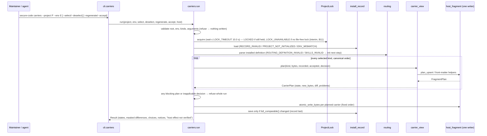
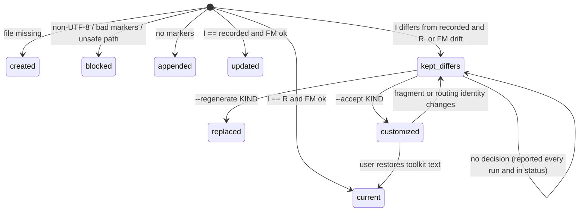

# Technical Design: Single-source Host Integration Carriers

> Feature ID: FEATURE-003-B | Epic: EPIC-003 | Version: v1.0 | Last Updated: 10-23-2026
> Specification: [specification.md](x-ipe-docs/requirements/EPIC-003/FEATURE-003-B/specification.md) (SHA-256 `80a40587281d7871aedf7d20a39a1f46a5d694a042389201d44baddcd50a33c4`) · Task: TASK-061 (Technical Design, owner Sage, free-mode)
> Decisions: DAO-001 (Q1…Q9) and DAO-002 conditions in [decisions_made_feature_refinement.md](x-ipe-docs/dao/26-10-23/decisions_made_feature_refinement.md) (SHA-256 `f778ab7fc619b878…`); DAO-003 (spec defect corrections for 01d and 01g…01j) and DAO-004 (Q2 explicit `--replace`, Q3 bounded lock wait, Q4 Windows interim refusal as human blocker B11) in [decisions_made_technical_design.md](x-ipe-docs/dao/26-10-23/decisions_made_technical_design.md) (SHA-256 `d1cb45d926deca02…`). These are decisions of the delegated 工程師 representative, not human decisions.

## Version History

| Version | Date | Description |
| --- | --- | --- |
| v1.0 | 10-23-2026 | Initial design (TASK-061), draft `b74cd885…` bound to spec `86ed33e3…` |
| v1.0 | 10-23-2026 | Revision after the independent design review ("needs revision") and DAO-003. Rebound to spec `21e5da5d…` (53 automated ACs). Real two-step pre-003B upgrade (01d). Plain-`init` accepted-customization exception (01g…01j). Per-invocation registered write-audit roots with canaries. No-file lock: `carriers` refuses `LOCK_UNAVAILABLE`, plain `init` waits but never refuses or proceeds differently from FEATURE-001-A. `TOOLKIT_VERSION_MISMATCH` removed. FEATURE-001-A-era `--toolkit-source` keeps working via the FEATURE-001-A minimal fragment. Moved front matter is relocated. Still unimplemented |
| v1.0 | 10-23-2026 | Revision after re-review and DAO-004. Rebound to spec `80a40587…` (56 automated ACs: 45 Integration, 11 Unit). 01k (accepted → `--replace AGENTS.md` → `carriers`). Bounded lock wait reusing the existing 10 s toolkit lock timeout, then `LOCKED` (04g, 04h). Windows interim `LOCK_UNAVAILABLE` for `carriers` (04i, open human blocker B11) with plain `init` exactly FEATURE-001-A. An invalid-but-present payload definition is refused before writing; the minimal fallback is used only when the file is absent. Explicit moved front-matter branch. Still unimplemented |

---

## Part 1: Agent-Facing Summary

> **Purpose:** quick reference for implementing agents. Read Part 2 before coding.

### Scope & Boundaries

**In scope.** All 56 automated ACs of the specification (AC-003B-01a…01k, 02a…02g, 03a…03h, 04a…04i, 05a…05g, 06a…06d, 07a…07e, 08a…08e: 45 Integration, 11 Unit; counted from the spec tables at `80a40587…`). The work covers:
- one **routing definition** data file inside the installed Framework skill (Q4 = A);
- a deterministic **renderer** for three carrier kinds: `host-entry`, `github-instructions`, `system-prompt`;
- a dedicated **`secure-code carriers`** operation for selection, deselection, regeneration, acceptance and keeping;
- the extension of the FEATURE-001-A **fragment writer** (`host_fragment.py`; CR-001: no second writer);
- the extension of the **install record** (`install_record.py`): one optional, defaulted `carriers` member under the unchanged `install-record/v1` schema;
- a **no-file project lock** (`flock` on the project-root directory descriptor). Where it is available, both `init` and `carriers` run only under it. A busy lock is waited for at most the existing toolkit lock timeout (10.0 s), then the run refuses `LOCKED`. Where it is unavailable (Windows, file systems without `flock`), `carriers` refuses `LOCK_UNAVAILABLE` (interim, B11) and plain `init` runs exactly as FEATURE-001-A;
- the **single plain-`init` exception** (DAO-003): honouring an exactly matching accepted host-entry customization from a valid `carriers` member (01g…01j);
- **per-carrier status** entries;
- **secret-masked** differences, reusing the FEATURE-002-A `guard/mask.py`;
- a **suite-wide write-audit and protected-tree harness** for the automated tests;
- the Framework `SKILL.md`, `references/environments.md` and `references/cli-contract.md` updates.

**Open human blocker B11 (Windows `carriers` support).** Until the human decides, `carriers` refuses `LOCK_UNAVAILABLE` on Windows as an **interim** behaviour (04i). This is an open gap against the Windows requirement, not a scope reduction. Plain `init` on Windows keeps exactly the delivered FEATURE-001-A behaviour (hard condition). Candidate approaches for the human are listed in Appendix B11; none is implemented.

**HO-003B-01 (EPIC AC-33).** In scope but **not automated**. Nothing in this design or its tests performs, simulates or claims it (DAO blocker B7, Q8 = B). The feature parks at acceptance until a human records the smoke check.

**Out of scope** (specification "Out of Scope"):
- automatic host-loading acceptance (I-19, S-05);
- persona files (D-25, Q6);
- uninstall and deletion of carriers (I-21);
- global or host configuration and other hosts' mirrors;
- symbolic-link support (Q9);
- Windows verification (CR-002 item);
- requirement-analysis routing (C-03);
- the legacy mode switch (I-22).

**Hard constraints carried from DAO-002.**
1. Plain `init` keeps FEATURE-001-A's observable behaviour, and the full FEATURE-001-A regression runs unchanged. The single exception is the accepted host-entry customization (DAO-003, 08c, BR-17), which applies only when a valid `carriers` member exists. An explicit `--replace AGENTS.md` still replaces (delivered FEATURE-001-A behaviour, DAO-004 Q2, 01k). Any other needed FEATURE-001-A behaviour change → STOP, human CR (BR-14).
2. The record member is omitted when unused, so FEATURE-001-A-only projects keep byte-identical records. When the member is written, the result and status disclose that pre-FEATURE-003-B binaries cannot read the record.
3. The carriers operation writes only carrier files and the install record, enforced by write-audit tests. Automated ACs never claim real host invocation.

**Program type:** cli + library + skills (Framework data file and references). **Tech stack:** Python ≥ 3.11, standard library only (`json`, `hashlib`, `difflib`, `fcntl`, `re`); pytest; ruff; Markdown and JSON. No new dependency.

### Outcome / Goal Frame

| Goal ID | Parent / Source | Stakeholder | Desired Observable Outcome | Contribution of this design (means) | Success Evidence (planned) | Constraints / Non-goals | AC Links | Outcome State |
| --- | --- | --- | --- | --- | --- | --- | --- | --- |
| G-06 | EPIC-001 G-06; FR-27, FR-28 | Maintainer, Developer | Host integrations route to the right skill without conflicting with each other or overwriting user content | All-required children G-06a…G-06e below | Sandbox scenario: regenerate after user edits; only fragment differences reported; HO-003B-01 by a human | Host loading not verified automatically (I-19) | via children | not measured |
| G-06a | G-06; FR-27; EPIC AC-31; CR-001 | Maintainer | One routing definition yields consistent carriers; one writer | `routing.py` renders every carrier from `references/routing-definition.json`. `init` and `carriers` both call `host_fragment` (one writer, one marker convention, one record) | Integration tests 01a/01b/01d/01e/01f/01g…01j; unit test 01c | No copied skill procedures (I-02); plain `init` exception bounded to exact-match acceptance | AC-003B-01a…01j | not measured |
| G-06b | G-06; FR-27 (I-05…I-11, §14.2) | Developer, upstream agent | Copilot for design/implementation/fix/refactor; Guard only on explicit or authorized verification; no duplicate or recursive flows | Directive routing statements with exclusions (Q7) in the definition; content checks against the three `SKILL.md` "When to Use" sections | Unit tests 02a…02g; actual triggering only by HO-003B-01 | Content ≠ host behaviour (I-18) | AC-003B-02a…02g; HO-003B-01 | not measured |
| G-06c | G-06; FR-27 (I-03, I-04), FR-28 (I-12…I-17) | Maintainer | Only chosen carriers are written; user content survives; the Maintainer decides every difference | Selection stored in the record member; plan-first, all-or-nothing writer; three-way difference detection; explicit per-carrier `--regenerate`/`--accept`; masked differences; project lock | Integration tests 03*, 04*, 05*, 08*; unchanged FEATURE-001-A tests | Never delete deselected carriers; strictly additive record | AC-003B-03a…03h, 04a…04g, 05a…05g, 08a…08e | not measured |
| G-06d | G-06; FR-28 (I-18), FR-03, I-19; EPIC AC-33; B7 | User, owner | Status is honest; invocability rests on a human observation | Per-carrier status with `host_effect: "not verified"`; generation result states "written / component-checked; host effect not verified" | Integration tests 06a…06d; HO-003B-01 recorded by a human | No automatic loading acceptance | AC-003B-06a…06d; HO-003B-01 | not measured (HO-003B-01 pending human) |
| G-06e (enabling) | DAO plan; S-01…S-04; AC-35 | Maintainer | Developing and testing never alters routing in the development repository | Every test writes beneath pytest's session base temp. The write-audit hook covers the test process and every CLI subprocess. Protected-tree snapshots cover the toolkit tree, the development-repository carriers and sandbox ancestors | Tests 07a…07e plus the session-end guard | Workspace sandbox ≠ OS isolation (S-06) | AC-003B-07a…07e | not measured |

### Design Options and Tradeoffs

| Decision | Selected | Rejected / deferred | Goal / AC / constraint rationale |
| --- | --- | --- | --- |
| Where carriers are generated | New `secure-code carriers` subcommand (spec: dedicated operation; final name fixed here) | Options on `init` | 08c: plain `init` keeps FEATURE-001-A options and ignores optional carriers (single exception: the accepted host-entry customization, 01g…01j) |
| What `init` renders into the host entry | The **same** routing-definition rendering as `carriers` (spec Overview and FR-003B-4) | Keep the hard-coded FEATURE-001-A text in `init` | Two renderings would ping-pong. `init` sees the `carriers` text equal to the recorded digest and "updates" it back, and vice versa, which violates 01e and 04b. The rendering keeps the FEATURE-001-A pointer wording (including "in-flow"), so the unchanged FEATURE-001-A test `test_rerun_no_second_fragment_and_edited_fragment_reported` still finds its edit target |
| Routing definition format and location | JSON `x-ipe-secure-code-toolkit-framework/references/routing-definition.json`, schema `ai-secure-code-toolkit/routing-definition/v1` (Q4 = A) | YAML (needs parsing rules); Markdown (not machine-checkable); code constants (not Maintainer-editable, I-01) | Standard-library parsing; strict validation; Maintainer edits survive FEATURE-001-A safe reinstall as `locally_edited` |
| Which definition `init` renders | The payload (`--toolkit-source` or default) is checked first. (a) Definition file **absent**: a genuine FEATURE-001-A-era payload. Render the **FEATURE-001-A minimal fragment** (`render_minimal_body(profile)`, the FEATURE-001-A `render_body` text byte for byte). (b) **Present but invalid** (unreadable, not UTF-8 or JSON, fails validation, symlink): refuse `ROUTING_DEFINITION_INVALID` **before any write**, with the next step "use a complete toolkit folder (`--toolkit-source DIR`)". (c) Present and valid: render the **effective installed** definition. That is the on-disk file when the init plan keeps it (`locally_edited`) and it is valid, otherwise the payload file | Refusing `PAYLOAD_INCOMPLETE` for a definition-less payload (it would reject a valid FEATURE-001-A input); silently falling back on a corrupt definition (it would hide a broken payload) | A FEATURE-001-A-era `--toolkit-source` installs FEATURE-001-A-era skills, so `init` writes exactly what FEATURE-001-A wrote, and `carriers` then refuses per 03d. A present-but-invalid definition is not a FEATURE-001-A input, so refusing it changes no FEATURE-001-A behaviour. Rendering the effective installed bytes prevents ping-pong with `carriers` after a valid Maintainer edit (Q4) |
| Definition identity | `toolkit_version` (= the **running** `__version__`) + SHA-256 of canonical JSON (sorted keys, compact, UTF-8) | `record.toolkit_version`; a version-mismatch refusal | The renderer is the running code, so its version is part of what it produces. An old record with a new running version works: `carriers` from a new toolkit updates unedited carriers (01b). A whitespace-only re-indent does not change identity (NFR-003B-1) |
| Carrier text per kind | One body for all kinds; only the first "Integration carrier: …" line differs | Shorter or different system-prompt wording | 01f requires identical routing statements; 02a…02g apply to "any carrier". "Concise" has no sourced threshold (NFR-003B-4) |
| Instructions file boundaries | Exact front matter `---\napplyTo: "**"\n---\n` at file start + the existing BEGIN/END markers for the body (Q1, BR-18) | A separate marker style | Reuses the FEATURE-001-A marker and writer; drift is detected by exact comparison |
| System-prompt fragment location | `.x-ipe/private/secure-code/carriers/system-prompt.md`, same markers | Next to the record, or co-located with `precheck-key` | 03h: dedicated folder, no key/trust/authorization files; fragment-level detection |
| Record extension | One optional `carriers` member on `InstallRecord`, default `None`, omitted from `to_dict()` when empty and excluded from `comparable()` | A second record file; a schema bump | Q5 / FR-003B-6 / 08b; `init` stays a no-op on unchanged projects |
| Concurrency | `ProjectLock`: `flock(LOCK_EX \| LOCK_NB)` polled on a read-only descriptor of the **project root folder** itself. No lock file is ever created on any platform. Where the lock is **available**, `init` and `carriers` both run only under it. A held lock is waited for at most `atomic.LOCK_TIMEOUT` (10.0 s, the existing toolkit lock timeout, see Project Lock); then the run refuses `LOCKED` with a retry next step and writes nothing. Where it is **unavailable** (Windows; a file system without `flock`; root not openable read-only), `carriers` refuses `LOCK_UNAVAILABLE` (interim, B11) and plain `init` runs the delivered FEATURE-001-A path (no lock, no new refusal) | A lock file under `.x-ipe/private/secure-code/locks/`; indefinite wait; unlocked progress where the lock exists; unverified Windows locking code | 03d / DAO-002 condition 3 (no extra file); DAO-004 Q3 (bounded wait, existing timeout, `LOCKED`, never unlocked) and Q4 (Windows interim refusal; plain `init` on Windows unchanged); 04g, 04h, 04i |
| Plain `init` and an accepted host-entry customization (DAO-003, DAO-004 Q2) | `init` reads only `carriers.entries["host-entry"].accepted` from a **valid** member. An exact digest match without `--replace AGENTS.md` → `customized`: no write, no `FRAGMENT_EDITED`, never current, routing-change problem when applicable. With explicit `--replace AGENTS.md` → FEATURE-001-A `replaced`, plus a statement that an accepted customization was replaced, the masked previous-content difference, and the acceptance **cleared** from the member. Anything else → FEATURE-001-A logic | Ignoring the member (contradicts 01e); blocking `--replace` (a FEATURE-001-A CR) | 01e, 01g…01k; fail-closed. An invalid member is refused by the existing invalid-record handling (`RECORD_INVALID`); no lenient parse, no new fallback (01i) |
| Masking | Reuse `guard/mask.mask_text` (FEATURE-002-A / FEATURE-001-B patterns); markers `[masked:<kind>]` | New marker syntax `[REDACTED:…]` | The spec gives `[REDACTED:github-token]` only as an example ("e.g.") and requires FEATURE-002-A patterns. One marker convention across the toolkit (DRY) |
| Difference display | Unified diff (`difflib`) of the masked current text against the masked rendering, as a list of lines | Raw old content | 05a/05c/05g: show the difference, never unmasked replaced content |
| Version guard | None. `TOOLKIT_VERSION_MISMATCH` is removed | Refusing when the running version ≠ record version | It blocked 01b (a new toolkit version updating unedited carriers). Two different toolkit versions rendering different text is ordinary FEATURE-001-A "update" behaviour per version, not a defect |
| Write auditing across subprocesses | `sys.addaudithook` in the test process (product frames only) plus a `sitecustomize.py` on `PYTHONPATH` for every child Python process that imports `x_ipe_secure_code`. **Allowed roots are registered per invocation** (the exact project root of the run, plus the per-test temp redirect and any declared trust/output path), passed to children via environment. `subprocess.Popen` audit flags unaudited product subprocesses | One allowed prefix for the whole base temp; hook only in `launcher.py` | 07c: every product write beneath the run's own sandbox root; writes into the base temp, sibling folders or another registered project are violations (canary-tested) |

Rejected alternatives are not work items.

### Key Components Implemented

| Component | Responsibility | Scope/Impact | Tags |
| --- | --- | --- | --- |
| `references/routing-definition.json` (new, Framework skill data) | The single routing definition: declaration, skill pointers, six statement sections, status command | Installed with the skills by `init`; Maintainer-editable | #routing #single-source #data |
| `x_ipe_secure_code/routing.py` (new, ~190 lines) | Load, validate, digest and render the definition per carrier kind; `RoutingError(code, message)` | Used by `init`, `carriers` and `status` | #routing #renderer #deterministic |
| `x_ipe_secure_code/host_fragment.py` (extended, ~127 → ~230) | **The one writer**. Unchanged `plan_upsert`, `inspect` and markers; `render_body(profile, definition, identity)`; instructions front-matter boundary (`FRONT_MATTER`, `front_matter_state`, `restore_front_matter`); `fragment_text`, `outside_text` | All carrier writes | #writer #cr-001 #idempotency |
| `x_ipe_secure_code/carrier_view.py` (new, ~230) | Carrier kinds, paths and env support; per-carrier plan and inspection (three-way difference, customization, front-matter drift, user content); masked diff | Shared by `carriers` and `status` (DRY) | #carriers #diff #masking |
| `x_ipe_secure_code/carriers.py` (new, ~330) | The `carriers` operation: argument resolution, prerequisites, lock, plan-all, all-or-nothing apply, record update, result | New command | #cli #carriers #plan-first |
| `x_ipe_secure_code/install_record.py` (extended, 72 → ~150) | Optional `carriers` member: validation in `load`, omission in `to_dict`, exclusion from `comparable` | Read by `init`, `status` and `carriers` | #record #compat #additive |
| `x_ipe_secure_code/atomic.py` (extended, 147 → ~195) | Names the existing `ProcessLock` default timeout as `LOCK_TIMEOUT = 10.0` (value unchanged; `ProcessLock` defaults to it). `ProjectLock(root, timeout=LOCK_TIMEOUT)`: polled directory `flock`, never a file; raises `LockHeld` (timeout) or `LockUnavailable` | `init` and `carriers` | #concurrency #lock |
| `x_ipe_secure_code/project_init.py` (extended, 184 → ~260) | Payload-definition check (absent → FEATURE-001-A minimal fragment; present-invalid → refuse before writing); effective-definition rendering; `ProjectLock` where available (bounded wait → `LOCKED`), FEATURE-001-A path where unavailable; accepted-customization exception and explicit-`--replace` lapse; member carry-forward/drop | `init` | #init #regression-guarded |
| `x_ipe_secure_code/status.py` (extended, 179 → ~225) | `host_integration` keeps the FEATURE-001-A keys and adds `routing_identity`, `carriers`, `integration_declaration`, `differences`, `record_compatibility` | `status` | #status #honest-limits |
| `x_ipe_secure_code/cli.py` (extended, 352 → ~380) | `carriers` subparser and dispatch | CLI | #cli |
| Framework `SKILL.md`, `references/environments.md`, `references/cli-contract.md` | Carriers, selection, choices, codes, record member, no forward compatibility, honest limit | Docs (FR-003B-8, 08e) | #docs |
| `tests/support/write_audit.py`, `tests/support/auditsite/sitecustomize.py`, `tests/conftest.py` (additive), `tests/support/launcher.py` (additive `--test-canary-write`) | Write-audit hook with per-invocation registered roots, per-test enforcement, canaries, protected-tree and ancestor snapshots, TMPDIR/cwd redirection | Whole automated suite | #test-isolation #audit |
| `tests/carriers/*` (new) | AC tests 01a…08e (56 ACs) | Tests | #tests |

### Dependencies

| Dependency | Source | Design Link | Usage Description |
| --- | --- | --- | --- |
| `host_fragment.plan_upsert` / `inspect`, BEGIN/END markers | FEATURE-001-A | [FEATURE-001-A design](x-ipe-docs/requirements/EPIC-001/FEATURE-001-A/technical-design.md) | The only writer for every carrier body; outcomes create_file/append/current/update/edited_kept/replaced/malformed/unreadable |
| `install_record` (`InstallRecord`, `load`, `save`, `RECORD_REL`, `SCHEMA`) | FEATURE-001-A | same | Extended additively; same schema id |
| `paths.validate_root`, `unsafe_component`; `atomic.atomic_write_bytes`, `LockHeld` | FEATURE-001-A | same | Explicit root, symlink refusal (`PATH_UNSAFE`), atomic per-file writes |
| `environments.PROFILES` / `lookup` | FEATURE-001-A | same | Host entry file and skills folder per environment |
| `payload.SKILL_NAMES`, `payload.files` | FEATURE-001-A | same | Installed-skill prerequisite check; locating the definition in the payload |
| `results.Result` / `Problem` | FEATURE-001-A | same | Result envelope (text and `--json`) |
| `guard.mask.mask_text` | FEATURE-002-A (patterns from FEATURE-001-B) | [FEATURE-002-A design](x-ipe-docs/requirements/EPIC-002/FEATURE-002-A/technical-design.md) | Masks fragment, front-matter and difference text with `[masked:<kind>]` markers |
| Copilot and Guard `SKILL.md` "When to Use" | FEATURE-003-A, FEATURE-002-A | [FEATURE-003-A design](x-ipe-docs/requirements/EPIC-003/FEATURE-003-A/technical-design.md) | Reference for the AC-003B-02f consistency check (read-only; not edited) |
| `tests/support/launcher.py` (`--audit-open`), `conftest.run_cli`, `tree_hashes` | FEATURE-001-A tests | — | Read auditing (07e), CLI subprocess runs, tree snapshots |

### Major Flow

1. **`init`** (FEATURE-001-A pipeline, unchanged order):
   - validate root, env, `--replace` and payload;
   - check the payload's routing definition (absent → FEATURE-001-A minimal fragment later; present but invalid → refuse `ROUTING_DEFINITION_INVALID`, nothing written);
   - where the lock is available, take `ProjectLock` (bounded wait of `LOCK_TIMEOUT`, then `LOCKED`). Where it is unavailable, continue exactly as FEATURE-001-A;
   - load the record (an invalid member is `RECORD_INVALID`, the existing handling) and plan the skill files;
   - render the host entry body from the **effective definition**, or the FEATURE-001-A minimal body when the payload has no definition;
   - `plan_upsert`, then the **accepted-customization exception**: an exact digest match without `--replace` → `customized`, no write. With explicit `--replace AGENTS.md` → `replaced` + masked previous difference + acceptance cleared;
   - refuse or apply, and write the record only if `comparable()` changed.

   The record's `carriers` member is carried forward for the same environment and dropped on an environment switch.
2. **`carriers`**: validate root and env → resolve the selection and decisions (refuse unknown or unsupported kinds) → `ProjectLock` with the bounded wait (`LOCKED` / `LOCK_UNAVAILABLE`) → load the record (refuse if missing, invalid or another environment) → check the installed skills and definition (refuse with an `init` next step) → plan **every** selected carrier through the writer and the three-way difference rules → refuse the whole run on any blocking plan → write the planned carriers atomically in a fixed order → write the record last if it changed → return per-carrier states, masked differences, choices, the system-prompt content and the manual step, plus "written / component-checked; host effect not verified".
3. **`status`** (read-only, no lock): FEATURE-001-A `host_integration` keys unchanged, plus per-carrier entries from `carrier_view.inspect`, masked differences and the record-compatibility notice when the member exists.

### Usage Example

```bash
# 1. Initialize a sandbox target project (FEATURE-001-A; now renders AGENTS.md from the routing definition)
secure-code init --project /work/sandbox/marathon --env github-copilot --json

# 2. Default carriers run: checks or updates only the AGENTS.md fragment
secure-code carriers --project /work/sandbox/marathon --env github-copilot

# 3. Opt in to the GitHub instructions file and a system-prompt fragment for a named host
secure-code carriers --project /work/sandbox/marathon --env github-copilot \
  --select github-instructions --select system-prompt --system-prompt-host copilot-cli --json

# 4. A kept difference in AGENTS.md: take the toolkit version, or accept the customization
secure-code carriers --project /work/sandbox/marathon --env github-copilot --regenerate host-entry
secure-code carriers --project /work/sandbox/marathon --env github-copilot --accept host-entry

# 5. Stop managing the system-prompt fragment (the file is left in place and reported as no longer managed)
secure-code carriers --project /work/sandbox/marathon --env github-copilot --deselect system-prompt

# 6. Read-only per-carrier status, always "host effect: not verified"
secure-code status --project /work/sandbox/marathon --json
```

### Tool Capability Summary

- **Actual type and stack:** cli + library + skills; Python ≥ 3.11 standard library, pytest, ruff.
- **Configuration:** `x-ipe-docs/config/tools.json` `stages.implement.technical_design` explicitly enables python, html5, typescript, java, mcp and general. `_extra_instruction` says: "Consultation mode: read tool capabilities for informational use only. Do not invoke tools for code execution."
- **Matched and consulted:** `x-ipe-tool-implementation-python`, read for information only. Relevant built-in practices: PEP 8, type hints on all signatures, pytest with AAA scenarios and `parametrize`, ruff check. Its `python -m pytest` and `ruff format` steps are implementation-time guidance. The project runs tests through `uv run pytest` and configures `ruff check` only (`scripts/pyproject.toml`), so implementation follows the project configuration.
- **Excluded (no matching responsibility):** html5, typescript, java and mcp. `general` is not needed because the specific Python tool matched.
- No tool operation was invoked. Part 2 does not depend on tool availability.

---

## Part 2: Implementation Guide

### Files and Layout

Paths are relative to `ai-secure-code-toolkit/x-ipe-secure-code-toolkit-framework/`. The baseline (SHA-256 prefix, lines) was read on 10-23-2026.

```text
SKILL.md                                   c8f8af097c1519ef 155  edit: carriers op, When to Use line, honest limit
references/
  routing-definition.json                  NEW  single routing definition (Q4 = A)
  environments.md                          e713fae2d5944ea7  35  edit: carriers, formats, record member, no forward compat
  cli-contract.md                          c23568c31c481ec4 165  edit: `carriers` row, problem codes
scripts/src/x_ipe_secure_code/
  routing.py                               NEW  ~190
  carrier_view.py                          NEW  ~230
  carriers.py                              NEW  ~330
  host_fragment.py                         a14b9b859a680c65 127 → ~230
  install_record.py                        613ee0704be8a576  72 → ~150
  project_init.py                          7bfe353ed969ec5f 184 → ~245
  status.py                                1966adebadb53c1d 179 → ~225
  atomic.py                                8082bd3fa0a7ec03 147 → ~195
  cli.py                                   f513610654e9bc03 352 → ~380
  guard/mask.py                            08777ec712ae663e  64  reused, unchanged
scripts/tests/
  conftest.py                              99b3f77775aa9d70 135  additive: audit hooks, registered roots, snapshots, TMPDIR/cwd;
                                                             run_cli derives per-invocation allowed roots
  support/launcher.py                      02cc5631e81d8b42  58  additive: `--test-canary-write PATH` (harness canary);
                                                             `--audit-open` reused
  support/write_audit.py                   NEW  hook, classifier, log reader
  support/auditsite/sitecustomize.py        NEW  installs the hook in child Python processes
  carriers/carhelp.py                      NEW  sandbox helpers, toolkit-copy builders (FEATURE-001-A-era payload,
                                                             bumped-version copy, changed-definition copy)
  carriers/test_*.py                       NEW  see Test Plan
  test_project_init.py                     2f56555b3f0cda79 258  UNCHANGED (AC-003B-08a)
  test_host_fragment.py                    2b0bb8e672508791  86  UNCHANGED (AC-003B-08a)
  test_status.py                           32771fbd8df43f25 142  UNCHANGED (FEATURE-001-A status regression)
scripts/pyproject.toml                     additive: `write_audit_exceptions` ini list
```

Every module stays below 800 lines (`tests/test_module_size.py`). The largest new module, `carriers.py`, is about 330 lines. If it grows past about 600 lines during implementation, split argument resolution into `carrier_args.py`.

### Routing Definition (`references/routing-definition.json`)

**Location (Q4 = A).** `<skills_dir>/x-ipe-secure-code-toolkit-framework/references/routing-definition.json` in the target project. `init` places it like every other payload file and records it in `files`. Constant: `routing.DEFINITION_REL = "x-ipe-secure-code-toolkit-framework/references/routing-definition.json"`, relative to the skills folder.

**Initial content (authoritative; directive wording with exclusions, Q7):**

```json
{
  "schema": "ai-secure-code-toolkit/routing-definition/v1",
  "title": "AI Secure Code Toolkit",
  "declaration": "All toolkit carriers with this routing identity are one integration declaration: together they start at most one Copilot or Guard flow for the same stage and effective context.",
  "skills": [
    {"name": "x-ipe-secure-code-toolkit-copilot", "pointer": "use during design, implementation, bug fix and refactor tasks for in-flow security suggestions and adoption review."},
    {"name": "x-ipe-secure-code-toolkit-guard", "pointer": "use only for an explicit or authorized security verification request; it reports findings and does not fix."},
    {"name": "x-ipe-secure-code-toolkit-framework", "pointer": "security knowledge, Policies, status and Maintainer authorization."}
  ],
  "sections": [
    {"id": "copilot", "heading": "Copilot", "statements": [
      "Use the Copilot skill proactively for every design, implementation, bug fix and refactor task, including changes to an existing design.",
      "Do not use the Copilot skill for plain questions or read-only knowledge lookups, and not to verify already finished artifacts."]},
    {"id": "guard", "heading": "Guard", "statements": [
      "Use the Guard skill only on an explicit verification request or an authorized upstream verification step.",
      "Never start Guard automatically because an artifact was completed, and never use Guard instead of Copilot for in-flow suggestions."]},
    {"id": "deduplication", "heading": "One flow per stage and context", "statements": [
      "Loading several toolkit carriers never starts a Copilot or Guard flow more than once; they are one integration declaration.",
      "Do not start the flow again for the same stage and the same effective context.",
      "Evaluate again after a relevant change of input or stage; never skip it permanently.",
      "A read-only Reviewer never starts the Copilot or Guard flow.",
      "Do not merge different Framework needs within one task."]},
    {"id": "results", "heading": "Reports and gates", "statements": [
      "A failed or old report never counts as done for the current work.",
      "Report an unavailable skill or invalid output as not completed; the upstream caller decides under its existing gates.",
      "Never make up Policies from memory.",
      "Continuing the work is not passing.",
      "Never bypass mandatory gates silently."]},
    {"id": "roles", "heading": "Roles", "statements": [
      "Roles come only from actual verification: the Maintainer by the owner-signed authorization, agents by real requests or signed pre-authorization.",
      "This carrier text grants no role, permission or consent."]},
    {"id": "handoff", "heading": "Minimal handoff", "statements": [
      "Framework: pass the scenario, rule clues and information need; it returns concrete Policies, sources and unresolved items.",
      "Copilot: pass the task, the current artifact or change and the constraints; it returns concrete suggestions, the adoption review and items not adopted or not verifiable.",
      "Guard: pass the formed artifact, explicit targets, rule clues and the execution authorization and budget; it returns the three-state verdict, findings, coverage gaps and execution state.",
      "Only naming a skill is not a completed handoff; the upstream caller acts on the results."]}
  ],
  "status_command": "uvx --from {skills_dir}/x-ipe-secure-code-toolkit-framework/scripts secure-code status --project . --json"
}
```

The skill pointers repeat the FEATURE-001-A `render_body` wording verbatim, including "in-flow". The unchanged FEATURE-001-A test replaces `in-flow` to simulate a user edit and asserts that the bytes differ. The pointer text must keep that word; the unit test `test_pointer_wording_keeps_001a_edit_target` pins it.

**Validation (`routing.validate(obj) -> None`, raises `RoutingError("ROUTING_DEFINITION_INVALID", reason)`):**

| Rule | Reason |
| --- | --- |
| File is a regular file (not a symlink, `unsafe_component`), at most 65 536 bytes, UTF-8, a JSON object | Bounded read; no link following |
| Keys are exactly `schema`, `title`, `declaration`, `skills`, `sections`, `status_command`; `schema` equals the v1 id | Strict, so a typo is not silently ignored |
| `skills` lists each of `payload.SKILL_NAMES` exactly once, each with a non-empty `pointer` | Pointers to the three installed skills (01c) |
| `sections` holds exactly the ids `copilot`, `guard`, `deduplication`, `results`, `roles`, `handoff` once each (any order), each with `heading` and 1…20 `statements` | Every required statement group (AC-003B-02) is present. Meaning is checked by unit tests on the packaged file, not at run time |
| Every string is 1…500 characters, has no newline, contains neither `<!--` nor `-->`, is not `---`, and contains `{` / `}` only as the `{skills_dir}` placeholder in `status_command` | No marker, front-matter or template injection into a carrier |
| No string contains an absolute path: regex ``(^|[\s`(])(/[^\s/]|~/|[A-Za-z]:\\)`` | 01c: no absolute machine path |
| `guard.mask.mask_text(s)[0] == s` for every string | 01c: no credential-like content |
| `status_command` contains `secure-code status` | Status pointer (01c) |

A Maintainer edit that passes these rules is **valid** (Q4) and renders. Any other edit makes `carriers` refuse with an `init` next step (03d). `routing.parse(data: bytes) -> RoutingDefinition` runs the checks; `RoutingDefinition(obj: dict, digest: str)`.

**Identity.** `digest = sha256(json.dumps(obj, sort_keys=True, ensure_ascii=False, separators=(",", ":")).encode("utf-8")).hexdigest()`. `RoutingIdentity(toolkit_version: str, definition_sha256: str)` where `toolkit_version` is the **running** `__version__` (never compared with `record.toolkit_version`), displayed as `ai-secure-code-toolkit <version>, definition sha256:<64 hex>`.

### Carrier Kinds, Locations and Formats

| Kind | `github-copilot` path | `claude-code` path | Default | Managed boundaries |
| --- | --- | --- | --- | --- |
| `host-entry` | `AGENTS.md` | `CLAUDE.md` | yes, always managed (it is the FEATURE-001-A fragment) | BEGIN/END fragment |
| `github-instructions` | `.github/instructions/x-ipe-secure-code-toolkit.instructions.md` | not supported | explicit `--select` | (1) exact front matter at file start, (2) BEGIN/END fragment |
| `system-prompt` | `.x-ipe/private/secure-code/carriers/system-prompt.md` | same | explicit `--select` + `--system-prompt-host NAME` | BEGIN/END fragment |

`carrier_view.SUPPORTED = {"github-copilot": ("host-entry", "github-instructions", "system-prompt"), "claude-code": ("host-entry", "system-prompt")}`. The kind order is the plan, write and report order.

**Rendered body** (identical for every kind except line 3). The renderer is `routing.render(defn, identity, profile, kind, host=None) -> str` with LF newlines; the writer converts to the file's newline style.

```markdown
## AI Secure Code Toolkit

Integration carrier: host entry (`AGENTS.md`). Routing identity: ai-secure-code-toolkit 0.1.0, definition sha256:<64 hex>.
All toolkit carriers with this routing identity are one integration declaration: together they start at most one Copilot or Guard flow for the same stage and effective context.

This project uses the AI secure-code toolkit skills in `.github/skills/`:

- `x-ipe-secure-code-toolkit-copilot`: use during design, implementation, bug fix and refactor tasks for in-flow security suggestions and adoption review.
- `x-ipe-secure-code-toolkit-guard`: use only for an explicit or authorized security verification request; it reports findings and does not fix.
- `x-ipe-secure-code-toolkit-framework`: security knowledge, Policies, status and Maintainer authorization.

### Copilot

- Use the Copilot skill proactively for every design, implementation, bug fix and refactor task, including changes to an existing design.
- …(each statement of each section in definition order, one "- " line each; sections in the order copilot, guard, deduplication, results, roles, handoff)

Check status: `uvx --from .github/skills/x-ipe-secure-code-toolkit-framework/scripts secure-code status --project . --json`
```

Line 3 per kind:
- `host-entry`: ``Integration carrier: host entry (`AGENTS.md`).`` or ``(`CLAUDE.md`)``;
- `github-instructions`: `Integration carrier: GitHub instructions.`;
- `system-prompt`: `Integration carrier: system-prompt fragment for host "<name>".`

Each is followed by the identity sentence. "Routing statements" for 01f means every line from `This project uses` up to and including `Check status:`. The body contains no time, absolute path or machine-specific text (NFR-003B-1).

**Host entry file** (unchanged FEATURE-001-A layout): `BEGIN\n<body>END\n`. The writer creates the file, appends after a blank line, or updates in place.

**FEATURE-001-A minimal body** (`host_fragment.render_minimal_body(profile)`): the FEATURE-001-A `render_body` text kept verbatim from `host_fragment.py` `a14b9b85…`. Plain `init` uses it **only** when the payload has no valid routing definition, i.e. a FEATURE-001-A-era `--toolkit-source`. `carriers` never uses it. A golden-bytes test pins it.

**GitHub instructions file** (new file layout; the front-matter bytes are exact):

```text
---
applyTo: "**"
---

<!-- BEGIN ai-secure-code-toolkit: managed fragment, edits are reported not overwritten -->
<body>
<!-- END ai-secure-code-toolkit -->
```

- `host_fragment.FRONT_MATTER = '---\napplyTo: "**"\n---\n'`. This follows GitHub Copilot's documented path-specific instruction format: YAML front matter with an `applyTo` glob in `.github/instructions/*.instructions.md`. The format could not be re-checked online in this task (no network); see Evidence Gaps.
- `front_matter_state(text) -> (state, region)`, where `state ∈ {"ok", "missing", "altered", "moved"}`:
  - `ok`: the text starts with `FRONT_MATTER`, with LF or with every `\n` as `\r\n`;
  - `altered`: it starts with a `---` line that has a closing `---` line within the first 50 lines, but the block differs; `region` is that block;
  - `moved`: the text does not start with it, and the exact block (in the file's newline style) occurs **exactly once** elsewhere, starting at a line boundary. `region` is that occurrence `(start, end)` in bytes;
  - `missing`: otherwise. This includes two or more exact copies away from the start, which are left as user bytes.
- **Regenerate restores the front matter** (`restore_front_matter(text, state, region) -> text`). It runs after the body was regenerated by `plan_upsert(replace=True)`, and the state is re-detected on that result:
  - `ok`: unchanged;
  - `missing`: `FM + text`;
  - `altered`: `FM + text[region_end:]`. Only the leading `---…---` block is replaced;
  - `moved` (**relocation**): `FM + text[:start] + text[end:]`. Exactly the detected managed block is removed and the exact block is inserted at byte 0; surrounding blank lines are not touched.

  `FM` is `FRONT_MATTER` in the file's newline style.

  The states are checked in this order: `ok` → `altered` (leading block) → `moved` → `missing`.

  Postconditions, asserted by tests:
  - after relocation of `moved`: exactly one front-matter block in the whole file, at byte 0, and every other byte equal to the original apart from the regenerated marker body;
  - after `missing` or `altered`: the exact block is at byte 0, and every other byte is unchanged.
- **User content outside the boundaries** (03g): remove the leading front-matter region (when `ok` or `altered`) and the BEGIN…END block. If any non-whitespace remains, `user_content = "detected outside the managed boundaries (kept)"`. The blank line the toolkit writes between the two boundaries is whitespace and is not user content.

**System-prompt fragment file:** created as `BEGIN\n<body>END\n` by the writer. Its folder `.x-ipe/private/secure-code/carriers/` holds only this file. Key, trust and authorization material lives elsewhere: the trust store is outside the project (FEATURE-001-A), and `precheck-key` is in the parent folder. The host name is required on first selection; regex `^[a-z0-9][a-z0-9._-]{0,63}$`; stored in the record entry.

### CLI Contract: `secure-code carriers`

```text
secure-code carriers --project PATH --env github-copilot|claude-code
                     [--select KIND]... | [--deselect KIND]...
                     [--system-prompt-host NAME]
                     [--regenerate KIND]... [--accept KIND]...
                     [--json]
KIND = host-entry | github-instructions | system-prompt
```

Exit codes: `0` completed (kept differences, customized and no-longer-managed carriers included) · `1` refused or failed · `2` argparse usage error (unknown option only). Kind names are validated in code, not by argparse `choices`, so that an unknown kind returns the envelope refusal listing the supported kinds (03f).

**Selection resolution.**
- `stored` = `record.carriers["selected"]` if the member exists, else `["host-entry"]`.
- With `--select`, the new selection is `["host-entry"]` plus the given kinds, deduplicated in canonical order. It **replaces** `stored`. `host-entry` is implicit and may be named.
- With `--deselect`, the new selection is `stored` minus the given kinds. Deselecting `host-entry` is refused (`ARGUMENT_INVALID`: it is the FEATURE-001-A fragment that `init` keeps).
- With neither, the selection is `stored` (03e "later run without any selection").
- `--select` together with `--deselect` → `ARGUMENT_INVALID`.
- A kind that is in the record entries but not in the new selection is reported as **no longer managed**. Its file is neither read, written nor deleted (03e, I-21).

**Decisions (Q3; keep is the default and needs no flag).**
- `--regenerate KIND`: replace that carrier's managed boundaries with the current rendering. For the instructions file this means the front matter and the body.
- `--accept KIND`: record the carrier's current managed content as an accepted customization.
- Refused with `ARGUMENT_INVALID`: the same kind in both options, or a kind that is not in the new selection.
- `--accept` for a carrier that has no reported difference → `DECISION_NOT_APPLICABLE`; nothing is written.
- `--regenerate` on a current carrier is a no-op (state `current`).

**System-prompt host.**
- `--system-prompt-host NAME` is required when `system-prompt` is in the new selection and no host is stored (`ARGUMENT_INVALID`, next step names the option).
- It is invalid without `system-prompt` in the selection.
- A different name than the stored one re-renders line 3. An unedited file is `updated`; an edited one is kept and reported.

**Check and refusal order** (the first failure returns; a refusal writes nothing).

| # | Check | Code | Next step |
| --- | --- | --- | --- |
| 1 | Root (`validate_root`) | `ROOT_REQUIRED` / `ROOT_INVALID` | Pass an existing project folder with `--project PATH` |
| 2 | Environment (`lookup`) | `ENV_REQUIRED` / `ENV_UNSUPPORTED` | Re-run with `--env …` (`data.supported_environments`) |
| 3 | Kinds known and supported for the env | `CARRIER_UNSUPPORTED` (`data.supported_carriers`) | Use one of the listed carriers |
| 4 | Argument combinations, host name | `ARGUMENT_INVALID` | Specific message |
| 5 | `ProjectLock(root, timeout=LOCK_TIMEOUT)` | `LOCKED` (still held after the bounded wait of 10.0 s) / `LOCK_UNAVAILABLE` (exclusivity cannot be established: Windows, a file system without `flock`, root not openable read-only; interim, B11) | `LOCKED`: retry when the other `init`/`carriers` run has finished. `LOCK_UNAVAILABLE`: no lock file was created and nothing was written; Windows support is pending human decision B11 (run on a local POSIX file system meanwhile) |
| 6 | Record (`install_record.load`) | `PATH_UNSAFE` / `RECORD_INVALID`; none → `PROJECT_NOT_INITIALIZED` | `secure-code init --project P --env E` / inspect the record |
| 7 | `record.environment == env` | `ENV_MISMATCH` | `secure-code init --project P --env <env>` (08d) |
| 8 | Installed skills: `<skills_dir>/<name>/SKILL.md` for each of the three names is a regular, safe, UTF-8-readable file | `SKILLS_INVALID` | `secure-code init --project P --env E` (no implicit reinstall, 03d) |
| 9 | Installed definition readable and valid | `ROUTING_DEFINITION_INVALID` | `secure-code init …`; if you edited the definition, fix it or re-run init with `--replace <skills_dir>/x-ipe-secure-code-toolkit-framework/references/routing-definition.json` |
| 10 | `unsafe_component` for the record path and every selected carrier path | `PATH_UNSAFE` (names each path) | Replace the link with a regular file or folder (Q9) |
| 11 | Plan every selected carrier | `FRAGMENT_DUPLICATE`, `FRAGMENT_MALFORMED`, `HOST_ENTRY_UNREADABLE` (host entry) or `CARRIER_UNREADABLE` (other kinds), one problem per affected carrier | Fix the named carrier; nothing was written (04d) |
| 12 | Decisions applicable | `DECISION_NOT_APPLICABLE` | Only accept a reported difference |
| 13 | Apply writes | `IO_ERROR` (`data.written_before_failure`), record not updated | Fix the file-system problem and re-run; written carriers are recognized as current (04f) |

Informational problems on success: `FRAGMENT_EDITED` (kept difference, the same code as `init`) and `FRONT_MATTER_DRIFT`. New codes, all added to `cli-contract.md`: `CARRIER_UNSUPPORTED`, `ENV_MISMATCH`, `LOCK_UNAVAILABLE`, `SKILLS_INVALID`, `ROUTING_DEFINITION_INVALID`, `CARRIER_UNREADABLE`, `DECISION_NOT_APPLICABLE`, `FRONT_MATTER_DRIFT`. Reused codes: `ROOT_*`, `ENV_*`, `ARGUMENT_INVALID`, `LOCKED`, `PROJECT_NOT_INITIALIZED`, `RECORD_INVALID`, `PATH_UNSAFE`, `FRAGMENT_*`, `HOST_ENTRY_UNREADABLE`, `IO_ERROR`.

**Result `data` (text and `--json` carry the same content):**

```json
{
  "root": "/abs/sandbox",
  "environment": "github-copilot",
  "routing_identity": "ai-secure-code-toolkit 0.1.0, definition sha256:9f…",
  "carriers": [
    {"carrier": "host-entry", "path": "AGENTS.md", "selection": "selected", "state": "updated",
     "front_matter": "n/a", "user_content": "n/a", "next_step": "None"},
    {"carrier": "github-instructions", "path": ".github/instructions/x-ipe-secure-code-toolkit.instructions.md",
     "selection": "selected", "state": "kept-differs", "front_matter": "drift: altered",
     "user_content": "detected outside the managed boundaries (kept)",
     "next_step": "Decide: keep (default), modify then keep or accept, change the routing definition, --regenerate github-instructions, or --accept github-instructions"},
    {"carrier": "system-prompt", "path": ".x-ipe/private/secure-code/carriers/system-prompt.md",
     "selection": "no longer managed", "state": "no longer managed", "front_matter": "n/a", "user_content": "n/a",
     "next_step": "Left in place; remove it manually if no longer wanted (the toolkit never deletes carriers)"}
  ],
  "integration_declaration": "2 managed carriers share routing identity … and form one integration declaration: AGENTS.md, .github/instructions/x-ipe-secure-code-toolkit.instructions.md",
  "differences": {
    ".github/instructions/x-ipe-secure-code-toolkit.instructions.md": {
      "content": "secret-masked (pattern-based; not a complete data-loss-prevention guarantee)",
      "masked_kinds": ["credential.token"],
      "front_matter_diff": ["--- current front matter (masked)", "+++ toolkit front matter", "@@ …", "-applyTo: \"src/**\"", "+applyTo: \"**\""],
      "diff": ["--- current fragment (masked)", "+++ toolkit rendering", "@@ …", "-token: [masked:credential.token]", "…"],
      "choices": ["keep (default)", "modify, then keep or accept", "change the routing definition", "regenerate (--regenerate github-instructions)", "accept customization (--accept github-instructions)"]
    }
  },
  "system_prompt": {"path": ".x-ipe/private/secure-code/carriers/system-prompt.md", "host": "copilot-cli",
                    "content": ["## AI Secure Code Toolkit", "…masked rendering lines…"],
                    "manual_step": "Adding this fragment to the host's system prompt is your manual step; the toolkit never changes host, global or user-level configuration"},
  "record": ".x-ipe/private/secure-code/install-record.json",
  "record_written": true,
  "host_effect": "written / component-checked; host effect not verified",
  "notices": ["The install record now holds the optional 'carriers' member. Toolkit versions without the carriers operation cannot read this record and refuse it (RECORD_INVALID)."]
}
```

- Carrier `state` values: `created`, `appended`, `current`, `updated`, `kept-differs`, `replaced`, `customized`, `no longer managed`, `blocked`.
- `system_prompt` appears only while that kind is selected.
- `notices` appears whenever the written or existing record holds the member (DAO-002 condition 2).
- For a regenerated carrier, `differences[path]` carries `"replaced": true` and the diff from the replaced content to the new rendering, masked (05c, 05g).
- A carrier whose text outside the markers contains the rendering's first line or identity sentence gets `"note": "similar toolkit text found outside the fragment; it is user content and was not taken over"` (04c edge case).

### Install Record Extension (`install_record.py`)

```python
@dataclass
class InstallRecord:
    toolkit_version: str
    environment: str
    skills_dir: str
    host_entry: str
    fragment_sha256: str | None
    initialized_at: str
    updated_at: str
    files: dict[str, str] = field(default_factory=dict)
    carriers: dict[str, Any] | None = None          # FEATURE-003-B: optional, defaulted

    def to_dict(self) -> dict[str, Any]:
        data = {"schema": SCHEMA, **asdict(self)}
        if not self.carriers:
            data.pop("carriers")                       # omitted when unused → FEATURE-001-A bytes
        return data

    def comparable(self) -> dict[str, Any]:            # init's rewrite decision (unchanged meaning)
        data = self.to_dict()
        data.pop("updated_at")
        data.pop("carriers", None)                     # excluded: plain init stays a no-op
        return data

    def full_comparable(self) -> dict[str, Any]:       # carriers' rewrite decision
        data = self.to_dict()
        data.pop("updated_at")
        return data
```

- `SCHEMA` stays `ai-secure-code-toolkit/install-record/v1`.
- `dumps_json` sorts keys, so an omitted member gives bytes identical to a FEATURE-001-A record with the same values.
- `load()` keeps its code path: `InstallRecord(**data)` now accepts a `carriers` key, then `_validate_carriers(record.carriers, record)` raises `RecordError("install record carriers member invalid: <reason>")` (code `RECORD_INVALID`).
- This strict validation **is** the "existing invalid-record handling" of 01i: an unreadable or invalid member makes the whole record invalid. `init`, `carriers` and `status` treat it like any other invalid record (refusal / "invalid record", not repaired automatically). There is no lenient parse and no partial reading of a damaged member, so acceptance data can only be honoured from a fully valid member.
- Positional construction with eight arguments (used by FEATURE-001-A tests) still works.

**Member shape** (validated strictly; unknown keys refused):

```json
"carriers": {
  "selected": ["host-entry", "github-instructions"],
  "entries": {
    "github-instructions": {
      "path": ".github/instructions/x-ipe-secure-code-toolkit.instructions.md",
      "fragment_sha256": "<64 hex | null>",
      "routing": {"toolkit_version": "0.1.0", "definition_sha256": "<64 hex>"}
    },
    "system-prompt": {"path": ".x-ipe/private/secure-code/carriers/system-prompt.md", "host": "copilot-cli",
                      "fragment_sha256": "…", "routing": {…}},
    "host-entry": {"accepted": {"fragment_sha256": "…", "routing": {…}, "accepted_at": "2026-10-23T08:00:00Z"}}
  }
}
```

Validation rules:
- `selected` is a unique list of known kinds that includes `host-entry`.
- `entries` keys are known kinds.
- An optional-kind entry has `path` equal to the kind's canonical path, `fragment_sha256` (64 lowercase hex or `null`), `routing` and an optional `accepted`. `system-prompt` additionally has a valid `host`.
- A `host-entry` entry has only `accepted`. The top-level `host_entry`/`fragment_sha256` stay authoritative for the host entry (08b).
- `accepted` holds `fragment_sha256`, `routing`, `accepted_at` (`YYYY-MM-DDTHH:MM:SSZ`) and, for `github-instructions` only, `front_matter_sha256` (64 hex or `null` when the front matter is missing).
- **Omission rule:** the member is `None` unless some optional kind has an entry or some entry has `accepted`. A once-selected optional kind keeps its entry (needed for "no longer managed").

**Rules per writer:**

| Writer | Top-level fields | `carriers` member | Rewrite when |
| --- | --- | --- | --- |
| `init` (FEATURE-001-A logic + the 01g…01k exception) | As today: `fragment_sha256` = rendered digest, or the recorded one when `edited_kept` **or `customized`** | Same environment: carried forward **unchanged**, except explicit `--replace AGENTS.md` over an existing host-entry acceptance, which **clears** `entries["host-entry"].accepted` (omission rule applies) (01k). Different environment: `None` (08d) | `comparable()` changed, or the member changed (01k only) |
| `carriers` | `fragment_sha256` = rendered digest after create/append/update/replace/current; unchanged when kept or customized. `files`, `toolkit_version`, `skills_dir`, `environment`, `initialized_at` unchanged | Selection, entries and accepted data updated | `full_comparable()` changed |

On **accept** of `host-entry`, the top-level `fragment_sha256` deliberately keeps the last toolkit-written digest, so FEATURE-001-A logic alone would classify the accepted text as `edited_kept`. Plain `init` then applies the bounded exception (see "Plain `init` accepted-customization exception"): an exact match gives `customized`, anything else stays FEATURE-001-A `FRAGMENT_EDITED`. Without `--replace`, `init` never changes the member (01g: "recorded acceptance data is unchanged"). Its only member change is clearing the host-entry acceptance after an explicit `--replace AGENTS.md` replaced the fragment (01k, DAO-004 Q2). After that, the fragment equals the rendering, so both `init` and `carriers` report `current` and never `customized`. `carriers` also clears accepted data when the carrier becomes `current` or is regenerated.

### Workflow Diagram (`carriers`)



### Algorithms and State Transitions

**Per-carrier plan** (`carrier_view.plan(kind, path, data, body, recorded_sha, accepted, identity, decision) -> CarrierPlan`).

`I` is the text between the markers, `R` is the rendered body, `sha` is `host_fragment.sha256_text` (CRLF-normalized), and `FM` is the front-matter state (instructions only; otherwise `ok`).

1. `data is None` (file missing) → **created**. Bytes are `FRONT_MATTER + "\n" + block` for instructions, else `block`.
2. Not UTF-8 → **blocked** (`HOST_ENTRY_UNREADABLE` for host entry, `CARRIER_UNREADABLE` otherwise).
3. Markers duplicate or malformed (`_locate`) → **blocked** (`FRAGMENT_DUPLICATE` / `FRAGMENT_MALFORMED`).
4. Instructions with `FM != ok`:
   - `decision == regenerate` → **replaced**. First `plan_upsert(..., replace=True)` regenerates the marker body. Then the front-matter state is re-detected on that result and handled by one explicit branch per state (`FM` = `FRONT_MATTER` in the file's newline style):
     - `FM == missing` → `FM + text`;
     - `FM == altered` → `FM + text[leading_block_end:]`;
     - `FM == moved` → `FM + text[:start] + text[end:]`, where `(start, end)` is the single detected exact managed block. Exactly that block is removed and the exact block is inserted at byte 0. Assert: exactly one front-matter block remains, at byte 0, and every other byte is preserved apart from the regenerated marker body.
   - `decision == accept` → **customized**: record `accepted` with the body digest and `front_matter_sha256` (digest of the leading region, or `null`).
   - `accepted` matches the body digest, the front-matter digest and `identity` → **customized**, no write.
   - Otherwise → **kept-differs** with `FRONT_MATTER_DRIFT` and a masked `front_matter_diff`. **No byte is written**, even if the body alone would be an update (06d: "the file is kept, not rewritten"). A carrier with drifted front matter is not "unedited" in the sense of 01b.
5. Markers absent → **appended** (FEATURE-001-A "absent → added"; for instructions after the front matter).
6. `sha(I) == sha(R)` → **current**; clear `accepted`.
7. `decision == regenerate` → `plan_upsert(replace=True)` → **replaced**. The masked diff goes from `I` to `R`; clear `accepted`.
8. `accepted` exists, `accepted.fragment_sha256 == sha(I)` and `accepted.routing == identity` → **customized**, no write. The next step says "customized (accepted) — not synced with the routing definition".
9. `recorded_sha is not None and sha(I) == recorded_sha` → **updated** (unedited fragment, new definition or version, 01b/01d).
10. `decision == accept` → **customized**: record `accepted = {sha(I), identity, now}`.
11. Otherwise → **kept-differs** (`FRAGMENT_EDITED`): masked diff from `I` to `R`, the five choices, nothing written. This covers a missing, foreign or mismatched recorded digest (05e) and a stale acceptance (05d).

Steps 5, 6, 7, 9 and 11 are exactly `host_fragment.plan_upsert`'s existing outcomes (append, current, replaced, update, edited_kept). `carrier_view` adds only the acceptance branch (8, 10) and the front-matter branch (4). There is no second marker parser or writer (CR-001).

`recorded_sha` is the record's top-level `fragment_sha256` for `host-entry` when `record.host_entry == profile.host_entry`, otherwise `entries[kind].fragment_sha256`. It is `None` when the entry is absent.



**Run-level algorithm** (`carriers.run`):
1. Resolve the selection and decisions.
2. Lock, then run the prerequisite checks.
3. `plans = [plan(k) for k in selected]`. If any plan is blocked or any decision is inapplicable, return a refusal listing **every** affected carrier. Nothing is written (04d).
4. For each plan with `new_bytes`, call `atomic_write_bytes(root/path, new_bytes)` in canonical order (temp file in the same folder, `fsync`, `os.replace`). On `OSError`, return `IO_ERROR` with `written_before_failure` and leave the record untouched (04f).
5. Build the new record: top-level `fragment_sha256` per the table above, then the member (selection, entries with `fragment_sha256` = `sha(R)` and `routing = identity` for written or current carriers; recorded values kept for kept-differs/customized; `accepted` per steps 4, 6, 7, 8 and 10). Apply the omission rule. Save only if `full_comparable()` changed (04b).
6. Release the lock and return the result.

A re-run after a partial failure converges: already written carriers satisfy step 6 (`current`). The record then catches up, with no duplicate fragment (the writer never adds a second block).

**Masked differences** (`carrier_view.masked_diff(current: str, rendered: str, label) -> (lines, kinds)`):

```python
cur, k1 = mask_text(current)
new, k2 = mask_text(rendered)
lines = list(difflib.unified_diff(cur.splitlines(), new.splitlines(),
             fromfile=f"current {label} (masked)", tofile=f"toolkit {label}", lineterm="", n=2))
lines = [mask_text(line)[0] for line in lines]   # defence in depth; idempotent on [masked:…]
return lines[:400] + (["… truncated after 400 lines; open the file to see the rest"] if len(lines) > 400 else []), sorted(set(k1) | set(k2))
```

- Only masked text reaches `Result.data`.
- The toolkit has no log output. stderr stays empty on these paths.
- The 400-line cap bounds output size; it is not a concision threshold.
- `system_prompt.content` is `mask_text(rendering)` split into lines (normally unchanged).

**Integration declaration** (01f): `integration_declaration` lists every managed (selected) carrier that is `current`, `updated`, `created`, `appended` or `replaced` with the one current identity. A `customized` or `kept-differs` carrier is listed separately as "not synced with the routing definition".

### Project Lock (`atomic.ProjectLock`)

**What FEATURE-001-A did.** Delivered FEATURE-001-A `init` (`project_init.py` `7bfe353e…`) has **no** concurrency control. It reads, plans and then writes every file with `atomic_write_bytes` (temp file + `os.replace`); the record is written last. Concurrent runs both complete, and each file ends as one run's complete version. The FEATURE-001-A specification documents "two initializations started concurrently: at most one succeeds; the other refuses". DAO-004 Q3 adopts that complete-or-refuse contract wherever the file-free lock is available.

**Timeout: an existing toolkit value, not a new one.** The bounded wait is **10.0 s**:
- the default `timeout: float = 10.0` of the existing `atomic.ProcessLock` (`atomic.py` `8082bd3f…`);
- the same value as `copilot/service.py` `LOCK_TIMEOUT = 10.0` (line 65) and `guard/service.py` `LOCK_TIMEOUT = 10.0` (line 38).

The implementation names the existing `ProcessLock` default as `atomic.LOCK_TIMEOUT = 10.0` and makes `ProcessLock` default to it (value unchanged). `ProjectLock` uses the same constant; Copilot and Guard are not edited. The unit test `test_lock_timeout_reuses_existing_value` asserts that `atomic.LOCK_TIMEOUT`, the `ProcessLock` default, `copilot.service.LOCK_TIMEOUT` and `guard.service.LOCK_TIMEOUT` are equal.

```python
LOCK_TIMEOUT = 10.0                             # existing ProcessLock default, now named (unchanged value)

class LockUnavailable(Exception): ...           # exclusivity cannot be established on this platform/file system

class ProjectLock:
    """Exclusive lock on the project root folder itself; never creates or touches any file.

    POSIX: polls flock(LOCK_EX | LOCK_NB) every 0.05 s on an O_RDONLY | O_DIRECTORY descriptor of the
    validated root until `timeout`; released by the OS when the process ends (no stale lock).
    """
    @staticmethod
    def available(root: Path) -> bool: ...      # fcntl present, os.name == "posix", root opens read-only,
                                                # and a probe flock does not fail with ENOLCK/EOPNOTSUPP/ENOTSUP/EINVAL
    def __init__(self, root: Path, *, timeout: float = LOCK_TIMEOUT) -> None: ...
    def __enter__(self) -> "ProjectLock": ...   # LockHeld after timeout | LockUnavailable
    def __exit__(self, *exc: object) -> None: ...
```

| Situation | `carriers` | Plain `init` |
| --- | --- | --- |
| Lock available and free | Acquire, run | Acquire, run (identical output) |
| Lock available, held by another `init`/`carriers` or a foreign process | Waits ≤ 10.0 s. Acquired → run. Still held → `LOCKED`, next step "retry when the other run has finished", nothing written | **Same as `carriers`**: waits ≤ 10.0 s, then `LOCKED`, nothing written. It never proceeds unlocked (DAO-004 Q3, 04g/04h) |
| Lock **unavailable**: Windows (no `fcntl`; directories cannot be opened with `os.open`), a file system whose `flock` fails with `ENOLCK`/`EOPNOTSUPP`/`ENOTSUP`/`EINVAL`, or a root that cannot be opened read-only | `LOCK_UNAVAILABLE`; no lock file; nothing written. **Interim** behaviour, open gap B11 (04i) | **Exactly delivered FEATURE-001-A**: no lock attempt beyond the availability probe, no `LOCKED` or `LOCK_UNAVAILABLE`, no lock file, same outcomes (DAO-004 Q4 hard condition, 04i) |
| `EINTR` | retry | retry |

- **Read-only probe.** `available()` opens the root read-only and calls `flock(LOCK_SH | LOCK_NB)` followed by `LOCK_UN`, or detects Windows from `os.name`. It never writes.
- **Windows is a constant decision.** On Windows `available()` is `False` without any I/O, so plain `init` takes exactly the FEATURE-001-A code path. The 04i test simulates the platform by patching `os.name` and making the `fcntl` import fail. **No Windows concurrency code is implemented** (B11 candidates are in the appendix).
- **AC-003B-04g.** Where the lock is available, every `init` and `carriers` run either completes under the lock or refuses `LOCKED` after ≤ 10.0 s, writing nothing. No run proceeds unlocked, so no fragment is duplicated, no member update is lost, and the record matches the carriers on disk. Where the lock is unavailable, `carriers` never runs (`LOCK_UNAVAILABLE`), so plain `init` alone keeps its FEATURE-001-A behaviour: concurrent runs each write whole files, there is one fragment, and the records have identical content apart from `updated_at`.
- **FEATURE-001-A impact.** Where the lock is available, the only new `init` outcome is `LOCKED` after a 10 s contention, the complete-or-refuse behaviour the FEATURE-001-A specification documents (DAO-004 Q3). Where it is unavailable, there is none. No file is created anywhere; the test `test_project_lock_creates_no_file` checks this.

Spike (design-time, scratch folder, not product code; macOS, 10-23-2026): a second `flock` on another descriptor of the same folder is refused (`errno 35`) and succeeds after release.

### Changes to `project_init.py` (FEATURE-001-A behaviour preserved)

```python
def initialize_project(project, env, replace=None, toolkit_source=None) -> Result:
    try:
        root = validate_root(project); profile = lookup(env)
        replace_set = {...}; source_root = locate(toolkit_source); payload = files(source_root)
    except (RootError, EnvError, PayloadError) as exc: ...        # unchanged refusals, unchanged order
    try:
        payload_defn = _payload_definition(payload, profile)       # None = absent (FEATURE-001-A-era payload)
    except RoutingError as exc:                                    # present but invalid → refuse, nothing written
        return Result.refused(COMMAND, "ROUTING_DEFINITION_INVALID",
                              f"The toolkit source's routing definition is invalid: {exc}",
                              "Use a complete, unmodified toolkit folder (--toolkit-source DIR)")
    if not ProjectLock.available(root):
        return _init_locked_body(root, profile, replace_set, payload, payload_defn)   # FEATURE-001-A path, no lock
    try:
        with ProjectLock(root):                                   # waits ≤ LOCK_TIMEOUT (10.0 s)
            return _init_locked_body(root, profile, replace_set, payload, payload_defn)
    except LockHeld:
        return Result.refused(COMMAND, "LOCKED",
                              "Another secure-code init or carriers run holds the project lock",
                              "Retry when the other run has finished; nothing was written")

def _init_locked_body(...):   # record load (unchanged RECORD_INVALID/PATH_UNSAFE refusals; invalid member included) + _plan_and_apply
```

**Payload definition check** (`_payload_definition`; key `"x-ipe-secure-code-toolkit-framework/references/routing-definition.json"` in `payload`):

| Payload state | Behaviour |
| --- | --- |
| **Absent** (genuine FEATURE-001-A-era payload) | `None`. `init` renders `render_minimal_body(profile)`, the FEATURE-001-A text pinned by golden bytes, with no identity. No new refusal: the whole run is FEATURE-001-A |
| **Present but invalid** (a symlink is already refused by `payload.files` with `PAYLOAD_SYMLINK`; otherwise unreadable, over 64 KiB, not UTF-8 or JSON, or fails `routing.validate`) | Refuse `ROUTING_DEFINITION_INVALID` **before the lock, the record load and any write**. Project tree unchanged |
| Present and valid | Parsed `RoutingDefinition` |

**Rendering in `_plan_and_apply`.** `render_body(profile)` is replaced by `_host_body(root, profile, plans, payload_defn) -> (body, identity | None)`:
- `payload_defn is None` → `(render_minimal_body(profile), None)`;
- otherwise, if the plan for the definition target is `locally_edited` and the on-disk bytes parse → render them;
- else render `payload_defn`. The identity is `RoutingIdentity(__version__, defn.digest)`.

An invalid **installed** (locally edited) definition is not an `init` error: the payload definition will be the one in force for `init` (FEATURE-001-A keeps the edit on disk as `locally_edited`), and `carriers` reports it.

**Accepted host-entry customization** (DAO-003, DAO-004 Q2; 01g…01k). It runs after `fragment = plan_upsert(data, body, recorded_fragment, host_entry in replace)`:

```python
acc = _accepted_host_entry(record, profile)       # None unless record.carriers is present (hence valid),
                                                  # record.environment == profile.name and
                                                  # entries["host-entry"]["accepted"] exists
explicit_replace = profile.host_entry in replace
if acc is not None and not explicit_replace and fragment.outcome == "edited_kept" \
        and sha256_text(current_inner) == acc.fragment_sha256:          # exact digest match only (01g, 01j)
    fragment = replace(fragment, outcome="customized", problem=None)    # no write, no FRAGMENT_EDITED
    if identity is None or acc.routing != identity:                     # 01j
        problems.append(Problem("CUSTOMIZATION_ROUTING_CHANGED",
            f"The accepted {profile.host_entry} customization was accepted against routing identity "
            f"{acc.routing}; the routing definition is now {identity or 'not installed'}"))
        next_steps.insert(0, f"Decide the accepted customization: secure-code carriers --project {root} "
                             f"--env {profile.name} (keep, --regenerate host-entry or --accept host-entry)")
elif acc is not None and explicit_replace and fragment.outcome == "replaced":       # 01k
    diff, kinds = carrier_view.masked_diff(current_inner, body, "fragment")
    data["replaced_customization"] = {
        "statement": f"An accepted customization of {profile.host_entry} was replaced with the toolkit rendering "
                     "(explicit --replace); the acceptance no longer applies",
        "content": "secret-masked (pattern-based; not a complete data-loss-prevention guarantee)",
        "masked_kinds": kinds, "diff": diff}
    new_member = _without_host_entry_acceptance(record.carriers)        # cleared; omission rule applies
```

- **Without `--replace`** the exception only changes `edited_kept` into `customized`. It never turns `current`, `update`, `append`, `malformed` or `unreadable` into anything else.
- **With explicit `--replace AGENTS.md`** the outcome is the delivered FEATURE-001-A `replaced`.
  - Only when an acceptance existed does the result add `replaced_customization` (statement, masked previous-content diff) and clear the acceptance.
  - The masked diff shows `[masked:<kind>]` markers. No raw previous content is ever in `data`, text, JSON or stderr.
  - The next `carriers` and plain `init` both see the fragment equal to the rendering → `current` (01e), never `customized`. If the user later restores the old text, nothing honours it, because the acceptance is gone.
- **`customized` result values.** `data.fragment = "customized"`, `data.fragment_note = "accepted customization, not synced with the routing definition"`, `already_current = false`. The top-level `fragment_sha256` keeps the recorded value.
- **Fail-closed.**
  - Bytes changed after acceptance → FEATURE-001-A `edited_kept`/`FRAGMENT_EDITED` (01h).
  - Invalid or unreadable member → `load` raises → the existing `RECORD_INVALID` refusal; nothing written (01i).
  - No member (every FEATURE-001-A-only project) → the exception code is unreachable, so output and record bytes stay FEATURE-001-A's (08c).
- **New `init` problem code:** `CUSTOMIZATION_ROUTING_CHANGED` (informational; exception path only). **New `init` data keys:** `fragment_note`, `replaced_customization` (exception paths only).

**Member carry-forward.** `new_record = InstallRecord(..., carriers=(new_member if replaced-acceptance else record.carriers) if record and record.environment == profile.name else None)`. The rewrite condition is `record.comparable() != new_record.comparable() or new_record.carriers != record.carriers`; the second term is only true in the 01k case or on an environment switch.

Unchanged: the order of checks, refusals, problem codes, per-file outcomes, `atomic_write_bytes` call order (the FEATURE-001-A IO-failure test counts calls), layout creation, `--replace` semantics, next steps and `data` keys.

**FEATURE-001-A behaviour audit** (DAO-002 condition 1, DAO-003, DAO-004):

| Area | Projects without a `carriers` member (every FEATURE-001-A project) | Projects with a valid member |
| --- | --- | --- |
| Options, refusals, codes, per-file outcomes, `data` keys, record bytes | Identical. The only additions concern inputs that FEATURE-001-A cannot produce: a payload with an invalid routing definition (`ROUTING_DEFINITION_INVALID`) and `LOCKED` after 10 s contention where the lock exists (DAO-004 Q3) | Identical, plus the 01g…01k exception values |
| Fragment text | Routing rendering with a current payload (the reviewer confirmed this breaks no FEATURE-001-A AC or test; `in-flow` kept). Byte-identical FEATURE-001-A minimal text with a FEATURE-001-A-era payload | Same |
| Platforms without the file-free lock (Windows) | Exactly FEATURE-001-A: no lock, no new refusal, no lock file (DAO-004 Q4 hard condition, 04i) | Same |

**No STOP condition is met.** The Windows hard condition holds by construction (`available()` is `False` there, so the FEATURE-001-A path runs), so no FEATURE-001-A regression risk needs adding to B11.

### Status Output (`status._host`)

FEATURE-001-A keys stay with unchanged meaning: `environment`, `host_entry`, `fragment` (from `inspect` against top-level `fragment_sha256`), `host_effect: "not verified"`, `next_step`. Added keys:

```json
"host_integration": {
  "environment": "github-copilot", "host_entry": "AGENTS.md", "fragment": "present",
  "host_effect": "not verified", "next_step": "None",
  "routing_identity": "ai-secure-code-toolkit 0.1.0, definition sha256:…",
  "carriers": [
    {"carrier": "host-entry", "path": "AGENTS.md", "selection": "selected", "fragment": "present",
     "identity": "current", "front_matter": "n/a", "user_content": "n/a",
     "host_effect": "not verified", "next_step": "None"}
  ],
  "integration_declaration": "1 managed carrier with routing identity …",
  "differences": {},
  "record_compatibility": "…present only when the record holds the carriers member…"
}
```

- Per-carrier `fragment` ∈ `present`, `absent`, `missing file`, `modified`, `customized`, `no longer managed`, `malformed`, `unreadable` (06a). `identity` ∈ `current`, `outdated` (unedited, rendered from an older identity; next step `secure-code carriers …`), `unknown` (definition missing or invalid; next step `secure-code init …`), `n/a`.
- `front_matter` is `ok` or `drift: missing|altered|moved`, distinct from `user_content` (06d vs 03g).
- `differences` holds masked diffs for `modified` carriers and front-matter drift (05b, 05f).
- Only carriers of the record's environment are listed (one environment per record; 06a, 08d).
- No-longer-managed carriers are listed from the record without reading their files.
- Status takes **no lock** and writes nothing. It reads only `.github/skills/**` (definition, `SKILL.md`), the record and the selected carrier files.
- With no `carriers` member it reads exactly what FEATURE-001-A status reads (the unchanged audit test `test_status_changes_nothing_and_reads_only_metadata` allows `.github/skills`, the record and `AGENTS.md`).
- No status text contains the substring `ready`. The unchanged FEATURE-001-A test asserts this; the wording avoids "already".
- A missing or invalid definition adds a status problem `ROUTING_DEFINITION_INVALID`; status still renders.

### Write-Audit and Protected-Tree Harness (AC-003B-07a…07e, NFR-003B-7)

**Registered roots, per invocation.** A product write is allowed only beneath the exact roots registered for **that invocation**, or in a declared cache exception. Base temp (`BASE = tmp_path_factory.getbasetemp().resolve()`), its ancestors, the current test's `tmp_path` outside the registered roots, and other registered projects are **not** allowed.

| Invocation | Registered allowed roots (all `realpath`) | How they reach the hook |
| --- | --- | --- |
| CLI subprocess via `conftest.run_cli(args, trust_dir, …)` (also used unchanged by FEATURE-001-A tests) | `--project` value, if present; `trust_dir` (the test trust store); the parent of `--output FILE`, if present; the per-test temp redirect `tmp_path/".tmp"` | `run_cli` derives the set and passes `SECURE_CODE_TEST_ALLOWED_ROOTS` (`os.pathsep`-joined) in the child env |
| CLI subprocess via `carhelp.run(project, …)` (FEATURE-003-B tests) | Exactly `project` (+ trust dir and temp redirect) | Same env variable |
| In-process product call in a FEATURE-003-B test | Exactly the roots given to `with write_audit.allow(project): …` | Module-level stack read by the in-process hook |
| Any other product write: a test that spawns `launcher.py` directly, or calls product code in-process without registering (existing FEATURE-002/003-A tests) | The current test's `tmp_path` only, a tightening from `BASE`. A test that needs less permissive registration uses `allow()` | `SECURE_CODE_TEST_TMP_PATH`, set per test by an autouse fixture in `os.environ` |

**Exceptions** (test configuration: `scripts/pyproject.toml` `[tool.pytest.ini_options] write_audit_exceptions`, registered with `parser.addini(..., type="linelist")`):
- `{rootdir}/.pytest_cache/**`;
- `**/__pycache__/**`;
- `{uv_cache}/**`, where `uv_cache` is `$UV_CACHE_DIR`, else `~/.cache/uv` or `~/Library/Caches/uv`;
- `{rootdir}/.coverage*`.

The audit log folder `BASE/write-audit/` is written through descriptors opened before the hook is installed, so it raises no audit event. Nothing else is excepted.

**Redirection.**
- An autouse fixture sets `TMPDIR` and `tempfile.tempdir` to `tmp_path/".tmp"` per test (Guard/Trivy staging uses the system temporary folder).
- It also sets `monkeypatch.chdir(tmp_path/".cwd")`. Neither path is a project; `.tmp` is registered only as the temp root.

**Hook (`tests/support/write_audit.py`).** `install(log_fd, role)` calls `sys.addaudithook(_hook)`. These events count as writes:

| Audit event | Write when | Paths |
| --- | --- | --- |
| `open` | `mode` contains any of `w a x +`, or `flags & (O_WRONLY \| O_RDWR \| O_CREAT \| O_TRUNC \| O_APPEND)` | `args[0]` |
| `os.rename` (also raised by `os.replace`), `os.link`, `os.symlink` | always | source and destination, each resolved against its `*_dir_fd` |
| `os.remove` (also `os.unlink`), `os.rmdir`, `os.mkdir`, `os.truncate`, `os.chmod`, `os.chown`, `os.utime` | always | `args[0]` resolved against `dir_fd` when given |
| `shutil.rmtree`, `shutil.copyfile`, `shutil.copytree`, `shutil.move` | always | destination (and the source for `move`/`rmtree`) |
| `subprocess.Popen` | test process only | records the argv. A child that runs `launcher.py`, `uvx … secure-code` or `x_ipe_secure_code` must produce a `process-start` record in the log; otherwise the test fails as an **unaudited product subprocess** |

**Path resolution.**
- An explicit `dir_fd` is resolved with `fcntl.F_GETPATH` (macOS) or `/proc/self/fd/<n>` (Linux), then `realpath`.
- A **relative** path in an `open` event can carry a hidden `dir_fd`: the event does not include it, and `knowledge/durable.py`, `adapters/safe_io.py` and `adapters/trivy_fs.py` use `os.open(name, …, dir_fd=fd)`. Such a path is checked against **every candidate**: the working directory and each open directory descriptor of the process. It is allowed only if **all** candidates resolve beneath an allowed root or exception (sound, no false negative).
- An unresolvable path is a violation.

**Product writes.**
- In the test process, a write is a product write if a stack frame's `co_filename` is under `scripts/src/x_ipe_secure_code/`, or under `x_ipe_secure_code/` of a toolkit copy used by a test.
- In a child, `tests/support/auditsite/sitecustomize.py` (on `PYTHONPATH`) installs the hook when `SECURE_CODE_TEST_WRITE_AUDIT` is set. It logs only while `"x_ipe_secure_code" in sys.modules`, so fake tool scripts are excluded.
- Each process writes JSON lines `{node, pid, event, raw, resolved[], allowed_roots[], product, allowed}` to `BASE/write-audit/<pid>.jsonl`.

**Enforcement.**
- An autouse fixture fails the test on any `product && !allowed` line or unaudited product subprocess. Expected canary violations are consumed by `write_audit.expect_violations(n)`.
- `pytest_sessionfinish` re-checks lines without a node and sets a failing exit status with a report (07c).

**Canaries** (`carriers/test_sandbox_isolation.py::test_07c_canaries_detected`). Each canary must be **detected as a violation**; the test then deletes the canary file. The test registers a project `P` (and a second registered project `Q` in the same test) and runs:

| Canary | In-process (product frame: `atomic.atomic_write_bytes` under `allow(P)`) | Subprocess (`launcher.py --test-canary-write PATH`, which writes after importing `x_ipe_secure_code`, allowed roots = `P`) |
| --- | --- | --- |
| Directly under `BASE` (`BASE/canary-<uuid>`) | detected | detected |
| Under `tmp_path` outside `P` (`tmp_path/outside/canary`) | detected | detected |
| Into another registered project `Q` (`Q/canary`) | detected | detected |
| Into `P` (control) | allowed | allowed |

Synthetic-event unit tests additionally cover `dir_fd`, relative-open candidates, `os.replace`, `mkdir` and the exception patterns (`test_07c_classifier_*`).

**Snapshots.**
1. **Session** (07a, 07d), at `pytest_sessionstart`:
   - the toolkit source tree `ai-secure-code-toolkit/` (path → SHA-256), skipping the cache exceptions plus `.venv`, `.ruff_cache` and `*.egg-info`;
   - the development-repository carriers at `TOOLKIT_ROOT.parent`: `AGENTS.md`, `CLAUDE.md`, `.github/copilot-instructions.md` (present today), `.github/instructions/**`, `.x-ipe/private/secure-code/**`;
   - the carrier-relevant paths in every ancestor of `BASE`.

   `pytest_sessionfinish` compares them, and no new `AGENTS.md`, `CLAUDE.md`, `.github/instructions/**` or `.x-ipe/private/secure-code/**` may appear outside the registered roots.
2. **Per registered project** (07b, 07e): when a root is first registered in a test, snapshot the **carrier-relevant paths in every ancestor folder** up to the file-system root:
   - `AGENTS.md`, `CLAUDE.md`, `.github/copilot-instructions.md`;
   - `.github/instructions/**`, `.github/skills/x-ipe-secure-code-toolkit-*/**`, `.claude/skills/x-ipe-secure-code-toolkit-*/**`;
   - `.x-ipe/private/secure-code/**`.

   Paths that lie inside another root registered in the same test (nested projects such as FEATURE-001-A `parent/child`) are excluded from that ancestor snapshot; the per-invocation write audit polices them instead. The snapshot is compared at test teardown.

**Seeded ancestors** (07e): the test builds `tmp_path/seed/a/b/project`. The seed and `a` levels get `AGENTS.md`/`CLAUDE.md` with and without markers, `.github/copilot-instructions.md`, `.github/instructions/x-ipe-secure-code-toolkit.instructions.md`, `.x-ipe/private/secure-code/install-record.json` and `.github/skills/x-ipe-secure-code-toolkit-framework/SKILL.md`. The same `init`/`carriers`/`status` sequence runs against the nested project and against an unseeded twin. The results are compared after replacing the root path. Read auditing uses the existing launcher `--audit-open`; no opened path may lie in a seeded ancestor. Registered root = `project` only, so any ancestor write fails the write audit and the ancestor snapshot.

### Edge Cases & Error Handling

| Scenario | Behaviour (code) |
| --- | --- |
| Project not initialized | `PROJECT_NOT_INITIALIZED`, next step `secure-code init --project P --env E`; nothing written |
| Pre-003B project (FEATURE-001-A record without member, no installed routing definition, FEATURE-001-A minimal fragment) | Two-step upgrade (01d): (1) `carriers` → `ROUTING_DEFINITION_INVALID` naming the missing definition, next step `secure-code init`, nothing written; (2) plain `init` (this version) creates the definition file under FEATURE-001-A safe-reinstall rules and updates the unedited fragment (`update`, not edited), one fragment, `initialized_at` kept; (3) `carriers` → host entry `current` |
| Record unreadable, symlinked or with an unreadable/invalid member | `RECORD_INVALID` / `PATH_UNSAFE` from every command; not repaired; plain `init` never honours acceptance from it (01i) |
| Record environment ≠ `--env` | `ENV_MISMATCH`; nothing written (08d) |
| `init` switches environment | Member dropped; the old environment's carriers untouched and no longer reported (08d) |
| Record read by a pre-feature binary | Its `InstallRecord(**data)` raises `TypeError` → `RECORD_INVALID`; documented, disclosed in `notices` and `record_compatibility` (08e, DAO-002 condition 2) |
| Running toolkit version ≠ record version (new toolkit, old record) | Allowed. The identity uses the running version, and unedited carriers are `updated` (01b). The record's `toolkit_version` changes only through `init` |
| Installed `SKILL.md` missing or unreadable | `SKILLS_INVALID` + `init` next step; the skills folder is never written |
| Maintainer edit of the definition, valid | Renders; identity changes; unedited carriers `updated` (01b); `init` renders the same effective definition |
| Maintainer edit of the definition, invalid | `carriers`: `ROUTING_DEFINITION_INVALID`. `init`: renders from the payload definition and keeps reporting the file `locally_edited` (FEATURE-001-A). `status`: identity `unknown` plus a problem |
| Deselected carrier | Untouched, unread, `no longer managed` (I-21) |
| Host entry file deleted by the user | Status `missing file`; `carriers` re-creates it (`created`) |
| Fragment edited and definition changed | `kept-differs` with the diff to the new rendering |
| Accepted host-entry customization, unchanged bytes | `carriers` and plain `init` both: `customized`, no write, acceptance data unchanged (01g) |
| Accepted customization edited again | `init`: `FRAGMENT_EDITED` (FEATURE-001-A); `carriers`: `kept-differs` (01h) |
| Accepted customization, then a new definition or toolkit version | `init`: `customized` + `CUSTOMIZATION_ROUTING_CHANGED` (A → B) + `carriers` next step, no write (01j); `carriers`: `kept-differs` (05d) |
| `init --replace AGENTS.md` on an accepted customization | FEATURE-001-A explicit replacement: `replaced`, plus `replaced_customization` (the statement and a masked previous-content diff). The acceptance is cleared. Afterwards `init` and `carriers` both report `current` (01k, DAO-004 Q2) |
| FEATURE-001-A-era `--toolkit-source` (routing definition **absent** from the payload) | Plain `init` succeeds as FEATURE-001-A and writes the FEATURE-001-A minimal fragment (golden bytes); `carriers` then refuses `ROUTING_DEFINITION_INVALID` with an `init` next step (03d) |
| `--toolkit-source` whose routing definition is **present but invalid** | `init` refuses `ROUTING_DEFINITION_INVALID` (payload error) before the lock, the record load and any write; project tree unchanged |
| Two fragments in one carrier | `FRAGMENT_DUPLICATE`, whole run refused |
| Fragment text pasted without markers | User text; a new block is appended; `note` mentions similar text (04c) |
| Symlink anywhere on a carrier path (`CLAUDE.md -> AGENTS.md`, `.github` link, `carriers/` link) | `PATH_UNSAFE`, whole run refused (Q9) |
| Instructions front matter removed, altered or moved | `FRONT_MATTER_DRIFT`, file kept; `--regenerate` inserts (missing), replaces the leading block (altered) or **relocates** the single detected block to byte 0 (moved): one block, other bytes identical |
| Secret pasted into a fragment or front matter | Kept on disk; every shown diff or replaced content is masked (`[masked:<kind>]`) |
| Pre-existing user `.github/copilot-instructions.md` | Never read for writing, never written (separate toolkit-owned file, Q1) |
| Write failure midway | `IO_ERROR`, `written_before_failure`, record unchanged; a re-run converges |
| Concurrent `init`/`carriers`, lock available | Each run completes under the lock, or waits ≤ 10.0 s (`atomic.LOCK_TIMEOUT`) and refuses `LOCKED` with a retry next step, writing nothing; never unlocked; no duplicate fragment; the record matches disk (04g) |
| Foreign process holds the project lock > 10 s | `init` and `carriers` each refuse `LOCKED` after ≤ 10.0 s; nothing written (04h) |
| Lock unavailable (Windows, a file system without `flock`, root not openable read-only) | `carriers`: `LOCK_UNAVAILABLE`, no lock file, nothing written. **Interim**, open human blocker B11, not a decided scope. Plain `init`: exactly FEATURE-001-A (no lock, no new refusal) (04i) |
| Non-ASCII or CRLF carrier | Bytes outside the boundaries identical; managed content in the file's newline style (04a) |

### Security, Tracing and Observability

- **Write boundary.** The `carriers` operation writes only the selected carrier files, their parent folders (`.github/instructions/`, `.x-ipe/private/secure-code/carriers/`) and the install record, via `atomic_write_bytes`. That includes same-folder temp files and `os.replace`. It never writes the skills folder, `.gitignore`, other environments' host entry files, `.github/copilot-instructions.md`, host, global or user configuration, or anything outside the root (03d). The write-audit log of the run proves the exact write set.
- **No network**; no host or model invocation (HO-003B-01 is manual only).
- **No secrets in carriers.** The definition validation forbids credential-like strings, absolute paths, newlines and marker or front-matter tokens. The system-prompt folder holds no key, trust, authorization or revocation file (03h).
- **Masking.** All user-sourced text (fragment and front-matter content, diffs, replaced content) passes through `mask_text` before entering `Result.data`. Labelled `content: "secret-masked (pattern-based; …)"`; `masked_kinds` lists the kinds. Error messages carry paths and `strerror` only, never file content.
- **Authority.** Carrier text and record digests grant nothing (BR-10, 02g). Regenerate and accept are explicit per carrier with no signed authorization (Q3, mirrors FEATURE-001-A `--replace`).
- **Tracing.** N/A. The toolkit has no logging infrastructure; the result envelope is the only output and is masked. No instrumentation is added.
- **Honest limits.** `host_effect: "not verified"` everywhere. The generation result states "written / component-checked; host effect not verified". No string claims host loading or verified routing (06c).

### Documentation Changes (FR-003B-8, 08e)

- **Framework `SKILL.md`.**
  - "When to Use" gains: "A Maintainer chooses which host integration carriers to generate or decides a carrier difference (`secure-code carriers`)."
  - "How to Call" gains the command.
  - A limit sentence: "Carriers are files; the toolkit never verifies that a host loads them (host effect: not verified)."
  - Phrases asserted by `test_skill_skeletons.py` stay ("adapter", "does not decide scan strategy", "reviewers have no extra authority").
- **`references/environments.md`.** New sections:
  - "Integration carriers": kinds, paths, defaults, the exact front matter, the system-prompt folder and the manual step.
  - "Routing definition": location, validity rules, identity, Maintainer edits.
  - "Differences and choices".
  - "Install record `carriers` member": shape; omitted while no optional carrier or customization is recorded; one environment per record. Required sentence: **"Toolkit versions before the carriers operation cannot read an install record that holds the `carriers` member and refuse it with `RECORD_INVALID`; there is no forward compatibility."**
- **`references/cli-contract.md`.**
  - A `secure-code carriers` row: arguments, behaviour, exit codes.
  - New problem codes in a "carriers" group.
  - `init` additions limited to exception or contention paths: `LOCKED` (after the 10 s bounded wait where the lock is available), `ROUTING_DEFINITION_INVALID` (payload with an invalid definition), `CUSTOMIZATION_ROUTING_CHANGED`, and the `fragment_note`/`replaced_customization` data.
  - `status` row: "`host_integration` adds per-carrier entries".
  - `environments.md` additionally states the interim Windows behaviour neutrally: "`carriers` currently refuses with `LOCK_UNAVAILABLE` on platforms without the file-free lock, including Windows; this is an open gap pending a decision (B11), not a statement that Windows is unsupported". It does not say "Windows unsupported" (DAO-004 Q4).
- **Copilot and Guard `SKILL.md`.** Unchanged. If AC-003B-02f fails, the definition wording changes, not the skills.

### Implementation Steps (test-first)

1. **Baseline.** Run the full suite (`uv run pytest` in `scripts/`) and `ruff check`; record pass counts and the SHA-256 of `test_project_init.py`, `test_host_fragment.py` and `test_status.py`.
2. **Harness first** (07c/07d/07e infrastructure):
   - write `tests/support/write_audit.py` (classifier, registered-root stack, log reader), `auditsite/sitecustomize.py`, the conftest hooks (per-invocation roots in `run_cli`, autouse TMPDIR/cwd, per-project ancestor snapshots, session snapshots), the launcher `--test-canary-write` option and the exceptions in `pyproject.toml`;
   - add the canary tests and the synthetic-event unit tests;
   - run the whole existing suite under the audit. Fix test-side leaks only (TMPDIR, cwd, root derivation in `run_cli`). If a product module of another feature writes outside its run's registered roots, stop and report; do not change other features' product code silently.
3. **Routing definition and renderer** (red → green): `test_routing_definition.py` (01c, 02a…02g, validation, determinism, `in-flow`), then `references/routing-definition.json` and `routing.py`.
4. **Writer extension**: `test_instructions_boundaries.py` (front-matter states, restore, outside text), then `host_fragment.py` additions. Run the unchanged `test_host_fragment.py`.
5. **Record member**: the 08b unit tests, then `install_record.py`.
6. **Lock**: unit tests first.
   - `test_lock_timeout_reuses_existing_value`.
   - Contention in-process: a held lock is waited for ≤ `LOCK_TIMEOUT` (patched shorter only in unit tests of the polling loop), then `LockHeld`.
   - No directory entry is created.
   - Simulated `EOPNOTSUPP` and `EACCES` give `available() == False`.
   - Simulated Windows (`os.name == "nt"`, `fcntl` import fails) gives `available() == False` without I/O.

   Then `atomic.py`.
7. **`init` integration**: tests 08c, 01d (two-step), 01e, 01g…01k, 04g/04h/04i (`init` parts), the absent-definition (FEATURE-001-A-era) and invalid-definition payload tests, and the bumped-version 01b. Then the `project_init.py` changes. Run the full unchanged `test_project_init.py` and `test_status.py` (08a).
8. **`carrier_view` + `carriers` + CLI**: tests 01a/01b/01f, 03*, 04*, 05*, 08d, then the modules and the CLI subcommand.
9. **Status**: 06a…06d tests, then `status.py`.
10. **Docs**: 08e and 06c doc tests, then `SKILL.md` and the references.
11. **Full regression** (see below), module-size test and `ruff check`; record evidence in the implementation section of this design.

### Goal / Acceptance / Design / Validation Coverage

Test paths are relative to `ai-secure-code-toolkit/x-ipe-secure-code-toolkit-framework/scripts/tests/`. Integration tests run the CLI through `conftest.run_cli` in a sandbox project under `BASE` that was initialized with an explicit `--env`. Delivery state for every row: **planned**; outcome state: **not measured**.

| Goal | Story | AC ID | Component / Flow | Interface / Data / Algorithm | Planned Validation (file::test) |
| --- | --- | --- | --- | --- | --- |
| G-06a | US-01 | AC-003B-01a | `carriers` → `carrier_view` → writer | Carrier formats; identity | Integration `carriers/test_carriers_generation.py::test_01a_all_selected_carriers_at_decided_locations_same_identity`: select all three on `github-copilot`; each file exists at its path; each managed body equals `routing.render(...)`; one identity line everywhere |
| G-06a | US-01 | AC-003B-01b | Plan step 9; record entries; identity = running version | Identity change → `updated` | `carriers/test_carriers_generation.py::test_01b_definition_change_updates_every_unedited_carrier_in_one_run`, parametrized over three changes. (a) Maintainer edits the installed definition (valid). (b) `init --toolkit-source <copy with changed definition>`, then `carriers`. (c) **Real old record / new running version**: project initialized and carriers selected by the repo toolkit (record `toolkit_version` 0.1.0, identity A). Then `carriers` is run by a **toolkit copy** (`carhelp.toolkit_copy(version="0.2.0", definition=B)`, executed through the copy's own `scripts/tests/support/launcher.py`, so the copy's code and `__version__` run). It is refused nowhere. Every unedited carrier is `updated` to `0.2.0` + the installed definition. The copy's `init` then installs B, and the copy's `carriers` updates the remaining carriers to `0.2.0`/B. In all three: no carrier still states A unreported and no `FRAGMENT_EDITED` |
| G-06a | US-01 | AC-003B-01c | `routing.render`, `validate` | Validation table | Unit `carriers/test_routing_definition.py::test_01c_rendering_holds_only_routing_pointers_and_status` (parametrized kinds × envs): only definition statements, three pointers, status line; no absolute path regex hit; `mask_text` invariant; no Policy or knowledge text |
| G-06a | US-01 | AC-003B-01d | Two-step upgrade; FEATURE-001-A minimal fallback; check 9 | `_host_body` (payload without definition), `ROUTING_DEFINITION_INVALID`, `plan_upsert` update | `…generation.py::test_01d_pre_003b_install_two_step_upgrade`. (1) Real pre-003B install: `init` with `carhelp.toolkit_copy(era="001A")`, a payload without `routing-definition.json` and the three FEATURE-003-B modules. Assert the FEATURE-001-A minimal fragment equals the pinned golden bytes, the record has the eight FEATURE-001-A keys and no member, and `files` lacks the definition. (2) `carriers` → `ROUTING_DEFINITION_INVALID` naming the definition path, next step `secure-code init`, write log empty, tree hash equal. (3) Plain `init` (repo toolkit): the definition is `created` under `files`, `data.fragment == "update"`, no `FRAGMENT_EDITED`, one BEGIN in `AGENTS.md` with the same markers, `initialized_at` unchanged. (4) `carriers` → ok, host entry `current` |
| G-06a | US-01 | AC-003B-01e | Shared writer, same effective definition, `init` exception | 01e sequence | `…generation.py::test_01e_init_and_carriers_interleaved_single_fragment_same_state`: sequences init/carriers ×N, with and without selections and including an accepted host entry. After each run: ≤ 1 BEGIN per file; `init.data.fragment` and the `carriers` host-entry state map to the same state (`current`↔`current`, `update`↔`updated`, `customized`↔`customized`); no `FRAGMENT_EDITED` for unedited or accepted fragments |
| G-06a, G-06b | US-01, US-03 | AC-003B-01f | One body; `integration_declaration` | Routing-statements region | `…generation.py::test_01f_agents_and_instructions_identical_routing_one_declaration`: the regions from `This project uses` to `Check status:` are byte-equal; same identity; the declaration sentence is present; the result and status `integration_declaration` name both paths with one identity |
| G-06a, G-06c | US-01, US-06 | AC-003B-01g | `init` exception (no `--replace`); plan step 8 | `_accepted_host_entry`, exact digest | `…generation.py::test_01g_accepted_host_entry_customized_in_init_and_carriers_both_orders` (parametrized order: accept → `init` → `carriers`, and accept → `carriers` → `init`; no `--replace` given): both report `customized`; `AGENTS.md` bytes unchanged and the write log shows no write to it; `init` has no `FRAGMENT_EDITED`, `data.fragment == "customized"`, `already_current` false, no current/updated; record `carriers.entries.host-entry.accepted` byte-identical |
| G-06a, G-06c | US-06 | AC-003B-01h | Fail-closed: digest mismatch | FEATURE-001-A `edited_kept` | `…generation.py::test_01h_edit_after_acceptance_is_fragment_edited`: accept, then edit the fragment again → `init`: `FRAGMENT_EDITED`, bytes identical, no `customized`; `carriers`: `kept-differs` with a masked diff and choices |
| G-06a, G-06c | US-06 | AC-003B-01i | Strict member validation = existing invalid-record handling | `RecordError` → `RECORD_INVALID` | `…generation.py::test_01i_invalid_member_never_honoured`. Parametrized: member not an object; `accepted` without `fragment_sha256`; malformed digest; wrong `routing` type; unknown key; truncated JSON. Each case runs without and with `--replace AGENTS.md`. `init` refuses `RECORD_INVALID`; no `customized`, current or synchronized anywhere in the output; `AGENTS.md` and the record byte-identical; write log empty |
| G-06a, G-06c | US-06 | AC-003B-01j | `init` exception routing-change branch | `CUSTOMIZATION_ROUTING_CHANGED` | `…generation.py::test_01j_accepted_then_new_routing_identity` (parametrized: Maintainer edit of the installed definition; `init --toolkit-source` copy with definition B; bumped-version copy): `init` keeps bytes, `data.fragment == "customized"`, the problem names A → B, the first next step names `secure-code carriers`, nothing says current/synchronized; then `carriers` → `kept-differs` (05d) |
| G-06a, G-06c | US-06 | AC-003B-01k | Explicit `--replace` branch of the `init` exception | `replaced_customization`, acceptance cleared, `masked_diff` | `…generation.py::test_01k_accept_then_replace_then_carriers`: accept a fragment containing the four canaries of 05f, then plain `init --replace AGENTS.md`. Assert: `data.fragment == "replaced"`; the fragment equals the rendering and bytes outside it are identical; `replaced_customization.statement` says an accepted customization was replaced; its diff carries `[masked:credential.*]` markers and no canary appears in stdout, stderr or `--json`; `carriers.entries.host-entry.accepted` is absent (member omitted if nothing else remains). Then `carriers` → host entry `current` and plain `init` → `current`, the same state, never `customized`; restoring the old text afterwards gives `FRAGMENT_EDITED`/`kept-differs`, not `customized` |
| G-06b | US-02 | AC-003B-02a | Definition section `copilot` | Rendered text | Unit `test_routing_definition.py::test_02a_copilot_proactive_for_design_impl_fix_refactor_not_questions` |
| G-06b | US-02 | AC-003B-02b | Section `guard` | Rendered text | Unit `…::test_02b_guard_only_explicit_or_authorized_never_on_completion` |
| G-06b | US-03 | AC-003B-02c | `declaration` + section `deduplication` | Rendered text | Unit `…::test_02c_one_declaration_no_restart_reevaluate_reviewer_no_merge` (all five statements) |
| G-06b | US-02, US-03 | AC-003B-02d | Section `results` | Rendered text | Unit `…::test_02d_failed_old_reports_not_done_no_invented_policies_no_silent_gates` |
| G-06b | US-02 | AC-003B-02e | Section `handoff` | Rendered text | Unit `…::test_02e_minimal_handoff_per_skill_and_naming_is_not_handoff` |
| G-06b | US-02 | AC-003B-02f | Definition vs `SKILL.md` | Test-side trigger map | Unit `…::test_02f_triggers_consistent_with_skill_when_to_use`: parse each `## When to Use` of the three installed skills. Copilot triggers (design, implementation, bug fix, refactor, changes to an existing design) are covered by the Copilot section and its non-use (plain questions, read-only lookups, verifying finished artifacts) is mirrored. Guard triggers (explicit verification request, authorized upstream verification step) are covered and "not for in-flow suggestions" is mirrored. No carrier sentence routes verification to Copilot or in-flow work to Guard |
| G-06b | US-02 | AC-003B-02g | Section `roles` | Rendered text | Unit `…::test_02g_roles_only_from_verification_and_text_grants_nothing` |
| G-06c | US-04 | AC-003B-03a | Selection resolution | Default `["host-entry"]` | Integration `carriers/test_carriers_selection.py::test_03a_default_selection_only_host_entry`: no instructions or system-prompt file; no `carriers` member |
| G-06c | US-04 | AC-003B-03b | Instructions format | `FRONT_MATTER` + markers | `…selection.py::test_03b_instructions_file_two_managed_boundaries`: file starts with the exact bytes; one BEGIN/END block; result names the path and state |
| G-06c | US-04 | AC-003B-03c | `system_prompt` result | Folder | `…selection.py::test_03c_system_prompt_file_shown_with_manual_step_no_host_config`: file under `carriers/`; `system_prompt.content` equals the rendering; `manual_step` present; write log shows no path outside the root and no write to the trust dir or home config |
| G-06c | US-04 | AC-003B-03d | Write boundary; prerequisite checks 9–10 | Write-audit log | `…selection.py::test_03d_write_set_only_selected_carriers_and_record` (write log ⊆ {carrier files, temp siblings, parent folders, record}; tree hash of the rest including `.gitignore`, `CLAUDE.md`, `.github/copilot-instructions.md` and `.github/skills/**` equal) **and** `::test_03d_missing_or_invalid_skills_or_definition_refused_with_init_step` (parametrized: missing `SKILL.md`, unreadable definition, invalid JSON, invalid edit vs valid edit accepted; refusal writes nothing) |
| G-06c | US-04 | AC-003B-03e | Deselection; stored selection | `selected` list | `…selection.py::test_03e_deselected_carrier_left_and_reported_no_longer_managed`: file bytes unchanged; result and status `no longer managed` with the manual step; a later run without selection re-checks the stored set |
| G-06c | US-04 | AC-003B-03f | Check 3 | `CARRIER_UNSUPPORTED` | `…selection.py::test_03f_unknown_or_unsupported_carrier_refused_lists_supported`: `--select bogus`; `--select github-instructions` with `claude-code`; `data.supported_carriers`; tree unchanged |
| G-06c | US-05 | AC-003B-03g | `outside_text`, `user_content` | Instructions boundaries | `…selection.py::test_03g_user_content_outside_boundaries_preserved_and_reported`: user text between the front matter and BEGIN and after END is byte-identical; `user_content` detected; `front_matter: ok` (distinct from drift) |
| G-06c | US-04 | AC-003B-03h | System-prompt folder; validation | Folder listing | `…selection.py::test_03h_system_prompt_fragment_has_no_secrets_and_no_key_material_nearby`: `mask_text` invariant; folder contains only `system-prompt.md`; no `*key*`, `*.pem`, grant or revocation file; trust dir (`--test-trust-dir`) hashes unchanged |
| G-06c | US-05 | AC-003B-04a | Writer newline handling | Bytes outside the boundaries | Integration `carriers/test_carriers_preservation.py::test_04a_outside_bytes_identical_lf_crlf_non_ascii` (parametrized LF/CRLF, non-ASCII, edits after generation; all three kinds) |
| G-06c | US-05 | AC-003B-04b | `full_comparable` | No write | `…preservation.py::test_04b_unchanged_inputs_write_nothing_record_identical`: second run: write log empty, tree hash equal, all `current` |
| G-06c | US-05 | AC-003B-04c | `_locate` markers only | `note` | `…preservation.py::test_04c_toolkit_mentions_outside_markers_not_taken_over` |
| G-06c | US-05 | AC-003B-04d | Plan-all, refuse-all | Blocking plans | `…preservation.py::test_04d_malformed_duplicate_reversed_or_non_utf8_refuses_whole_run` (one problem per affected carrier; no write including the record) |
| G-06c | US-05 | AC-003B-04e | `unsafe_component` | `PATH_UNSAFE` | `…preservation.py::test_04e_symlinked_carrier_path_or_folder_refused` (file link inside the project, `.github` link, `carriers/` link) |
| G-06c | US-05 | AC-003B-04f | Run step 4 | `written_before_failure` | `…preservation.py::test_04f_write_failure_reports_written_record_unchanged_rerun_converges` (in-process `monkeypatch` of `carriers.atomic_write_bytes` failing on the 2nd carrier; then a clean re-run: `current` + record caught up, one fragment) |
| G-06c | US-05 | AC-003B-04g | `ProjectLock` where available (bounded wait, then `LOCKED`) | `LOCK_TIMEOUT` = 10.0 s | `…preservation.py::test_04g_concurrent_runs_complete_or_refuse_locked`: 6 concurrent mixed `init`/`carriers` subprocesses with selections on a POSIX sandbox. Each result is ok, or `LOCKED` with a retry next step and an elapsed time ≤ 10.0 s + scheduling margin. A refused run wrote nothing (write log per process). ≤ 1 fragment per file; every record digest and member entry matches the files on disk; no product write occurs while another run holds the lock (write log timestamps vs lock-held intervals from `process-start` records) |
| G-06c | US-05 | AC-003B-04h | `ProjectLock` bounded wait | `LockHeld` → `LOCKED` | `…preservation.py::test_04h_held_lock_init_and_carriers_refuse_locked_after_bounded_wait`: a helper subprocess (not the toolkit) holds `flock` on the project root for 15 s. Plain `init` and, separately, `carriers` each return `LOCKED` with a retry next step after ≥ 9.5 s and ≤ 10.0 s + margin; no carrier, skill file or install record changed (tree hash, write log); no lock file exists. The bounded wait value comes from `atomic.LOCK_TIMEOUT` (`test_lock_timeout_reuses_existing_value`) |
| G-06c | US-05 | AC-003B-04i | `ProjectLock.available()` False → interim B11 refusal / FEATURE-001-A path | `LOCK_UNAVAILABLE` | Unit `…preservation.py::test_04i_windows_simulated_carriers_lock_unavailable_init_unchanged`, in-process with `os.name` patched to `nt` and the `fcntl` import made to fail. `carriers` → `LOCK_UNAVAILABLE`, no lock file, tree hash unchanged, message names B11 as an open gap. Plain `init` (fresh, re-run, edited-fragment and `--replace` cases) → no `LOCKED`/`LOCK_UNAVAILABLE`, no lock file, no lock attempt (the `flock` spy is never called), and outcomes, `data` keys, problems and record bytes equal the FEATURE-001-A expected values used by `test_project_init.py` |
| G-06c | US-06 | AC-003B-05a | Plan step 11; `masked_diff` | Choices | Integration `carriers/test_carriers_differences.py::test_05a_edited_fragment_kept_with_masked_diff_and_five_choices` (each kind) |
| G-06c | US-06 | AC-003B-05b | Re-report | Status `modified` | `…differences.py::test_05b_kept_difference_reported_every_run_and_in_status` |
| G-06c | US-06 | AC-003B-05c | Plan steps 4 and 7 (explicit `FM == missing`/`altered`/`moved` branches) | Only that carrier | `…differences.py::test_05c_regenerate_replaces_only_that_carrier_and_restores_front_matter`: two differing carriers, regenerate one, the diff shown masked. Parametrized front matter: (a) missing → inserted at byte 0; (b) altered → leading block replaced; (c) **moved** (the exact block below user text) → the detected block is removed and the exact block sits at byte 0. Asserts for (c): exactly one front-matter block in the file; `result == FM + original[:start] + original[end:]` outside the regenerated marker body; every other byte preserved |
| G-06c | US-06 | AC-003B-05d | Plan steps 8 and 10; `accepted` | Record data | `…differences.py::test_05d_accept_records_customization_never_synced_and_reopens_on_change` (record holds digest, identity and time; result and status `customized … not synced`; a fragment edit and a definition edit each reopen the difference) |
| G-06c | US-06 | AC-003B-05e | Plan step 11 with an unknown digest | No overwrite | `…differences.py::test_05e_missing_or_foreign_digest_never_overwrites` (record entry removed; digest from another env; lost record entry) |
| G-06c | US-06 | AC-003B-05f | `mask_text` on output | Canaries | `…differences.py::test_05f_canaries_masked_in_text_and_json_with_markers`: GitHub token (`ghp_` + 36), cloud key (`AKIA` + 16), private-key block, `password = "<non-placeholder>"`, in the fragment and front matter; `carriers` and `status`, text and `--json`; no canary in stdout or stderr; `[masked:credential.*]` present; `content` label present |
| G-06c | US-06 | AC-003B-05g | Regenerate path | Masked replaced diff | `…differences.py::test_05g_regenerate_shows_only_masked_replaced_content` |
| G-06d | US-07 | AC-003B-06a | `status._host` | Per-carrier entries | Integration `carriers/test_carriers_status.py::test_06a_per_carrier_states_metadata_and_host_effect_not_verified` (states present, absent, missing file, modified, customized, no longer managed, malformed, unreadable; only the record's env) |
| G-06d | US-07 | AC-003B-06b | Read-only status | Write log empty | `…status.py::test_06b_status_writes_nothing_in_any_state` (parametrized project states; write log has no product write; tree hash equal) |
| G-06d | US-07 | AC-003B-06c | Honest wording | Regex scan | `…status.py::test_06c_no_claim_of_host_loading_or_verified_routing`: generation results, status, every carrier text, Framework `SKILL.md` and references: no match of `loaded by (the )?host`, `routing (is \|was )?verified`, `host effect: verified`; generation result contains "written / component-checked; host effect not verified" |
| G-06d | US-07 | AC-003B-06d | Front-matter branch | `FRONT_MATTER_DRIFT` | `…status.py::test_06d_front_matter_drift_reported_distinct_and_kept_until_regenerate`, parametrized: removed / `applyTo` changed / key added / moved. Drift is reported distinct from user content and the file is byte-identical until regenerate. Then `--regenerate github-instructions`; for **moved**: exactly one block at byte 0, all other bytes preserved; status `front_matter: ok` afterwards |
| G-06e | US-05 | AC-003B-07a | Session snapshot (2) | Dev-repo carriers | `carriers/test_sandbox_isolation.py::test_07a_dev_repo_carriers_unchanged` (checks against the session-start snapshot) + `pytest_sessionfinish` guard |
| G-06e | US-05 | AC-003B-07b | `validate_root` (no parent search); per-project ancestor snapshot | Ancestor hashes | `…isolation.py::test_07b_nested_sandbox_writes_only_under_root_ancestors_unchanged` (registered root = nested project only; ancestor snapshot at registration compared at teardown) |
| G-06e | US-05 | AC-003B-07c | `write_audit` hook with per-invocation registered roots | Classification, subprocess coverage, canaries | `…isolation.py::test_07c_write_audit_active_in_process_and_subprocesses` (known product writes logged with the registered roots) + `::test_07c_canaries_detected` (under `BASE`, under `tmp_path` outside the project, into another registered project; in-process and subprocess; control write allowed) + `::test_07c_classifier_*` (synthetic `dir_fd`, relative-open candidates, rename/replace, mkdir, exceptions) + autouse per-test enforcement over the **whole suite** |
| G-06e | US-05 | AC-003B-07d | Session and per-project snapshots | Snapshot compare | `…isolation.py::test_07d_protected_snapshot_detects_change` (guard function tested on copies: modified, new `AGENTS.md`, new `.github/instructions/x`, new `.x-ipe/private/secure-code/x` all detected) + `::test_07d_registered_project_ancestor_snapshot` + `pytest_sessionfinish` guard over the real trees |
| G-06e | US-05 | AC-003B-07e | Seeded ancestors | `--audit-open` read log | `…isolation.py::test_07e_seeded_ancestors_do_not_change_results_or_get_read` |
| G-06c | US-05 | AC-003B-08a | Unchanged FEATURE-001-A tests | Pinned SHA-256 | `carriers/test_record_compat.py::test_08a_001a_tests_unmodified` (pins `test_project_init.py` `2f56555b3f0cda79884945b098b936f3b71493b1fffb3158f57e7c687d38daf6`, `test_host_fragment.py` `2b0bb8e6725087915338da03a91c450310cd59de1dfc8f40d28fdff26a7159a5`, `test_status.py` `32771fbd8df43f25b37739a285dad075c52bf01c13886ac997f769002f9c43b6`) + the full suite runs those files unmodified and green |
| G-06c | US-05 | AC-003B-08b | `InstallRecord` | `to_dict`, `comparable`, `load` | Unit `…compat.py::test_08b_record_schema_fields_member_omitted_or_defaulted_and_001a_record_loads`: schema id unchanged; the eight FEATURE-001-A fields present; member omitted → key set equals FEATURE-001-A's and `dumps_json` bytes equal a hand-built FEATURE-001-A dict; a FEATURE-001-A JSON fixture loads, re-saves byte-identically and keeps `initialized_at` |
| G-06c | US-05 | AC-003B-08c | `init` changes; exception bounded to a valid member | Member carried forward | `…compat.py::test_08c_plain_init_ignores_optional_carriers_and_carries_member_forward`: with stored selections, plain `init` has the same options, outcomes, codes and `data` keys as a project without them; optional files untouched and unreported; the member dict is unchanged after an `init` that rewrites the record (`--toolkit-source` copy with one changed `SKILL.md`); status FEATURE-001-A keys unchanged. Plus `::test_08c_member_less_project_record_and_output_identical`: for a project without a member, the record bytes equal `dumps_json` of the eight-field FEATURE-001-A dict, the `init` `data`/problem/next-step keys equal the FEATURE-001-A set, and a FEATURE-001-A-era payload run succeeds with the pinned FEATURE-001-A minimal fragment (no `PAYLOAD_INCOMPLETE`). Plus `::test_08c_absent_payload_definition_uses_001a_minimal_fragment` (definition file absent → golden FEATURE-001-A bytes, no new problem) and `::test_08c_invalid_payload_definition_refused_before_writing`. The second is parametrized: invalid JSON, schema mismatch, marker token in a statement, absolute path, non-UTF-8, over 64 KiB. Each run gets `ROUTING_DEFINITION_INVALID` with a `--toolkit-source` next step; project tree hash unchanged and write log empty, for a fresh project and for an initialized one |
| G-06c | US-05 | AC-003B-08d | Check 7; `init` drop | One env per record | `…compat.py::test_08d_env_mismatch_refused_and_init_switch_drops_member` |
| G-06c | US-05 | AC-003B-08e | Docs | Required sentences | Unit `…compat.py::test_08e_references_state_no_forward_compatibility_and_member_omission` (`environments.md` and `cli-contract.md`) |
| G-06d | US-08 | HO-003B-01 | None (manual) | — | **Not automated.** Recorded by a human on Copilot CLI and VS Code, cases 1–4, in the acceptance evidence. Agents must not perform it (B7, BR-13) |

Additional unit tests that are not AC rows but support the design:
- `test_routing_definition.py::test_packaged_definition_valid`, `::test_render_deterministic`, `::test_pointer_wording_keeps_001a_edit_target`, `::test_validation_rejects_marker_newline_abs_path_secret`;
- `test_instructions_boundaries.py::*`;
- `test_record_compat.py::test_invalid_member_is_record_invalid`;
- `test_carriers_preservation.py::test_project_lock_creates_no_file`.

### Test Plan

- **Commands.** From `ai-secure-code-toolkit/x-ipe-secure-code-toolkit-framework/scripts`:
  - `uv run pytest` (whole suite, write audit active by default);
  - `uv run pytest tests/carriers` (feature);
  - `uv run pytest tests/test_project_init.py tests/test_host_fragment.py tests/test_status.py` (FEATURE-001-A regression, unmodified);
  - `uv run ruff check src tests`.
- **Fixtures.**
  - `carhelp.sandbox(tmp_path, env)` creates `tmp_path/"sbx ü"/project`, registers it as the only allowed root, runs `init`, and returns the root, the trust dir and a `run(*args)` helper.
  - `carhelp.snapshot(root)` reuses `conftest.tree_hashes`.
  - `carhelp.toolkit_copy(tmp_path, era=None|"001A", version=None, definition=None)` copies `TOOLKIT_ROOT` (ignoring caches) into `tmp_path`.
    - `era="001A"` removes `references/routing-definition.json`, `routing.py`, `carrier_view.py` and `carriers.py`. This is the FEATURE-001-A-era payload; the only payload content `init` depends on that this feature adds is the routing definition.
    - `version` rewrites `__init__.__version__` and `pyproject.toml` `version`.
    - `definition` rewrites the definition JSON.
    - A copy's own code runs through `python <copy>/…/scripts/tests/support/launcher.py`, so the copy is a real second toolkit version.
  - `GOLDEN_001A_FRAGMENT`: the FEATURE-001-A minimal fragment bytes for both environments, derived from `host_fragment.py` `a14b9b85…` and pinned in the test module.
  - `carhelp.hold_project_lock(root, seconds)` starts a helper Python subprocess (not toolkit code) that holds `flock` on the root folder and signals readiness through a pipe (04h).
  - `carhelp.simulate_no_lock_platform(monkeypatch)` patches `os.name` to `nt` and makes the `fcntl` import fail for `ProjectLock.available` (04i, in-process unit test).
  - Canary values are assembled from parts in the test, so the test source contains no real-looking secret in one literal.
- **Regression plan.**
  - **FEATURE-001-A:** `test_project_init.py`, `test_host_fragment.py`, `test_status.py`, `test_payload.py` (incl. the uvx end-to-end test when uvx is present), `test_skill_skeletons.py`, `test_auth_*.py`, all unmodified and green (08a).
  - **FEATURE-002-A** (Guard, `tests/guard/*`) and **FEATURE-003-A** (Copilot, `tests/copilot/*`): unmodified and green. They now also run under the write audit. A failure that comes only from the audit is investigated as an out-of-sandbox write; fix test-side redirection only, never weaken the audit, and report any product cause.
  - Knowledge and policy tests (`tests/knowledge`, `tests/policy`), adapters and `test_module_size.py`: green.
  - The opt-in `trivy_real` gate stays deselected by default.
- **Evidence.** The implementation records commands, pass counts, durations and the SHA-256 of every changed source and test file at the tested revision. Edits after the evidence invalidate it.

### Outcome Scenario and Evidence Gaps

**Scenario (G-06; requirement-details):**
1. A Maintainer initializes a copy of the marathon sample for `github-copilot` and generates `AGENTS.md` plus the GitHub instructions.
2. They edit their own team rules in `AGENTS.md` and tweak the toolkit fragment.
3. After a toolkit update, `secure-code carriers` reports only the toolkit-fragment difference (masked), with the five choices. The team rules are byte-identical.
4. `status` shows both carriers, one routing identity, and "host effect: not verified".
5. A human then observes on Copilot CLI and VS Code that an implementation task invokes Copilot exactly once and an explicit verification request invokes Guard exactly once (HO-003B-01 cases 1–4).

**Evidence gaps (honest):**
- Steps 1–4 will be **verified engineering delivery** only after the implementation tests pass at a recorded revision. Step 5 is **not measured** until a human records HO-003B-01. No automated check, DAO guidance or fixture substitutes for it.
- The exact `applyTo` front matter follows GitHub's documented path-specific instruction format as known at design time. It could not be re-checked online (no network in this task). Real loading is observed only in HO-003B-01 case 4.
- **Windows:** `carriers` refuses `LOCK_UNAVAILABLE` there as **interim** behaviour (open human blocker B11, not a decided scope reduction); plain `init` behaves as FEATURE-001-A. CRLF and path behaviour stay unverified (CR-002 item).
- Masking is pattern-based (NFR-003B-2), not a data-loss-prevention guarantee.

### Mockup-to-Component Mapping

N/A. There is no UI; the specification's Linked Mockups lists none after bounded discovery. The user experience is the CLI result envelope and the status section specified above.

### Spec Notes and Remaining Questions (reported; specification unchanged)

**Resolved by DAO-003 and DAO-004** (history):
- 01d is the real two-step upgrade.
- Plain `init` honours an exactly matching acceptance (01g…01j).
- Explicit `--replace AGENTS.md` replaces and lapses an acceptance (01k).
- Bounded lock wait reuses the existing 10 s timeout, then `LOCKED` (04g/04h).
- Windows: interim `LOCK_UNAVAILABLE` for `carriers` (04i, B11), with plain `init` unchanged.
- Plain `init` writing the routing rendering breaks no FEATURE-001-A AC or test (reviewer).
- `TOOLKIT_VERSION_MISMATCH` is removed.
- No lock file.

**Design interpretations within the spec** (no change requested):
1. **01i:** the refusal branch (`RECORD_INVALID`) is used for every unreadable or invalid member, because strict member validation is part of record loading. A *valid* but non-matching acceptance falls under 01h.
2. **01k "cleared or marked lapsed":** the acceptance is **cleared** from the member (the omission rule then applies).
3. **Bounded-wait constant:** the existing `atomic.ProcessLock` default (10.0 s) is named `atomic.LOCK_TIMEOUT` without changing its value. It equals `copilot/service.LOCK_TIMEOUT` and `guard/service.LOCK_TIMEOUT`, which stay untouched, and a test asserts the equality. Importing `guard.service.LOCK_TIMEOUT` directly into `project_init` was rejected because it would make `init` import the Guard service.
4. **Lock availability:** "available" is the file-free lock established on a POSIX file system. A root that cannot be opened read-only counts as unavailable, like Windows: `carriers` refuses `LOCK_UNAVAILABLE` and plain `init` keeps the FEATURE-001-A path.
5. **Masking marker** `[masked:<kind>]` (FEATURE-002-A) is used instead of the spec example `[REDACTED:…]`.
6. **Acceptance of front-matter drift** is carrier-level (body digest + leading front-matter digest).
7. **06d "kept, not rewritten"** keeps the whole drifted carrier until regenerate or accept.
8. **07d "ancestor trees"** means the carrier-relevant paths in every ancestor of `BASE` and of each registered project root.

**Remaining questions:**
1. **B11 (pending human, not decidable by the designer).** Windows `carriers` support: approve the deferral, or require a Windows-specific file-free locking design. Candidates are listed in Appendix B11 (none verified or implemented). FEATURE-003-B closing waits on B7 (HO-003B-01) and B11.
2. **Non-POSIX-lock file systems on POSIX** (e.g. some network mounts) are treated like Windows: `carriers` refuses `LOCK_UNAVAILABLE` and plain `init` stays FEATURE-001-A. Should B11 cover these as well? The specification names Windows; the design applies the same interim rule to every lock-unavailable platform, as 04i's wording allows ("a platform on which the toolkit lock is unavailable").
3. **Suite-wide write audit** may expose existing out-of-registered-root writes in other features' tests. The planned remedy is test-side; a product cause is reported, not changed.
4. **`applyTo` front matter** could not be re-checked online (no network in this task); only HO-003B-01 case 4 observes it.

### Appendix B11: Candidate Windows Approaches (for the human; not designed or implemented)

These are listed only so the human can decide B11. None is verified, and none is part of this design's implementation steps.

| Candidate | Idea | File-free? | Known concerns to verify |
| --- | --- | --- | --- |
| W1 Named kernel mutex | `CreateMutexW` (via `ctypes`) named `Local\x-ipe-secure-code-<sha256(realpath(root))>`; `WaitForSingleObject` with the 10 s timeout; released by the OS on process exit (`WAIT_ABANDONED` handled) | Yes | Per-session namespace (`Local\` vs `Global\` privileges); no protection across machines on a network share; path canonicalization (case, 8.3, junctions) for the name |
| W2 Exclusive directory handle | `CreateFileW(root, …, FILE_FLAG_BACKUP_SEMANTICS, share_mode=0)`: a second exclusive open fails with a sharing violation | Yes | It may also block other tools (IDE, antivirus, Explorer) from opening the folder; whether creating files inside still works must be verified |
| W3 `LockFileEx` on the install record | Byte-range lock on the existing record handle | Yes (existing file) | `os.replace` of the record while it is open needs `FILE_SHARE_DELETE` or `ReplaceFileW`; there is no record before the first `init`, so `init` cannot use it; changes the record write path |
| W4 Defer (status quo) | Keep the interim `LOCK_UNAVAILABLE` until Windows verification (CR-002) | n/a | Requires explicit human approval of deferral (DAO-004 Q4) |

### Delta and Evidence Invalidation

- **This revision** (re-review of `07452302…` and DAO-004).
  - Rebound from spec `21e5da5d…` to `80a40587…`.
  - Affected design contracts: the plain-`init` exception (01g, 01i, 01k), the lock (04g, 04h, 04i), payload definition handling (absent vs invalid), the moved-front-matter branch (05c, 06d) and the Windows wording (B11).
  - Withdrawn: indefinite `init` wait, "plain `init` waits but never refuses", and "any definition problem → minimal fallback". Any review of them is invalid.
  - The independent re-review must run at this design's new hash.
- **FEATURE-001-A evidence.**
  - Recorded acceptance evidence for AC-001A-04h/04i and 09a stays valid only after the unchanged FEATURE-001-A tests pass again at the new revision (08a). Rerun the full FEATURE-001-A suite.
  - The fragment text that FEATURE-001-A evidence may quote changes when a current payload is used. Old reports are historical.
  - `environments.md` and `cli-contract.md` change: rerun `test_skill_skeletons.py` and 08e.
  - `atomic.py` names the existing `ProcessLock` default. Rerun every `ProcessLock` user's tests: Guard, Copilot, knowledge and Trivy.
- **FEATURE-002-A / FEATURE-003-A.** Product code is untouched (`guard/mask.py` is reused; the `LOCK_TIMEOUT` constants are only read by a test). Their tests rerun under the per-invocation write audit, a new verification condition.
- **Downstream.** FEATURE-003-C consumes the carrier formats and the CLI; later changes require its design to be re-read.
- **Unaffected and preserved.** FEATURE-001-A specification and design, all specification AC IDs, HO-003B-01 wording and the Q1…Q9 decisions.

---

## Implementation Evidence (TASK-062)

> Code Implementation, FEATURE-003-B, owner Sage, free-mode, DAO-005 conditions. **Stage A (RED test suite only, no production code) — 10-23-2026.** Bound to specification `80a40587281d7871aedf7d20a39a1f46a5d694a042389201d44baddcd50a33c4` and this design at `400f2aede2ee6c7d7f64913ac70d6223fd77dab9f45a235b87dfbc1655b58d87` (before this section was added). Delivery state of every AC at Stage A: **RED (tests written, failing for the expected reason)**; at Stage B: **GREEN** (see Stage B below); outcome state: **not measured**. HO-003B-01 is not automated and was not performed. No Windows or real-host claim is made.

**Commands** (from `ai-secure-code-toolkit/x-ipe-secure-code-toolkit-framework/scripts`; `<S>` = the session scratch folder outside the toolkit tree):
- Tests: `PYTHONDONTWRITEBYTECODE=1 UV_OFFLINE=1 uv run --offline python -m pytest -p no:cacheprovider -o addopts="" -q --tb=short --basetemp=<S>/bt-<name> [tests/carriers]`
- Lint: `PYTHONDONTWRITEBYTECODE=1 UV_OFFLINE=1 uv run --offline ruff check --no-cache src tests` → `All checks passed!`

**Baseline (unmodified code and tests, before any TASK-062 file).** Full suite: **1796 passed, 3 skipped, 23 deselected in 325.82 s** (exit 0). Production and FEATURE-001-A test hashes equal the design's baseline prefixes: `host_fragment.py a14b9b859a680c65`, `install_record.py 613ee0704be8a576`, `project_init.py 7bfe353ed969ec5f`, `status.py 1966adebadb53c1d`, `atomic.py 8082bd3fa0a7ec03`, `cli.py f513610654e9bc03`, `conftest.py 99b3f77775aa9d70`, `launcher.py 02cc5631e81d8b42`, `test_project_init.py 2f56555b3f0cda79`, `test_host_fragment.py 2b0bb8e672508791`, `test_status.py 32771fbd8df43f25`, Framework `SKILL.md c8f8af097c1519ef`, `environments.md e713fae2d5944ea7`, `cli-contract.md c23568c31c481ec4`. They are still unchanged after Stage A (re-hashed).

**RED results.**
- `tests/carriers` alone: **247 collected → 244 failed, 3 passed** (18.3 s).
- Full suite with the new tests: **244 failed, 1799 passed, 3 skipped, 23 deselected in 301.69 s**. Every failure is in `tests/carriers/`; all 1796 baseline tests still pass (0 failures outside `tests/carriers/`).
- The 3 passing tests are baseline-satisfied regression guards, not RED items: `test_08a_001a_tests_unmodified` (pinned hashes), `test_plan_upsert_still_the_only_body_writer_for_instructions` (unchanged FEATURE-001-A writer), `test_08c_absent_payload_definition_uses_001a_minimal_fragment` (a FEATURE-001-A-era payload still gives the golden FEATURE-001-A fragment).
- First-failure reason of the 244 RED items (from the FAILURES section):

| Code | Count | Reason (feature not yet implemented) |
| --- | --- | --- |
| A | 93 | `secure-code carriers` absent: `argparse` "invalid choice: 'carriers'", exit 2 |
| D | 38 | `references/routing-definition.json` not packaged/installed (FileNotFoundError; for 08c-member-less: definition missing from the record `files`; for 08c-invalid-payload: the copy has no definition to corrupt) |
| R | 19 | `x_ipe_secure_code.routing` absent |
| L | 19 | `atomic.ProjectLock` / `LOCK_TIMEOUT` absent |
| F | 16 | `host_fragment.FRONT_MATTER` / `front_matter_state` absent |
| M | 13 | `InstallRecord.carriers` member absent (FEATURE-001-A `load` rejects any `carriers` key) |
| C | 2 | `x_ipe_secure_code.carriers` absent |
| O | 2 | Docs not yet updated: `environments.md` lacks the no-forward-compatibility sentence (08e); Framework `SKILL.md` lacks `secure-code carriers` (FR-003B-8) |
| H | 42 | Write-audit harness `tests/support/write_audit.py` absent (27 harness tests of 07a…07d plus 15 product-AC items whose write-log check wraps the product call: 01d, 03c, 03d ×4, 03f ×3, 04e ×4, 06b[fresh-init], `test_plain_init_ewouldblock_waits_bounded_then_locked`) |

  No RED item fails from a collection/import error of the test modules themselves. 01d step 1 (FEATURE-001-A-era install equals the golden fragment and 8-key record) and the 08c member-less golden comparison already pass before their RED assertion, which self-checks the baseline fixture.

**Stage B order (agreed design steps).** Harness first (design step 2), then a re-run that shows product-level RED for the 15 harness-gated product items before any product code; then steps 3…11. If the suite-wide audit exposes another feature's out-of-root write, only test-side causes are fixed and a product cause is reported.

**DAO-005 RED-first items.**
- EWOULDBLOCK/EAGAIN = supported but held, bounded wait of the existing 10.0 s `atomic.LOCK_TIMEOUT` then `LOCKED`: `test_project_lock.py::test_lock_timeout_reuses_existing_value`, `::test_probe_ewouldblock_eagain_is_supported_but_held[EAGAIN|EWOULDBLOCK]`, `::test_held_lock_waited_for_bounded_time_then_lockheld_and_acquired_after_release`, `::test_plain_init_ewouldblock_waits_bounded_then_locked`; 04h (real held lock, init and carriers).
- ENOLCK/EOPNOTSUPP/ENOTSUP/EINVAL = unavailable: `::test_probe_enolck_eopnotsupp_enotsup_einval_is_unavailable` ×4, `::test_root_not_openable_read_only_is_unavailable`, `::test_windows_simulated_unavailable_without_io`.
- Plain `init` with a simulated unavailable lock byte-identical to the FEATURE-001-A baseline: `::test_plain_init_with_unavailable_lock_identical_to_001a_baseline` (4 errnos × 2 environments) and 04i (simulated Windows, both environments). Both compare the full fresh / rerun / rerun-text / edited / `--replace` sequence (normalized result text and JSON, host entry bytes, record) with `fixtures/init_001a_baseline.json`, recorded from the **unmodified baseline code** with a FEATURE-001-A-era `--toolkit-source`. Self-checks at baseline (scratch, not deliverables): the in-process sequence, the simulated-Windows sequence and the ENOLCK sequence all equal the fixture for both environments.

**Test-side interpretations within the design (reported, design unchanged).**
1. *Windows simulation (simulated, not verified).* A global `os.name = "nt"` patch turns every `pathlib.Path` into `WindowsPath` on the project's Python 3.14.6 (verified), which breaks any in-process code. `carhelp.simulate_no_lock_platform` therefore gives the lock code (`atomic`) an `os` view with `name == "nt"`, sets `atomic.fcntl = None` and makes `import fcntl` fail process-wide, and spies on the real `flock`. This simulates exactly where the design makes the platform decision; it is not a Windows verification.
2. *`user_content` value* for an instructions file without user content: `"none"` (the design names only the detected value; `"n/a"` stays for kinds without that boundary).
3. *Interfaces the tests bind* (from Part 2; Stage B implements them as named): `routing.DEFINITION_REL/parse/validate/render/RoutingIdentity/RoutingError(.code)`; `host_fragment.FRONT_MATTER/front_matter_state/restore_front_matter`; `InstallRecord.carriers/full_comparable`; `atomic.LOCK_TIMEOUT/ProjectLock(root, timeout=)/ProjectLock.available/LockUnavailable`; `carriers.run(project, env, *, select, deselect, regenerate, accept, host)` with a module-level `atomic_write_bytes`; the `carriers`/`status`/`init` result keys of Part 2.
4. *Harness API the tests bind* (`tests/support/write_audit.py`, Stage B): `allow(*roots)`, `mark()`, `writes_since(mark)` (records `node, pid, t, event, raw, resolved, allowed_roots, product, allowed`), `expect_violations()`, `child_env(roots)`, `classify(event, args, *, allowed, exceptions, cwd, open_dir_fds) → (write, paths, allowed)`, `snapshot_tree`, `protected_violations`, `ancestor_snapshot`, `ancestor_violations`, `session_snapshot()`; launcher `--test-canary-write PATH`; ini list `write_audit_exceptions`.

**AC → test map** (paths relative to `scripts/tests/carriers/`; `[n]` = parametrized cases; RED code from the table above).

| AC | Type | Test(s) | RED |
| --- | --- | --- | --- |
| AC-003B-01a | Integration | `test_carriers_generation.py::test_01a_all_selected_carriers_at_decided_locations_same_identity` | R |
| AC-003B-01b | Integration | `test_carriers_generation.py::test_01b_definition_change_updates_every_unedited_carrier_in_one_run[maintainer-edit, toolkit-source-definition, new-toolkit-version]` | A |
| AC-003B-01c | Unit | `test_routing_definition.py::test_01c_rendering_holds_only_routing_pointers_and_status[5 kind×env]` | R |
| AC-003B-01d | Integration | `test_carriers_generation.py::test_01d_pre_003b_install_two_step_upgrade` | H |
| AC-003B-01e | Integration | `test_carriers_generation.py::test_01e_init_and_carriers_interleaved_single_fragment_same_state` | A |
| AC-003B-01f | Integration | `test_carriers_generation.py::test_01f_agents_and_instructions_identical_routing_one_declaration` | A |
| AC-003B-01g | Integration | `test_carriers_generation.py::test_01g_accepted_host_entry_customized_in_init_and_carriers_both_orders[2]` | A |
| AC-003B-01h | Integration | `test_carriers_generation.py::test_01h_edit_after_acceptance_is_fragment_edited` | A |
| AC-003B-01i | Integration | `test_carriers_generation.py::test_01i_invalid_member_never_honoured[6 cases × plain/--replace]`; supporting `test_record_compat.py::test_invalid_member_is_record_invalid[11]` | A, M |
| AC-003B-01j | Integration | `test_carriers_generation.py::test_01j_accepted_then_new_routing_identity[3]` | A |
| AC-003B-01k | Integration | `test_carriers_generation.py::test_01k_accept_then_replace_then_carriers[json, text]` | A |
| AC-003B-02a | Unit | `test_routing_definition.py::test_02a_copilot_proactive_for_design_impl_fix_refactor_not_questions` | R |
| AC-003B-02b | Unit | `test_routing_definition.py::test_02b_guard_only_explicit_or_authorized_never_on_completion` | R |
| AC-003B-02c | Unit | `test_routing_definition.py::test_02c_one_declaration_no_restart_reevaluate_reviewer_no_merge` | R |
| AC-003B-02d | Unit | `test_routing_definition.py::test_02d_failed_old_reports_not_done_no_invented_policies_no_silent_gates` | R |
| AC-003B-02e | Unit | `test_routing_definition.py::test_02e_minimal_handoff_per_skill_and_naming_is_not_handoff` | R |
| AC-003B-02f | Unit | `test_routing_definition.py::test_02f_triggers_consistent_with_skill_when_to_use` | R |
| AC-003B-02g | Unit | `test_routing_definition.py::test_02g_roles_only_from_verification_and_text_grants_nothing` | R |
| AC-003B-03a | Integration | `test_carriers_selection.py::test_03a_default_selection_only_host_entry` | A |
| AC-003B-03b | Integration | `test_carriers_selection.py::test_03b_instructions_file_two_managed_boundaries`; supporting `test_instructions_boundaries.py::*` (17) | A, F |
| AC-003B-03c | Integration | `test_carriers_selection.py::test_03c_system_prompt_file_shown_with_manual_step_no_host_config`, `::test_03c_system_prompt_requires_an_explicit_host` | H, A |
| AC-003B-03d | Integration | `test_carriers_selection.py::test_03d_write_set_only_selected_carriers_and_record`, `::test_03d_missing_or_invalid_skills_or_definition_refused_with_init_step[5]`, `::test_03d_valid_maintainer_edit_of_definition_is_not_invalid` | H, D |
| AC-003B-03e | Integration | `test_carriers_selection.py::test_03e_deselected_carrier_left_and_reported_no_longer_managed[deselect, select-replaces]`, `::test_03e_host_entry_cannot_be_deselected` | A |
| AC-003B-03f | Integration | `test_carriers_selection.py::test_03f_unknown_or_unsupported_carrier_refused_lists_supported[3]` | H |
| AC-003B-03g | Integration | `test_carriers_selection.py::test_03g_user_content_outside_boundaries_preserved_and_reported` | A |
| AC-003B-03h | Integration | `test_carriers_selection.py::test_03h_system_prompt_fragment_has_no_secrets_and_no_key_material_nearby` | A |
| AC-003B-04a | Integration | `test_carriers_preservation.py::test_04a_outside_bytes_identical_lf_crlf_non_ascii[lf, crlf]` | A |
| AC-003B-04b | Integration | `test_carriers_preservation.py::test_04b_unchanged_inputs_write_nothing_record_identical` | A |
| AC-003B-04c | Integration | `test_carriers_preservation.py::test_04c_toolkit_mentions_outside_markers_not_taken_over` | D |
| AC-003B-04d | Integration | `test_carriers_preservation.py::test_04d_malformed_duplicate_reversed_or_non_utf8_refuses_whole_run[3 kinds × 4]`, `::test_04d_every_affected_carrier_named_in_one_refusal` | A |
| AC-003B-04e | Integration | `test_carriers_preservation.py::test_04e_symlinked_carrier_path_or_folder_refused[4]` | H |
| AC-003B-04f | Integration | `test_carriers_preservation.py::test_04f_write_failure_reports_written_record_unchanged_rerun_converges` | C |
| AC-003B-04g | Integration | `test_carriers_preservation.py::test_04g_concurrent_runs_complete_or_refuse_locked` | A |
| AC-003B-04h | Integration | `test_carriers_preservation.py::test_04h_held_lock_init_and_carriers_refuse_locked_after_bounded_wait`; supporting `test_project_lock.py::test_held_lock_…`, `::test_probe_ewouldblock_eagain_…[2]`, `::test_plain_init_ewouldblock_waits_bounded_then_locked`, `::test_lock_timeout_reuses_existing_value` | A, L, H |
| AC-003B-04i | Unit | `test_carriers_preservation.py::test_04i_windows_simulated_carriers_lock_unavailable_init_unchanged`; supporting `test_project_lock.py::test_windows_simulated_unavailable_without_io`, `::test_probe_enolck_…[4]`, `::test_root_not_openable_read_only_is_unavailable`, `::test_plain_init_with_unavailable_lock_identical_to_001a_baseline[8]`, `test_carriers_preservation.py::test_project_lock_creates_no_file` | C, L |
| AC-003B-05a | Integration | `test_carriers_differences.py::test_05a_edited_fragment_kept_with_masked_diff_and_five_choices[3 kinds]` | A |
| AC-003B-05b | Integration | `test_carriers_differences.py::test_05b_kept_difference_reported_every_run_and_in_status` | A |
| AC-003B-05c | Integration | `test_carriers_differences.py::test_05c_regenerate_replaces_only_that_carrier_and_restores_front_matter[unchanged, missing, altered, moved]` | A |
| AC-003B-05d | Integration | `test_carriers_differences.py::test_05d_accept_records_customization_never_synced_and_reopens_on_change[3 kinds]` | A |
| AC-003B-05e | Integration | `test_carriers_differences.py::test_05e_missing_or_foreign_digest_never_overwrites[3]` | A |
| AC-003B-05f | Integration | `test_carriers_differences.py::test_05f_canaries_masked_in_text_and_json_with_markers[json, text]` | A |
| AC-003B-05g | Integration | `test_carriers_differences.py::test_05g_regenerate_shows_only_masked_replaced_content[json, text]` | A |
| AC-003B-06a | Integration | `test_carriers_status.py::test_06a_per_carrier_states_metadata_and_host_effect_not_verified[8 states]` | A |
| AC-003B-06b | Integration | `test_carriers_status.py::test_06b_status_writes_nothing_in_any_state[9]` | A, H |
| AC-003B-06c | Integration | `test_carriers_status.py::test_06c_no_claim_of_host_loading_or_verified_routing`; supporting `::test_docs_framework_skill_describes_carriers_and_honest_limit` (FR-003B-8) | A, O |
| AC-003B-06d | Integration | `test_carriers_status.py::test_06d_front_matter_drift_reported_distinct_and_kept_until_regenerate[removed, applyTo-changed, key-added, moved]` | A |
| AC-003B-07a | Integration | `test_sandbox_isolation.py::test_07a_dev_repo_carriers_unchanged` (+ session guard, Stage B) | H |
| AC-003B-07b | Integration | `test_sandbox_isolation.py::test_07b_nested_sandbox_writes_only_under_root_ancestors_unchanged` | H |
| AC-003B-07c | Integration | `test_sandbox_isolation.py::test_07c_write_audit_active_in_process_and_subprocesses`, `::test_07c_canaries_detected`, `::test_07c_classifier_open_modes[7]`, `::test_07c_classifier_os_open_flags[5]`, `::test_07c_classifier_rename_replace_and_mkdir`, `::test_07c_classifier_dir_fd_and_relative_candidates`, `::test_07c_classifier_cache_exceptions`, `::test_07c_exceptions_declared_in_test_configuration` (+ autouse whole-suite enforcement, Stage B) | H |
| AC-003B-07d | Integration | `test_sandbox_isolation.py::test_07d_protected_snapshot_detects_change[6]`, `::test_07d_registered_project_ancestor_snapshot` (+ session-end guard, Stage B) | H |
| AC-003B-07e | Integration | `test_sandbox_isolation.py::test_07e_seeded_ancestors_do_not_change_results_or_get_read` | A |
| AC-003B-08a | Integration | `test_record_compat.py::test_08a_001a_tests_unmodified` + the unmodified FEATURE-001-A files in the full suite | guard (passes) |
| AC-003B-08b | Unit | `test_record_compat.py::test_08b_record_schema_fields_member_omitted_or_defaulted_and_001a_record_loads`; supporting `::test_valid_member_shapes_load` | M |
| AC-003B-08c | Integration | `test_record_compat.py::test_08c_plain_init_ignores_optional_carriers_and_carries_member_forward`, `::test_08c_member_less_project_record_and_output_identical`, `::test_08c_absent_payload_definition_uses_001a_minimal_fragment` (guard, passes), `::test_08c_invalid_payload_definition_refused_before_writing[6 × fresh/initialized]` | A, D |
| AC-003B-08d | Integration | `test_record_compat.py::test_08d_env_mismatch_refused_and_init_switch_drops_member` | A |
| AC-003B-08e | Unit | `test_record_compat.py::test_08e_references_state_no_forward_compatibility_and_member_omission` | O |
| HO-003B-01 | manual | none: recorded human observation only; not automated, not performed (B7) | — |

Coverage: 56/56 automated ACs (45 Integration, 11 Unit) mapped to failing or guard tests; design-supporting tests: `test_routing_definition.py` (`test_packaged_definition_valid`, `test_render_deterministic_and_identity_is_canonical_digest`, `test_pointer_wording_keeps_001a_edit_target`, `test_validation_rejects_marker_newline_abs_path_secret[18]`, `test_parse_rejects_unreadable_bytes[4]`, `test_valid_maintainer_edit_accepted_with_new_identity`, `test_definition_unchanged_by_rendering`), `test_instructions_boundaries.py` (17), `test_project_lock.py` (19).

**New test files (SHA-256; none existed before; no existing test file was modified).**

| File (`scripts/tests/carriers/`) | Lines | SHA-256 |
| --- | --- | --- |
| `carhelp.py` | 494 | `c661ff55fa3cd5abcb75c79631a0616159ff10051eae2cd4d4c0c16ba01763d8` |
| `fixtures/init_001a_baseline.json` | — | `bcd4623166dab4958a23fa458313048dbf70ab8587864be9580a16b788aee96e` |
| `test_carriers_differences.py` | 252 | `dacc2aff75cfdd036867541f38ad60461381f845fb8a7cebafad1525821ab7e0` |
| `test_carriers_generation.py` | 413 | `e6f5a555fd19e33d4da60bc58dd68069601411bfb9a82c41653b3aaf28840505` |
| `test_carriers_preservation.py` | 352 | `f6c71176de2a58c15988e206b77bced906307bd27a8b1d12e09237ab9c0f6232` |
| `test_carriers_selection.py` | 273 | `ebdcc5b0dfa39b638cab8b344ae5fae1113b6b3da7001ddf8a7c9644b7b5a440` |
| `test_carriers_status.py` | 193 | `cbecf4abfb4087eac14e4a4a9a8a676484fb15a52a7e4042ea827a5c315dfa6f` |
| `test_instructions_boundaries.py` | 88 | `de82a8b898b62774c5e7f2a2a05c203c502b98515270193aaae4997a2162533c` |
| `test_project_lock.py` | 166 | `2ad04afa58ab88ab36b30b2330578b41a45722cfd8251b304c1a991e7713e5cc` |
| `test_record_compat.py` | 316 | `8981a9465e3d48d113673437a02a6d1d36d29e4c35a9d11c2b036c3dc99cf034` |
| `test_routing_definition.py` | 359 | `d65bea661f69480948353a7795a729265cfc40defb7c0656b1dae35a5254c57a` |
| `test_sandbox_isolation.py` | 361 | `7b17a56fa53bd16bc825d628b34403d6aaec7024ed329ad1db5c8fbfdebb780a` |

**Hygiene.** No writes inside `ai-secure-code-toolkit/` other than the files above (checked by modification time; no `__pycache__`, cache, log or temp file). The development repository still has no `AGENTS.md`, `CLAUDE.md` or `.github/instructions/`; `.github/copilot-instructions.md` SHA-256 `db317ea5dceaf0fc567a814250e4ed348b1543af8e989b35c92abc5000bb8962`. No board, Git, network, memory or `.github/skills` change.

### Stage B — harness, product RED, implementation and GREEN (10-23-2026, owner GO after Stage A verification)

**Order kept.** (1) Write-audit harness; (2) product-level RED for the 15 harness-gated items, before any product code; (3) product code and docs; (4) full suite twice, coverage, lint, module size, hygiene.

**(1) Harness (test-side only).** `tests/support/write_audit.py` (new), `tests/support/auditsite/sitecustomize.py` (new), additive `tests/conftest.py` (session hooks, autouse per-test guard, `run_cli` registers per-invocation roots), additive `tests/support/launcher.py` (`--test-canary-write PATH`), additive `scripts/pyproject.toml` ini list `write_audit_exceptions` (`{rootdir}/.pytest_cache/**`, `**/__pycache__/**`, `{uv_cache}/**`, `{rootdir}/.coverage*`). Harness interpretations within the design, all test-side:
- The temp and working-folder redirects live in a per-test `tmp_path_factory` folder (`redirectN/tmp`, `redirectN/cwd`) instead of `tmp_path/.tmp` and `tmp_path/.cwd`, because the unchanged FEATURE-002-D test `adapters/test_trivy_units.py::…` asserts that `tmp_path` stays empty. The temp redirect is registered for every invocation; the working folder must be empty at test end (checked), so a relative write there is still detected.
- A relative `open` (hidden `dir_fd`) is checked against the working folder and every directory descriptor opened during the current test; descriptors already open when the test began (leaked by earlier tests) are excluded. Device paths (`/dev/null`, a pty) are not file-system writes.
- Log lines are written with a retry loop through the original `os.write` (a FEATURE-002-B test patches `os.write`); an unreadable log line counts as a violation (fail closed).
- `carhelp` passes a non-existent `tmp_path/.tmp` as an extra root for toolkit-copy runs; it is harmless (unused path) and the test file was not edited.

Result of the whole existing suite under the harness (before product code): **no product write outside the registered roots in any FEATURE-001/002/003-A test**; only the expected 07c canaries were detected. The only harness defects found were in the harness itself (fixed above): relative-open candidates, devices, partial writes, a too-broad "product subprocess" marker. No product cause, no test of another feature changed.

**(2) Product RED for the 15 harness-gated items** (harness present, no product code; `<S>/red15.log`): 01d, 03c, 03d write-set, 03d ×3 (missing skill, unreadable definition, invalid JSON), 03f ×3, 04e ×4, `test_plain_init_ewouldblock_waits_bounded_then_locked` → **14 RED** for product reasons (13: `carriers` subcommand absent; 1: plain `init` returned `ok` instead of `LOCKED`). `06b[fresh-init]` **passed** — status was already read-only; it is a baseline-satisfied guard, not a RED item. (The two other 03d cases stay RED with reason D.)

**(3) Implementation** per Part 2: `references/routing-definition.json` (design content verbatim), `routing.py`, `carrier_view.py`, `carriers.py` (new); `host_fragment.py` (`FRONT_MATTER`, `front_matter_state`, `restore_front_matter`, `fragment_text`, `user_content_outside`; `render_body` renamed `render_minimal_body`, text unchanged), `install_record.py` (optional `carriers` member, strict validation, `full_comparable`), `atomic.py` (`LOCK_TIMEOUT = 10.0` naming the existing `ProcessLock` default; `ProjectLock`, `LockUnavailable`), `project_init.py` (payload-definition check, effective definition, lock where available / FEATURE-001-A path where not, accepted-customization exception and `--replace` lapse, member carry-forward/drop), `status.py` (per-carrier entries), `cli.py` (`carriers` subcommand). Docs: Framework `SKILL.md`, `references/environments.md`, `references/cli-contract.md`, toolkit `README.md`. Copilot and Guard `SKILL.md` unchanged; routing consistency with their "When to Use" is checked by `test_02f_triggers_consistent_with_skill_when_to_use` (passes). Product interpretations: `user_content = "none"` (accepted by the owner); a moved front matter's drift difference compares "no front matter at file start" with the exact block. Windows: **simulated, not verified** (`carriers` → `LOCK_UNAVAILABLE`; plain `init` identical to the FEATURE-001-A baseline in the simulation); B11 stays open.

No FEATURE-001-A/002-x/003-A test or delivered behaviour needed to change: the FEATURE-001-A tests are byte-identical (pinned by 08a) and green; the FEATURE-001-A-era payload reproduces the recorded baseline byte for byte (fixture equality in 04i and the DAO-005 tests).

**(4) GREEN.**
- `tests/carriers`: **247 passed** (all 56 automated ACs and the supporting tests; 0 failed).
- Full suite, run 1: **2043 passed, 3 skipped, 23 deselected in 535.98 s** (exit 0; no session-end write-audit or protected-tree violation).
- Full suite, run 2: **2043 passed, 3 skipped, 23 deselected in 533.35 s** (exit 0).
- Full suite with coverage (`COVERAGE_FILE=<S>/cov/.coverage … --cov=x_ipe_secure_code`): **2043 passed, 3 skipped, 23 deselected in 562.78 s**. Statement coverage of the new and changed modules: `routing.py` 97 %, `carrier_view.py` 97 %, `carriers.py` 92 %, `host_fragment.py` 97 %, `install_record.py` 94 %, `atomic.py` 92 %, `project_init.py` 92 %, `status.py` 90 %, `cli.py` 97 % (all ≥ 80 %).
- The 23 deselected items are the opt-in real-binary Trivy gate (unchanged). Run time grew from 326 s to about 535 s: the suite-wide audit hook and the bounded lock-wait tests (04h: 2 × 10 s; EWOULDBLOCK init: 10 s).
- `ruff check --no-cache src tests`: **All checks passed!**; `test_module_size.py` passes (largest new module `carriers.py` 407 lines).
- Every Stage A test file is byte-identical to its Stage A hash (re-verified); every AC row of the map above is now **GREEN** (delivery state: verified engineering delivery at the hashes below; outcome state: not measured). HO-003B-01 remains not executed (B7); B11 remains pending human.

**Hygiene.** Under `ai-secure-code-toolkit/` only the product, doc and test files listed here and in Stage A changed; no cache, log, coverage, temp or lock file was created there (`scripts/.coverage`, `.pytest_cache`, `.ruff_cache` are untouched pre-existing files). Basetemps, logs and coverage data are in the session folder. The development repository still has no `AGENTS.md`, `CLAUDE.md` or `.github/instructions/`; `.github/copilot-instructions.md` is unchanged (`db317ea5…`). No board, Git, network, memory or `.github/skills` change; HO-003B-01 not performed.

**Changed and new files at the GREEN revision** (paths under `ai-secure-code-toolkit/x-ipe-secure-code-toolkit-framework/` unless noted; Stage A test files unchanged, hashes above).

| File | Lines | SHA-256 |
| --- | --- | --- |
| `references/routing-definition.json` (new) | 39 | `3b8b49f601d9f5bfff73574118eea7c5ca36698552159469457aac35de9bcb67` |
| `references/environments.md` | 117 | `02d7f9c5cdb9b42034522be2f9c20edc05e47669157ab4e5d45cf5fe79c5f751` |
| `references/cli-contract.md` | 196 | `1c4dbc50bcf35d4a714f4218b7529bfd82fcbdeb639628b1ec17e9bfca2aeb74` |
| `SKILL.md` | 165 | `5a444baacf695529788bafc92e4bf1220829035e8923b63d679d44c59e5f81ec` |
| `ai-secure-code-toolkit/README.md` | 199 | `5c8d1cd93edae71873104894fe343495ae9adeec8b8488ec78ad3dcf7ce38c4f` |
| `scripts/pyproject.toml` | 54 | `0905c8274180e1d85fd7ef8c72ea265066e152860d21dba5db4d8c835d0106b3` |
| `scripts/src/x_ipe_secure_code/routing.py` (new) | 180 | `c5825e9cacf0ef404210e44435e170f6a5816c2041db1d7144f55cfe6b9ee929` |
| `scripts/src/x_ipe_secure_code/carrier_view.py` (new) | 286 | `6a1a9464f4e5ab026fb31e22c4cb7dbbceae577279251371f5d48359d7759a90` |
| `scripts/src/x_ipe_secure_code/carriers.py` (new) | 407 | `59c07d5d3153733106cc968bc0d75f3f4a62e32229ac6920d95b2b087797b0a0` |
| `scripts/src/x_ipe_secure_code/host_fragment.py` | 183 | `9913629aaf0d37ceaf0a35b02c58d5712a8754eac4d4223c13ebb7aee950977a` |
| `scripts/src/x_ipe_secure_code/install_record.py` | 162 | `92cbaaf1195f7e001996ee881544d6d03f808b735dc1ebf789e36129e9040e77` |
| `scripts/src/x_ipe_secure_code/atomic.py` | 231 | `99f6a11c6e8d4d1d34b81673f58f31e7e2a0fa7adac52ab2730b7be2526c1a9e` |
| `scripts/src/x_ipe_secure_code/project_init.py` | 288 | `7a66080ea2fcf0d742da54a039853eeb050b7f688b37f69517fa9b5ccdc5415d` |
| `scripts/src/x_ipe_secure_code/status.py` | 263 | `33f7985de15fb65499d2baca30077780ab4db0f9604de17a66ecce0b8d751689` |
| `scripts/src/x_ipe_secure_code/cli.py` | 373 | `f0f6ca23994d1183df8bd73413f2c25830d55958ffe026240ad7adad14cf09df` |
| `scripts/tests/conftest.py` (additive) | 207 | `834b1e92878d2875b5b05ff51eed08459fd40a20d16eb082ae2f76e317575aa2` |
| `scripts/tests/support/launcher.py` (additive) | 65 | `ef233c08b0d377018b574ae5e231ed0cdd65438ffee7995e123e60d41d7c569d` |
| `scripts/tests/support/write_audit.py` (new) | 614 | `d89c880248a4ddd806a6afba249a58976f61cf652eee642f1b3f67302e325f0d` |
| `scripts/tests/support/auditsite/sitecustomize.py` (new) | 17 | `cd75c974aeee7ce67528c18c797847413ea750d21fc068da0bcc2eaa0d40fb8e` |

Independent code review of this revision has not yet run (owner's next step).

### Code review fixes (10-23-2026; independent review "approve with 2 non-blocking fixes")

1. **Unopenable carrier file** (exists but `open` fails, e.g. mode 000). Before: uncaught `PermissionError` traceback in `carriers` (`carriers.py` `_plan_kind`) and `status` (`status.py` carrier read, and the FEATURE-001-A host-entry read in `status._host`, which fails first for `AGENTS.md`). Now: `carriers` refuses with `HOST_ENTRY_UNREADABLE` (host entry) or `CARRIER_UNREADABLE`, naming the path, and writes nothing (same as non-UTF-8); `status` reports that carrier `unreadable` (and the FEATURE-001-A `host_integration.fragment` `unreadable` with the status code `FRAGMENT_UNREADABLE`, which status already produced for a non-UTF-8 host entry (see the DAO-001 conditions below)) and still produces its full output. The `status._host` change touches the FEATURE-001-A code path only for this input, which previously ended in a traceback; no FEATURE-001-A test or other output changed. (Plain `init` on an unopenable `AGENTS.md` still raises, as delivered by FEATURE-001-A; it was not in the review scope and is unchanged.)
2. **Audit-hook internal errors** (`write_audit._hook`). The audited operation is still never disturbed, but an internal failure is now recorded as an `audit-error` record (a product write that is not allowed, so per-test `end_test` and `orphan_violations` count it) and counted in a session flag that `pytest_sessionfinish` checks (`internal_error_problems`); `consume()` (also used by `expect_violations`) clears expected records. The first full run with this fix found a real hidden harness gap: a `popen` record with a surrogate-escaped argument (`tests/policy/test_policy.py::test_surrogate_reference_via_cli_bytes`) could not be UTF-8 encoded and had been silently dropped. Log lines are now encoded with `backslashreplace`.

**RED-first.** New test file only: `tests/carriers/test_review_fixes.py` (5 tests): `test_carriers_refuses_an_unopenable_carrier_and_writes_nothing[instructions|agents]`, `test_status_reports_an_unopenable_carrier_unreadable_with_full_output[instructions|agents]` (POSIX, skipped as root; chmod 000), `test_audit_hook_internal_error_is_recorded_as_a_violation` (injects a failing handler). Before the fix: 5 failed (4 × `PermissionError` traceback in `carriers.py:298` / `status.py:73` and `:125`; 1 × no `audit-error` recorded). After: 5 passed. No existing test file was changed except the harness files below (`conftest.py`: the session-finish check adds `internal_error_problems()`; `write_audit.py`: fix 2 and the encoding fix).

**GREEN.** Full suite: **2048 passed, 3 skipped, 23 deselected in 541.36 s** (exit 0; no write-audit, protected-tree or hook-error report; the only `audit-error` records in the logs are the injected ones, consumed). `ruff check --no-cache src tests`: All checks passed. Hygiene unchanged (no artifacts under `ai-secure-code-toolkit/`, no carriers in the development repository, `.github/copilot-instructions.md` `db317ea5…`). All Stage A test files are unchanged.

| File | Lines | SHA-256 |
| --- | --- | --- |
| `scripts/src/x_ipe_secure_code/carriers.py` | 412 | `f1204a77c1ba8780fbb3272c2fbdaead8015eac90217a9a776dd68582427d369` |
| `scripts/src/x_ipe_secure_code/status.py` | 273 | `b905f61e45f2dab103e8c34147eacd23c16517cc5f94bc1454ad0887d4c097c9` |
| `scripts/tests/support/write_audit.py` | 645 | `61d9c7b12e4ea99aa180c319f51ce5bc2c42495c73a714f68fc2bbad32418527` |
| `scripts/tests/conftest.py` | 208 | `c0fadd240180c5af7731e224f3a3cdc7386a23f32c0e124cdbe017e3cab37396` |
| `scripts/tests/carriers/test_review_fixes.py` (new) | 104 | `39dde59fb1a3952a4eb1250395ef405add57b5324733c77dbe285e9efaf932e9` |

These supersede the Stage B hashes of the same four files; every other Stage B hash is unchanged.

**DAO-001 conditions for the `status._host` defect fix** (`x-ipe-docs/dao/26-10-23/decisions_made_code_implementation.md`, DAO-001: approved as a FEATURE-001-A defect fix, not a CR).
- *Evidence precision.* `status._host` builds the problem code as `"FRAGMENT_" + state`. `FRAGMENT_UNREADABLE` is therefore existing status output, produced before this task for a host entry file that is not UTF-8 (the `unreadable` state of `host_fragment.inspect`). It was not listed in `references/cli-contract.md`, which lists `HOST_ENTRY_UNREADABLE` (the `init`/`carriers` code). The fix reuses that existing code for the new "file cannot be opened" case. `cli-contract.md` now lists `FRAGMENT_UNREADABLE` among the status-only codes (documentation of existing output).
- *Next step.* Only for the new cannot-open case the host section's next step is "Make AGENTS.md readable, then re-run status" (the host entry file name of the record), because plain `init` cannot read that file either. The non-UTF-8 case is byte-identical to before ("Run project initialization to add the toolkit fragment", same problem message). The per-carrier entry for a carrier file that cannot be opened now reads "Make <path> readable (<reason>), then re-run status".
- *Tests.* New FEATURE-001-A-level file `tests/test_status_unreadable_host_entry.py` (3 tests): `test_status_unopenable_host_entry_reported_with_next_step_not_traceback` (POSIX, skipped as root; chmod 000 `AGENTS.md`: no traceback, exit 0, all status sections, `fragment: unreadable`, the corrected next step, `FRAGMENT_UNREADABLE` with its existing message, no product write and an unchanged tree, AC-001A-09b), `test_status_non_utf8_host_entry_output_unchanged`, `test_cli_contract_lists_fragment_unreadable_as_status_output`. Failing-before, recorded against the pre-fix `status._host` read (a scratch toolkit copy in the session folder with only that read reverted; log `<S>/status_before.log`): the chmod-000 test failed with `PermissionError: [Errno 13] Permission denied` raised at `status.py` line 73, `data = host.read_bytes() …`, through `collect` → `_host`, with no status result; the contract test failed; the non-UTF-8 test passed (existing behaviour). On the code before this step (fix without the conditions): the next-step assertion (`'Run project initialization to add the toolkit fragment'`) and the contract test failed (`<S>/status_red_current.log`). After: all 3 pass. `test_project_init.py`, `test_host_fragment.py` and `test_status.py` are unchanged (`2f56555b…`, `2b0bb8e6…`, `32771fbd…`) and pass.
- *Scope.* Plain `init` still raises `PermissionError` on an unopenable `AGENTS.md`. This is a separate pre-existing FEATURE-001-A defect; it is not fixed here and is recorded as a bug candidate for the human or a later Bug Fix task.

GREEN after the conditions: full suite **2051 passed, 3 skipped, 23 deselected in 539.70 s** (exit 0; no write-audit, protected-tree or hook-error report); `ruff check --no-cache src tests`: All checks passed; hygiene unchanged (no artifacts under `ai-secure-code-toolkit/`, no carriers in the development repository, `.github/copilot-instructions.md` `db317ea5…`). Updated hashes (supersede earlier rows for the same files):

| File | Lines | SHA-256 |
| --- | --- | --- |
| `scripts/src/x_ipe_secure_code/status.py` | 276 | `c4d460150613ff869830d6505f6ea2aac66fb1ec470dcf112c0b8d6440510c8d` |
| `references/cli-contract.md` | 197 | `54ad66dcfb3be3b277b28598403b3aeb92f846360f555a8a7ac069e887fd7e68` |
| `scripts/tests/test_status_unreadable_host_entry.py` (new) | 83 | `705d7a0f7c8249a7502a3850fb013efb34ac9b1480f3cd25f8c1f56b76f90a47` |

---

## Design Change Log

| Date | Phase | Change Summary |
| --- | --- | --- |
| 10-23-2026 | Technical Design | Initial technical design (TASK-061). The single routing definition is a JSON file in the Framework skill, rendered by `routing.py` into three carrier kinds through the extended FEATURE-001-A writer. New `secure-code carriers` operation with select/deselect, per-carrier regenerate/accept (keep is the default), plan-all and refuse-all, three-way difference detection with masked diffs, and a root-folder `flock` lock shared with `init`. Additive `carriers` record member: omitted when unused, excluded from `init`'s rewrite decision. Per-carrier status. Suite-wide write-audit and protected-tree harness. 49 ACs mapped to distinct planned tests; HO-003B-01 is left to the human. |
| 10-23-2026 | Technical Design | Revision after the independent design review ("needs revision") and DAO-003; rebound to spec `21e5da5d…` (53 automated ACs, all mapped to distinct rows). (1) 01d is the real two-step pre-003B upgrade, built from a FEATURE-001-A-era toolkit copy, including the first `carriers` refusal. (2) Plain `init` exception 01g…01j: exact-match accepted host-entry customization from a valid member gives `customized` (no write, never current); an edit gives `FRAGMENT_EDITED`; an invalid member gives the existing `RECORD_INVALID`; a routing change adds `CUSTOMIZATION_ROUTING_CHANGED` and a `carriers` next step. (3) Write audit uses per-invocation registered roots, canaries (under `BASE`, under `tmp_path` outside the project, into another registered project) and per-project ancestor snapshots. (4) Lock: no file ever; `carriers` refuses `LOCKED`/`LOCK_UNAVAILABLE`; plain `init` waits where the lock works and is otherwise exactly FEATURE-001-A. (5) `TOOLKIT_VERSION_MISMATCH` removed; identity uses the running version; real bumped-version copy test. (6) FEATURE-001-A-era `--toolkit-source` gives the FEATURE-001-A minimal fragment, with no new refusal. (7) A moved front matter is relocated to byte 0 (exactly one block). |
| 10-23-2026 | Technical Design | Revision after re-review of `07452302…` and DAO-004; rebound to spec `80a40587…` (56 automated ACs: 45 Integration, 11 Unit; all mapped to distinct rows). (1) 01k: explicit `init --replace AGENTS.md` over an acceptance → `replaced`, the statement, a masked previous-content diff and the acceptance cleared; `init` and `carriers` then both report `current`. (2) Bounded lock wait reusing the existing `ProcessLock` default (10.0 s, named `atomic.LOCK_TIMEOUT`) for both `init` and `carriers`, then `LOCKED` with nothing written; never unlocked where the lock is available (04g, 04h). (3) Where the lock is unavailable (Windows; simulated in test 04i): `carriers` → interim `LOCK_UNAVAILABLE` (B11, no lock file); plain `init` keeps the exact FEATURE-001-A path. Appendix lists B11 candidates only. (4) Payload routing definition: absent → FEATURE-001-A minimal fragment; present but invalid → `ROUTING_DEFINITION_INVALID` before any write. (5) Explicit `FM == moved` regenerate branch with one-block and byte-preservation assertions (05c, 06d). |
| 10-23-2026 | Maintenance note (DAO-002 code implementation, TASK-069 / FEATURE-001-F) | Recorded by the delegated DAO representative's ruling (DAO-002 in `x-ipe-docs/dao/26-10-23/decisions_made_code_implementation.md`, not the human), applied by the FEATURE-001-F implementation worker. **Every later payload-adding feature appends its payload paths to `ERA_001A_REMOVED`; the fixture and assertions are never re-recorded for this reason.** FEATURE-001-F appended its 5 payload paths (`references/presets-and-tags.md`, `knowledge/catalog.py`, `knowledge/presets.py`, `knowledge/tags.py`, `policy/preset_scope.py`) to `tests/carriers/carhelp.py::ERA_001A_REMOVED`, with a comment that the list removes every payload file added after the recorded baseline. `carhelp.py` `c661ff55…` → `ed1fc988df40b1ce590ea918b519c78dbf9ef772ba623c94b28f2b8c6aa501be`. `fixtures/init_001a_baseline.json` (`bcd46231…`), every assertion, AC and schema are unchanged. Classified as a test-defect fix in delivered test support: the helper tied a behavioural baseline to the current payload size. |
